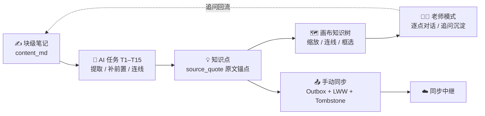
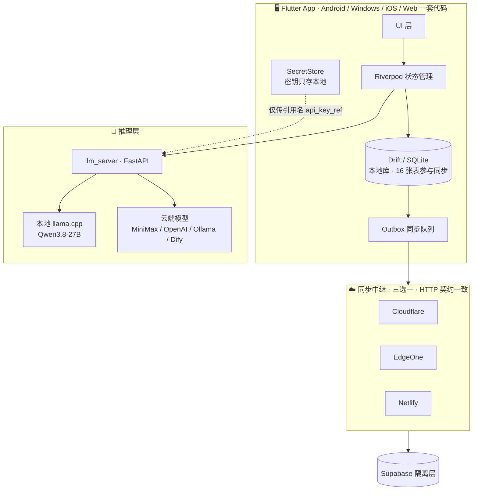

<div align="center">


# 🌳 AIMindTree

**把笔记长成知识树 —— 一款 AI 驱动的学习笔记本。**

你写笔记，AI 把笔记拆成知识点、补全前置知识路径、当老师考你；追问沉淀成画布上的卡片。


</div>

---

## 🤔 为什么做 AIMindTree

> 传统笔记像一座**文件柜**：文件夹一层层嵌套，整理、归类、维护结构全靠你自己。记的时候很勤快，回头看时却常常找不到、连不起来。
>
> AIMindTree 想做一棵**知识树**：你只管写，**结构由 AI 长出来** —— 它从笔记里抽出知识点、推断前置知识路径、把相关概念连起来；你则像园丁一样修剪、调整、追问。每一次追问，都会沉淀成画布上的一张卡片。

**目标很朴素**：让笔记不再是信息的坟墓，而是能持续生长、可回溯、可迁移的个人知识体系。

---

## ✨ 核心特性

- ✍️ **块级 WYSIWYG 笔记编辑器** —— 正文以 Markdown 纯文本（`content_md`）存储，11 种内容块自由组合，未编辑块原文字节直通。
- 🌱 **AI 自动长出结构** —— T1–T15 任务体系覆盖知识提取、前置知识推断、节点连线、问答、作业出题，从一篇笔记长成一张知识网络。
- 🗺️ **画布知识树** —— 缩放、平移、节点拖拽、连线、框选、网格吸附，把抽象的知识关系变成可动手整理的地图。
- 👨‍🏫 **每个知识点一位 AI 老师** —— 逐点对话、随堂提问，追问的结论直接沉淀成画布卡片。
- 🔄 **跨设备同步（手动）** —— Outbox + LWW + Tombstone + 冲突行级内联合并，16 张表参与同步，三套中继共享一致的 HTTP 契约。
- 🤖 **本地与云端模型自由切换** —— 本地 llama.cpp（Qwen3.8-27B）离线可用，也可接 MiniMax / OpenAI / Ollama / Dify。
- 🔐 **密钥不出本机** —— 密钥只存本地 SecretStore，配置仅保留引用名，API Key 默认不同步。
- 📦 **三端发布脚本开箱即用** —— Android（`--split-per-abi` 三个架构包）、Windows、iOS（Codemagic）构建脚本齐备。

---

## 🏗️ 系统架构

### 数据与体验主链路



### 组件关系



---

## 🛠️ 技术栈

| 层次 | 技术 | 说明 |
|------|------|------|
| 客户端 | Flutter / Dart | 一套代码覆盖 Android、Windows、iOS、Web |
| 状态管理 | Riverpod | 跨模块状态与依赖注入 |
| 本地存储 | Drift（SQLite） | 本地优先的数据底座，16 张表参与同步 |
| 推理服务 | 自研 llm_server（FastAPI） | 统一的模型调用入口 |
| 本地模型 | llama.cpp（Qwen3.8-27B） | 离线可用 |
| 云端模型 | MiniMax / OpenAI / Ollama / Dify | 按需切换 |
| 数据隔离 | Supabase | 用户数据隔离层 |
| 同步中继 | Cloudflare / EdgeOne / Netlify | 三选一部署，HTTP 契约一致 |
| 构建发布 | `scripts/*.bat`、`codemagic.yaml` | Android / Windows / iOS 三端脚本 |

---

## 🚀 快速开始

### 环境要求

- Flutter SDK（含 Dart），并配置好目标平台工具链
- Android Studio（Android 构建）或 Visual Studio / MSVC（Windows 构建）
- Git
- 如需本地推理：Python 环境与 llama.cpp 运行条件（见 `docs/BUILD.md`）

### 拉取与运行

```bash
git clone https://github.com/duyongjian/AIMindTree.git
cd AIMindTree/aimindtree_app
flutter pub get
flutter run
```

### 打包构建（Windows 下执行）

```bat
scripts\build_android_new.bat
scripts\build_windows.bat
```

> `build_android_new.bat` 使用 `--split-per-abi` 产出三个架构包。
> llm_server 的启动与本地模型配置请参考 `docs/BUILD.md` 与 `docs/RUN_ON_WINDOWS.md`。
> 跨设备同步当前为**手动**模式：在设置页通过「上传 / 拉取」按钮触发。

---

## 📚 文档索引

- [产品需求文档 PRD](docs/PRD.md)
- [系统架构设计](docs/ARCHITECTURE.md)
- [构建指南](docs/BUILD.md)
- [Windows 运行指南](docs/RUN_ON_WINDOWS.md)
- [环境配置](docs/ENVIRONMENT_SETUP.md)
- 更多设计说明与调研文档见 `docs/` 目录（30+ 份，含 10 个 Mermaid 图）

---

## 🔐 安全设计

> 以下只描述机制，不涉及任何具体密钥或配置值。

- **密钥边界**：API Key 只保存在本机 SecretStore；数据库与配置文件仅保存 `api_key_ref` 引用名，不落明文。
- **传输边界**：App 调用 llm_server 时不传递密钥本身，只传引用；**API Key 默认不参与同步**。
- **内容可信**：知识点必须携带 `source_quote` 原文逐字锚点，无原文锚点的知识点视为幻觉、不得持久化。

---

## 📄 License 与作者

- 作者：**duyongjian**
- 仓库：[https://github.com/duyongjian/AIMindTree.git](https://github.com/duyongjian/AIMindTree.git)
- 版本：2.0.2
- 许可协议：待补充（仓库暂未包含 LICENSE 文件；如需开源许可请自行添加）
