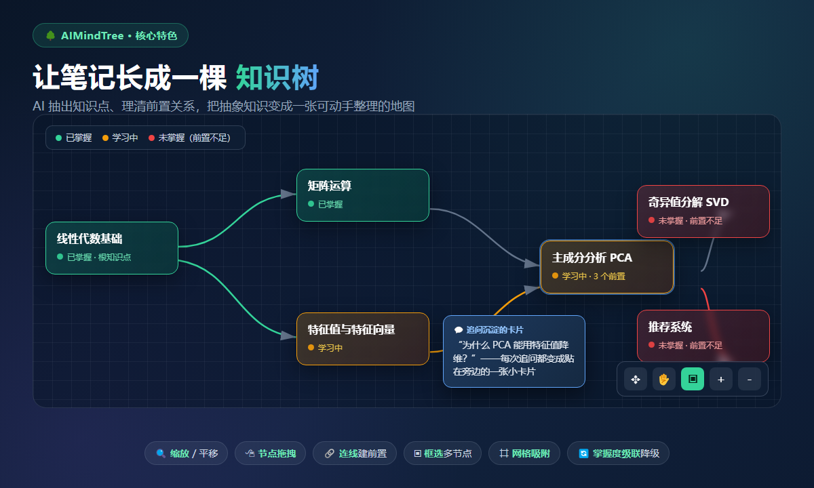
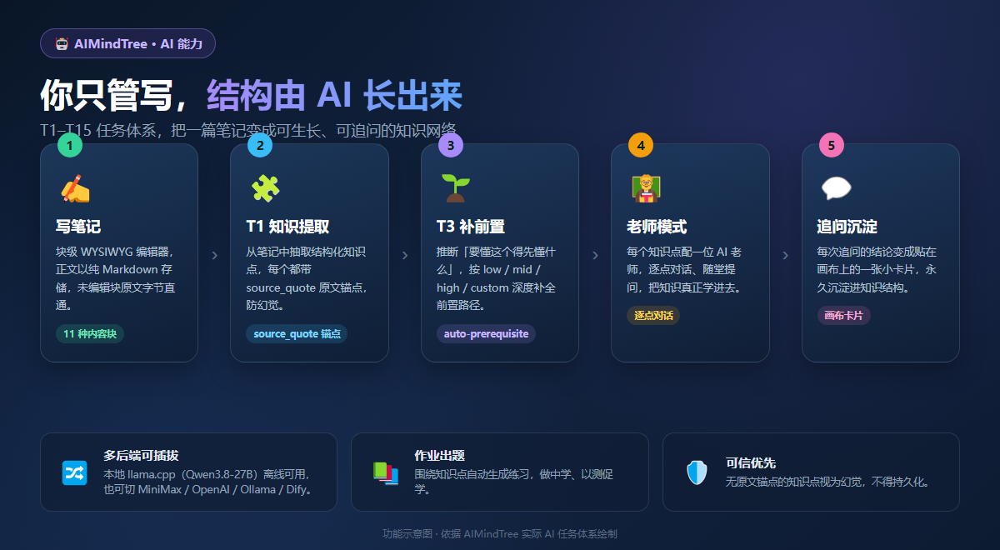
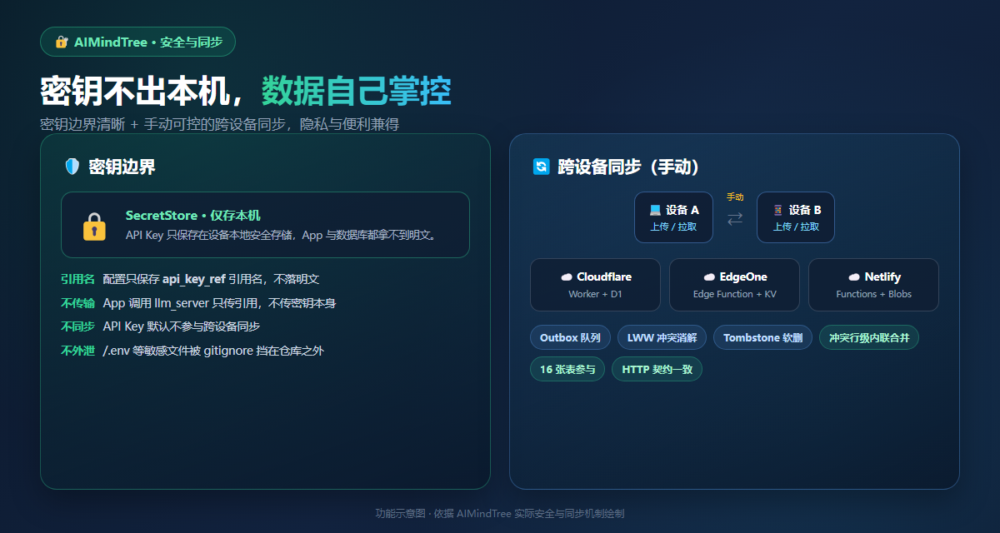
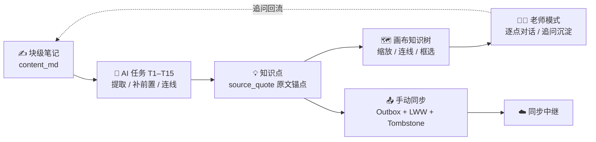
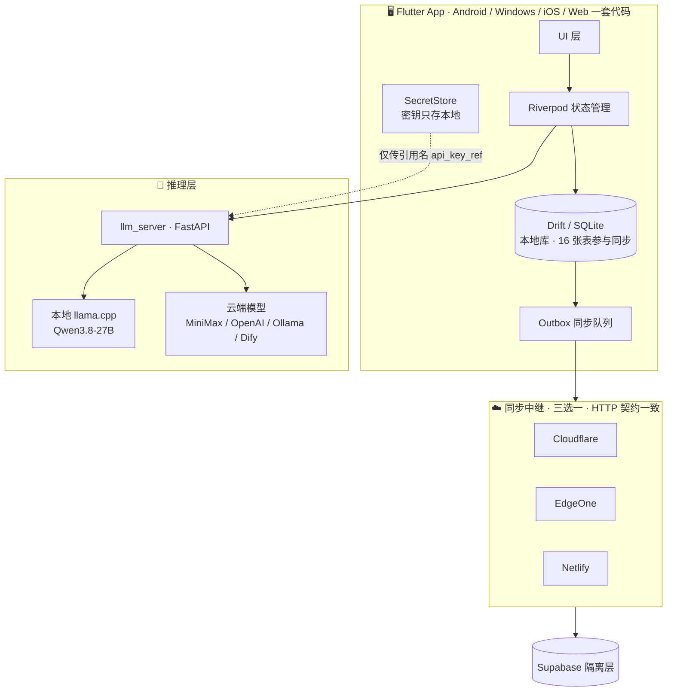

<div align="center">


# 🌳 AIMindTree

**把笔记长成知识树 —— 一款 AI 驱动的学习笔记本。**

你写笔记，AI 把笔记拆成知识点、补全前置知识路径、当老师考你；追问沉淀成画布上的卡片。


</div>

<p align="center">
  
</p>
<p align="center"><sub>▲ 画布知识树：AI 理清前置关系，掌握度一目了然，追问沉淀成卡片</sub></p>

---

## 🤔 为什么做 AIMindTree

> 传统笔记像一座**文件柜**：文件夹一层层嵌套，整理、归类、维护结构全靠你自己。记的时候很勤快，回头看时却常常找不到、连不起来。
>
> AIMindTree 想做一棵**知识树**：你只管写，**结构由 AI 长出来** —— 它从笔记里抽出知识点、推断前置知识路径、把相关概念连起来；你则像园丁一样修剪、调整、追问。每一次追问，都会沉淀成画布上的一张卡片。

**目标很朴素**：让笔记不再是信息的坟墓，而是能持续生长、可回溯、可迁移的个人知识体系。

---

## ✨ 特色功能一览

### 🗺️ 画布知识树 —— 把抽象关系变成可动手整理的地图

知识点落在可自由缩放、平移的画布上，拖动节点、连出前置关系，支持**框选多节点**与**网格吸附**。掌握度用颜色区分，某知识点被标为「未掌握」时，依赖它的后继会**级联降级**并打上「前置不足」角标。你在老师模式里的每一次追问，都会变成贴在旁边的一张小卡片，永久沉淀进知识结构。

> ✍️ 配套的块级 WYSIWYG 编辑器正文以纯 Markdown 存储（11 种内容块），坚守 **L1 红线**：未编辑块原文字节直通、序列化往返幂等——「打开不改也不会变脏」。

### 🤖 AI 自动长结构 —— 从一篇笔记到一张知识网络

T1–T15 任务体系覆盖知识提取（T1）、前置知识推断（T3，按 low / mid / high / custom 深度）、节点连线、问答、作业出题。每个知识点都带 `source_quote` 原文锚点，**无锚点视为幻觉、不得持久化**。模型可插拔：本地 llama.cpp（Qwen3.8-27B）离线可用，也可切 MiniMax / OpenAI / Ollama / Dify。

<p align="center">
  
</p>
<p align="center"><sub>▲ AI 能力主线：写笔记 → 提取知识点 → 补前置 → 老师模式 → 追问沉淀</sub></p>

### 🔐 安全与同步 —— 密钥不出本机，数据自己掌控

API Key 只存本地 SecretStore，配置只保留 `api_key_ref` 引用名、不落明文，App 调用服务时只传引用、**默认不参与同步**。跨设备同步由你在设置页**手动**触发上传 / 拉取：Outbox 队列 + LWW 冲突消解 + Tombstone 软删，冲突在行级做内联合并而非整篇覆盖；Cloudflare / EdgeOne / Netlify 三套中继共享一致的 HTTP 契约。

<p align="center">
  
</p>
<p align="center"><sub>▲ 安全与同步：密钥边界清晰 + 手动可控的三中继同步</sub></p>

> 📦 三端发布脚本开箱即用：Android（`--split-per-abi` 三个架构包）、Windows、iOS（Codemagic）。

---

## 🏗️ 系统架构

### 数据与体验主链路



### 组件关系



---

## 🛠️ 技术栈

| 层次 | 技术 | 说明 |
|------|------|------|
| 客户端 | Flutter / Dart | 一套代码覆盖 Android、Windows、iOS、Web |
| 状态管理 | Riverpod | 跨模块状态与依赖注入 |
| 本地存储 | Drift（SQLite） | 本地优先的数据底座，16 张表参与同步 |
| 推理服务 | 自研 llm_server（FastAPI） | 统一的模型调用入口 |
| 本地模型 | llama.cpp（Qwen3.8-27B） | 离线可用 |
| 云端模型 | MiniMax / OpenAI / Ollama / Dify | 按需切换 |
| 数据隔离 | Supabase | 用户数据隔离层 |
| 同步中继 | Cloudflare / EdgeOne / Netlify | 三选一部署，HTTP 契约一致 |
| 构建发布 | `scripts/*.bat`、`codemagic.yaml` | Android / Windows / iOS 三端脚本 |

---

## 🚀 快速开始

### 环境要求

- Flutter SDK（含 Dart），并配置好目标平台工具链
- Android Studio（Android 构建）或 Visual Studio / MSVC（Windows 构建）
- Git
- 如需本地推理：Python 环境与 llama.cpp 运行条件（见 `docs/BUILD.md`）

### 拉取与运行

```bash
git clone https://github.com/duyongjian/AIMindTree.git
cd AIMindTree/aimindtree_app
flutter pub get
flutter run
```

### 打包构建（Windows 下执行）

```bat
scripts\build_android_new.bat
scripts\build_windows.bat
```

> `build_android_new.bat` 使用 `--split-per-abi` 产出三个架构包。
> llm_server 的启动与本地模型配置请参考 `docs/BUILD.md` 与 `docs/RUN_ON_WINDOWS.md`。
> 跨设备同步当前为**手动**模式：在设置页通过「上传 / 拉取」按钮触发。

---

## 📚 文档索引

- [产品需求文档 PRD](docs/PRD.md)
- [系统架构设计](docs/ARCHITECTURE.md)
- [构建指南](docs/BUILD.md)
- [Windows 运行指南](docs/RUN_ON_WINDOWS.md)
- [环境配置](docs/ENVIRONMENT_SETUP.md)
- 更多设计说明与调研文档见 `docs/` 目录（30+ 份，含 10 个 Mermaid 图）

---

## 🔐 安全设计

> 以下只描述机制，不涉及任何具体密钥或配置值。

- **密钥边界**：API Key 只保存在本机 SecretStore；数据库与配置文件仅保存 `api_key_ref` 引用名，不落明文。
- **传输边界**：App 调用 llm_server 时不传递密钥本身，只传引用；**API Key 默认不参与同步**。
- **内容可信**：知识点必须携带 `source_quote` 原文逐字锚点，无原文锚点的知识点视为幻觉、不得持久化。

---

## 📄 License 与作者

- 作者：**duyongjian**
- 仓库：[https://github.com/duyongjian/AIMindTree.git](https://github.com/duyongjian/AIMindTree.git)
- 版本：2.0.2
- 许可协议：[PolyForm Noncommercial License 1.0.0](LICENSE) —— 允许个人学习、研究、实验与修改分发，**禁止商业用途**（商用需另行取得授权）。
