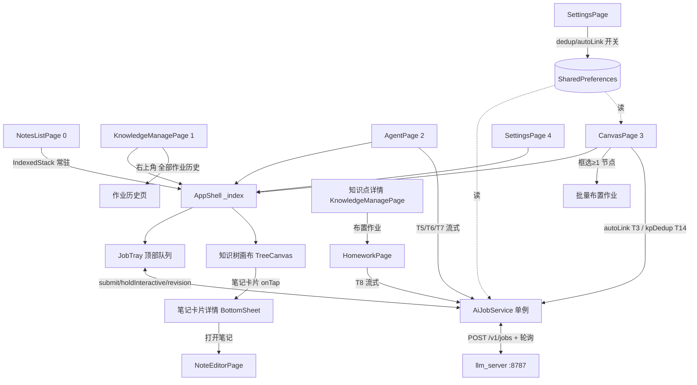
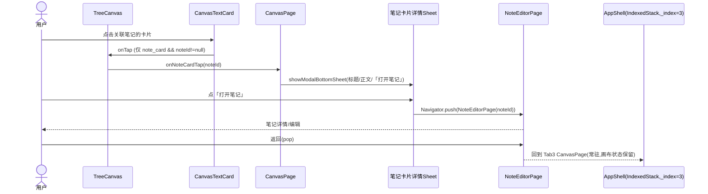
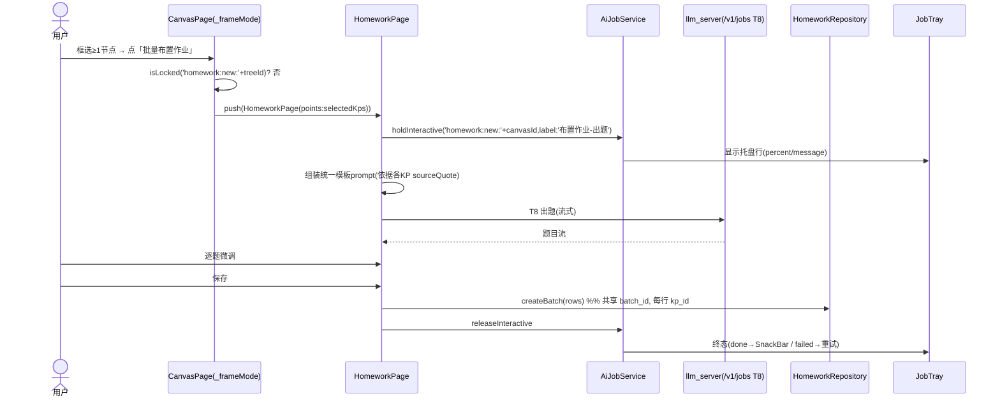
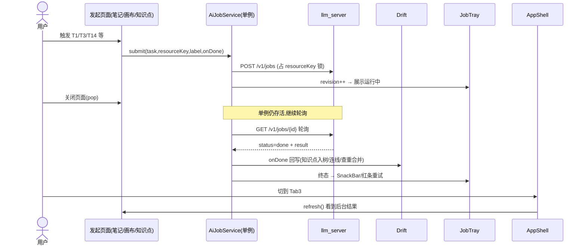

# AIMindTree 增量 PRD — 系统设计 + 任务拆解

> 架构师：高见远 ｜ 日期：2026-10-23 ｜ 语言：简体中文
> 配套文档：`docs/TASK_QUEUE_PLAN.md`（模块 D 既存方案，已实施）、`docs/incremental_prd.md`（PRD 原文）

---

## 0. 先读代码：调研结论

按要求先读真实代码，把设计落到真实文件。关键发现如下。

### 0.1 已读取的真实文件与关键类/方法

| 文件 | 关键类 / 方法 | 与本次设计的关系 |
|---|---|---|
| `lib/main.dart` | `MyApp`、`AppShell`(`_index`)、`IndexedStack(index:_index,children:pages)`、`_openTeacher(kp)`、`onJumpToCanvas`→`setState(()=>_index=3)`、`CanvasPage(key:_canvasKey, onKpTap:_openTeacher)` | 5 Tab 常驻、画布状态天然保活（A 返回栈基础）；`_index` 控制 Tab |
| `lib/ai/ai_job_service.dart` | `AiJobService`（单例，`revision:ValueNotifier`、`terminalStream`、`requestExpandTray()`、`submit({task,resourceKey,label,stages,inputs,query,variant,keepLockOnDone,silent,...})`、`cancel(jobId)`、`holdInteractive(key,{label})`/`releaseInteractive(sessionId)`/`setInteractiveMessage`、`isLocked(key)`、`reconcile()`、`_notify()`）`AiJobStatus{queued,running,done,failed,canceled}`、`AiJob`（含 `stages/stageIndex/stageTotal/percent/message/result/retryable/...`） | **模块 D 核心已落地**：单例脱离 Widget 生命周期、资源锁互斥、轮询/取消/重试、冷启动 `reconcile` 收养在途任务 |
| `lib/ui/job_tray.dart` | `JobTray`（挂 `AppShell`，`JobTrayState`） | 顶部队列控件：折叠 4px 细条 + 「N 个任务进行中」；展开每行 label/百分比/阶段文案/已用时间/取消/锁徽标；终态 done→SnackBar、failed→红条+重试、canceled→消失；`silent` 终态不弹 |
| `lib/data/db/tables.dart` | `SyncMeta` mixin（`id`ULID/`version`/`updated_at`/`device_id`/`deleted_at`）、`Homeworks`（仅 `canvas_id`/`title`/`kp_ids_json`/`items_json`）、`CanvasCards`（`note_id`可空、`style_json`含 `kind:note_card\|text_box`）、`KnowledgePoints`、`PrerequisiteEdges`、`CanvasNodes` | B 数据缺口（无 KP 外键 / batch 聚合键）；A 卡片载体 `CanvasCards.note_id` |
| `lib/data/models/homework.dart` | `Homework(id,canvasId,title,kpIds:List<String>,items:List<HomeworkItem>)`、`HomeworkItem(kpId,kpName,type,question,answer,difficulty)`、`encodeKpIds/decodeKpIds`、`encodeHomeworkItems/decodeHomeworkItems` | B 领域模型 |
| `lib/data/repositories/homework_repository.dart` | `HomeworkRepository`：`listByCanvas(canvasId)`、`byId(id)`、`create()`、`save()`、`softDelete()`、`_fromRow()` | B 仓储（需补 `listByKp`/`listByBatch`/`createBatch`） |
| `lib/data/repositories/ai_session_repository.dart` | `getOrCreateForKp`(已弃用)、`addMessage`、`listMessages`、`listSessionsForKp`、`primarySessionForKp`、`createSessionForKp`、`mergeLegacyExplain`、`createAgentSession`/`listAgentSessions` | C 会话数据底座 |
| `lib/ai/extraction_service.dart` | `ExtractionService{repo,ai,trees,groups,jobs,assets}`、`extract()`、`extractFromSelection()`(T15→fire-and-forget `kpDedupSchedule`)、`bootstrap()` 装配 `AiJobService` | D 装配点 |
| `lib/ai/auto_graph_service.dart` | `autoLink`/`autoLinkByGroups`/`linkInputsFor`、`autoPrerequisites`(T4，客户端递归) | E 连线调用点 |
| `lib/features/knowledge/kp_dedup.dart` | `kpDedupSchedule`/`kpDedupRunNow`→`_kpDedupScan`(`jobs.submit(t14KpDedup, resourceKey:'kp:dedup', silent:true)`)→`_onKpDedupResult`→`showKpDedupDialog`、`mergeDuplicateCluster`、`kpDedupInFlight` | E 查重调用点（T14） |
| `lib/features/canvas/canvas_page.dart`（88KB） | `_homeworkMode`/`_frameMode`/`_selectedKpIds`、`_toggleHomeworkMode()`/`_toggleFrameMode()`(互斥)、`_openHomeworkPage()`(B4 锁 `homework:new:${tree.id}`)、`_showHomeworkHistory()`→`_homeworkHistorySheet(canvasId)`、`_autoLink()`/`_autoLinkSelected()`、`selectionMode:_homeworkMode||_frameMode` | B 画布入口（框选批量布置）、E 连线入口 |
| `lib/features/canvas/render/tree_canvas.dart` | `TreeCanvas`（`onKpTap`、`frameMode`、`selectionMode` 等回调）；line 1399 `CanvasTextCard(kind:c.kind, linked:c.noteId!=null)` **未传 `onTap`** | **A 模块触发点缺口**：笔记卡片无点击处理 |
| `lib/canvas/render/canvas_text_card.dart` | `CanvasTextCard({title,body,kind,linked:false,onTap})` | A：已支持 `onTap` 与 `linked` 徽标，调用方未接线 |
| `lib/features/notes/note_editor_page.dart` | `NoteEditorPage({service,db,noteId})`；`_openKp(kp)`→`TeacherPage`；`_buildKpSection()` 用 `ExpansionTile` 展示本笔记知识点 `ActionChip`；`_onExtract()`(T1)/`_onExtractFromSelection()`(T15) | A「打开笔记」目标页；C 接线点 |
| `lib/features/teacher/teacher_page.dart` | `TeacherPage`；`_KpHeader`(line 520 `color:Colors.indigo.shade50`)；`_MessageBubble(role,content,isExplain)` 用 `Text(content)` **未渲染 Markdown/LaTeX**(line 441)；`holdInteractive`/`releaseInteractive`/`_ticket` 持 `kp:{id}` 锁 | **C 缺陷定位**：① 多余颜色块 = `_KpHeader` 的 indigo 大色块；② `_MessageBubble` 不渲染公式 |
| `lib/features/teacher/teacher_session_controller.dart` | `TeacherSessionController`：`buildQuery`(L2 拼装)、`ensurePrimarySession`/`createPrimarySessionWithExplain`/`deleteSession`/`mergeLegacy`、`_generateExplainOnce` 用 `ai.chat(T6Explain)` | C：老师回复来自 `ai.chat`，内容为 Markdown+LaTeX |
| `lib/features/homework/homework_page.dart` | `HomeworkPage`；initState `jobs.holdInteractive(existingId!=null?'homework:${id}':'homework:new:${canvasId}')`，dispose `releaseInteractive`；`_generate`(T8 流式)、`_save`、`_export`(Markdown) | B 作业编辑页；已接交互锁托盘 |
| `lib/features/settings/settings_page.dart` | 仅 `AiServiceStatusSection` + `SyncSettingsSection` | **E 缺口**：无去重/连线/作业开关 |
| `lib/features/settings/ai_service_status_section.dart` | 用 `SharedPreferences.getInstance()` 读写 AI 服务配置 | E 开关落地参考（同款 SharedPreferences 方案） |
| `lib/data/sync/sync_engine.dart` | `homeworks`/`ai_providers`/`ai_task_routes`/`sync_outbox` **被显式排除出同步** | Q6 现状依据 |
| `pubspec.yaml` | `drift ^2.34.4`、`flutter_riverpod ^3.4.3`、`ulid ^2.0.1`、`shared_preferences`(间接)；**无 Markdown/公式渲染包** | Q3 需引包 |
| `docs/TASK_QUEUE_PLAN.md` | B0–B4 + M10 **已实施完成**（服务端 `routers/jobs.py`、`core/jobs.py`、状态机、并发默认 1、取消语义、资源锁矩阵） | D 不是从零搭，是「纳入/补强」 |

### 0.2 关键阶段性结论（决定设计取向）

1. **模块 D 已在生产代码中落地**：`AiJobService` 单例 + `JobTray` 顶部队列 + 服务端 `/v1/jobs` + 资源锁 + 轮询/取消/重试 + 冷启动 `reconcile` 全部就绪。因此 D 的设计重点不是从零，而是：**① 老师/作业/AI助手三类任务统一可见性（Q8）**、**② 是否补 Drift 任务快照（Q2）**、**③ 列出待改造调用点**。
2. **模块 C 缺陷已定位**：`teacher_page.dart` 的 `_MessageBubble` 用 `Text` 直接显示未渲染的 Markdown/LaTeX；pub spec 当前无渲染包 → Q3 必须引包。
3. **模块 B 数据缺口**：`homeworks` 表无知识点外键、`kp_ids_json` 是扁平列表、无 batch 聚合键 → Q1 设计点。
4. **模块 A 触发点已定位但「断线」**：`tree_canvas.dart:1399` 的 `CanvasTextCard` 未传 `onTap`；`canvas_text_card.dart` 已支持 `onTap`/`linked`。只需接线 + 新增笔记卡片详情弹层。
5. **模块 E 现状**：`settings_page.dart` 仅有 AI 服务状态 + 同步两节；去重/连线开关需新增（用 `SharedPreferences`，与 `ai_service_status_section` 同款）。

---

## 1. 总体架构与模块交互

- **5 Tab 常驻**：`NotesListPage(0) / KnowledgeManagePage(1) / AgentPage(2) / CanvasPage(3) / SettingsPage(4)` 由 `IndexedStack` 保活，`_index` 切换。`CanvasPage` 永不被 dispose → 画布平移/缩放/框选/作业模式状态天然保留（**模块 A 返回栈的关键基础**）。
- **AI 任务两条通道（已定义）**：
  - **交互通道**（流式 SSE 直连，保留现状）：T5 追问 / T6 讲解 / T7 苏格拉底 / T8 出题 → 进页面后 `holdInteractive` 在 `JobTray` 占一行。
  - **队列通道**（提交即返回）：T1 提取 / T3 前置连线 / T4 缺口 / T14 查重 / detect → `jobs.submit(...)` 入 `AiJobService`。
- **资源锁键约定**：`tree:{id}`、`note:{id}`、`kp:{id}`、`homework:{id}`、`homework:new:{canvasId}`、`conversation:agent`、`kp:dedup`。
- **后台不中断**：`AiJobService` 在 `ExtractionService.bootstrap()` 单例装配，进程级存活；提交后由服务端实际跑、App 轮询。即使关闭发起页面，单例仍轮询并在 `JobTray` 展示/完成后回写 DB。冷启动 `reconcile()` 从服务端收养在途任务。



---

## 2. 各模块详细设计

### A. 知识树笔记卡片 → 笔记详情入口

**目标**：关联笔记的笔记卡片点开提供「打开笔记」按钮进笔记详情/编辑页；返回应回知识树 Tab（Tab3）并保持画布状态；未关联不显示按钮。

**触发点（已定位）**：`lib/features/canvas/render/tree_canvas.dart:1399`
```dart
// 现状：无 onTap
child: CanvasTextCard(title:c.title, body:c.body, kind:c.kind, linked:c.noteId!=null),
```

**改造方案（不在文件里写实现，只给接线点）**：
1. `lib/canvas/render/canvas_text_card.dart`：`CanvasTextCard` 已支持 `onTap`，无需改（仅确认 `linked` 徽标位置在左上角，已 OK）。
2. `lib/features/canvas/render/tree_canvas.dart`：给 `TreeCanvas` 增加回调 `final VoidCallback? onNoteCardTap;`；line 1399 处改为：
   - 仅当 `c.kind=='note_card' && c.noteId!=null` 时把 `onTap: () => widget.onNoteCardTap?.call()` 透传给 `CanvasTextCard`（非笔记卡片 / 未关联笔记的不挂 onTap，满足「未关联不显示按钮」）。
3. `lib/features/canvas/canvas_page.dart`：把 `TreeCanvas` 的 `onNoteCardTap` 接成「弹出**笔记卡片详情 BottomSheet**」——展示卡片标题/正文摘要 +（若 `noteId!=null`）「打开笔记」按钮。`c.noteId` 经 `TreeCanvas` 现有 `orderedCards` 已知，需一并回调（建议 `onNoteCardTap(String noteId)` 传入）。
4. 「打开笔记」按钮 → `Navigator.of(ctx).push(MaterialPageRoute(builder:(_)=>NoteEditorPage(service:widget.service, db:widget.db, noteId:noteId)))`。

**返回栈处理（Q5 设计）**：
- 因 `CanvasPage` 在 `IndexedStack` 中常驻、`_index==3` 不变，`NoteEditorPage` 以 `Navigator.push` 压在 `AppShell` 之上；`pop` 后自动回到 `Tab3` 且画布平移/缩放/框选/作业模式状态全部保留。
- **不需要**额外保存/恢复画布状态；但为稳妥，建议在 `NoteEditorPage` 返回时若当前 `_index!=3`（理论上不会发生）则 `setState(()=>_index=3)`。此分支仅防御性保留。
- 注意：`NoteEditorPage` 内部 `_openKp(kp)` 会 push `TeacherPage`（另一层），从老师页返回仍是笔记页，再返回仍是画布 Tab3 —— 三层栈均落在 `AppShell` 之上，互不干扰。

**文件影响**：`tree_canvas.dart`（加 `onNoteCardTap` + 接线）、`canvas_page.dart`（BottomSheet + 接线）、`canvas_text_card.dart`（不改，仅确认）、`note_editor_page.dart`（不改，已是目标页）。

---

### B. 作业模块完整化（P0，核心：与知识点关联）

**数据模型设计（Q1，架构师设计）**

`homeworks` 表**已带 `id`(ULID, SyncMeta 主键)**，需新增列。目标字段：

| 列 | Drift 类型 | 说明 |
|---|---|---|
| `id` | text (PK, ULID) | 既有（SyncMeta） |
| `canvas_id` | text | 既有，所属知识树 |
| `title` | text | 既有，作业标题 |
| `kp_ids_json` | text | 既有，该作业覆盖的知识点 id 列表（快照，用于展示与历史「全部」分组） |
| `items_json` | text | 既有，题目 JSON |
| `kp_id` | text, nullable | **新增**：本作业行归属的**主知识点外键**（FK→knowledge_points.id）。用于「进某知识点自动筛该点作业」 |
| `batch_id` | text, nullable | **新增**：批量布置聚合键。一次框选布置 N 个知识点 → 同一 `batch_id`，N 行各带一个 `kp_id` |
| `status` | text, default 'assigned' | **新增**：assigned / draft / done（生命周期展示） |
| `due_at` | datetime, nullable | **新增**：截止日期（可选） |

**批量语义（一对多落地方式）**：
- 单知识点布置（入口① 知识点详情）：1 行，`kp_id=<kp>`，`batch_id=null`（或自填），`kp_ids_json=[kp]`。
- 批量布置（入口② 画布框选 ≥1）：1 个 `batch_id` + N 行（每选中知识点 1 行），每行 `kp_id=<该kp>`、`kp_ids_json=[该kp]`、共享 `batch_id`。
- 这样「进某知识点」按 `kp_id` 过滤；「全部历史」按 `batch_id` 分组展示（同 batch 的 N 行合并为一组卡片，显示其覆盖的知识点名列表）。

**领域模型补字段**：`lib/data/models/homework.dart` 的 `Homework` 增 `kpId`、`batchId`、`status`、`dueAt`；`HomeworkItem` 不变。`encode/decode` 维持。

**Repository 方法（改 `homework_repository.dart`）**：
- `listByKp(kpId)` → `SELECT * FROM homeworks WHERE kp_id = ? AND deleted_at IS NULL`
- `listByBatch(batchId)` → `WHERE batch_id = ?`
- `createBatch(List<Homework> rows)` → 单事务 `batchInsert`
- 既有 `listByCanvas` / `byId` / `save` / `softDelete` 保留。

**入口①：知识点详情页「布置作业」**
- 在 `KnowledgeManagePage`（Tab1）知识点详情/操作中加「布置作业」按钮 → `Navigator.push(HomeworkPage(ai,db,canvasId, points:[kp], jobs))`（`points` 仅一个 KP）。

**入口②：画布 `_frameMode` 选中 ≥1 节点右上角「批量布置作业」**
- `canvas_page.dart`：`_frameMode` 下 `_selectedKpIds.isNotEmpty` 时，工具栏右上角显示「批量布置作业」→ 锁 `homework:new:${tree.id}`（B4 已有该锁）→ `Navigator.push(HomeworkPage(ai,db,canvasId, points:selectedKps, jobs))`，`points` 为多个选中 KP；`HomeworkPage` 内部生成时按 batch 写 N 行共享 `batch_id`。

**历史①：进某知识点自动筛选该点作业**
- `KnowledgeManagePage` 知识点详情：查询 `homeworkRepository.listByKp(kp.id)` 直接展示该点作业（含其作为 batch 成员的行）。

**历史②：知识点界面右上角独立入口看全部历史（搜索 + 筛选 + 分类）**
- 新增 `lib/features/homework/homework_history_page.dart`：`listByCanvas(canvasId)` 取出全部 → 按 `batch_id`（非空）分组、无 batch 的单行自成一组；顶部 `SearchAnchor`/搜索框（按标题、知识点名、题型）+ 筛选（状态 / 题型 / 是否批量）+ `ListView` 分类卡片。点卡片 → `HomeworkPage(existingId)` 查看/编辑。
- 入口：① `KnowledgeManagePage` 右上角「作业历史」按钮；② `canvas_page.dart` 已有 `_showHomeworkHistory()`/`_homeworkHistorySheet(canvasId)`，可升级为跳转此独立页（保留 sheet 作为快速入口亦可）。

**批量布置作业流（Q7 推荐：统一模板 + 可微调）**
1. 框选/单选知识点 → 进入 `HomeworkPage(points)`。
2. `HomeworkPage` 组装统一 prompt 模板（复用既有 T8 出题 prompt，依据各 KP 的 `sourceQuote`），一次性请求 T8 为 N 个 KP 出题（或逐 KP 出题再合并）。
3. 生成后展示可编辑列表（既有 `_buildPrompt`/`_parseQuestions`/`_generate`/`_save` 复用），用户可在统一模板基础上**逐题微调**。
4. 保存：`createBatch(rows)` 写 N 行共享 `batch_id`，`kp_ids_json` 各填对应 KP；`kp_id` 各填对应 KP。同时 `kp:dedup` 资源锁不冲突。

---

### C. 老师模式 UX（渲染 P1 / 视觉清理 P2）

**Markdown + 公式渲染方案（Q3，架构师设计）**

推荐引入两个包：
- `flutter_markdown: ^0.7.x` —— 通用 Markdown 渲染（标题/列表/代码/表格/引用）。
- `flutter_math_fork: ^0.7.x` —— 纯 Dart 的 LaTeX 渲染（行内 `$...$` 与块级 `$$...$$`），无原生依赖、对中文/符号支持好。

**封装统一组件 `MarkdownMessage`**（新建 `lib/features/teacher/markdown_message.dart`）：
- 入参 `String content`、`TextStyle? baseStyle`、`bool shrinkWrap`。
- 渲染策略（不在文档写实现，只给契约）：
  1. 用正则把 `content` 切成「块级公式 `$$...$$`」「行内公式 `$...$`」「普通 Markdown 文本」三段；
  2. 普通文本段 → `FlutterMarkdown(data:..., styleSheet:...)`；
  3. 块级公式 → `Math.tex(expr, mathStyle: MathStyle.display)` 包 `SingleChildScrollView` 横向滚动；
  4. 行内公式 → `Math.tex(expr, mathStyle: MathStyle.text)` 用 `WidgetSpan` 内嵌到 `RichText`（或与 Markdown 行内混排）。
- 边界：未闭合的 `$` 视为普通文本（避免把金额/美元符号误渲染）；公式解析失败降级为等宽文本 + 红字提示，不整段崩溃。

**接线点**：
- `lib/features/teacher/teacher_page.dart`：`_MessageBubble(role,content,isExplain)` 现用 `Text(content)` → 改为 `MarkdownMessage(content: content)`（老师回复来自 `ai.chat(T6/T7)`，内容为 Markdown+LaTeX）。
- 老师模式已有流式：`_generateExplainOnce` 经 `ai.chat` 返回 Markdown，直接喂 `MarkdownMessage`。

**「多余颜色块」定位与清理（P2）**
- 定位：`teacher_page.dart:520` 的 `_KpHeader` `Container(color:Colors.indigo.shade50)` —— 即「会话列表上方」那一整条靛蓝色块（PRD 所指）。
- 处理建议（需用户确认取舍，见 §8 Q-颜色块）：默认方案 = **去掉整条纯色大色块**，改为与全局一致的浅灰分隔线 + 知识点名（保留「知识点名 + 掌握度徽标」信息，仅去背景色），视觉更干净且不与页面其它块喧宾夺主。

**补充加载/失败重试/滚动 UX（P1）**
- 加载中：消息列表为空且 `_askBusy` 时，在底部插入「老师正在思考…」`CircularProgressIndicator` + 打字气泡占位（复用既有 `_askBusy` 状态）。
- 失败重试：`_error!=null` 已有红字行（`teacher_page.dart:433`）→ 改为可点「重试」按钮调用 `_send`/上一条 query 重发（复用既有 `_askBusy`/`_send`）。
- 滚动：流式增量到来时 `ScrollController(_scroll)` 自动滚到底（若用户已上滑查看历史则不打扰）。

---

### D. AI 任务后台化 + 统一任务队列（P0，最关键架构项）

**现状**：`AiJobService`（单例、`bootstrap` 装配、`revision`+`terminalStream` 驱动 `JobTray`）已落地；服务端 `llm_server/routers/jobs.py` + `core/jobs.py` 已实现提交/轮询/取消/重试/状态机，`docs/TASK_QUEUE_PLAN.md` 标注 B0–B4+M10 完成。

**设计决策**

**D-1 三类任务统一可见性（Q8，架构师设计）**
- **结论**：老师(T6/T7)、作业(T8)、AI助手(T5 等) 交互任务**保持交互流式**（页面内 SSE 直连，体验最佳），但**统一经 `holdInteractive(resourceKey,label)` 在 `JobTray` 占一行** —— 因此它们**早已纳入顶部队列可见**（done→SnackBar、failed→红条+重试、canceled→消失），满足「所有运行/排队/完成/失败/已取消任务及进度都在顶部队列可见」。
- **不建议**把交互流式任务改成 fire-and-forget 的 `submit` 任务：会让老师/作业对话失去「边生成边看」的体验，违背 PRD「老师模式」交互本质。
- **后台任务通道**（T1/T3/T4/T14/detect）继续 `jobs.submit(...)` 入队，退出页面后由单例轮询、完成回写，天然「后台化」。
- 统一标签规范：`resourceKey` 用既有约定（`kp:{id}`/`homework:new:{canvasId}`/`kp:dedup`/`conversation:agent`）；`label` 用中文任务名（如「提取知识点」「前置连线」「查重合并」「布置作业-出题」），托盘行据此展示。

**D-2 是否需要 Drift 持久化任务快照（Q2，架构师设计）**
- **结论：推荐新增轻量 Drift 表 `AiJobSnapshots`（P1/P2 韧性增强，非阻塞），但不强制**。
- 理由：当前 `AiJobService._jobs` 纯内存，冷启动靠 `reconcile()` 从**服务端** `/v1/jobs` 收养在途任务。若服务端重启/任务丢失则本地无据。加本地快照表可：① App 被杀后重开先快速展示本地快照（秒级可见），再 `reconcile` 校正；② 离线时也能看到「上次在跑的任务」。
- 表结构（建议）：`ai_job_snapshots(id PK, task_code, label, resource_key, status, stages_json, stage_index, percent, message, inputs_json, query, variant, submitted_at, updated_at)`。写入时机：`_notify()` 后 `upsert` 当前活跃/近终态任务；终态清理。`reconcile()` 改为「先载本地快照 → 再向服务端对齐」。
- 若本期不排此表：靠既有 `reconcile()` 即可，仅韧性略弱，不影响主流程。

**D-3 受控并发 / 取消 / 失败重试**
- 并发上限：服务端 `core/jobs.py` 默认并发 = 1（同质任务串行，避免 LLM 限流）；App 侧无硬并发上限，但靠 `isLocked(resourceKey)` 资源锁做互斥（如 `kp:dedup` 在飞则拒绝新查重）。**设计上保持服务端默认 1**，App 侧不额外加全局信号量（避免与资源锁语义冲突）。
- 取消：`submit` 型走 `jobs.cancel(jobId)` → `POST /v1/jobs/{id}/cancel`；交互型由页面 `releaseInteractive` 自行中断。
- 失败重试：服务端任务 `retryable` 标记 → `JobTray` 红条「重试」→ `jobs.retry(jobId)`（复用 `AiJob` 的 `onError`/`retryable`）。

**D-4 待改造/验证调用点清单（工程师开工清单）**
1. `teacher_page.dart`：`holdInteractive('kp:${kp.id}', label:'老师模式：${kp.name}')` 已在 initState、`releaseInteractive` 在 dispose —— **验证**托盘行 label/进度/取消正确。
2. `homework_page.dart`：`holdInteractive(existingId!=null?'homework:${id}':'homework:new:${canvasId}', label:'布置作业-出题')` 已就位 —— **验证**终态 SnackBar/重试。
3. `canvas_page.dart` `_openHomeworkPage` 锁 `homework:new:${tree.id}` —— **确认**与历史页/批量入口不冲突。
4. `kp_dedup.dart` `jobs.submit(t14KpDedup, resourceKey:'kp:dedup', silent:true)` —— **确认** `silent` 终态不弹 SnackBar、结果走 `showKpDedupDialog`。
5. `extract_into_tree_chain.dart` T1→T3 链式 `submit`（同 `tree:{id}` 锁，`keepLockOnDone`）—— **确认**取消回滚 `_rollback`。
6. `note_editor_page.dart` T1/T15 `extract`/`extractFromSelection` —— **确认**后台跑完回写、画布刷新（`_canvasKey.currentState?.refresh()`）。

---

### E. 补前置 / 加树 去重与连线策略（P1）

**开关落点（Q4，架构师推荐默认）**
- 新增设置项，落 `SettingsPage`（Tab4）。用 `SharedPreferences`（与 `ai_service_status_section.dart` 同款），不进 Drift（纯本地偏好，无需同步）。
- 推荐默认：**查重开（true）/ 连线关（false）**。

**新增文件 `lib/features/settings/tree_behavior_settings.dart`**（封装读写，避免散落）：
- `Future<bool> get dedupEnabled` / `setDedupEnabled(bool)` —— key `kp_dedup_enabled`，默认 `true`。
- `Future<bool> get autoLinkEnabled` / `setAutoLinkEnabled(bool)` —— key `kp_auto_link_enabled`，默认 `false`。
- 可选 `ValueNotifier` 供 UI 即时反映。

**`SettingsPage` 接线**：在 `AiServiceStatusSection` 之后插入新 `TreeBehaviorSection`（同文件或新建 `lib/features/settings/tree_behavior_section.dart`），含两个 `SwitchListTile`（「提取/加树时自动查重」「提取/加树时自动连线」），读写为上面的 helper。

**调用处改造点**：
- 查重：`lib/features/knowledge/kp_dedup.dart` 的 `kpDedupSchedule`/`kpDedupRunNow` 入口先读 `await TreeBehaviorSettings().dedupEnabled`，为 `false` 则跳过扫描（不打扰）。
- 连线：`lib/features/canvas/canvas_page.dart` 的 `_autoLink()`/`_autoLinkSelected()` 及 `extract_into_tree_chain.dart` 的 T3 `submit` 前读 `autoLinkEnabled`：为 `false` 则「只查重/只入库、不自动连线」（满足 PRD「默认只查重、不自动连线」）。
- 补前置（「补前置」功能）与 AI助手加入树：复用同一 `dedupEnabled`/`autoLinkEnabled` 开关，逻辑一致（一处读取、全局生效）。

**同步（Q6 待拍板）**：现状 `homeworks` 被 `sync_engine` 排除。推荐「纳入同步，随知识点 push/pull」——需给 `Homeworks` 表补 `SyncMeta` 已具备（表已 `with SyncMeta`），仅需在 `sync_engine` 的排除清单移除 `homeworks` 并在 `row_map` 注册即可。详见 §8。

---

## 3. 数据模型与接口（Mermaid classDiagram）

```mermaid
classDiagram
    class Homeworks {
        <<Drift Table + SyncMeta>>
        +String id  %% ULID PK
        +String canvas_id
        +String title
        +String kp_ids_json
        +String items_json
        +String? kp_id        %% 新增：主知识点外键
        +String? batch_id     %% 新增：批量聚合键
        +String status        %% 新增：assigned/draft/done
        +DateTime? due_at     %% 新增
    }
    class Homework {
        +String id
        +String canvasId
        +String title
        +List~String~ kpIds
        +List~HomeworkItem~ items
        +String? kpId         %% 新增
        +String? batchId      %% 新增
        +String status        %% 新增
        +DateTime? dueAt      %% 新增
        +copyWith()
    }
    class HomeworkItem {
        +String kpId
        +String kpName
        +String type
        +String question
        +String answer
        +int difficulty
    }
    class HomeworkRepository {
        +listByCanvas(canvasId)
        +listByKp(kpId)       %% 新增
        +listByBatch(batchId) %% 新增
        +createBatch(rows)    %% 新增
        +byId(id)
        +save(h)
        +softDelete(id)
    }
    class AiJobService {
        <<singleton>>
        +ValueNotifier revision
        +Stream terminalStream
        +submit(task,resourceKey,label,...) AiJob?
        +cancel(jobId)
        +holdInteractive(key,label) String
        +releaseInteractive(sessionId)
        +isLocked(key) bool
        +reconcile()
    }
    class AiJob {
        +String id
        +String taskCode
        +String label
        +String resourceKey
        +AiJobStatus status
        +int stageIndex / stageTotal
        +int percent
        +String message
        +bool retryable
    }
    class TreeBehaviorSettings {
        +get dedupEnabled() bool
        +setDedupEnabled(b)
        +get autoLinkEnabled() bool
        +setAutoLinkEnabled(b)
    }
    class TreeCanvas {
        +VoidCallback? onKpTap
        +VoidCallback? onNoteCardTap  %% 新增
        +bool frameMode
    }
    class CanvasTextCard {
        +String title / body / kind
        +bool linked
        +VoidCallback? onTap
    }
    class MarkdownMessage {
        +String content
        +build()
    }
    class NoteEditorPage {
        +String? noteId
    }

    Homeworks "1" --> "1" Homework : fromRow/toCompanion
    Homework "1" *-- "many" HomeworkItem
    HomeworkRepository ..> Homeworks : CRUD
    HomeworkRepository ..> Homework : map
    AiJobService ..> AiJob : manages
    TreeCanvas --> CanvasTextCard : renders
    TreeCanvas ..> NoteEditorPage : onNoteCardTap push
    TreeBehaviorSettings ..> AiJobService : dedupEnabled gates kp:dedup
    TeacherPage ..> MarkdownMessage : renders replies
```

---

## 4. 关键调用流（Mermaid sequenceDiagram）

### A. 笔记卡片 → 详情 → 打开笔记 → 返回（保持画布状态）



### B. 批量布置作业（画布框选 → 统一模板 → T8 出题 → 入树）



### D. AI 任务后台化（退出页面仍跑，完成后回写）



---

## 5. 任务清单（有序、含依赖、按模块）

> 原则：D 的基础设施已就绪，故多数任务为「接线 / 补数据 / 引包 / 加 UI」；依赖 D 的 B/C 的 AI 部分排在其后。每个任务标注真实文件与预估（人日，pn）。

| 任务 | 模块 | 名称 | 源文件（新增/修改） | 依赖 | 优先级 | 预估 |
|---|---|---|---|---|---|---|
| **T1** | E | 设置页去重/连线双开关 + `TreeBehaviorSettings` | `lib/features/settings/tree_behavior_settings.dart`(新)、`tree_behavior_section.dart`(新)、`settings_page.dart`(改，插入 Section) | — | P1 | 0.5d |
| **T2** | E+B+C | 调用处接入开关 + 作业数据模型补全 | `kp_dedup.dart`(改,读dedupEnabled)、`canvas_page.dart`(改,读autoLinkEnabled)、`tables.dart`(改,Homeworks 加 kp_id/batch_id/status/due_at + migration)、`homework.dart`(改,加字段)、`homework_repository.dart`(改,listByKp/listByBatch/createBatch) | T1 | P0/P1 | 1.5d |
| **T3** | A | 笔记卡片入口 + 返回栈 | `tree_canvas.dart`(改,onNoteCardTap)、`canvas_page.dart`(改,BottomSheet+接线)、`canvas_text_card.dart`(确认) | — | P1 | 0.5d |
| **T4** | C | Markdown + 公式渲染封装与老师模式接线 | `pubspec.yaml`(改,引flutter_markdown+flutter_math_fork)、`lib/features/teacher/markdown_message.dart`(新)、`teacher_page.dart`(改,_MessageBubble→MarkdownMessage + 加载/重试/滚动 + 清理_KpHeader色块) | — | P1 | 1.5d |
| **T5** | B | 作业全生命周期与历史 | `homework_page.dart`(改,批量batch写+统一模板+微调)、`knowledge_manage_page.dart`(改,「布置作业」+「作业历史」入口+listByKp)、`homework_history_page.dart`(新,搜索/筛选/分类)、`canvas_page.dart`(改,批量布置入口+历史跳转) | T2 | P0 | 2.5d |
| **T6** | D | 统一队列韧性增强（可选） | `ai_job_service.dart`(改,reconcile 读本地快照)、`tables.dart`(改,加 AiJobSnapshots 表)、`ai_job_snapshots.drift` 相关 DAO | — | P2 | 1d |
| **T7** | D | 队列接线验证 + 资源锁/label 规范 | `teacher_page.dart`/`homework_page.dart`/`kp_dedup.dart`/`extract_into_tree_chain.dart`/`note_editor_page.dart`(核查 holdInteractive/submit/label/cancel) | T4,T5 | P0 | 1d |

**依赖图**：T1 → T2 → T5；T3 独立；T4 独立；T6 独立（可选）；T7 依赖 T4,T5（验证其托盘接线）。D 的核心单例/托盘/服务端不变，T6/T7 为补强与验证。

---

## 6. 依赖包清单（pub.dev）

| 包 | 版本 | 用途 | 关联模块 |
|---|---|---|---|
| `flutter_markdown` | ^0.7.4 | 通用 Markdown 渲染（标题/列表/代码/表格） | C（Q3） |
| `flutter_math_fork` | ^0.7.2 | 纯 Dart LaTeX 渲染（行内 `$..$` / 块级 `$$..$$`），无原生依赖 | C（Q3） |
| `markdown` | ^7.2.x | （`flutter_markdown` 依赖，若需自定义 AST 解析可选直接用） | C |
| ~~`drift`~~ | 已 ^2.34.4 | 本地库（T2/T6 表改动复用既有） | B/D |
| ~~`shared_preferences`~~ | 已间接 | E 开关落地（与 ai_service_status_section 同款） | E |
| ~~`ulid`~~ | 已 ^2.0.1 | 主键/ batch_id 生成 | B |

> 注：模块 D 的 `AiJobService`、服务端 `llm_server` 的 jobs 路由**无需新增依赖**，已具备。

---

## 7. 共享约定（跨模块，工程师直读）

- **资源锁键**：`tree:{id}`、`note:{id}`、`kp:{id}`、`homework:{id}`、`homework:new:{canvasId}`、`conversation:agent`、`kp:dedup`。所有 `submit`/交互锁必须带语义化 `label`（中文任务名），托盘据此展示。
- **JSON 编码约定**：`kp_ids_json` / `items_json` 沿用 `encodeKpIds`/`encodeHomeworkItems`；新增 `batch_id` 为普通 ULID 字符串；`status` 取值 `assigned|draft|done`。
- **同步契约**：`Homeworks` 已 `with SyncMeta`（含 `id` ULID/version/updated_at/device_id/deleted_at），纳入同步只需在 `sync_engine` 排除清单移除 `homeworks` 并在 `row_map` 注册（见 Q6）。
- **后台任务回写**：所有 `onDone` 回写走既有 repo，写完调用对应页 `refresh()`（`_canvasKey.currentState?.refresh()` 等）让界面即时可见。
- **错误处理**：交互通道失败 → 红条/「重试」；队列通道 `retryable` → `JobTray` 重试；公式渲染失败 → 降级等宽文本，不整段崩溃。
- **时间格式**：所有 `due_at`/`updated_at` 存 UTC ISO 8601（Drift `dateTime()` 默认 UTC）。

---

## 8. 待明确事项（需用户拍板）

| 编号 | 问题 | 现状/约束 | 架构师推荐默认 | 待拍板方 |
|---|---|---|---|---|
| **Q4** | 去重/连线开关落点与默认态 | 设置页无相关项 | 设置页双开关，**查重开 / 连线关** | 用户确认默认（已给推荐） |
| **Q6** | 作业是否纳入同步 | `homeworks` 被 `sync_engine` 排除；表已带 SyncMeta | **纳入同步，随知识点 push/pull**（仅需移除排除 + 注册 row_map） | 用户拍板（推荐采纳） |
| **Q7** | 批量布置作业内容来源 | `HomeworkPage` 现每条独立 | **统一模板 + 可微调**（一次 T8 为 N 个 KP 出题，用户逐题改） | 用户拍板（推荐采纳） |
| **Q-颜色块** | `_KpHeader` indigo 大色块是否去除 | 定位 `teacher_page.dart:520` | **去整条纯色块**，改浅灰分隔线 + 知识点名（保留信息） | 用户确认（影响 P2 视觉） |
| **Q2-快照** | 是否建 `AiJobSnapshots` Drift 表 | 现靠服务端 `reconcile` 收养 | **推荐建（P2 韧性增强，非阻塞）** | 用户/工程师排期 |
| **Q8-交互** | 老师/作业交互任务是否并入 fire-and-forget 队列 | 现 `holdInteractive` 已在托盘占行 | **保持交互流式 + 托盘可见，不转 submit** | 已决策（架构师定） |

> 已决策（架构师定，无需再拍板）：Q1 数据模型（见 §2-B）、Q2 方向（见 §2-D-2）、Q3 渲染包（见 §2-C）、Q5 返回栈（见 §2-A，IndexedStack 保活）。

---

## 9. 文件清单汇总（新增 / 修改）

**新增**
- `lib/features/settings/tree_behavior_settings.dart` —— 开关读写封装（E）
- `lib/features/settings/tree_behavior_section.dart` —— 设置页双开关 UI（E）
- `lib/features/teacher/markdown_message.dart` —— 统一 Markdown+公式渲染组件（C）
- `lib/features/homework/homework_history_page.dart` —— 作业全部历史（搜索/筛选/分类）（B）
- `lib/data/db/ai_job_snapshots.dart`（或并入 tables.dart）—— 任务快照表（D-可选 T6）

**修改**
- `lib/data/db/tables.dart` —— `Homeworks` 加 `kp_id/batch_id/status/due_at`；可选 `AiJobSnapshots`（B/D）
- `lib/data/models/homework.dart` —— `Homework` 加 `kpId/batchId/status/dueAt`（B）
- `lib/data/repositories/homework_repository.dart` —— 加 `listByKp/listByBatch/createBatch`（B）
- `lib/features/canvas/render/tree_canvas.dart` —— 加 `onNoteCardTap` 并接线 `CanvasTextCard.onTap`（A）
- `lib/features/canvas/canvas_page.dart` —— 笔记卡片 BottomSheet、批量布置入口、历史跳转、`autoLinkEnabled` 读取（A/B/E）
- `lib/features/notes/note_editor_page.dart` —— 确认为目标页（A，基本不改）
- `lib/features/teacher/teacher_page.dart` —— `_MessageBubble`→`MarkdownMessage`、加载/重试/滚动、清理 `_KpHeader` 色块（C）
- `lib/features/homework/homework_page.dart` —— 批量 batch 写、统一模板、逐题微调（B）
- `lib/features/knowledge/knowledge_manage_page.dart` —— 「布置作业」「作业历史」入口 + `listByKp` 展示（B）
- `lib/features/knowledge/kp_dedup.dart` —— 读 `dedupEnabled`（E）
- `lib/features/settings/settings_page.dart` —— 插入 `TreeBehaviorSection`（E）
- `lib/ai/ai_job_service.dart` —— 可选 `reconcile` 读本地快照（D-T6）
- `lib/data/sync/sync_engine.dart` —— 若 Q6 采纳，移除 `homeworks` 排除 + 注册 row_map（B/Q6）
- `pubspec.yaml` —— 加 `flutter_markdown` + `flutter_math_fork`（C）
- `docs/incremental_prd_design.md` —— 本设计文档

---

*设计原则：基于既有实现做「纳入/补强」而非从零重写；模块 D 基础设施已生产就绪，重点在统一可见性与韧性；所有改动落到真实文件与既有 API（`jobs.submit/holdInteractive`、`HomeworkRepository`、`SyncMeta` 等），工程师可直接开工。*
