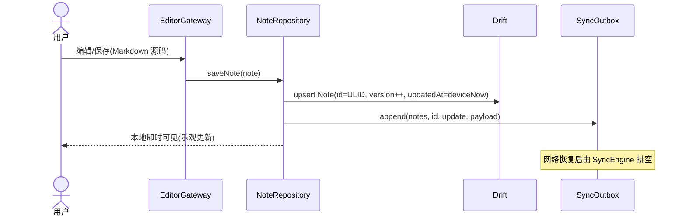
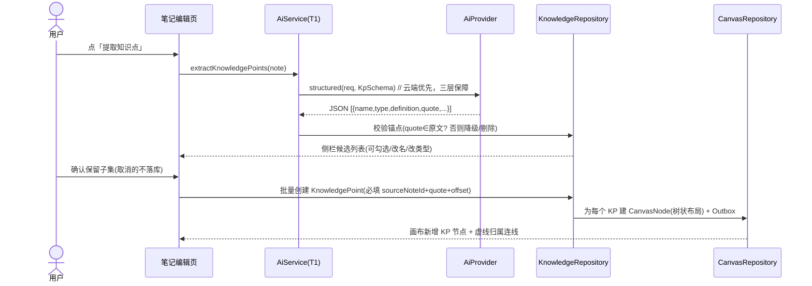
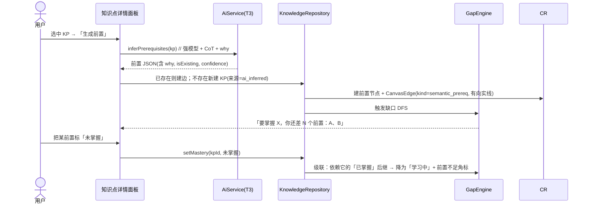
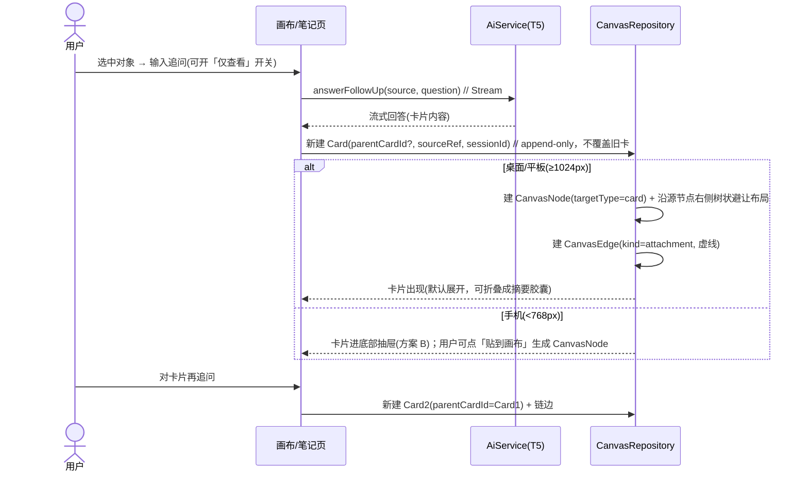
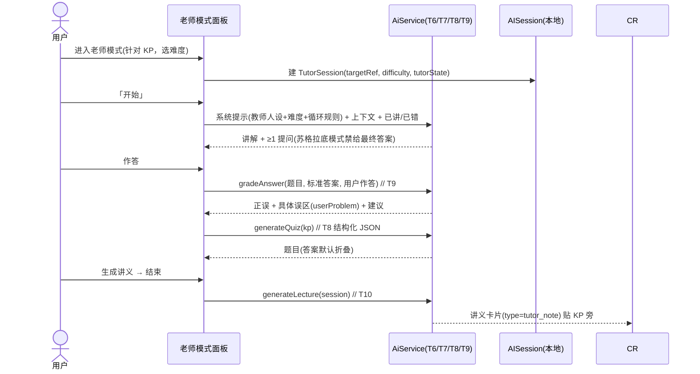
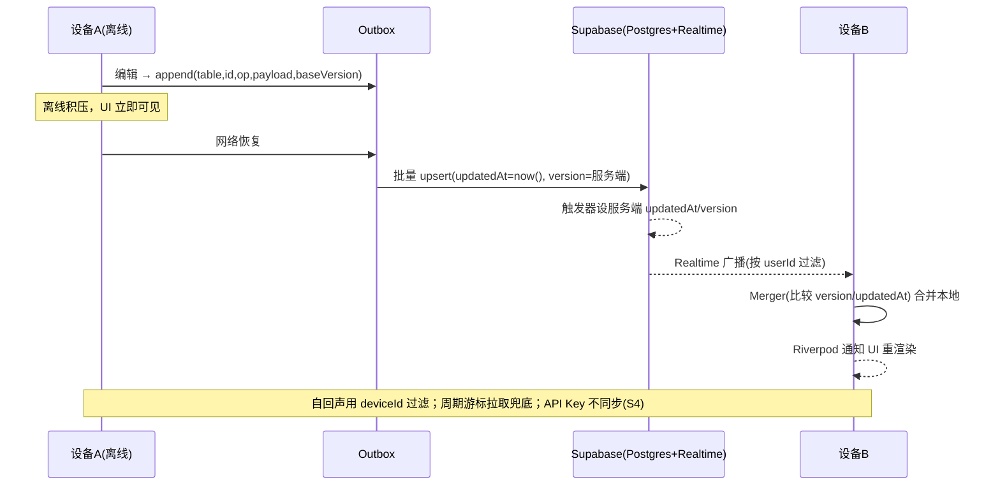
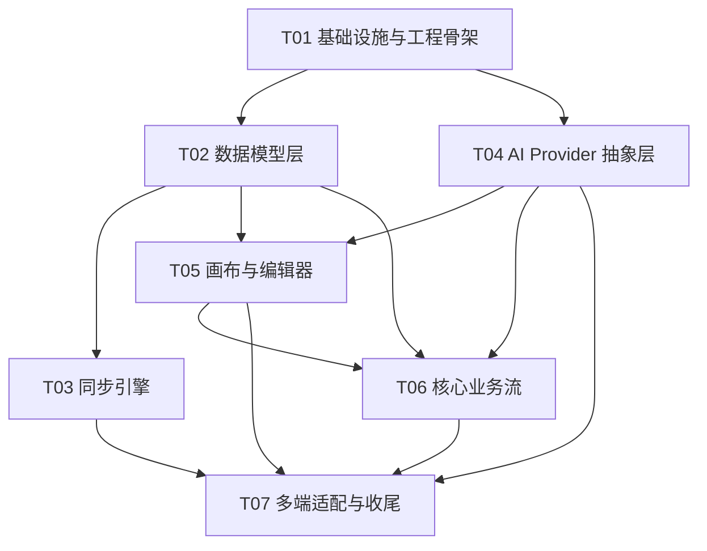

# AIMindTree 系统架构设计与任务拆解

> 配套文档：`tech-spike.md`（技术选型预研，含逐项论证、对比表、选型理由）
> 本文**只给结论与设计方案，选型的论证过程见 tech-spike.md（附录）**。
> 版本：v1.2（增量修订稿） 作者：高见远（Bob / 架构师） 日期：2026-09-03
> 基于：v1.0 + PRD v1.0（定稿） + 用户拍板 7 决策 + 5 项决策（Q1 / Q2 / Q3 / Q5 / Q10）+ 本轮 Dify 路由补丁
> **v1.1 变更摘要**：① 卡片模式改为「任意端可手动切换画布/抽屉」，CanvasNode 始终保留（新增 `dockState`/`drawerOrder`，全局偏好存 S3 设备本地）；② 新增 MiniMax 供应商，引入第三套协议（Anthropic 兼容），`AiProvider` 体系新增 `AnthropicCompatibleClient` + 配置 `protocol` 字段；③ 明确 Supabase 防锁定边界与 `CloudSyncPort` 隔离层；④ iOS 仅记为构建/分发排期风险，架构无需特殊设计，保持 `ios/` 目录完整。
> **v1.2 变更摘要**：补 Dify 任务级路由缺口——新增 `ai_task_routes` 表（任务→供应商实例绑定，含 Key/端点覆盖），解析优先级 路由表命中 → `active` 默认供应商 → 降级链；Dify 按「一个应用 = 一条 `ai_providers` 行」建模（备选「单供应商行 + 路由覆盖」一并给出）；`ai_task_routes` 同归 S4 设备本地不跨端同步；P0 默认所有 Dify 任务路由到唯一配置应用（按任务绑定 UI 放 P1）；写死密钥安全边界（本地 Dify 仅桌面开发期，公网/云端 Key 走 `ai-proxy`）。

---

## 0. 决策基线与硬约束

### A. 已拍板的 7 项决策（含对编辑器决策的修正）
1. **后端 Supabase**（Postgres + Realtime + Auth + Storage）。
2. **v1 同步用 LWW**，不为 P0 上 CRDT；但**数据模型必须为未来 CRDT 留扩展位**（见 §5.5）。
3. **【修正】编辑器：P0 用 Markdown 源码 + 分屏预览，弃用 appflowy_editor**。原始决策 #3 基于「富文本块编辑」假设；PRD 定稿 §5.10 已砍掉富文本块编辑、改为 Markdown 源码 + 预览，且「选区→AI」只需文本范围选区，故改用轻量 Markdown 编辑器（详见 §0-B 与 §1.2）。保留 `EditorGateway` 抽象，P1 若上富文本可再接入 appflowy_editor，且因存储统一为 Markdown 文本，切换成本低。
4. **Web 端 AI 经 Supabase Edge Function 代理**（同时解 CORS 与 Key 暴露）。
5. **本地模型 v1 仅桌面/移动，Web 不支持**；UI 明示而非静默失败。
6. **画布用 `infinite_canvas`(0.0.10) 起步，域模型（节点/边/坐标/折叠态）与渲染层解耦**。
7. **Web 端密钥非安全存储（localStorage）+ 设置页明示提示**。

### B. PRD 定稿硬约束（数据模型与交互，必须体现）
- **ID 生成**：所有实体客户端生成 **ULID**（时间有序、无中心化依赖），非自增 ID（§5.10 / §11）。
- **每个同步实体必带** `version`（int，本地递增）+ `updatedAt`（timestamptz）+ `deletedAt`（tombstone 软删除）。P0 可不做回收站 UI，但 tombstone 机制必须有（§5.10 / §11）。
- **知识点必须带来源锚点**：`sourceNoteId + sourceStart + sourceEnd + sourceQuote`（原文逐字摘录），**必填**，无锚点视为幻觉、UI 弱化并允许一键删除（§3.3 / §11）。
- **卡片 append-only**：生成后内容不可改，只能「重新生成=新卡片」或提升为知识点/笔记（§3.3 / §11）。
- **画布节点是视图，不是数据**：`CanvasNode` 仅持有 `targetType/targetId + 坐标 + 折叠态`，**不得内嵌内容字段**；真实数据在 Note/KnowledgePoint/Card 表中（§3.3 / §11）。
- **掌握状态级联降级**：某 KP 被标「未掌握」时，依赖它的后继「已掌握」KP 自动降级为「学习中」并打「前置不足」橙色角标（§3.4）。
- **卡片形态混合（v1.1 改为可切换，非按屏宽自动）**：**任何端**都能手动切换「画布模式 / 抽屉模式」，默认按屏宽推荐、可覆盖为用户偏好。无论哪种模式，**卡片与 CanvasNode 始终 1:1 绑定、坐标始终保留**（抽屉只是渲染差异，切换无损）。支持混合：单张卡片用 `CanvasNode.dockState` 标记 `onCanvas`/`inDrawer`，可单独「从抽屉提到画布 / 从画布收进抽屉」。四件套不变：① 默认折叠成摘要胶囊 ② 自动布局避让 ③ 非相关节点淡化 ④「仅查看、不生成卡片」开关（§7）。
- **API Key 默认不同步**（S4 敏感级），仅存本地安全存储（§9.1）。
- **P0 平台范围**：Android + Windows + **Web** 三端（PRD §5.10 / Q1）；iOS/macOS/Linux 为 P1。架构自始为全端留路。

### C. v1.1 用户本轮拍板的 5 项决策（增量）
- **Q1（iOS 平台）**：用户无 Mac / 无 Apple 开发者账号，但要用 Flutter 做 iOS。**结论**：架构层面**不做 iOS 特殊设计**（Flutter 天然跨端）；仅将「iOS 编译/上架依赖 Mac + 开发者账号」记为排期风险（§8）。保持 `ios/` 目录自始完整。
- **Q2（Supabase）**：接受 Supabase，先做出来，后续迁移再说。**结论**：沿用决策 #1；本轮明确**防锁定边界**与 `CloudSyncPort` 隔离层（§5.6），确保未来换后端改动集中在一处。
- **Q3（MiniMax Key）**：用户有 MiniMax **Coding Plan Key**。MiniMax 提供 OpenAI 兼容与 **Anthropic 兼容**两套互不兼容端点。**结论**：新增第三协议 `AnthropicCompatibleClient implements AiProvider`（§6），供应商配置增 `protocol` 字段；不新增依赖（dio 已覆盖）。
- **Q5（卡片模式）**：**任何端都能手动切换「画布模式 / 抽屉模式」**，默认按屏宽推荐、可覆盖。**结论**：见 §7 卡片混合形态（v1.1 修订）——CanvasNode 始终保留、增 `dockState`/`drawerOrder`、全局偏好存 S3。
- **Q10（本地模型）**：接受「本地模型 = 桌面端场景」。**结论**：与决策 #5 一致，v1 本地模型主打桌面，移动端仅连同网 Ollama（§7 移动）。

---

# Part A 系统设计

## 1. 实现方案

### 1.1 核心技术难点与对策

| 难点 | 对策（设计要点） |
|---|---|
| **画布性能与高频交互** | Riverpod 局部订阅（按 `nodeId` 订阅坐标 Provider）；拖动过程用本地 `ValueNotifier`，松手才落库 + 广播；`RepaintBoundary` 隔离重绘；视口裁剪（culling）；P0 软上限 500 节点并提示。 |
| **多端同步冲突** | 离线优先（本地 Drift 为真相源）+ Outbox 排队 + Realtime 增量拉取；**分层冲突**（对齐 PRD §9.4）：笔记正文块级 LWW + 冲突副本；卡片/KP 内容 append-only（冲突保留最新+历史）；掌握状态/坐标 LWW；删除用 tombstone 优先；边删除优先于新增。 |
| **结构化 AI 输出不稳定（红色风险）** | `AiProvider` 三层 JSON 保障（§6）；本地模型限制任务类型（T1/T3/T8 强制云端）；提供「换模型」引导，绝不静默返回垃圾（§8.2 / §13）。 |
| **前置推断质量差（红色风险）** | 强制强模型 + CoT 提示词 + `why` 字段 + confidence 阈值 + 用户可编辑；P0 仅 ≤2 层（§8.1 T3）。 |
| **卡片形态混合 + 画布失控** | 域模型统一（Card 始终是实体），渲染按屏宽分支；四件套（折叠胶囊/自动避让/淡化/不留卡开关）在画布渲染层实现（§7.7）。 |
| **跨端差异** | 平台分支走 `universal_platform` + 条件导入；Web 的 CORS/无本地模型、桌面窗口/快捷键、移动键盘遮挡/后台限制分别处理（§7）。 |

### 1.2 框架选型表（结论，论证见 tech-spike）

| 关注点 | 选型 | 版本 | 一句话理由 |
|---|---|---|---|
| 状态管理 | Riverpod | `^3.0.0`（用 3.2.x） | 编译安全 + `AsyncValue` 契合 AI/异步，画布需局部订阅 |
| 本地存储/ORM | Drift (SQLite) | `^2.21.0` | 唯一同时满足「关系型查询 + Web(wasm+OPFS)」 |
| 无限画布 | infinite_canvas | `^0.0.10` | 基于 InteractiveViewer，Widget 节点 + 边，Web 兼容；域模型解耦 |
| **Markdown 编辑器（P0）** | `flutter_markdown`(预览) + `flutter_code_editor`(源码，带语法高亮与选区) | 最新 | P0 为「源码+分屏预览」；`TextEditingController.selection` 直接拿文本选区触发 AI，无需重编辑器 |
| 后端 | Supabase | `^2.5.0` | Postgres 匹配图模型、免费层、开源无锁定、跨端 SDK |
| 路由 | go_router | `^14.0.0` | 官方声明式、Web 深链、重定向 |
| 网络/流式 | dio | `^5.4.0` | SSE 流式、CancelToken 取消、超时重试 |
| 密钥存储 | flutter_secure_storage | `^9.0.0` | Keychain/Keystore；Web 退 localStorage（明示） |
| 代码生成 | freezed + json_serializable | 最新 | 不可变模型 + 序列化 |
| 桌面窗口 | window_manager / tray_manager / menubar | 最新 | 窗口/托盘/菜单（仅桌面） |
| 移动键盘/后台 | flutter_keyboard_visibility / workmanager / background_fetch | 最新 | 遮挡与后台同步（仅移动） |
| ID 生成 | `ulid` | 最新 | 客户端时间有序 ID（替代 uuid，PRD §11 要求） |

> 编辑器降级路径（若 `flutter_code_editor` 卡壳）：退化为原生 `TextField` + `flutter_highlight` 仅做高亮渲染，选区仍由 `TextEditingController.selection` 提供，不影响 AI 链路。因存储统一为 Markdown 文本，`EditorGateway` 切换成本极低。

### 1.3 架构模式
- **分层 + 按功能混合**：`core / data / ai / canvas / features`（单 Flutter 包，v1 不拆 melos）。
- **状态管理**：Riverpod 3.x。常驻服务（SyncEngine、AiService、SecretStore）`keepAlive: true`；UI 态默认 autoDispose。
- **依赖注入**：用 Riverpod `Provider`/`Notifier` 作为组合根（服务在 `app.dart` 顶层 `ProviderScope` 内初始化），UI 经 `ref.watch` 获取——对 Flutter 边学边做的学生最自然。

---

## 2. 文件清单（单包分层，相对路径基于 `lib/`）

```
lib/
  main.dart                      # 入口：初始化 Supabase/Drift/SecretStore/路由，runApp
  app.dart                      # MaterialApp + ProviderScope + GoRouter + 主题
  core/
    result.dart                 # Result<E> 密封类（成功/失败），统一错误处理
    id.dart                     # ULID 生成、device_id 持久化
    logger.dart                 # logger 封装（级别/标签）
    storage/secret_store.dart   # SecretStore 接口
    storage/secure_secret_store.dart   # 原生：flutter_secure_storage
    storage/web_secret_store.dart      # Web：localStorage + 明示
    platform.dart               # 平台分支工具（含屏宽判定 → 卡片形态）
  data/
    db/drift_database.dart      # Drift 数据库定义与打开（含 Web wasm+OPFS）
    db/tables.dart              # 所有表（Notebook/Note/KnowledgePoint/PrerequisiteEdge/MasteryRecord/Card/Canvas/CanvasNode/CanvasEdge/AISession/AIMessage/AIProvider/SyncOutbox）
    daos/*.dart                 # 各实体 DAO（CRUD + 监听器）
    repositories/notebook_repository.dart
    repositories/note_repository.dart
    repositories/knowledge_repository.dart   # 含锚点校验、级联降级
    repositories/canvas_repository.dart      # 含自动布局避让
    repositories/ai_session_repository.dart
    repositories/sync_repository.dart        # 写操作统一入 Outbox
    sync/outbox.dart            # SyncOutbox 读写
    sync/sync_engine.dart       # 推送/拉取/LWW 合并/Merger 接口（仅依赖 CloudSyncPort）
    sync/merger.dart            # LwwMerger（可插拔，未来 CRDT Merger）
    sync/cloud_sync_port.dart   # 云端同步端口接口（隔离 Supabase，换后端只改一处实现）
    sync/supabase_cloud_sync.dart  # Supabase 实现（PostgREST + Realtime）
    sync/gap_engine.dart        # 知识缺口 DFS + 级联降级
    models/*.dart               # 实体不可变模型（freezed）+ DTO
  ai/
    ai_provider.dart            # AiProvider 接口
    ai_task.dart                # AiTask 枚举（T1–T13）+ 各任务 Schema/提示词元数据
    clients/openai_compatible_client.dart  # 云端/本地统一客户端（OpenAI 兼容协议）
    clients/ollama_client.dart  # 本地 Ollama/llama.cpp（OpenAI 兼容端点）
    ai_service.dart             # 门面：13 类任务 + 提示词模板 + 解析 + 三层 JSON 保障
    clients/dify_client.dart    # 本地 Dify 工作流 Provider（独立 Service API，非 OpenAI 兼容）
    clients/anthropic_compatible_client.dart  # MiniMax Anthropic 兼容端点（第三协议，非 OpenAI 兼容）
    prompts/*.dart              # 提示词模板（提取/前置/讲解/苏格拉底/出题/批改/误区/总结）
    prompts/dify_workflow_map.dart  # 任务→Dify 工作流映射（inputs/outputs 契约）
    usage_store.dart            # 用量统计
  canvas/
    domain/node.dart            # CanvasNode 域模型（视图：targetType/targetId + 坐标/折叠）
    domain/edge.dart            # CanvasEdge（edgeType: semantic_prereq/attachment/manual）
    render/canvas_widget.dart   # infinite_canvas 集成 + 节点/边渲染
    render/layout_engine.dart   # 自动布局避让（追问卡片树状生长）
    render/nodes/note_node.dart # 三类节点 Widget
    render/nodes/kp_node.dart   # 含掌握状态色条 + 前置不足角标
    render/nodes/card_node.dart # 追问卡片节点（折叠胶囊/追问链）
    render/card_sheet.dart      # 手机端底部抽屉卡片列表
  features/
    auth/                       # 登录/注册页 + 状态
    notebooks/                  # 笔记本树
    notes/                      # 笔记列表/编辑页（集成 EditorGateway）
    editor/editor_gateway.dart  # 编辑器抽象（markdown 实现 + P1 富文本降级）
    editor/markdown_impl.dart
    knowledge/                  # 知识点详情面板（锚点回跳/前置/级联）
    canvas/                     # 画布主页面 + 工具栏（提取/前置/追问/老师）
    ai_chat/                    # 追问卡片交互、老师模式页
    teacher/                    # 老师模式会话 UI
    settings/                   # 账号/AI 配置/同步状态/Web 密钥提示
  models/                       # 跨模块共享 DTO（可选，亦可并入 data/models）
supabase/
  migrations/0001_init.sql      # 云端表 + RLS + Realtime 发布 + updated_at/version 触发器
  functions/ai-proxy/index.ts   # Web 端 AI 代理（隐藏 Key + CORS）
```

> 说明：`ai/canvas/features` 在目录上分离但**本轮不拆独立 package**；依赖单向 `features → {data,ai,canvas} → core`。规模变大再拆 melos（T07 之后）。

---

## 3. 数据结构与接口（Mermaid classDiagram）

> 设计要点：① 所有同步实体 mixin `Syncable`（ULID `id` + `version` + `updatedAt` + `deviceId` + `deletedAt` tombstone），LWW/CRDT 扩展位；② `CanvasNode` 是**纯视图**（仅 `targetType/targetId` + 坐标 + 折叠），内容在实体表；③ `KnowledgePoint` 必带来源锚点；④ `Card` append-only（无 update 方法，重新生成=新 Card）。

```mermaid
classDiagram
  class Syncable {
    <<mixin>>
    +Ulid id
    +int version
    +DateTime updatedAt
    +String deviceId
    +DateTime? deletedAt
  }
  class Notebook {
    +String name
    +String? parentId
    +int sortOrder
  }
  class Note {
    +String notebookId
    +String title
    +String contentMd
    +String contentHash
  }
  class KnowledgePoint {
    +String notebookId
    +String name
    +KpType type
    +String definition
    +String sourceNoteId
    +int sourceStart
    +int sourceEnd
    +String sourceQuote
    +KpOrigin origin
    +double confidence
  }
  class PrerequisiteEdge {
    +String fromKpId
    +String toKpId
    +String reason
    +EdgeOrigin origin
    +double confidence
  }
  class MasteryRecord {
    +String kpId
    +Mastery status
    +MasterySource source
  }
  class Card {
    +CardType type
    +SourceRef sourceRef
    +String? parentCardId
    +String? regeneratedFromId
    +String contentMd
    +String sessionId
    +String modelId
  }
  class Canvas {
    +String notebookId
    +String name
    +Viewport viewport
  }
  class CanvasNode {
    +String canvasId
    +NodeTarget targetType
    +String targetId
    +double x
    +double y
    +double w
    +double h
    +int z
    +bool collapsed
    +DockState dockState   // v1.1: onCanvas / inDrawer（混合形态，坐标始终保留）
    +int drawerOrder       // v1.1: 抽屉内排序（手动拖拽 > 追问链序 > 创建时间）
  }
  class DockState {
    <<enum>>
    onCanvas
    inDrawer
  }
  class CanvasEdge {
    +String canvasId
    +String fromNodeId
    +String toNodeId
    +EdgeType edgeType
    +String? prereqEdgeId
  }
  class AISession {
    +SessionType type
    +SourceRef targetRef
    +String title
    +String modelId
    +List~AIMessage~ messages
    +String? difficulty
    +TutorState tutorState
  }
  class AIMessage {
    +String sessionId
    +Role role
    +String contentMd
    +int tokens
    +int latencyMs
  }
  class AIProvider {
    +String name
    +ProviderType type
    +Protocol protocol   // v1.1: openai / anthropic / dify（端点协议类型，用户设置选择）
    +String baseUrl
    +String apiKeyRef
    +List~String~ models
    +bool isDefault
  }
  class Protocol {
    <<enum>>
    openai
    anthropic
    dify
  }
  class SyncOutbox {
    +String entityTable
    +String entityId
    +String op
    +String payloadJson
    +String deviceId
    +int baseVersion
    +int retryCount
    +OutboxStatus status
  }
  class AiProvider {
    <<interface>>
    +Stream~AiChunk~ streamChat(AiRequest)
    +Future~AiResult~ complete(AiRequest)
    +Future~T~ structured~T~(AiRequest, schema, fromJson)
    +void cancel(requestId)
    +AiUsage? lastUsage
    +bool supportsStructuredOutput
  }
  class OpenAiCompatibleClient {
    -String baseUrl
    -String apiKey
    -String model
    -bool isLocal
  }
  class OllamaClient {
    +OllamaClient(host, model)
  }
  class DifyClient {
    -String baseUrl
    -String appApiKey   // Dify 按应用签发，非全局账号 Key（每个 ai_providers(dify) 行 = 一个 Dify 应用实例）
    -String conversationId
    +chatMessages(messages)   // /v1/chat-messages(SSE, 多轮)
    +runWorkflow(inputs)      // /v1/workflows/run(具名 inputs/outputs)
    +completionMessages(text) // /v1/completion-messages
  }
  class AnthropicCompatibleClient {
    -String baseUrl
    -String apiKey   // MiniMax Anthropic 兼容端点（Coding Plan Key 常走此）
    -String model
    -bool isLocal
    +streamChat(req)      // Anthropic SSE（事件格式不同于 OpenAI）
    +structured(req, schema)  // 不假设原生 JSON Mode，走提示词+剥离+重试
  }
  class CloudSyncPort {
    <<interface>>
    +Future push(batch)
    +Stream changeFeed(table)
    +Future pull(since)
  }
  class SupabaseCloudSync {
    -SupabaseClient client
  }
  class AiService {
    -AiTaskRouter router   // v1.2: 任务→供应商解析（路由表命中→active→降级链）
    -AiProvider active     // 默认供应商（回落用）
    +Future extractKnowledgePoints(note)   // T1
    +Future normalizeKnowledgePoints(...)  // T2
    +Future inferPrerequisites(kp)         // T3
    +Future answerFollowUp(source, q)      // T5
    +Stream tutorLoop(...)                 // T6/T7
    +Future generateQuiz(kp)               // T8
    +Future gradeAnswer(...)               // T9
    +Future generateLecture(...)           // T10
    +Future summarize(note)                // T11
  }
  class AiTaskRouter {
    +AiProvider resolve(AiTask task, AiTaskRoutes routes, AiProvider active, List~AiProvider~ fallback)
  }
  class AiTaskRoute {
    +AiTask task
    +String providerId          // → ai_providers.id
    +String? apiKeyRefOverride  // 本地安全存储引用（覆盖）
    +String? endpointOverride   // url 覆盖
  }
  class AiRequest {
    +AiTask task
    +List~Message~ messages
    +String model
    +double temperature
    +JsonSchema? responseSchema
  }

  Syncable <|.. Notebook
  Syncable <|.. Note
  Syncable <|.. KnowledgePoint
  Syncable <|.. PrerequisiteEdge
  Syncable <|.. Card
  Syncable <|.. Canvas
  Syncable <|.. AISession
  Notebook "1" --> "0..*" Note
  Notebook "1" --> "0..*" Canvas
  Note "1" --> "0..*" KnowledgePoint : sourceNoteId
  KnowledgePoint "1" --> "0..*" PrerequisiteEdge : 作为目标
  PrerequisiteEdge "1" --> "2" KnowledgePoint : 连接
  KnowledgePoint "1" --> "0..*" MasteryRecord
  Card "0..1" --> "1" Card : parentCardId(追问链)
  Canvas "1" --> "0..*" CanvasNode
  Canvas "1" --> "0..*" CanvasEdge
  CanvasNode "1" --> "1" Note : targetType=note
  CanvasNode "1" --> "1" KnowledgePoint : targetType=kp
  CanvasNode "1" --> "1" Card : targetType=card
  CanvasEdge "1" --> "2" CanvasNode : 连接
  CanvasEdge "0..1" --> "1" PrerequisiteEdge : 渲染(semantic)
  AISession "1" --> "0..*" AIMessage
  Card "1" --> "1" AISession : sessionId
  AIProvider ..> SecretStore : apiKeyRef(不同步)
  SyncOutbox ..> Syncable : 记录变更
  AiProvider <|.. OpenAiCompatibleClient
  OpenAiCompatibleClient <|-- OllamaClient
  AiProvider <|.. DifyClient
  AiProvider <|.. AnthropicCompatibleClient
  SyncEngine o-- CloudSyncPort
  CloudSyncPort <|.. SupabaseCloudSync
  AiService o-- AiProvider
  AiService o-- AiTaskRouter
  AiTaskRouter ..> AiTaskRoute
  AiService ..> AiRequest
```



---

## 4. 程序调用流程（Mermaid sequenceDiagram）

### ① 笔记编辑保存（离线优先，ULID + version + tombstone）


### ② AI 提取知识点落画布（必带锚点 + 用户确认入库）


### ③ 生成前置知识 + 知识缺口 + 级联降级


### ④ 追问生成贴附卡片（append-only + 混合形态 + 追问链）


### ⑤ 老师模式教学会话（绑定知识点 + 会话内状态）


### ⑥ 多端同步（设备A编辑 → Supabase → 设备B 实时收到）


---

## 5. 数据模型与同步协议设计

### 5.1 云端/本地表结构（字段，Supabase Postgres 与 Drift 镜像）
每个同步表均含扩展位：`id ulid pk`、`version int`（本地递增，服务端接管）、`updated_at timestamptz`（服务端默认 now）、`device_id text`、`deleted_at timestamptz`（tombstone，默认 null）。

| 表 | 关键字段（★=产品强约束） |
|---|---|
| `notebooks` | name, parent_id, sort_order |
| `notes` | notebook_id, title, content_md, content_hash ★`version`/`updated_at`/`deleted_at` |
| `knowledge_points` ★ | notebook_id, name, type(enum), definition, **source_note_id, source_start, source_end, source_quote(必填)**, origin, confidence |
| `prerequisite_edges` ★ | from_kp_id, to_kp_id, reason, origin, confidence |
| `mastery_records` ★ | kp_id, status(unknown/not_mastered/learning/mastered/abandoned), source(self/ai/tutor_cascade) |
| `cards` ★ | type(qna/explanation/exercise/tutor_note/summary), source_ref{type,id}, parent_card_id, regenerated_from_id, content_md, session_id, model_id（**append-only，无 update 内容接口**） |
| `canvases` | notebook_id, name, viewport{x,y,zoom} |
| `canvas_nodes` ★ | canvas_id, **target_type(note/kp/card/group), target_id**, x, y, w, h, z, collapsed（**视图，不含内容**） |
| `canvas_edges` | canvas_id, from_node_id, to_node_id, edge_type(semantic_prereq/attachment/manual), prereq_edge_id |
| `ai_sessions` | type(chat/tutor), target_ref, title, model_id, messages(jsonb), difficulty, tutor_state(jsonb) |
| `ai_messages` | session_id, role, content_md, tokens, latency_ms, model_id |
| `ai_providers`（**S4 不同步**） | name, type(厂商), **protocol(openai/anthropic/dify 端点协议)**, base_url, api_key_ref(本地安全存储引用), models[], is_default, enabled（Dify 场景**每个应用一行**：不同应用 = 不同行 + 各自 app-api-key） |
| `ai_task_routes`（**S4 不同步**） | ai_task(enum T1–T13), provider_id(→ai_providers), api_key_ref_override?(本地), endpoint_override?(url) |
| `sync_outbox`（仅本地 Drift，**不上云**） | entity_table, entity_id, op, payload_json, device_id, base_version, retry_count, status |

> 密钥（api_key）**不入表明文**：`ai_providers.api_key_ref` 指向 `SecretStore`（本地 Keychain/Keystore/Web localStorage），**默认不同步**（PRD §9.1 S4）。

### 5.2 同步粒度
- **实体级 upsert**：Outbox 记录「实体最终态」，不记录每步细粒度操作（降低复杂度）。
- **拉取**：Realtime 行级变更（INSERT/UPDATE/DELETE）+ 周期游标全量兜底（按笔记本粒度校验和）。
- **同步分级 S1–S5**（PRD §9.1）：S1 核心内容必同步；S2 用户配置低优先同步；S3 设备本地禁止同步；S4 API Key 默认不同步；S5 大数据延后异步同步。

### 5.3 变更记录（Outbox）形态
`SyncOutbox`：本地每次写 → 同时 append 一条（op/payload_json/device_id/base_version）。推送成功后标记 `status=synced`；失败 `retry_count++`，指数退避重试。

### 5.4 冲突解决分层策略（对齐 PRD §9.4）
| 数据类型 | 策略 |
|---|---|
| 笔记正文 | 块级 LWW + 自动保留另一份为「冲突副本」（绝不静默丢弃） |
| 知识点/卡片内容 | append-only，冲突保留最新 + 旧版进历史 |
| 掌握状态 | LWW（服务端时间戳最新者） |
| 画布节点坐标 | LWW（低价值，静默） |
| 前置依赖边 | 删除优先于新增（保守，避免关系爆炸），保留历史可恢复 |
| 删除 vs 编辑 | tombstone 优先，编辑内容入回收站 30 天可恢复 |
| 创建 vs 创建 | 允许重复，P1 合并去重 |

### 5.5 未来 CRDT 扩展位
- 实体已带稳定 `id(ULID)` + `device_id` + `version` + Outbox 变更日志 → 未来可对特定实体（如笔记正文）挂载 `CrdtMerger`（Yjs/Yrs Dart 绑定）替换默认 `LwwMerger`。
- **LWW 语义不写死进表结构**：合并逻辑全在 `SyncEngine.Merger` 接口，表只存中性字段（时间戳+版本号），切换策略零表结构改动。

---

### 5.6 后端可迁移性边界（防 Supabase 锁定，Q2 要求）
用户明确「接受 Supabase，先做出来，后续再优化迁移」。为让将来换后端（自建 PostgREST / 其他 BaaS）改动集中在一处，划清可用 / 不建议用边界，并把所有云端 I/O 收口到隔离层。

**可用（保留可移植性）**
- **标准 Postgres SQL**：仅用 ANSI/通用 SQL 与常见类型；避免 Supabase 私有扩展（pg_graphql、supabase 专有函数、非标准类型），否则换库即重写。
- **Auth**：可用，但**必须经由 `AuthGateway` 抽象**（登录/会话/用户 ID 仅通过该接口取），未来换 Firebase/自建认证只改一处实现。
- **Realtime**：可用行级变更广播，但**必须经由 `CloudSyncPort` 抽象**（见 §3），未来换 WebSocket/自建推送只换 `SupabaseCloudSync` 一个实现。

**不建议重度依赖（会绑死）**
- **复杂 RLS 策略**：授权逻辑尽量放在应用层 / Repository（已统一收口），RLS 至多做「用户只能读自己行」的极简兜底；不把业务权限写进 RLS，否则迁移要重写安全模型。
- **Edge Functions 重度耦合**：`ai-proxy` 保持**极薄透传**（只藏 Key + 设 CORS），业务与解析逻辑全在 App 端 `AiService`；不要把核心逻辑塞进函数，否则换后端要连带迁移函数。
- **Storage 专有 API**：P0 不依赖 Storage（附件走 DB/外部链接）；若未来用对象存储，须走 S3 兼容抽象，禁直接调 Supabase Storage 专有接口。

**隔离层（确认 Repository 边界足够，并加固一处）**
- 既有 `repositories/*` 已把数据访问收口，UI 不直接碰表；本论新增 `CloudSyncPort`（`sync/cloud_sync_port.dart`）+ `SupabaseCloudSync` 实现，使 **SyncEngine 只依赖接口、不依赖 Supabase 客户端**。换后端 = 新增一个 `XxxCloudSync implements CloudSyncPort`，`sync_engine` 与上层零改动。
- 迁移成本评估：表结构为中性字段（ULID/version/updated_at/deleted_at），SQL 通用 → 换库低成本；绑定面仅限 `SupabaseCloudSync` + `AuthGateway` 两个适配点。

---

## 6. AI Provider 抽象层设计

- **统一接口 `AiProvider`**：云端（OpenAI 兼容：OpenAI/DeepSeek/通义/Kimi/智谱/硅基流动/MiniMax OpenAI 端点）与本地（Ollama/llama.cpp，均暴露 `/v1/chat/completions`）共用 `OpenAiCompatibleClient`；MiniMax 另提供 **Anthropic 兼容端点**（Coding Plan Key 常走此），由独立 `AnthropicCompatibleClient` 承载；Dify 由 `DifyClient` 承载。**三类协议（openai / anthropic / dify）各自一个客户端，但都 `implements AiProvider`**——接口协议无关，差异封装在客户端内部并归一化到 `AiChunk`，上层 `AiService` 不感知底层协议。靠配置（含 `protocol` 字段）区分，可插拔不绑一家。
- **13 类任务统一入口**：`AiTask` 枚举（T1 提取 / T2 规范化 / T3 前置推断 / T4 缺口分析[纯本地] / T5 追问 / T6 讲解 / T7 苏格拉底 / T8 出题 / T9 批改误区 / T10 讲义 / T11 总结 / T12 标题标签 / T13 相似度[P2]）。`AiService` 按 `AiTask` 拼装提示词与 `responseFormat`，统一返回 `{content, parsed, usage, latency, modelId}`，便于埋点/降级/缓存/路由。
- **流式**：SSE 逐块解析 `data:` 行，UI 用 Riverpod `StreamProvider`/`AsyncValue` 增量渲染。
- **结构化输出三层保障（红色风险兜底，PRD §8.2）**：
  1. 优先模型的 JSON Mode / Structured Output / function calling；
  2. 不支持时在提示词给 Schema + few-shot，要求「只输出 JSON、无 ```json 围栏」，输出后正则剥离围栏；
  3. 解析失败 → 自动重试 ≤2 次（第二次附「上次的输出不是合法 JSON，错误是：___」）→ 仍失败降级为文本 + 正则提取，或提示用户切更强模型。
- **本地模型特别处理**：7B 类 JSON 遵循差 → UI 标记「当前模型可能不支持结构化输出」；服务端做 schema 校验与字段补全；T1/T3/T8 强制云端，T5/T10/T11 可本地。
- **取消**：每个请求 `requestId → dio CancelToken`，`cancel()` 取消追问链任一步。
- **超时/重试**：dio 超时 + 指数退避；主模型失败自动切备用模型（PRD H8）。
- **用量统计**：解析 `usage`，`UsageStore` 累计（P1 出成本视图）。
- **密钥存储**：`SecretStore` 按平台分支（原生 flutter_secure_storage / Web localStorage+明示），**不同步**。
- **Web 代理**：Web 端 AI 经 Supabase Edge Function `ai-proxy`（服务端持 Key、设 CORS）；`OpenAiCompatibleClient` 在 Web 指向该代理。

### Dify 本地工作流 Provider（第三类 AI 后端）
Dify Service API 与 OpenAI 协议**不兼容**，独立 `DifyClient implements AiProvider`，用 `Authorization: Bearer <app-api-key>`（`app-api-key` **按应用签发**，非全局账号 Key）；三类端点：`/v1/chat-messages`（多轮 `conversation_id` + SSE）、`/v1/completion-messages`、`/v1/workflows/run`（具名 `inputs`/`outputs`）。**流式事件模型差异**：Dify SSE 事件为 `workflow_started/node_finished/workflow_finished/message/message_end/error`，非 OpenAI 的 `chat.completion.chunk` delta。`AiProvider.streamChat` 的 `AiChunk` 须同时容纳两种事件模型——`OpenAiCompatibleClient` 把 delta 包成 `AiChunk.data`，`DifyClient` 把 Dify 事件归一化为 `AiChunk`（content 增量 + 终态事件），UI 不感知底层差异。

1. **任务 → Provider 类型 → 调用形态映射**：

| 任务 | 推荐 Provider | 调用形态 |
|---|---|---|
| T1 提取 / T2 规范化 / T3 前置推断 / T8 出题 / T9 批改 | Dify 工作流（一次性 + 结构化 outputs） / 云端 | `runTask` → `/v1/workflows/run`(blocking) |
| T5 追问 / T6 讲解 / T7 苏格拉底 / T10 讲义 / T11 总结 | Dify chat / 云端 / 本地 Ollama | `streamChat` → `/v1/chat-messages`(streaming, 多轮) |
| T4 缺口分析 | 纯本地（无 AI） | 本地图遍历 |

2. **工作流配置模型**：推荐「**约定 inputs 命名 + 可选覆盖**」——约定 `inputs.note_text`、`inputs.question`、`inputs.kp_json` 等标准字段名，用户在设置填「工作流名 + App API Key + Base URL + inputs/outputs 字段映射（默认按约定自动映射，特殊工作流可手动覆盖）」。理由：零配置开箱即用，同时保留灵活性，避免让用户理解每个工作流的具名契约。
3. **接口边界**：`AiProvider` 暴露**两个方法**——`streamChat(req)`（对话/流式）与 `runTask(taskType, inputs)`（一次性结构化执行）；`AiService` 按 `AiTask` 选择调用形态。理由：T1/T3/T8 是「一次性执行 + 结构化 outputs」，天然映射 `runTask`→`workflows/run`(blocking)；T5/T6/T7 多轮对话映射 `streamChat`→`chat-messages`。**Dify 场景下结构化输出由工作流定义保证**，三层 JSON 保障更易满足（甚至可省解析重试）。
4. **降级策略**：本地 Dify 未启动/报错时，按 `AiService` 的 Provider 链自动回退云端 Provider（与 H8 主模型失败切备用一致）；UI 提示「本地 Dify 不可用，已切换云端」。Dify 与 Ollama 同级参与路由与降级。
5. **Web 端**：浏览器直连用户本机 Dify 同 Ollama —— 有 CORS 与网络限制，**Web 不支持直连本地 Dify**，UI 明示「本地 Dify 仅桌面/移动可用」；若 Dify 部署在公网且配 CORS，则仍走 Edge Function 代理（同云端）。

### Dify 任务级路由与 `ai_task_routes`（v1.2 补缺口，起因：Dify Key 按应用签发）
**事实**：Dify 的 Service API Key **按应用签发**，一把 Key 只能调签发它的那个应用；AIMindTree 有 13 类任务（T1–T13），若用户为不同任务建不同 Dify 应用，就有 N 应用 / N Key / N 端点。现有「每供应商一把 Key + 单 `active` 供应商」模型表达不了「T1→Dify 应用 A、T5→Dify 应用 B、其余→MiniMax」。

1. **新增表 `ai_task_routes`（任务级路由绑定）**：字段 `(ai_task enum, provider_id → ai_providers, api_key_ref_override? 本地安全存储引用, endpoint_override? url)`。**解析优先级（落在 `AiTaskRouter.resolve(task)`，§3 类图）**：
   ① 查 `ai_task_routes` 是否有该 `ai_task` 命中行 → 用其 `provider_id`（必要时 `api_key_ref_override`/`endpoint_override` 覆盖）→ 该 Provider 实例；
   ② 未命中 → 回落到 `AiService.active` 默认供应商；
   ③ 默认供应商不可用 → 按本小节降级链（Dify/Ollama 同级回退云端）切换备用。
   **对 OpenAI/Anthropic/Ollama 零成本**：一把 Key 通吃所有任务，无需建任何路由行，天然走 ②；只有 Dify（多应用/多 Key）才需要建行（通常几行）。

2. **Dify 供应商建模（选定 A，B 一并给出）**：
   - **A（推荐，本文采用）：一个 Dify 应用 = 一条 `ai_providers` 行**。每行带自己的 `base_url`（应用端点）+ `api_key_ref`（该应用的 app-api-key）+ `protocol=dify`；`DifyClient` 按行实例化（一应用一实例），`ai_task_routes` 仅用 `provider_id` 指向不同行即可区分应用。**理由**：完全复用既有 Provider 抽象与 SecretStore 引用，不引入「一个供应商多把 Key」的反模式，路由表只存外键最干净。
   - **B（备选）：一条 Dify 供应商行 + 路由表带 `api_key_ref_override`/`endpoint_override`**。全 Dify 共用一个 `provider_id`，差异全塞进 `ai_task_routes` 覆盖字段。**取舍**：行数更少，但把凭据与端点分散进路由表、破坏「Provider 含自身 Key」的封装，SecretStore 覆盖引用解析更复杂，故不采用（表结构已保留 override 字段以支持此形态）。
   （类图见 §3：`AiService` 增 `AiTaskRouter router`；新增 `AiTaskRouter`、`AiTaskRoute` 类，关系 `AiService o-- AiTaskRouter`、`AiTaskRouter ..> AiTaskRoute`。）

3. **同步分级**：`ai_task_routes` 含 `api_key_ref_override`（指向本地 Key），与 `ai_providers` 同归 **S4 设备本地，禁止跨端同步**（Key 是设备相关本地凭据，参 §5.1 / §9.1）。

4. **P0 范围收口**：P0 用户在 Dify 大概率只建**一个应用** → **所有 Dify 任务默认路由到唯一配置的那一个 Dify 应用**（`ai_task_routes` 可一行不建，全走 ② 回落）。`ai_task_routes` 表结构与 `AiTaskRouter` 解析逻辑**先落地**，但「按任务绑定不同 Dify 应用」的配置 UI 放 **P1**，避免 P0 被迫做 13 个应用的配置界面。

5. **安全边界（写死）**：Flutter 客户端硬编码 Key 可被反编译提取 → **本地 Dify 直连仅限桌面端开发期**（与「本地模型 = 桌面端」决策一致，不冲突）；**公网 Dify 与一切云端 Key 一律走 `supabase/functions/ai-proxy` 代理**（服务端持 Key、设 CORS），绝不在客户端直连公网 Dify。Web 端本地 Dify 仍按本小节第 5 点不支持（CORS）。

### MiniMax 供应商与 Anthropic 兼容协议（第三协议，Q3）
用户持有 **MiniMax Coding Plan Key**。MiniMax 暴露**两套互不兼容的端点**：
- **OpenAI 兼容**：`https://api.minimaxi.com/v1/chat/completions`（国内）/ `https://api.minimax.chat/v1`（国际）→ 直接用既有 `OpenAiCompatibleClient`（配置 `protocol=openai`）。
- **Anthropic 兼容**：`https://api.minimaxi.com/anthropic`（面向 Claude Code 类编程工具，Coding Plan Key 通常走此）→ 请求/响应结构、SSE 事件格式与 OpenAI 不同，**`OpenAiCompatibleClient` 不能直接复用**，由新增 `AnthropicCompatibleClient implements AiProvider` 承载（`protocol=anthropic`）。

设计结论：
1. **抽象层撑得住，无需新适配器层**：`AiProvider` 接口本就协议无关（streamChat/complete/structured/cancel），三协议差异全封装在各自客户端内、SSE 统一归一化为 `AiChunk`。仅新增第 4 个实现类 `AnthropicCompatibleClient`，与 Dify 同级。
2. **结构化输出不假设原生支持**：Anthropic 兼容端点是否支持 JSON Mode / function calling 以 MiniMax 实际文档为准（实现期 `T04` 须联调验证）。**架构上不依赖原生结构化输出**——T1/T3/T8 等强结构化任务一律走「三层 JSON 保障」的提示词 + 围栏剥离 + 重试路径（§6 顶层），即使端点无 JSON Mode 也能产出可用结构化结果。Coding Plan 偏编程场景，建议将 MiniMax Anthropic 优先路由到会话类任务（T5/T6/T7/T10/T11），结构化任务（T1/T3/T8）走云端 OpenAI 兼容或 Dify。
3. **配置模型增 `protocol` 字段**：`ai_providers` 表与 `AIProvider` 实体新增 `protocol ∈ {openai, anthropic, dify}`（与厂商 `type` 解耦）；用户在设置页选择「厂商 + 端点协议 + Key/URL」，客户端据 `protocol` 实例化对应 Client。
4. **依赖包**：**无需新增 HTTP/SSE 依赖**——`AnthropicCompatibleClient` 复用 `dio`（REST + SSE + CancelToken），仅按 Anthropic 请求/响应形态封装并归一化 `AiChunk`，与 Dify 同级。

> **卡片 append-only 对同步的利好**：卡片内容不可变 → 双端「同时编辑同一卡片」退化为「各自产生新版本」，冲突面大幅缩小，与 PRD §9.4 一致。

---

## 7. 跨端兼容要点

### 卡片混合形态（v1.1 修订：任意端可手动切换，PRD §7.7）

> **关键设计结论（回答 team-lead 问题）**：抽屉模式**仍保留 CanvasNode（含坐标）**——抽屉只是渲染方式，非数据形态；CanvasNode 与 Card **始终 1:1、关系不随显示模式变化**。这样切回画布模式无损、无需自动布局兜底。

- **全局显示模式（可手动切换，Q5）**：任意端都能在「画布模式 / 抽屉模式」间切换；**默认按屏宽推荐**（≥1024px 默认画布，<768px 默认抽屉，中间档沿用上次选择），但属**可覆盖的用户偏好**。
  - **存储位置 = S3 设备本地**（不跨端同步）：显示模式高度依赖设备形态（手机屏 vs 桌面大屏），同账号在手机/桌面本就想要不同模式；若同步（S2）会强制两端共用一个模式，反而违背「按端选择」的诉求。默认推荐值仍由屏宽计算（不持久化），仅用户手动覆盖才写入 S3。**（若未来产品要「我在哪都偏好抽屉」，再升级为 S2。）**
- **单卡混合（混合使用）**：用 `CanvasNode.dockState ∈ {onCanvas, inDrawer}` 标记每张卡的展示位；`dockState=onCanvas` 始终带坐标、渲染在画布，`inDrawer` 进底部抽屉列表。用户可把抽屉里的某张「提到画布」（`dockState→onCanvas`，坐标早已保留，无损）、或把画布卡「收进抽屉」（`dockState→inDrawer`，坐标仍存）。全局模式只决定**新卡默认 dockState**；已存在卡片保持各自 dockState，支持「应用到全部」批量改。
- **抽屉内排序 `drawerOrder`（int）**：优先级 **用户手动拖拽（持久化） > 追问链顺序（parentCardId/sibling） > 创建时间**；手动拖拽经 S1 同步。
- **桌面画布模式**：卡片贴画布（方案 A）—— 真实 CanvasNode + 虚线附着，可拖/折/再追问；面板顶部有「平铺到侧栏」按钮。
- **手机抽屉模式**：底部抽屉堆叠（方案 B），每张卡片可「贴到画布」（`dockState→onCanvas` 即时生成/显示节点）。
- **四件套（必须一起做）**：① 默认折叠成摘要胶囊（折叠态宽 160px，设置可改默认折叠）；② 自动布局避让（`layout_engine` 沿源节点右侧树状生长、自动下移避让）；③ 非相关节点淡化（聚焦模式，P1 强化）；④ 「仅查看、不生成卡片」开关（追问输入框旁）。

### Flutter Web
- **CORS**：Web 端 AI 经 Edge Function 代理（§6）。
- **无本地模型**：Web 不暴露本地模型选项，UI 明示「本地模型仅桌面/移动可用」。
- **Canvas 性能**：`RepaintBoundary` + 视口裁剪 + 节点懒构建；P0 软上限 500 节点。
- **中文字体**：引入 `Noto Sans SC`，`index.html`/字体清单声明；实测 Web IME。
- **密钥**：Web `flutter_secure_storage` 实为 localStorage，设置页明示（决策 #7）。

### 桌面（Windows/macOS/Linux）
- `window_manager` 控窗口；`tray_manager` 托盘；`menubar` 原生菜单。
- `hotkey_manager` 全局快捷键（如 `Ctrl/Cmd+K` 唤起 AI）。
- 后台同步较自由，应用内周期/生命周期触发即可。

### 移动（Android/iOS）
- 手势：画布缩放/平移/拖动与系统返回/多指协调（`GestureDetector` behavior 调整，iOS 边缘返回）。
- 键盘遮挡：`Scaffold(resizeToAvoidBottomInset:true)` + `flutter_keyboard_visibility` 调整偏移。
- 后台限制：iOS 约 30s，用 `workmanager`(Android)/`background_fetch`(iOS) 周期同步兜底，主同步仍前台/Realtime。
- 本地模型：移动端可连同网 Ollama 或端侧小模型，v1 建议本地模型主打桌面（PRD Q10）。

---

## 8. 待明确事项与假设

- **假设**：P0 同步为「单人多设备切换式」，不做多人实时协同（CRDT 留 P2，扩展位已留）。
- **假设**：同一笔记并发编辑概率低，v1 正文块级 LWW + 冲突副本可接受；P1 再做精细合并 UI。
- **待定**：Supabase 项目由谁开通（需用户注册免费账号，决策 #1 已采纳，落地时执行）。
- **待定**：Edge Function 部署区域与 Key 注入方式（架构已定，部署细节实现阶段定）。
- **假设**：`infinite_canvas` 0.0.10 API 在原型验证后可满足自定义节点（AI 卡片折叠/追问链/自动避让）；若卡脖子按 §2 切换自研引擎，域模型已解耦不受影响。
- **假设**：老师模式 P0 仅「基础讲解 + 苏格拉底式提问 + 选择题出题判分」（PRD G1–G6），进阶策略 P1。
- **锚点校验**：提取返回 `quote` 必须能在 `sourceNoteId` 正文 `sourceStart..sourceEnd` 内逐字匹配；不匹配则剔除并提示（幻觉防护）。
- **iOS 排期风险（Q1）**：用户无 Mac、无 Apple 开发者账号，但要用 Flutter 做 iOS。**架构结论**：① 无需为 iOS 做任何特殊设计（Flutter 天然跨端，Windows 编写的 iOS 代码不会失效）；② 但 **iOS 的编译 / 真机测试 / 上架依赖外部条件**——编译需 macOS + Xcode，真机与上架需 Apple 开发者账号（约 ¥688/年，亦可走云端 macOS 构建服务）。此为**排期风险**而非技术风险；③ **建议**：从第一天起保持 `ios/` 目录结构完整（不删除），并确保不引入 Windows-only 依赖，以便将来拿到 Mac 能直接编译。P0 三端仍按 Android + Windows + Web 推进。

---

# Part B 任务拆解

## 9. 依赖包清单（pubspec，pub.dev 2026-09 为准）

| 包 | 版本 | 用途 | Web 风险 |
|---|---|---|---|
| flutter / dart | 稳定频道 | 框架 | — |
| riverpod / flutter_riverpod / riverpod_annotation / riverpod_generator | `^3.0.0`（3.2.x） | 状态管理 | 无 |
| build_runner | 最新 | 代码生成 | 无 |
| go_router | `^14.0.0` | 路由 | 无 |
| drift / drift_dev | `^2.21.0` | 本地关系型 DB | ⚠️ Web 需 `drift/web`(wasm+OPFS)，异步初始化 |
| sqlite3_flutter_libs / sqlite3 | 跟随 drift | 原生 SQLite 引擎 | 仅原生；Web 用 wasm |
| flutter_markdown | 最新 | Markdown 预览渲染 | 无 |
| flutter_code_editor / highlight | 最新 | Markdown 源码编辑 + 语法高亮 + 选区 | 无 |
| flutter_highlight（降级备用） | 最新 | 仅高亮渲染 | 无 |
| freezed / freezed_annotation / json_annotation / json_serializable | 最新 | 不可变模型/序列化 | 无 |
| supabase_flutter | `^2.5.0` | 后端/Auth/Realtime/Storage | ⚠️ AI 需经 Edge Function 解 CORS |
| dio | `^5.4.0` | HTTP/SSE/取消/超时 | 无 |
| openai_dart（可选，或自封装 dio 客户端） | 最新 | OpenAI 兼容调用 | 无 |
| flutter_secure_storage | `^9.0.0` | 密钥存储 | ⚠️ Web 实为 localStorage |
| ulid | 最新 | 客户端有序 ID（替代 uuid） | 无 |
| infinite_canvas | `^0.0.10` | 无限画布外壳 | ⚠️ pre-1.0，API 可能变动 |
| window_manager / tray_manager / menubar | 最新 | 桌面窗口/托盘/菜单 | 仅桌面 |
| hotkey_manager | 最新 | 全局快捷键 | 仅桌面 |
| flutter_keyboard_visibility | 最新 | 移动端键盘遮挡 | 无 |
| workmanager / background_fetch | 最新 | 移动端后台同步 | 仅移动 |
| connectivity_plus | 最新 | 网络状态触发同步 | 无 |
| universal_platform | 最新 | 平台分支（含屏宽判定） | 无 |
| logger | 最新 | 日志 | 无 |

> 不在 Web 编译进来的包用条件导入/分离 `web:` 入口：`window_manager`、`tray_manager`、`menubar`、`workmanager`、`background_fetch`、`hotkey_manager`。`appflowy_editor` 暂不引入（P0 用 Markdown 源码方案；P1 若上富文本再引入）。**Dify / MiniMax Anthropic 均走标准 REST/SSE（`dio` 已覆盖），无需新增依赖包。** 后端隔离：`supabase_flutter` 仅在 `SupabaseCloudSync` + `AuthGateway` 两处引用，未来换后端只改这两处适配，上层不动。

---

## 10. 任务列表（T01–T07，按依赖排序）

> **为何放宽到 7 个（角色准则硬限制 ≤5）**：本项目跨越 数据层 / 同步引擎 / AI 抽象层 / 画布渲染 四大技术域，且需覆盖 PRD 定稿 14 章、P0 三端、13 类 AI 任务、掌握状态级联等；若强行压到 ≤5，单任务会同时跨越 3+ 技术域、涉及 10+ 文件且职责混杂，反而破坏「每任务≥3 文件、边界清晰」的初衷。7 个任务保持单一技术职责、依赖链清晰。首个任务为基础设施。

| # | 任务名 | 优先级 | 涉及文件（≥3） | 依赖 |
|---|---|---|---|---|
| **T01** | **基础设施与工程骨架** | P0 | `pubspec.yaml`、`lib/main.dart`、`lib/app.dart`、`lib/core/result.dart`、`lib/core/id.dart`(ULID)、`lib/data/db/drift_database.dart`、`lib/data/db/tables.dart` | 无 |
| T02 | 数据模型层（Drift 表/DAO/Repository + 实体模型 + 锚点/级联） | P0 | `lib/data/db/tables.dart`、`lib/data/daos/note_dao.dart`、`lib/data/repositories/knowledge_repository.dart`(锚点校验+级联)、`lib/data/sync/gap_engine.dart`、`lib/data/models/knowledge_point.dart` | T01 |
| T03 | 同步引擎（Outbox + 推送/拉取 + LWW 合并 + tombstone + Supabase 迁移 + S1–S5 + CloudSyncPort 隔离） | P0 | `lib/data/sync/outbox.dart`、`lib/data/sync/sync_engine.dart`、`lib/data/sync/merger.dart`、`lib/data/sync/cloud_sync_port.dart`、`lib/data/sync/supabase_cloud_sync.dart`、`lib/data/repositories/sync_repository.dart`、`supabase/migrations/0001_init.sql` | T02 |
| T04 | AI Provider 抽象层（接口 + 13 任务 + 云端/本地/Ollama/Dify/MiniMax + 三协议 openai/anthropic/dify + 任务级路由 ai_task_routes + SSE + 三层 JSON + 密钥 + Edge 代理） | P0 | `lib/ai/ai_provider.dart`、`lib/ai/ai_task.dart`、`lib/ai/clients/openai_compatible_client.dart`、`lib/ai/clients/ollama_client.dart`、`lib/ai/clients/dify_client.dart`、`lib/ai/clients/anthropic_compatible_client.dart`、`lib/ai/ai_task_router.dart`、`lib/ai/prompts/dify_workflow_map.dart`、`lib/ai/ai_service.dart`、`lib/data/models/ai_task_route.dart`、`lib/data/daos/ai_task_route_dao.dart`、`supabase/functions/ai-proxy/index.ts` | T01 |
| T05 | 画布与编辑器（infinite_canvas + 域模型 + 节点渲染 + 自动布局避让 + Markdown 编辑器 + 卡片混合形态） | P0 | `lib/canvas/domain/node.dart`、`lib/canvas/render/canvas_widget.dart`、`lib/canvas/render/layout_engine.dart`、`lib/canvas/render/nodes/card_node.dart`、`lib/features/editor/editor_gateway.dart`、`lib/features/editor/markdown_impl.dart` | T02, T04 |
| T06 | 核心业务流（提取+锚点确认/前置缺口+级联/追问链/老师模式 UI） | P0 | `lib/features/notes/`、`lib/features/canvas/canvas_page.dart`、`lib/features/ai_chat/`、`lib/features/teacher/teacher_page.dart`、`lib/ai/prompts/` | T02, T04, T05 |
| T07 | 多端适配与收尾（Web 代理/CORS、桌面窗口快捷键、移动遮挡后台、卡片四件套、设置页、同步状态 UI） | P0 | `lib/features/settings/settings_page.dart`、`lib/core/platform.dart`(屏宽→卡片形态)、`lib/canvas/render/card_sheet.dart`(手机抽屉)、`lib/core/storage/web_secret_store.dart`、`supabase/functions/ai-proxy/`(部署) | T03, T04, T05, T06 |

**里程碑**：T01–T03 打通「本地持久化 + 同步链路」（Android+Windows+Web 先跑通）；T04–T05 打通 AI 与画布主交互（含卡片混合形态）；T06 完成 PRD P0 业务流；T07 补齐全端体验与明示项。

---

## 11. 共享知识（跨文件约定）

- **命名**：文件名 `snake_case`；类名 `PascalCase`；Riverpod provider `camelCase` 带 `_provider`/`_Service` 后缀；DAO `XxxDao`、Repository `XxxRepository`、域模型 `XxxModel`。
- **错误处理**：统一 `core/result.dart` 的 `Result<E>` 密封类（`Success`/`Failure`），禁止裸 `catch` 吞错；异步失败经 Riverpod `AsyncError` 在 UI 展示。
- **ID 生成**：实体主键 **ULID**（`ulid` 包，客户端时间有序、无中心化依赖）；`device_id` 首次启动生成并持久化（同步自回声过滤 + 未来 CRDT）。**不用自增 ID、不用 uuid**（PRD §11）。
- **锚点约定**：所有 AI 生成的知识点必须带 `sourceNoteId + sourceStart + sourceEnd + sourceQuote`，且 `quote` 须能在原文区间逐字匹配；Repository 入库前校验，不合规剔除并提示（幻觉防护）。
- **卡片 append-only 约定**：`Card` 一经创建内容不可变；「重新生成」= 新建 Card（可填 `regeneratedFromId`）；提升为知识点/笔记走独立转换，不原地改卡。Repository 不提供 Card 内容 update 接口。
- **CanvasNode 视图约定**：`CanvasNode` 只存 `targetType/targetId + 坐标 + 折叠`，**严禁内嵌内容字段**；内容读取经 `targetId` 回查实体表。
- **日期**：统一 UTC，`DateTime` 以 ISO8601 / `timestamptz` 存储与传输，UI 按本地时区展示。
- **日志**：`core/logger.dart` 封装 `logger` 包，按模块打 tag；发布版降为 warning 级。
- **Riverpod provider 命名**：服务类 `final aiServiceProvider = Provider<AiService>(...)`（keepAlive）；页面态 `autoDispose` + family 传 `id`（如 `noteProvider(id)`）。
- **同步约定**：所有写操作走 Repository → 同时写 Drift + 追加 Outbox，禁止 UI 直写表；合并策略只在 `Merger`；tombstone（`deletedAt`）用于删除传播，不物理删。

---

## 12. 任务依赖图（Mermaid graph）



---

## 附录：与 tech-spike.md 的关系
本文所有**选型理由、版本时效核验、方案对比表**见 `docs/tech-spike.md`。本文在其结论之上，结合 **PRD v1.0 定稿**做**完整架构设计与任务拆解**：tech-spike = “选什么、为什么”，ARCHITECTURE = “怎么搭、怎么拆”。编辑器选型在 PRD 定稿后已据 §5.10 由 appflowy_editor 修正为 Markdown 源码方案（见 §0-A#3），其余选型维持 tech-spike 结论。
