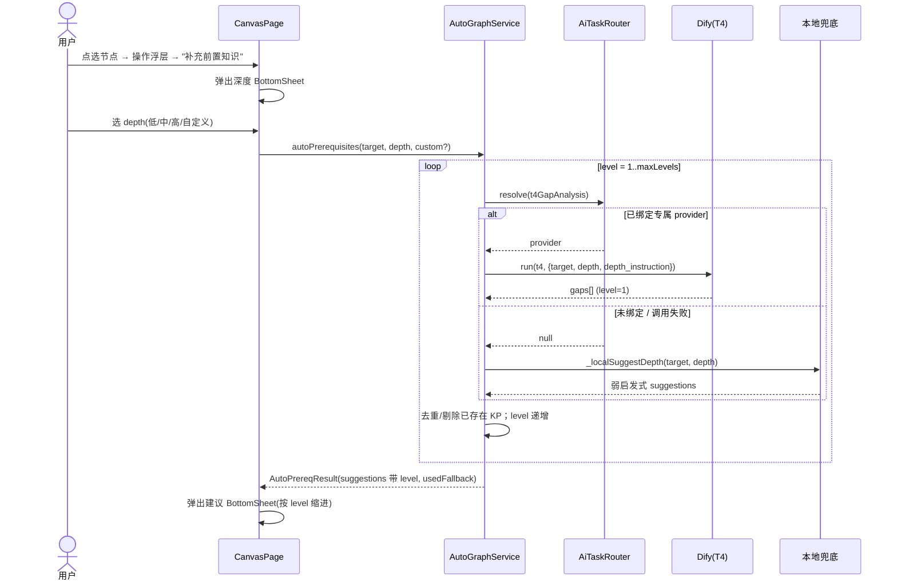
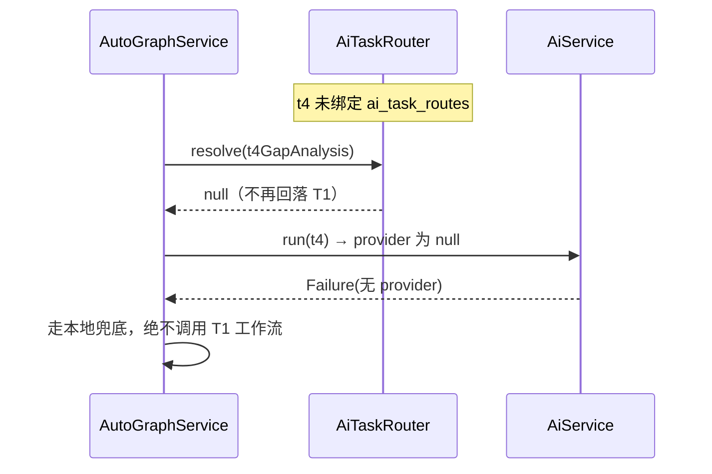

# 增量架构设计：选中知识点的递归前置链补完（T4 深度补充）

> 本文档为**增量设计**，仅描述本次变更与新增文件，不重写整份 `docs/ARCHITECTURE.md`。
> 关联需求：`docs/PRD_T4_DEPTH_SUPPLEMENT.md`
> 技术事实：Flutter 3.47 / Dart / Drift(sqlite) 桌面优先；AI 抽象层 `AiService → AiTaskRouter → AiProvider(DifyClient)`；`AiTask.t3Prerequisite`/`t4GapAnalysis` 均为 structured。

---

## 1. 深度模型 `PrereqDepth` 设计

### 1.1 枚举与层级契约

```dart
/// lib/ai/prereq_depth.dart（新增）
enum PrereqDepth {
  low,    // 低：最近一层直接相关前置（大学/高中入门即可）
  medium, // 中：中等基础（初中/高中）
  high,   // 高：最基础（小学/常识）
  custom; // 自定义：自然语言指令

  /// 递归层数上限（绝对层级，从 1 开始）。
  int get maxLevels => switch (this) {
    PrereqDepth.low => 1,
    PrereqDepth.medium => 2,
    PrereqDepth.high => 3,
    PrereqDepth.custom => 3, // 自定义默认上限，可被 customInstruction 覆盖
  };

  /// 每节点广度上限（单次展开建议数），控制响应体积。
  int get maxBreadth => switch (this) {
    PrereqDepth.low => 3,
    PrereqDepth.medium => 4,
    PrereqDepth.high => 5,
    PrereqDepth.custom => 5,
  };

  /// 学段文案，T4 prompt 与本地兜底共用同一契约。
  String get schoolStage => switch (this) {
    PrereqDepth.low => '大学/高中入门级',
    PrereqDepth.medium => '初中/高中基础',
    PrereqDepth.high => '小学/常识级',
    PrereqDepth.custom => '由自定义指令决定',
  };

  /// 编码进 Dify 输入的标准字符串。
  String get code => name; // 'low'|'medium'|'high'|'custom'
}
```

**契约要点（T4 工作流与本地兜底共用）**
- `depth` 量化为 `1/2/3` 层（绝对层级上限），同时携带 `schoolStage` 文案。
- `level` 字段语义：在建议链中 `level=1` 表示**最接近选中点**的直接前置，`level` 越大越底层基础。
- **自定义档**不量化成固定层数，而是把用户自由文本透传为 `depth_instruction`，由 Dify 与本地解析器分别消费（见 §4、§5）。

### 1.2 自定义指令透传（共用契约）

- **Dify 输入变量**：新增 `depth_instruction`（段落类型，仅 `custom` 档非空），与 `depth` 并列，**不拼进主 prompt**——原因：变量分离便于工作流条件分支、可日志、可单测，且避免污染主 prompt 长度。
- **本地兜底解析**：对自由文本做关键词粗映射（`大学/本科`→偏 medium、`高中/初中`→medium、`小学/常识/基础`→high、`只要一层/直接前置`→`maxLevels=1`），无法识别则回落 `high`。返回弱启发式，标注 `usedFallback`。

---

## 2. `AutoGraphService.autoPrerequisites` 新签名

### 2.1 数据模型变更

给 `SuggestedPrerequisite` 增加 `level` 字段（最小改动，保持 `canvas_page` 现有 `s.name`/`s.reason` 读取不变）：

```dart
/// lib/data/models/suggested_prerequisite.dart（改）
class SuggestedPrerequisite {
  const SuggestedPrerequisite({
    required this.name,
    this.type = '',
    this.definition = '',
    required this.reason,
    this.level = 0, // 新增：在建议链中的层级（1=最接近选中点）
  });
  final String name;
  final String type;
  final String definition;
  final String reason;
  final int level;
  ...
}
```

> 旧 `AutoPrereqResult{ List<SuggestedPrerequisite> suggestions, bool usedFallback }` 结构保留，仅要求每项带 `level`。

### 2.2 新签名与递归策略

```dart
/// lib/ai/auto_graph_service.dart（改）
Future<Result<AutoPrereqResult>> autoPrerequisites(
  KnowledgePoint target,
  PrereqDepth depth, {
  String? customInstruction,
});
```

**递归算法（客户端驱动，Dify 单次只产一层）**
1. `maxLevels = depth.maxLevels`，`frontier = [target]`。
2. `for (level = 1; level <= maxLevels; level++)`：
   - 对 `frontier` 中每个点调用一次 T4：`_run(AiTask.t4GapAnalysis, {target, depth, depth_instruction})`。
   - `_parseGaps` 解析出 `List<SuggestedPrerequisite>`（Dify 返回 `level:1` 相对层，客户端改写为绝对 `level`），按 `maxBreadth` 截断。
   - **去重 / 锚点硬规则**：若 gap 名称命中树中已有 `KnowledgePoint` 或已在链中 → 跳过（不重复、不入库）。
   - `frontier = 本层 gaps`；若 `frontier` 为空或已到 `maxLevels` → 停止。
3. **AI 路径失败处理**：任一层 `_run` 返回非 `Success` 或 `parsed` 为空 → 立即转本地兜底 `_localSuggestDepth(target, depth, customInstruction)`，填 `level=1`（high 档做一层伪递归到 `level=2`），置 `usedFallback=true`。
4. 全程**绝不** `new KnowledgePoint` / 写库。

> 为何 Dify 不内部递归：Dify workflow 是单 pass，无原生递归；把递归放在 `AutoGraphService` 可精确控制层数/广度、可单测、可断点续跑，且天然防无限递归与超长响应（呼应 Open Q4）。

---

## 3. `AiTaskRouter.resolve` 修正（消除 T3/T4 调错 T1）

### 3.1 根因

`ai_task_router.dart` 当前：未命中 `ai_task_routes` → `return fallback`（即 T1 应用）。`AiService.run` 又做 `router.resolve(task) ?? fallback` 双重兜底，导致 T3/T4 静默落到 T1 工作流。

### 3.2 修正方案

**(a) `lib/ai/ai_task_router.dart`** — 引入"专属任务集合"，未命中绑定显式返回 `null`：

```dart
class AiTaskRouter {
  /// 必须绑定专属 provider 的任务（T3/T4）。未绑定不得回落 T1。
  static const Set<AiTask> _dedicated = {
    AiTask.t3Prerequisite,
    AiTask.t4GapAnalysis,
  };

  Future<AiProvider?> resolve(AiTask task) async {
    if (task.isLocalOnly) return null;

    bool routeFound = false;
    try {
      final database = db;
      if (database != null) {
        final row = await database.aiTaskRouteDao.findForTask(task);
        if (row != null) {
          routeFound = true;
          final p = providers[row.providerId];
          if (p != null) return p; // 命中且可用
        }
      }
    } on Object {
      // 路由表查询失败不致命
    }

    // ① 专属任务：未命中 / 命中但 provider 缺失 → 显式 null（禁止回落 T1）
    if (_dedicated.contains(task)) return null;
    // ② 通用任务：回落默认供应商
    return fallback;
  }
}
```

**(b) `lib/ai/ai_service.dart`** — 去掉 `?? fallback`，让 router 的 `null` 真正生效：

```dart
final provider = await router.resolve(task); // 去掉 ?? fallback
if (provider == null) {
  return Failure(StateError('${task.code} 无可用 provider（未绑定专属/未配置），应走本地兜底'));
}
```

**效果**：T4 未绑 `ai_task_routes` 时 `resolve` 返回 `null` → `AiService.run` 返回 `Failure` → `AutoGraphService` 转入本地兜底。**绝不调用 T1 工作流**，彻底消除"调错 T4 工作流"。

> 此修法同时解决 P1-1（T3 同根缺陷），无需额外代码。

---

## 4. `dify_t4_gap_analysis.yaml` 改造方案

### 4.1 输入契约（替换原 `existing_points` 整树语义）

| 变量 | 类型 | 必填 | 说明 |
|------|------|------|------|
| `target` | paragraph | 是 | 选中点 `{name} \| {type.label} \| {definition}` |
| `depth` | text(枚举) | 是 | `low`/`medium`/`high`/`custom` |
| `depth_instruction` | paragraph | 否 | 仅 `custom` 档非空（自然语言） |

### 4.2 输出契约

`gaps`（string JSON），每项：`{name, type, definition, reason, level}`。`level` 在本工作流内恒为 `1`（相对直接前置）；**绝对层级由客户端在递归循环中累加**（见 §2.2）。

### 4.3 关键改动点（YAML 内）

- `start` 节点：变量由 `existing_points` 改为 `target` + `depth` + `depth_instruction`。
- `llm` 节点 system/user prompt：
  - 改为"给定 **单个目标知识点**，列出理解它**直接需要**的前置知识点（level=1）"。
  - 注入 `{{#start.depth#}}` 与 `{{#start.school_stage 文案#}}`：高→偏基础/常识概念，低→偏直接入门前置。
  - 输出 JSON 要求每项带 `level: 1`，`name` 不得超过 20 字，`reason` 说明为何先于目标掌握。
- `end` 节点：`outputs.gaps = {{#llm.text#}}`（与 `dify_client._taskOutputKey[t4]= 'gaps'` 一致，无需改客户端）。

### 4.4 "按 depth 递归展开"的实现位置

**递归不在 Dify 内做**，而在 `AutoGraphService` 客户端循环（§2.2）。Dify 工作流只负责"给定 target+depth，产出直接前置一层"。`depth` 仅用于调节抽象度与广度文案，层数上限由客户端 `maxLevels` 控制。此设计稳健、可测、避免单调用超长。

---

## 5. 本地按深度兜底算法（弱启发式，离线可用）

`_localSuggestDepth(KnowledgePoint target, PrereqDepth depth, String? custom)`：

1. 复用现有 `_tokens`/`_segmentCjk` 对 `target.name + target.definition` 分词，剔除 `stopwords` 与"已是树中知识点"的 token。
2. **depth 决定抽象层级与下钻层数**：

   | depth | 处理 | 层级 |
   |-------|------|------|
   | low | 取词频 Top `min(count,3)`，限 2–4 字具体名词短语 | level=1 |
   | medium | Top `min(count,4)`，放宽到 2 字及以上 | level=1 |
   | high | Top `min(count,5)`；再做**一层伪递归**：对 level-1 候选的 definition 二次分词产出 level=2 | level=1→2 |
   | custom | 解析 `custom` 文本映射 maxLevels/breadth（见 §1.2），其余同 high | 按映射 |

3. 每条构造 `SuggestedPrerequisite(level: L, ...)`，置 `usedFallback=true`，UI 明示"本地启发式，建议以 AI 为准"。
4. **明确这是弱启发式**：本地无模型，无法真正理解语义，仅基于字面共现/词频近似，不准做多跳语义推理。

---

## 6. 画布选中入口 UI 流程

### 6.1 新增状态（CanvasPageState）

- `KnowledgePoint? _selectedPoint`：当前选中节点。
- 节点点按时通过 `TreeCanvas` 上抛的 `(KnowledgePoint, Offset)` 屏幕坐标，用 `showMenu` 在节点旁弹出**操作浮层**（⭐ 标记已掌握 / 🔗 连接前置 / ➕ 补充前置知识）。

### 6.2 三组件调用顺序

```
节点点击 → (1) 操作浮层 ──"补充前置知识"──▶ (2) 深度 BottomSheet
                                                         │ 选 低/中/高/自定义(+输入框)
                                                         ▼
                                            _auto.autoPrerequisites(target, depth, custom)
                                                         │
                                                         ▼
                                                  (3) 建议 BottomSheet（按 level 缩进、标注"仅为建议"）
```

### 6.3 涉及文件与改动

- `lib/features/canvas/canvas_page.dart`
  - 新增 `_selectedPoint` 状态；`onKpTap` 改为内部 `_onKpTap(KnowledgePoint p, Offset at)`，设置选中并 `showMenu` 弹操作浮层。
  - 新增 `_openDepthSheet(p)`（SegmentedControl 四选一 + 自定义 TextField）+ `_runPrereq(p, depth, custom)`。
  - 改造 `_showSuggestions`：升级为 BottomSheet，按 `s.level` 分组缩进，顶部固定"⚠ 仅为建议，需自行新建笔记"，并预留 P2-1「去新建笔记」入口。
  - **保留**工具栏"补前置"按钮，但改为：有选中点→对该点跑深度补前置；无选中点→回落旧整树弱兜底（见 §7 Open Q5）。
- `lib/canvas/render/tree_canvas.dart`
  - `onKpTap` 回调签名改为 `void Function(KnowledgePoint, Offset)`（上抛点击屏幕坐标，供 `showMenu` 定位）。
  - 新增 `String? selectedKpId` 参数，透传给节点卡片做高亮。
- `lib/canvas/render/knowledge_node_card.dart`
  - 新增 `bool isSelected`，选中时加高亮边框（复用现有 `isLinkSource` 边框样式逻辑）。

---

## 7. 有序任务列表（拆给工程师）

> 优先级：P0=Must / P1=Should / P2=Nice。依赖按实现顺序标注。

| ID | 任务 | 优先级 | 改/新文件 | 关键函数 / 验收点 | 依赖 |
|----|------|--------|-----------|-------------------|------|
| **T1** | 路由修正：消除 T3/T4 静默回落 T1 | P0 | `lib/ai/ai_task_router.dart`、`lib/ai/ai_service.dart` | `AiTaskRouter.resolve` 加 `_dedicated` 集合+未命中返 `null`；`AiService.run` 去掉 `?? fallback`。验收：单测 `resolve(t4)` 无路由→`null`；注入 `aiRun=fail` 跑 T4 → `usedFallback=true` 且**未调用 T1 工作流**（断言 provider id≠T1）。 | 无 |
| **T2** | 深度模型 + 数据模型扩展 | P0 | **新增** `lib/ai/prereq_depth.dart`；改 `lib/data/models/suggested_prerequisite.dart` | 新增 `PrereqDepth` 枚举（`maxLevels`/`maxBreadth`/`schoolStage`/`code`）；`SuggestedPrerequisite` 加 `level` 字段（默认 0）。验收：`flutter analyze` 通过；单测 `depth→maxLevels` 映射正确。 | 无 |
| **T3** | `autoPrerequisites` 递归改造 | P0 | `lib/ai/auto_graph_service.dart` | 新签名 `(KnowledgePoint, PrereqDepth, {String? customInstruction})`；客户端递归循环 + `_parseGaps` 读 `level` + 新增 `_localSuggestDepth`。验收：给定 target+depth 返回带 `level` 的链；层数≤`maxLevels`；AI 失败路径走本地；**零 KnowledgePoint 入库**（断言无写库）。 | T1, T2 |
| **T4** | T4 Dify DSL 改造 | P0 | `scripts/dify_t4_gap_analysis.yaml` | `start` 输入改 `target`/`depth`/`depth_instruction`；prompt 改为"单点直接前置一层"+`level:1`；`end.outputs.gaps`。验收：导入 Dify 后手动 smoke，输出 JSON 每项含 `level`；`dify_client` 无需改（`_taskOutputKey[t4]='gaps'` 不变）。 | T2 |
| **T5** | 画布选中入口 + 深度/建议 BottomSheet | P0 | `lib/features/canvas/canvas_page.dart`、`lib/canvas/render/tree_canvas.dart`、`lib/canvas/render/knowledge_node_card.dart` | 选中状态 `_selectedPoint`；`onKpTap(KnowledgePoint, Offset)` 上抛；操作浮层 `showMenu`；深度 BottomSheet（SegmentedControl+自定义框）；建议 BottomSheet 按 `level` 缩进+"仅为建议"提示。保留工具栏按钮（无选中点走旧兜底）。验收：点节点→高亮+浮层→选深度→按层建议；全程无 KP 入库；widget test 覆盖主路径。 | T2, T3 |
| **T6** | 自定义透传 + 本地按深度解析 + 递归广度上限 | P1 | `lib/ai/auto_graph_service.dart` | 新增 `_parseCustomInstruction(text)→(maxLevels,breadth)` 关键词映射；各层截断 `maxBreadth`；`custom` 档默认 `maxLevels=3`，可被指令降到 1。验收：输入"补到大学水平"→偏 medium；"只要一层"→`maxLevels=1`；单测本地兜底按 depth 产出不同层级数。 | T3, T2 |
| **T7** | 测试补全 + 设置页绑定入口（P2-4） | P1/P2 | `test/ai/auto_graph_service_test.dart`、`lib/features/settings/`（P2 可选） | 补 T3/T4 路由单测、`autoPrerequisites` 递归/兜底单测、canvas widget 测试；设置页提供 T3/T4 provider 绑定 UI（替代 DB 直插 `ai_task_routes`）。验收：覆盖 T1–T6 的 `flutter test` 全绿。 | T3, T5 |

---

## 8. 依赖包

**预期无新增第三方依赖**。用到的均为项目已有能力：Flutter `material` 自带 `showMenu`/`BottomSheet`/`SegmentedControl`；Dify 调用沿用 `DifyClient`；本地分词复用 `AutoGraphService` 现有 `_tokens`/`_segmentCjk`。无需引入新 package。

---

## 9. 待明确事项（5 个 Open Question 建议默认值）

| # | Open Question | 建议默认值（架构拍板/需产品确认） |
|---|---------------|-----------------------------------|
| 1 | 学段契约：depth 是否量化为 `1/2/3` 供 T4 与本地共用？ | **已定（架构拍板）**：采用本文标准。`low/medium/high` 映射 `maxLevels=1/2/3`，并携 `schoolStage` 文案；`custom` 默认 3 层、可由指令覆盖。 |
| 2 | 自定义自然语言如何传给 Dify？本地如何解析？ | **已定（架构拍板）**：Dify 新增输入变量 `depth_instruction`（段落，仅 custom 非空），与 `depth` 并列、不拼主 prompt；本地用关键词粗映射（大学→medium、高中/初中→medium、小学/常识/基础→high、一层→`maxLevels=1`），无法识别回落 high。 |
| 3 | 本地兜底如何按低/中/高近似回溯深度？ | **已定（架构拍板）**：基于现有分词 + 学段层级，low/medium 产 1 层、high 产 2 层伪递归；返回弱启发式、标 `usedFallback`、提示"以 AI 为准"。 |
| 4 | 递归上限（层数/每节点广度）如何设？是否由 depth 推导？ | **已定（架构拍板）**：层数由 depth 推导（1/2/3），每节点广度 `low=3/medium=4/high=5`；Dify 单次只做一层、客户端递归，天然防无限递归与超长响应。 |
| 5 | 旧 `autoPrerequisites(treeId)` 整树扫描行为如何处理？ | **建议默认值（需产品确认）**：保留为**私有 `_scanTreeGaps`**，仅当工具栏"补前置"在无选中点时作为弱兜底触发；新单节点+深度入口为唯一主路径。是否完全删除整树入口，请产品拍板（推荐：保留为无选中点兜底）。 |

---

## 10. 调用时序图

### 10.1 主路径：选中 + 深度 → T4 递归 → 建议



### 10.2 路由修正效果：T4 未绑定 → 绝不调 T1



---

## 11. 变更文件清单（增量）

**新增**
- `lib/ai/prereq_depth.dart` — `PrereqDepth` 枚举与层级契约。

**修改**
- `lib/ai/ai_task_router.dart` — 加 `_dedicated` 集合，专属任务未命中返 `null`。
- `lib/ai/ai_service.dart` — `run` 去掉 `?? fallback`。
- `lib/ai/auto_graph_service.dart` — `autoPrerequisites` 新签名 + 客户端递归 + `_localSuggestDepth` + `level` 解析。
- `lib/data/models/suggested_prerequisite.dart` — 加 `level` 字段。
- `scripts/dify_t4_gap_analysis.yaml` — 输入/输出/ prompt 改造（单点+depth）。
- `lib/features/canvas/canvas_page.dart` — 选中状态 + 操作浮层 + 深度/建议 BottomSheet。
- `lib/canvas/render/tree_canvas.dart` — `onKpTap(KnowledgePoint, Offset)` + `selectedKpId` 高亮。
- `lib/canvas/render/knowledge_node_card.dart` — `isSelected` 高亮。

**测试**
- `test/ai/auto_graph_service_test.dart`（递归/兜底/路由）
- `test/features/canvas/canvas_page_test.dart`（widget 主路径）
