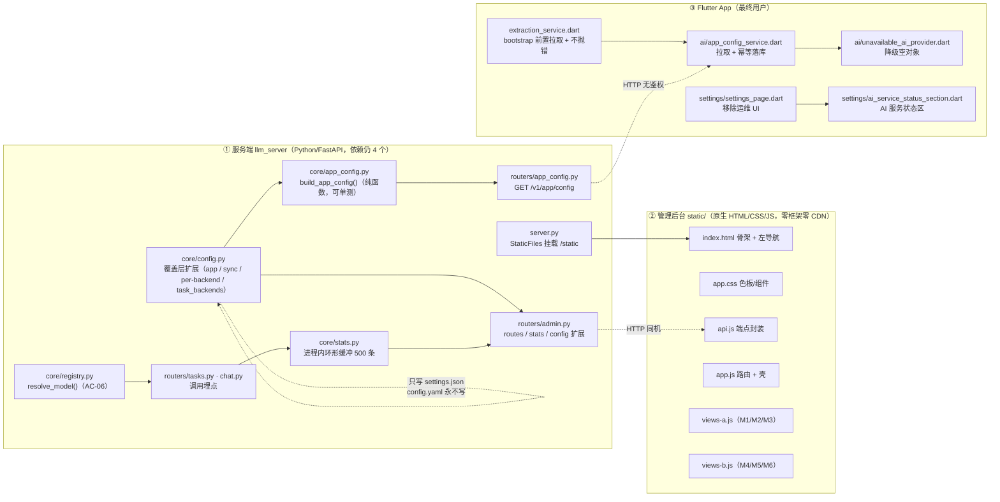
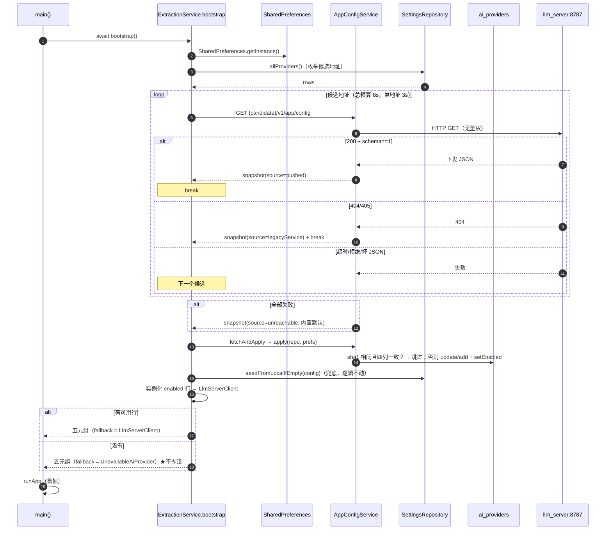
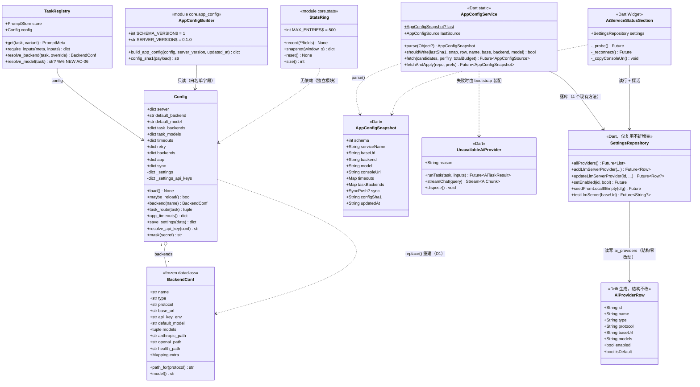
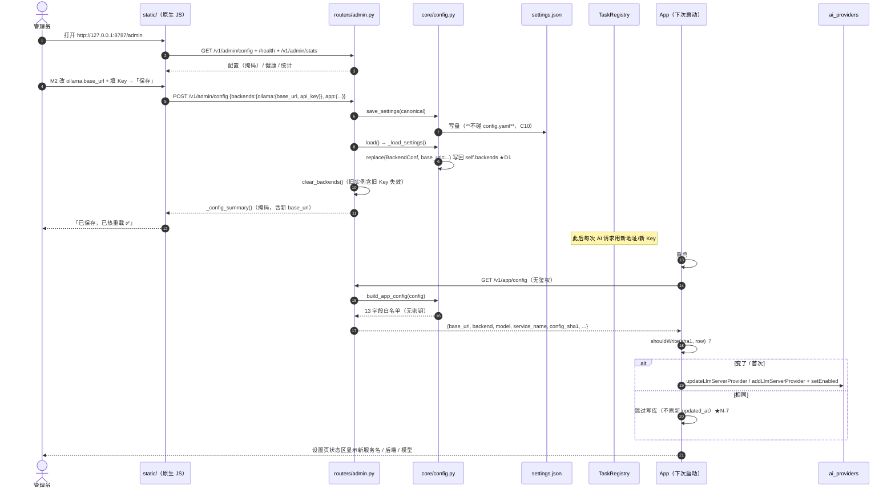
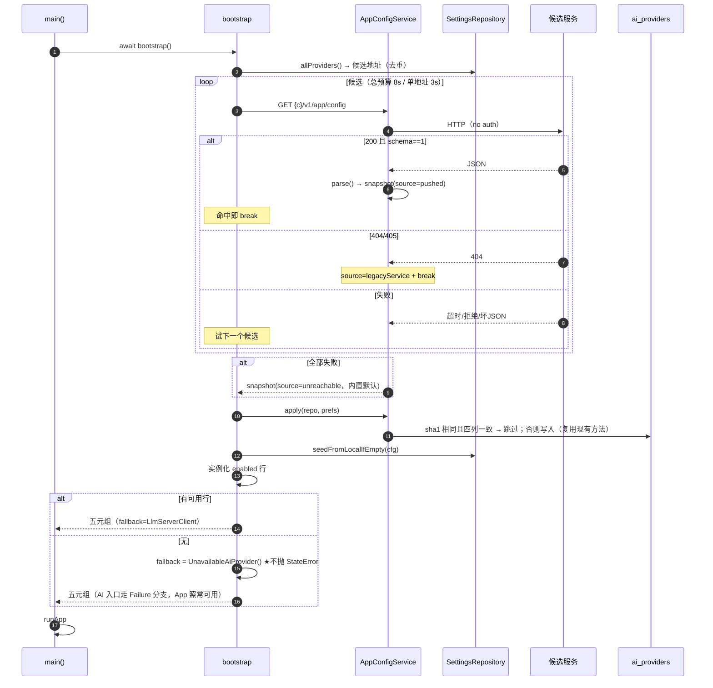
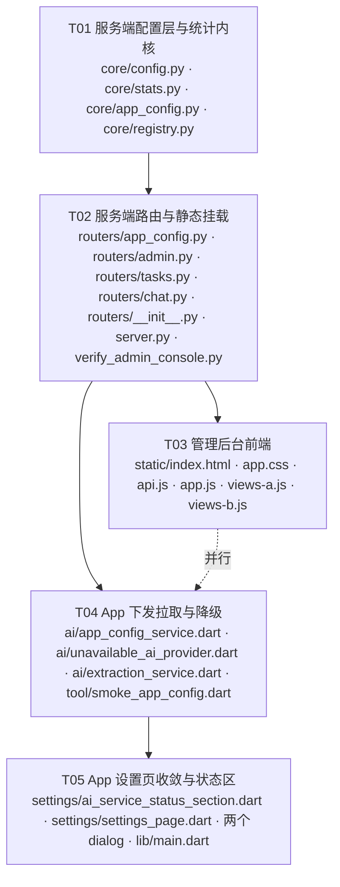

# 增量系统设计：AIMindTree 完整管理后台（App 配置收口 + LLM 运维后台）

| 项 | 内容 |
| --- | --- |
| 文档类型 | **增量设计**（只写「怎么实现」，不重复 PRD 全文） |
| 需求源 | `docs/PRD_ADMIN_CONSOLE.md`（690 行，P0 = AC-01~AC-20） |
| 关联文档 | `docs/DESIGN_LLM_SERVER.md`（§2.3 十二错误码）、`docs/PRD_LLM_SERVER.md`（§C1 契约）、`docs/ARCHITECTURE.md §6` |
| 撰写 | 高见远（架构师） |
| 状态 | 待评审（开放项见 §12，均带推荐默认值，**不留空阻塞**） |

> **阅读顺序**：§1 概述与关键决策 → §2 约束落地核对表 → §3 服务端 → §4 后台前端 → §5 App 侧 → §9 任务分解（**干活看这一节**）→ §11 风险 → §12 待拍板。

---

## 0. 修订记录（2026-10-22 · 工程师 T01–T05 落地后的口径回填）

工程师按本文档实现完三轮（提交 `4b90701` / `07ec726` / `a93d3ce`，门禁全绿）后反馈了 5 处
「文档与可落地实现冲突」。以下为**最终口径**，文档正文已同步改到对应小节。

| # | 争议点 | 裁定 | 代码是否要改 |
| --- | --- | --- | --- |
| R1 | `shouldWrite()` 签名（§5.2） | **采纳工程师实现**：显式补 `name` / `base` / `backend` / `model` 四个参数。理由：保持纯函数、可脱离 DB 单测，且这四个值本来就由 `apply()` 统一算，不该在纯函数里再算一遍 | **否**（文档已改） |
| R2 | `fetch()` 返回类型（§5.2） | **采纳工程师实现**：返回 `AppConfigSource`，快照写 `AppConfigService.last`。理由：快照已有单例出口，「这次怎么来的」是唯一无法从快照反推的信息 | **否**（文档已改） |
| R3 | T04 验收命令不可执行（§9.1） | **采纳工程师实现**：改用 `flutter.bat run -d windows tool/smoke_app_config.dart`（实测 23/23）；`test/app_config_service_test.dart` **确认入仓** | **否**（文档已改，文件清单已补） |
| R4 | `settings_page.dart` 的 `llm_server_client.dart` import（§5.5） | **保留 import**，但**理由更正是「说明文案插值 `$kLlmServerDefaultBaseUrl/admin`」**，并加绑定规则：改文案去掉地址插值时必须同步删 import | **否**（文档已改） |
| R5 | `since_startup` 语义（§3.3） | **采纳工程师实现**：单调计数器（可 > 500）。**同时追加一条新裁定**：`buffer_size` 必须改为 `len(_buf)`，不能恒等于 `MAX_ENTRIES`——否则这个字段和常量没区别，与 R5 指出的「字段没意义」是同一个毛病 | **是（1 行）** |
| R6 | 降级快照 sha1 为空串导致每次启动白写库（工程师自查发现） | **采纳空串方案**（不采用 `'builtin'` 哨兵）；**但必须再加一道「来源守卫」**：`lastSource != pushed && target != null` → 直接 return，一行不改。否则「服务临时挂了」会把真实下发过的行（如局域网地址）改写成 127.0.0.1 且改不回来 | **是（3 行 + 2 条断言）** |

> R5 / R6 是**唯二需要回改代码**的项，合计 4 行 + 2 条断言，见 §3.3 与 §5.2「守卫」小节。

---

## 1. 实现方案概述

**一句话定位**：把 `llm_server` 的临时配置页升级为 9 模块的原生 Web 管理后台，并把 App 设置页里所有**运维级配置**收口到后台；App 通过新增的 `GET /v1/app/config` 启动时拉取一次、幂等落库，从此只显示「AI 服务状态」。

### 1.1 三个改动面的关系



### 1.2 本次拍板的 8 个关键技术决策（工程师直接照做，别再自行发挥）

| # | 决策点 | 拍板结论 | 理由 |
| --- | --- | --- | --- |
| D1 | **config 覆盖层怎么落到 frozen `BackendConf`** | 在 `Config._load_settings()` 里收集 `patch: dict`，用 `dataclasses.replace(conf, **patch)` **重建后写回 `self.backends[name]`**；不新增可变包装类、不改 `BackendConf` 定义 | `BackendConf` 是 frozen dataclass，`replace` 是唯一标准姿势；调用方（`config.backend()`）拿到的一直是新对象，无需改 |
| D2 | **per-task model 覆盖挂哪一层** | **挂在 router 层**：新增 `TaskRegistry.resolve_model(task) -> str \| None`；`resolve_backend()` 签名与返回值**一字不改**。tasks.py / chat.py 里 `model_override = (body['model'] or '').strip() or None` 之后再 `??= registry.resolve_model(meta.task)` | 请求显式 model 优先（AC-06）；`resolve_backend` 只负责后端，不混入模型语义；调用点只有 2 处 |
| D3 | **`/health.task_backends` 会不会变形状** | **不变**。新增 `Config.task_models: dict[str,str]` 与 `Config.task_route(task) -> (backend, model)`；`self.task_backends` 仍是 `{task: backend字符串}`，`/health` 输出逐字不变 | C4 向后兼容硬约束 |
| D4 | **静态资源挂载方式** | `app.mount('/static', StaticFiles(directory=STATIC_DIR), name='static')`；`GET /admin` 与 `GET /` 仍返回 `FileResponse(STATIC_DIR/'index.html')`；删除 `static/admin.html` | 入口 URL 一个不变；`/static/*` 用于 css/js；git 历史可回退被删文件 |
| D5 | **bootstrap 降级态实现路径** | **Null Object**：新增 `UnavailableAiProvider implements AiProvider`（`runTask` 抛 `StateError('AI 服务未连接…')`、`streamChat` 发 `Stream.error`）。`bootstrap` 里 `fallback = pickFallback() ?? UnavailableAiProvider()`，**不抛 `StateError`、不把 fallback 改成可空** | `AiTaskRouter.resolve` 一字不改（C11）；`AiService.run` 已有 `try/on Object` 会把异常转成 `Failure`，上层 UI 零改动；避免 `AiProvider?` 可空化带来的全链路判空 |
| D6 | **下发配置怎么传给设置页** | **进程内静态单例** `AppConfigService.last`（`AppConfigSnapshot?`）+ `AppConfigService.lastSource`。**不改 `bootstrap` 返回的 5 元组、不改 `main.dart` 的解构** | 改元组形状会连带改 `main.dart` 与 4 处解构，收益为零 |
| D7 | **「打开管理后台」要不要 `url_launcher`** | **不加依赖**。按钮 = 复制 `console_url` 到剪贴板（`Clipboard.setData`，flutter 自带）+ SnackBar「已复制，请在浏览器打开」 | 加依赖要跑 `flutter pub get`，沙箱可能失败；`shared_preferences` 已够用 |
| D8 | **sha1 计算范围** | 对**下发字段全集**（`schema`…`sync`，**不含 `updated_at`、不含 `config_sha1` 自身**）做 `json.dumps(sort_keys=True, ensure_ascii=False, separators=(',',':'))` 后 `hashlib.sha1` | 幂等判据必须与「展示用的时间戳」解耦，否则每次启动都写库（违反 N-7） |

---

## 2. 约束落地核对表（违反即不合格）

| 编号 | 约束 | 本设计的落地方式 | 自检命令 |
| --- | --- | --- | --- |
| C1 | 不动 Drift 表结构 | App 侧只用 `addLlmServerProvider` / `updateLlmServerProvider` / `setEnabled` / `allProviders`；列解析只用 `backendOf` / `firstModel` / `encodeLlmServerModels`（后两个被 repository 内部调用，我们不重复实现） | `git diff --stat aimindtree_app/lib/data/db/tables.dart`（必须为空） |
| C2 | 不新增 pip 依赖；前端零框架零 CDN | 新增的 `core/stats.py` 只用 `collections.deque` + `threading` + `time` + `hashlib`（标准库）；`static/` 只有 6 个本地文件 | `wc -l llm_server/requirements.txt`（4 行）；`grep -rn "http://cdn\|https://unpkg\|<script src=\"http" llm_server/static/`（0 命中） |
| C3 | 密钥零扩散 | `/v1/app/config` 由 `core/app_config.py` 的**白名单字段表**构造（只取 12 个键），**不存在「把 config 整体 dump」的路径**；`sync` 只回 `token_set` 布尔 | 见 §9 T02 验收（断言响应体不含 `.env` 里任一 key 片段） |
| C4 | 既有端点契约向后兼容 | 只在 `GET /v1/admin/config` 上**新增** `base_url`/`editable`/`for_app`/`app`/`sync` 五个字段；`/health`、`/v1/task/*`、`/v1/chat`、`/v1/prompts/*` 响应字段一个不动 | `git diff llm_server/routers/tasks.py llm_server/routers/chat.py`（只允许新增 `stats.record` 调用与 `registry.resolve_model` 一行） |
| C5 | Dart 唯一门禁 | 每个 App 任务都把「跑门禁」写进验收；§5.5 给出**逐符号**的移除/注释清单与必须同步处理的 import | `cd aimindtree_app && D:/DevTools/flutter/bin/cache/dart-sdk/bin/dart.exe tool/analyze_inproc.dart` |
| C6 | 六层 JSON 容错两端等价 | 本次**不碰** `core/json_repair.py` 与 `lib/ai/structured_parse.dart` | `python llm_server/selftest.py`（6+1 样本全绿） |
| C7 | 沙箱验收 | 服务端一律 `fastapi.testclient.TestClient`（进程内）；App 侧只用门禁 + 纯 Dart 脚本（不连网） | 见 §9 各任务验收命令；**禁止**写「起 uvicorn + curl」 |
| C8 | 落库复用现有 helper | `AppConfigService.apply()` 只调 repository 现有 4 个方法；写库前对下发的 backend 走 `backendOf()`（白名单容错）后再传 | 代码评审：`grep -rn "aiProviders" aimindtree_app/lib/ai/app_config_service.dart` 应 0 命中 |
| C9 | 写入优先级 settings.json > config.yaml > 默认值 | `Config.save_settings()` 只写 `settings.json`；`config.yaml` 全程只读 | `git diff --stat llm_server/config.yaml`（必须为空） |
| C10 | `/v1/app/config` 不鉴权 | 路由注册在 `routers/app_config.py`，不带任何依赖/中间件；将来 AC-27 的 admin token 只挂 `/v1/admin/*` 与 `/admin` | 见 §9 T02 验收断言 `c.get('/v1/app/config').status_code == 200`（无 header） |
| C11 | `ai_task_routes` / `AiTaskRouter.resolve` 不动 | 服务端 `task_backends` 在服务端生效；App 侧 `bootstrap` 仍读 `ai_task_routes` 算 `dedicatedIds`（保留现状），不新增写路由的代码 | `git diff aimindtree_app/lib/ai/ai_task_router.dart`（必须为空） |

---

## 3. 服务端设计（`llm_server/`）

### 3.1 文件清单

| 相对路径 | 动作 | 职责（一句话） |
| --- | --- | --- |
| `llm_server/core/config.py` | **改** | 扩展 settings 覆盖层：`app` / `sync` / per-backend 四字段 / `task_backends` 对象形态；新增 `task_route()`、`app_timeouts()` |
| `llm_server/core/stats.py` | **新增** | 进程内调用环形缓冲（deque 500 + Lock）与 `snapshot()` 聚合 |
| `llm_server/core/app_config.py` | **新增** | 纯函数 `build_app_config(config) -> dict` + sha1；`/v1/app/config` 的唯一构造出口（密钥白名单在此封死） |
| `llm_server/core/registry.py` | **改** | 新增 `resolve_model(task)`（AC-06）；`resolve_backend` 不动 |
| `llm_server/routers/app_config.py` | **新增** | `GET /v1/app/config`（无鉴权、无密钥、no-store） |
| `llm_server/routers/admin.py` | **改** | 新增 `GET/PUT /v1/admin/routes`、`GET /v1/admin/stats`；`_config_summary` 加 `base_url/editable/for_app/app/sync`；`POST /v1/admin/config` 支持新 body |
| `llm_server/routers/tasks.py` | **改** | 调用埋点（成功/LlmError 都记）+ per-task model 覆盖生效 |
| `llm_server/routers/chat.py` | **改** | 调用埋点（blocking 与 SSE 终态/中断各记一条）+ per-task model 覆盖 |
| `llm_server/routers/__init__.py` | **改** | `build_router()` 里 `include_router(app_config.router)` |
| `llm_server/server.py` | **改** | 挂载 `/static`；`/admin`、`/` 改指 `index.html` |
| `llm_server/static/admin.html` | **删除** | 内容迁至 `index.html` + `app.css` + 4 个 js |
| `llm_server/verify_admin_console.py` | **新增** | P0 验收脚本：`TestClient` 断言 + 无密钥泄露断言（不进 requirements，纯标准库） |

> `backends/*`、`core/json_repair.py`、`core/errors.py`、`core/prompt_store.py`、`core/logging.py`、`config.yaml`、`requirements.txt` —— **一律不动**。

### 3.2 `core/config.py` 具体改法

#### 3.2.1 `DEFAULTS` 新增两段（代码默认值，不进 Git 基线文件）

```python
'app': {'service_name': 'AIMindTree AI 服务', 'console_url': '', 'timeouts': {}},
'sync': {'base_url': '', 'enabled': False, 'token': ''},
```

#### 3.2.2 `__init__` 新增字段

```python
self.app: dict[str, Any] = dict(DEFAULTS['app'])
self.sync: dict[str, Any] = dict(DEFAULTS['sync'])
self.task_models: dict[str, str] = {}   # 新增：per-task model 覆盖（'' = 跟随全局）
```

#### 3.2.3 `load()` 里 task_backends 归一化（不破坏 `/health`）

```python
raw_tb = merged.get('task_backends') or {}
self.task_backends, self.task_models = _split_task_backends(raw_tb)
```

新增模块级函数（放在 `_deep_merge` 旁边）：

```python
def _split_task_backends(raw: Mapping[str, Any]) -> tuple[dict[str, str], dict[str, str]]:
    """把 task_backends 拆成 (backend 映射, model 映射)。

    兼容三种形态（config.yaml 里的字符串形态**继续支持**）：
        'T1': 'minimax'                  → backend=minimax, model=''
        'T1': {'backend': 'minimax', 'model': 'MiniMax-M2.5'}  → 分别取
        'T1': None                      → 两者都 ''（= 跟随全局）
    `self.task_backends` 保持 {task: str} 形态 → /health 输出逐字不变（C4）。
    """
    backends: dict[str, str] = {}
    models: dict[str, str] = {}
    for key, value in (raw or {}).items():
        task = str(key).upper()
        if value is None:
            backends[task] = ''; models[task] = ''; continue
        if isinstance(value, Mapping):
            backends[task] = str(value.get('backend') or '').strip()
            models[task] = str(value.get('model') or '').strip()
        else:
            backends[task] = str(value).strip()
            models[task] = ''
    return backends, models
```

新增查询方法：

```python
def task_route(self, task: str) -> tuple[str | None, str | None]:
    """返回 (backend, model)；None = 跟随全局。"""
    t = str(task or '').upper()
    b = (self.task_backends.get(t) or '').strip() or None
    m = (self.task_models.get(t) or '').strip() or None
    return b, m

def app_timeouts(self) -> dict[str, int]:
    """/v1/app/config 下发的超时：settings.app.timeouts 覆盖 config.timeouts。"""
    merged = _deep_merge(self.timeouts, self.app.get('timeouts') or {})
    out = {}
    for k in ('structured_s', 'chat_s', 'connect_s'):
        try: out[k] = int(float(merged.get(k, DEFAULTS['timeouts'][k])))
        except (TypeError, ValueError): out[k] = int(DEFAULTS['timeouts'][k])
    return out
```

#### 3.2.4 `_load_settings()` 扩展（顺序很重要）

```python
def _load_settings(self) -> None:
    # ...（读 settings.json → raw，逻辑不变）
    self._settings = raw
    self._settings_api_keys = {}
    self.app = _deep_merge(DEFAULTS['app'], raw.get('app') or {})      # NEW
    self.sync = _deep_merge(DEFAULTS['sync'], raw.get('sync') or {})   # NEW

    # ① 默认后端覆盖（必须在 ②③ 之前，保证落到正确后端）
    db = raw.get('default_backend')
    if isinstance(db, str) and db in self.backends:
        self.default_backend = db

    # ② NEW：per-backend 形态覆盖（base_url / protocol / default_model / models）
    bk = raw.get('backends')
    if isinstance(bk, dict):
        for name, sub in bk.items():
            if not isinstance(sub, dict): continue
            if isinstance(sub.get('api_key'), str) and sub['api_key']:
                self._settings_api_keys[str(name)] = sub['api_key']
            patch: dict[str, Any] = {}
            if isinstance(sub.get('base_url'), str) and sub['base_url'].strip():
                patch['base_url'] = sub['base_url'].strip()
            if isinstance(sub.get('protocol'), str) and sub['protocol'] in ('openai_compat', 'anthropic_compat'):
                patch['protocol'] = sub['protocol']
            if isinstance(sub.get('default_model'), str) and sub['default_model'].strip():
                patch['default_model'] = sub['default_model'].strip()
            if isinstance(sub.get('models'), list):
                patch['models'] = tuple(str(m).strip() for m in sub['models'] if str(m).strip())
            if patch and str(name) in self.backends:
                # ★ 关键：frozen dataclass 用 replace 重建后写回 dict（D1）
                self.backends[str(name)] = replace(self.backends[str(name)], **patch)

    # ②b 旧字段 minimax_protocol 继续支持（向后兼容，不改）
    mp = raw.get('minimax_protocol')
    if isinstance(mp, str) and mp in ('openai_compat', 'anthropic_compat') and 'minimax' in self.backends:
        self._apply_backend_protocol(self.backends, 'minimax', mp)

    # ②c 重算顶层默认模型（②可能改了 default_backend 的 default_model）
    if self.default_backend in self.backends:
        self.default_model = self.backends[self.default_backend].model()
    else:
        self.default_model = ''

    # ③ 顶层 default_model 覆盖（**顶层优先**于 per-backend）
    dm = raw.get('default_model')
    if isinstance(dm, str) and dm:
        self._apply_default_model(dm)

    # ④ NEW：task_backends 覆盖（对象形态，来自 settings.json）
    tb = raw.get('task_backends')
    if isinstance(tb, dict):
        nb, nm = _split_task_backends(tb)
        self.task_backends.update(nb)
        self.task_models.update(nm)

    # ...（mtime 记录不变）
```

> **注意**：`self.app` / `self.sync` 的 merge 必须放在最前面，且 `_load_settings()` 在 `load()` 里是被**最后**调用的（现有代码已是如此），所以 `self.backends` 已按 config.yaml 建好，覆盖能正确落到对象上。

#### 3.2.5 `save_settings()` 扩展

```python
def save_settings(self, data: dict[str, Any] | None = None) -> dict[str, Any]:
```

在现有的 `default_backend` / `default_model` / `minimax_protocol` 之后追加：

| body 键 | 取值语义（**写死**） | 落到 `settings.json` |
| --- | --- | --- |
| `backends[name].api_key` | 非空字符串 = 覆盖；**空串 = 不改**；`null` = 删除覆盖 | `backends[name].api_key` |
| `backends[name].base_url` | 非空字符串 = 覆盖；`null` 或 `''` = 删除覆盖（回落 config.yaml） | `backends[name].base_url` |
| `backends[name].protocol` | 仅接受 `openai_compat` / `anthropic_compat`；`null` = 删除 | 同上 |
| `backends[name].default_model` | 非空字符串 = 覆盖；`null`/`''` = 删除 | 同上 |
| `backends[name].models` | 字符串数组 = 覆盖（空数组 `[]` = 覆盖为空）；`null` = 删除 | 同上 |
| `app` | `{service_name?, console_url?, timeouts?{structured_s,chat_s,connect_s}}`，**深合并** | `app` |
| `sync` | `{base_url?, enabled?, token?}`；`token` 落盘但**永不回显** | `sync` |
| `task_backends` | `{T1: 'minimax' \| {backend, model} \| null}`；**由 router 校验后再传进来**，本函数只落盘 | `task_backends` |

实现要点（避免写出 bug）：

```python
_BACKEND_KEYS = ('base_url', 'protocol', 'default_model', 'models', 'api_key')

if isinstance(data.get('backends'), dict):
    merged_backends = dict(out.get('backends') or {})
    for name, sub in data['backends'].items():
        if not isinstance(sub, dict): continue
        cur = dict(merged_backends.get(str(name)) or {})
        for k in _BACKEND_KEYS:
            if k not in sub:            # 键不存在 = 不改
                continue
            v = sub[k]
            if v is None:               # null = 删除覆盖
                cur.pop(k, None); continue
            if k == 'api_key' and not str(v).strip():
                continue                # 空串 = 不改（表单友好）
            if k == 'base_url' and not str(v).strip():
                cur.pop(k, None); continue
            if k == 'protocol' and v not in ('openai_compat', 'anthropic_compat'):
                continue
            if k == 'models' and not isinstance(v, list):
                continue
            cur[k] = v
        merged_backends[str(name)] = cur
    out['backends'] = merged_backends

if isinstance(data.get('app'), dict):
    out['app'] = _deep_merge(out.get('app') or {}, data['app'])
if isinstance(data.get('sync'), dict):
    out['sync'] = _deep_merge(out.get('sync') or {}, data['sync'])
if isinstance(data.get('task_backends'), dict):
    out['task_backends'] = data['task_backends']
```

`_log.info(...)` 追加一行「已写入 settings.json（…, app=%s, sync_token_set=%s）」——**只打布尔，不打值**。

### 3.3 `core/stats.py`（新增 · AC-07）

```python
"""进程内调用统计（环形缓冲，不落盘、不引入存储依赖，§C2）。

并发安全：``deque.append`` 单操作线程安全，但 ``snapshot()`` 要遍历，
因此统一用一把 ``threading.Lock`` 保护「写」与「快照」。
"""

from __future__ import annotations
import threading, time
from collections import deque
from typing import Any

MAX_ENTRIES = 500

_lock = threading.Lock()
_buf: deque[dict[str, Any]] = deque(maxlen=MAX_ENTRIES)
_STARTED = time.time()

def record(**fields: Any) -> None: ...        # 内部补 ts=time.time()，永不抛异常
def record_entry(entry: dict[str, Any]) -> None: ...
def snapshot(window_s: float = 3600.0) -> dict[str, Any]: ...
def reset() -> None: ...                      # 仅供测试
def size() -> int: ...
def uptime_s() -> float: ...
```

**单条记录字段**（与 PRD §6.3 逐字一致）：

```json
{"ts": 1757059200.123, "kind": "task|chat", "task": "T1", "variant": null,
 "backend": "ollama", "model": "qwen3:8b-8k", "latency_ms": 4137,
 "ok": true, "error_code": null, "attempts": 1,
 "input_chars": 812, "output_chars": 431}
```

- `record()` 必须 `try/except Exception: pass`（统计绝不能把业务请求搞挂）。
- `kind` 只允许 `task` / `chat`；`error_code` 必须是 12 个归一化码之一或 `None`（**不得**出现上游原文）。
- `input_chars` = `len(json.dumps(values, ensure_ascii=False))`；`output_chars` = `len(content)`。

`snapshot(window_s)` 返回（PRD §6.3）：

```json
{"window_s":3600,"total":128,"ok":120,"error":8,"avg_latency_ms":3120,"p95_latency_ms":8100,
 "by_task":[{"task":"T1","count":40,"ok":38,"error":2,"avg_latency_ms":4100}],
 "by_backend":[{"backend":"ollama","count":128,"error":8}],
 "last_error":{"ts":1757059200,"task":"T1","code":"bad_json","message":"..."},
 "slowest":[{"ts":...,"task":"T3","latency_ms":9100}],
 "buffer_size":500,"since_startup":412}
```

- 刚启动无记录时：`total=0`，`by_task` / `by_backend` / `slowest` 返回 **`[]`**，`last_error` 返回 **`None`**，**不得返回 `null` 数组**（AC-08）。
- `p95_latency_ms`：把窗口内 `latency_ms` 升序，`idx = int(0.95 * (n-1))`；`n==0` → `0`。
三个「条数」字段**语义互不相同**（工程师 2026-10-22 落地时确认，勿再合并）：

- `total` = **窗口内**条数（受 `window_s` 限制）；
- `buffer_size` = **环形缓冲当前占用** = `len(_buf)` = `min(since_startup, 500)`（**不是常量 500**；`MAX_ENTRIES` 只是上限，另有常量文档，不再单开字段）；
- `since_startup` = **进程启动以来累计**条数的**单调计数器**（`_SEQ`，与 `record()` 同步自增、`reset()` 清零），**可以 > 500**；
  灌 600 条后应为：`total=500`、`buffer_size=500`、`since_startup=600`。

### 3.4 `core/app_config.py`（新增 · AC-01）

```python
"""App 运行配置下发（§C3 密钥边界的唯一出口）。

**纯函数**：只吃 ``Config``，不碰 Request / Response，可脱离 FastAPI 单测。
构造方式是「白名单逐字段抄」，**绝不** dump 整个 config，
因此在结构上不可能把 ``api_key`` / Supabase token 带出去。
"""

SCHEMA_VERSION = 1
APP_CONFIG_FIELDS = ('schema','server_version','service_name','protocol','base_url',
                     'backend','model','console_url','timeouts','task_backends',
                     'sync','config_sha1','updated_at')

def build_app_config(config, *, server_version: str = '0.1.0',
                     updated_at: str | None = None, now=None) -> dict: ...
def config_sha1(payload: Mapping[str, Any]) -> str: ...   # 排除 config_sha1 与 updated_at
def _derive_base_url(server: Mapping[str, Any]) -> str: ...
```

| 字段 | 取值规则 |
| --- | --- |
| `schema` | 常量 `1` |
| `server_version` | 由 router 传入（`server.VERSION`） |
| `service_name` | `config.app['service_name']`，空则 `'AIMindTree AI 服务'` |
| `protocol` | 常量 `'llm_server'`（与 `kLlmServerProtocol` 一致） |
| `base_url` | `host ∈ {127.0.0.1, localhost, 0.0.0.0, ::1}` → `http://127.0.0.1:<port>`；否则 `http://<host>:<port>` |
| `backend` | `config.default_backend`（空则 `'auto'`）。**服务端不做白名单收敛**，App 侧用现有 `backendOf()` 兜底（C8，避免两处白名单漂移） |
| `model` | `config.default_model`（空串 = 用后端默认模型） |
| `console_url` | `config.app['console_url']`，空则 `f'{base_url}/admin'` |
| `timeouts` | `config.app_timeouts()` → `{structured_s, chat_s, connect_s}`（int） |
| `task_backends` | `{T1: {'backend':..,'model':..} \| None}`，`None` = 跟随全局。**仅供展示/诊断，App 不做本地路由（C11）** |
| `sync` | **始终返回对象**（见 §3.9 偏差 ③）：`{'base_url': str, 'enabled': bool, 'token_set': bool}`；`token_set = bool(config.sync['token'])`，**token 明文永不出现** |
| `config_sha1` | 对除 `config_sha1` / `updated_at` 外的字段做 sha1（D8） |
| `updated_at` | `settings.json` 的 mtime（ISO8601 本地时区，`datetime.fromtimestamp(m).astimezone().isoformat(timespec='seconds')`）；文件不存在 → 进程启动时刻 |

`task_backends` 归一化器：

```python
def _task_backends_payload(config) -> dict[str, Any]:
    out = {}
    for task in sorted(set(config.task_backends) | set(config.task_models)):
        b, m = config.task_route(task)
        out[task] = None if (not b and not m) else {'backend': b, 'model': m}
    return out
```

### 3.5 `core/registry.py`（改 · AC-06）

只加一个方法，**不动 `resolve_backend`**：

```python
def resolve_model(self, task: str) -> str | None:
    """per-task 模型覆盖；``None`` = 跟随全局（后端默认模型）。

    只在**请求未显式带 model** 时被调用（router 层，D2），因此不会覆盖
    调用方显式指定的模型（AC-06）。
    """
    _, model = self.config.task_route(str(task or '').upper())
    return model
```

`tasks.py` / `chat.py` 的接入点（各 1 行）：

```python
# tasks.py（约 62 行）
model_override = (body.get('model') or '').strip() or None
if model_override is None:
    model_override = registry.resolve_model(meta.task)
```

```python
# chat.py（约 103 行）
model_override = (body.get('model') or '').strip() or None
if model_override is None and task_code:
    model_override = state.registry.resolve_model(task_code)
```

> `resolve_backend(meta.task, body.get('backend'))` 保持原样（含 `task_backends` 的字符串形态解析），**不改**。

### 3.6 新增 / 扩展端点

#### 3.6.1 `GET /v1/app/config`（新增 · AC-01/02 · 无鉴权）

```
GET /v1/app/config
→ 200 application/json
  Cache-Control: no-store
```

响应体 = `build_app_config(config, server_version=VERSION)`（见 §3.4）。
路由实现（`routers/app_config.py`）：

```python
@router.get('/v1/app/config')
async def app_config(request: Request) -> JSONResponse:
    state = request.app.state
    state.config.maybe_reload()               # 与 /health 一致：改了 settings.json 立即生效
    payload = build_app_config(state.config, server_version=VERSION)
    return JSONResponse(payload, headers={'Cache-Control': 'no-store'})
```

`VERSION` 从 `server.py` 导入会造成循环 import（`server` → `routers` → `app_config` → `server`）。
**解决**：`core/app_config.py` 里定义 `SERVER_VERSION = '0.1.0'`，`server.py` 改为 `VERSION = SERVER_VERSION`（`health.py` 的 `VERSION` 也改为从 `core.app_config` 导入，保持三处同源）。

#### 3.6.2 `GET/POST /v1/admin/config`（扩展 · AC-02/03/04）

**GET 响应新增字段**（既有 4 个字段一字不改）：

| 新增字段 | 位置 | 说明 |
| --- | --- | --- |
| `backends[].base_url` | 每项 | 当前生效地址（可能被 settings 覆盖） |
| `backends[].editable` | 每项 | 恒 `true`（前端不用硬编码） |
| `backends[].for_app` | 每项 | `name == config.default_backend` |
| `app` | 顶层 | `{service_name, console_url, timeouts}`（**不含任何密钥**） |
| `sync` | 顶层 | `{base_url, enabled, token_set}`（**无 token 明文**） |

**POST body 新增**：`backends`（见 §3.2.5）、`app`、`sync`、`task_backends`（也可由 routes 端点单独写）。
POST 行为不变：落盘 → `config.load()` → `clear_backends()` → 返回 `_config_summary(request)`。

新增校验（失败一律 `raise invalid_request(...)`，错误码 `invalid_request` / 400）：

- `app.service_name` / `app.console_url`：必须是字符串，`console_url` 非空时须以 `http://` 或 `https://` 开头；
- `app.timeouts`：必须是 dict，三个键必须是 > 0 的数值；
- `sync.enabled`：必须是 bool；`sync.base_url` 必须是字符串；
- `backends`：key 必须是**已存在**的后端名（否则提示可用列表）；非法值按 §3.2.5 表忽略/删除。

#### 3.6.3 `GET/PUT /v1/admin/routes`（新增 · AC-05）

**GET 响应**（PRD §6.4）：

```json
{"default_backend":"ollama","default_model":"qwen3:8b-8k",
 "task_backends":{"T1":{"backend":"ollama","model":null}},
 "tasks":[{"task":"T1","variant":null,"backend":null,"model":null,
           "structured":true,"preferred_backend":"ollama","inputs":["note_text"]}]}
```

- `tasks[]` 由 `state.registry.store.list()` 派生（14 条，含 `T5/detect`），排序 `(task, variant)`；
- 每行 `backend` / `model` 取 `config.task_route(task)`，`None` = 跟随全局；
- `variant` 为 `null` 的任务前端显示为 `T1`，非 null 显示为 `T5 · detect`。

**PUT body**：

```json
{"task_backends": {"T1": {"backend":"minimax","model":"MiniMax-M2.5"}, "T3": "ollama", "T4": null}}
```

校验（**逐条**）：

- `backend` 必须是 `config.backends` 里的名字或 `null`（缺失/未知 → `400 invalid_request`，message 列出可用后端）；
- `model` 必须是字符串或 `null`（任意字符串都接受，不做存在性校验——模型列表可能随时变）；
- `task` 键统一 `.upper()`。

行为：`config.save_settings({'task_backends': normalized})` → `config.load()` → `state.clear_backends()` → 返回 GET 同构响应。

#### 3.6.4 `GET /v1/admin/stats`（新增 · AC-08）

```
GET /v1/admin/stats?window_s=3600
→ 200  {"window_s":3600, "total":…, …}   # 结构见 §3.3
```

`window_s` 非正数或非法 → 回落 3600。

### 3.7 调用埋点接入（AC-07）

**`routers/tasks.py`**：把现有 `run_task` 重命名为 `_run_task_impl`（函数体一行不改），新增薄壳：

```python
@router.post('/v1/task/{task_code}')
async def run_task(task_code: str, request: Request) -> JSONResponse:
    started0 = time.time()
    state = request.app.state
    try:
        resp = await _run_task_impl(task_code, request)
        return resp
    except LlmError as exc:
        stats.record(kind='task', task=task_code.upper(), ok=False,
                     error_code=exc.code, backend=getattr(exc, 'backend', None),
                     latency_ms=int((time.time()-started0)*1000))
        raise
    except Exception as exc:
        stats.record(kind='task', task=task_code.upper(), ok=False,
                     error_code='internal', latency_ms=int((time.time()-started0)*1000))
        raise
```

成功那条在 `_run_task_impl` 的 `return JSONResponse(...)` 之前插入（拿得到 `backend_conf.name` / `model_id` / `attempts` / `latency_ms` / `parsed` / `content`）：

```python
stats.record(kind='task', task=meta.task, variant=meta.variant,
             backend=backend_conf.name, model=model_id or '',
             latency_ms=latency_ms, ok=True, error_code=None, attempts=attempts,
             input_chars=len(json.dumps(values, ensure_ascii=False)), output_chars=len(content))
```

> 注意 `bad_json` 走的是 `raise`，会被薄壳的 `except LlmError` 捕获并记一条 `ok=False, error_code='bad_json'` —— 符合 AC-07「成功与 LlmError 都记录」。
> `json` 需 `import json`（文件顶部新增一行）。

**`routers/chat.py`**：在 `_blocking()` 的 `return JSONResponse(...)` 之前记一条 `kind='chat'`；在 `_sse()` 里 `yield _line({done:True, ...})` 之后记一条（已有 `latency_ms`），`except` 分支里记 `ok=False, error_code=<payload['code']>`。
`chat()` 本体不改（SSE 是生成器，包装无意义）。

### 3.8 `server.py` 静态资源挂载（AC-09）

```python
from fastapi.staticfiles import StaticFiles

STATIC_DIR = ROOT / 'static'
INDEX_HTML = STATIC_DIR / 'index.html'

# include_router 之后：
app.mount('/static', StaticFiles(directory=str(STATIC_DIR)), name='static')

@app.get('/admin', include_in_schema=False)
async def admin_page() -> FileResponse:
    return FileResponse(str(INDEX_HTML), headers={'Cache-Control': 'no-store'})

@app.get('/', include_in_schema=False)
async def index_page() -> FileResponse:
    return FileResponse(str(INDEX_HTML), headers={'Cache-Control': 'no-store'})
```

- `fastapi.staticfiles` 属于 fastapi 自带，不新增依赖（C2 ✔）。
- `admin.html` **删除**（git 可回退）。若保守，可改名为 `static/_legacy_admin.html.bak` 但**禁止被引用**。

### 3.9 与 PRD §6 的偏差（**逐条说明理由**，请主理人过目）

| # | PRD 写法 | 本设计 | 理由 |
| --- | --- | --- | --- |
| ① | §6.1 `backend`：「空/非法时 App 写 `auto`」 | 服务端**原样下发** `config.default_backend`，收敛在 App 侧 `backendOf()` 做 | C8 禁止两处白名单；`backendOf()` 是唯一实现，服务端再加一份必然漂移 |
| ② | §6.1 `updated_at`：「ISO8601 最后保存时间」 | 取 `settings.json` 的 mtime；文件不存在取进程启动时刻 | 「最后保存时间」的真实语义；且 sha1 已排除它，不影响幂等 |
| ③ | §6.1 `sync` 类型 `object \| null` | **恒为 object**（未配置时 `{'base_url':'','enabled':false,'token_set':false}`） | 类型稳定 → App 不用判 null；「服务端给空则保留本地」（Q3）直接用 `base_url.isEmpty` 判 |
| ④ | §6.2 GET `/v1/admin/config` 只加 3 个 per-backend 字段 | 额外加顶层 `app` / `sync` | 否则 M3/M8 页面要再打 2 个端点；属于**新增字段**，不违反 C4 |
| ⑤ | §6.4 GET `/v1/admin/routes` 的 `tasks[]` | 额外给 `variant` / `inputs` 两个字段 | 调试台（M6）要按 `inputs[]` 生成表单，顺手带上零成本 |
| ⑥ | PRD §5 把「运行日志」列为 M7/P1 | 埋点与 `/v1/admin/stats` 按 P0 做，**M7 明细页**本次只放占位卡 | 与 PM 口径一致（AC-07/08 是 P0，AC-21/22 是 P1） |

---

## 4. 后台前端设计（`llm_server/static/`）

### 4.1 文件清单

| 文件 | 行数预算 | 实测（2026-10-22 落地） | 职责 |
| --- | --- | --- | --- |
| `static/index.html` | ~140 | — | 骨架：`<aside>` 左导航 9 项 + `<header>` 顶栏 + `<main id="view">`（各页容器预置 `<section class="page" data-page="m1">`，默认 `hidden`）+ 6 个 `<script src="/static/...">` |
| `static/app.css` | ~320 | — | CSS 变量、卡片/表格/徽标/按钮/表单/标签页/pre、响应式（<900px 导航转顶部横条） |
| `static/api.js` | ~120 | **235** | 全部端点封装 + `esc()` / `badge()` / `fmtTime()` / `cardError()` |
| `static/app.js` | ~180 | **132** | hash 路由 + 导航高亮 + 模块注册表 + 顶栏重载按钮 + M7/M8/M9 占位卡 |
| `static/views-a.js` | ~380 | **555** | M1 概览 / M2 LLM Provider / M3 App 下发配置 |
| `static/views-b.js` | ~420 | **495** | M4 任务路由 / M5 提示词管理 / M6 任务调试台 |

> 预算合计 ~1560 行；**实测合计 1417 行**（不含 html/css），功能点零裁剪，M6 按 Q-F 做了完整版。原生 JS，无构建、无框架、无外链（C2 ✔）。`<script src="/static/api.js">` 是**相对根路径**，不含 `http`，C2 的 CDN 自检正则不会误伤。

### 4.2 页面切换（无路由库）

```js
const MODULES = {
  m1: {title:'概览',            render: renderDashboard},
  m2: {title:'LLM Provider',    render: renderProviders},
  m3: {title:'App 下发配置',     render: renderAppConfig},
  m4: {title:'任务路由',         render: renderRoutes},
  m5: {title:'提示词管理',       render: renderPrompts},
  m6: {title:'任务调试台',       render: renderPlayground},
  m7: {title:'运行日志',         render: renderPlaceholder},
  m8: {title:'同步（Supabase）', render: renderPlaceholder},
  m9: {title:'备份与系统信息',   render: renderPlaceholder},
};
```

- 用 `location.hash`（`#/m2`）驱动；`window.addEventListener('hashchange', route)`；默认 `#/m1`。
- 切换 = 给对应 `<section>` 去 `hidden`、其它加 `hidden`，**不刷新页面**（AC-09）。
- 每个模块导出 `async function renderXxx(root)`，内部自己拉数据；模块之间零共享状态（除 `app.js` 里的一个 `serverVersion` 缓存）。

### 4.3 `api.js` 封装清单（统一出口，禁止在 views 里裸 `fetch`）

| 函数 | 端点 | 说明 |
| --- | --- | --- |
| `apiGet(path)` | GET | `cache:'no-store'`；非 2xx → 读 `error.code/message` 抛 `ApiError{code,message,status}` |
| `apiPost(path, body)` | POST | `Content-Type: application/json` |
| `apiPut(path, body)` | PUT | 同上 |
| `health()` | `/health` | |
| `adminConfig()` / `saveAdminConfig(body)` | `/v1/admin/config` | |
| `adminModels(backend)` | `/v1/admin/models?backend=` | |
| `adminBalance()` | `/v1/admin/balance` | 外网卡，**失败局部降级** |
| `adminStats(windowS)` | `/v1/admin/stats` | |
| `adminRoutes()` / `saveRoutes(taskBackends)` | `/v1/admin/routes` | |
| `appConfig()` | `/v1/app/config` | |
| `prompts()` / `prompt(task, variant)` / `savePrompt(task, variant, content)` / `reloadPrompts()` | `/v1/prompts*` | `savePrompt` 带 `?reload=true` |
| `runTask(code, body)` | `/v1/task/{code}` | |
| `runChat(body)` | `/v1/chat` | body 固定 `stream:false` |
| `reloadConfig()` | `/v1/admin/reload` | |
| `esc(s)` / `badge(kind, text)` / `fmtTime(ts)` / `fmtAgo(ts)` | — | 渲染工具 |
| `cardError(container, err)` | — | 把错误渲染成红色条 + `重试` 按钮 |
| `mount(id, fn)` | — | `try{ await fn(el) } catch(e){ cardError(el,e) }`，**卡片级隔离** |

**错误归一化**：所有错误展示必须经过 `ERROR_TEXT` 映射（12 个码 → 中文 + 是否可重试），**绝不**把 `err.message` 里的英文 traceback 原样铺给用户；未识别的码统一显示「服务返回未知错误（code=xxx）」。

```js
const ERROR_TEXT = {
  unknown_task:'任务不存在', missing_input:'缺少必填输入', prompt_not_found:'提示词加载失败',
  backend_unknown:'后端未配置', backend_unreachable:'后端连不上', backend_timeout:'后端超时',
  auth_failed:'密钥鉴权失败', rate_limited:'触发限流', bad_json:'模型输出不是合法 JSON',
  upstream_error:'上游返回异常', invalid_request:'请求不合法', internal:'服务端内部错误',
};
```

### 4.4 CSS 变量与色板（沿用 `admin.html`，小幅扩展）

```css
:root{
  --bg:#f4f6fb; --card:#fff; --line:#e3e8f0; --text:#1f2733; --muted:#6b7785;
  --brand:#2f6fed; --brand-soft:#eaf1ff;
  --ok:#1f9d57; --ok-soft:#e7f6ee; --bad:#d6453d; --bad-soft:#fdecea; --warn:#c98a00;
  --shadow:0 1px 3px rgba(20,30,50,.08), 0 6px 18px rgba(20,30,50,.06);
  --radius:10px; --mono: ui-monospace, SFMono-Regular, Menlo, Consolas, monospace;
}
```

- 布局：`body{display:flex}` + `aside{width:240px}` + `main{flex:1; overflow:auto}`；内容区 `max-width:1040px; margin:0 auto`。
- 字阶：页面标题 18px/600；卡片标题 15px/600 + 12px `--muted` 提示；表格 13px；`<pre>` 12px `--mono`。
- 圆角一律 8–12px；阴影 `var(--shadow)`。
- 导航选中：底色 `--brand-soft` + 文字 `--brand` + 左侧 3px 蓝色竖条。
- 状态徽标（胶囊 12px/600）：`已连接`(绿) / `未连接`(红) / `部分可用`(橙 `--warn`) / `未知`(灰)。
- `<900px`：`aside` 变顶部横向标签条（`flex-direction:column` 外层 + `aside{width:auto; display:flex; overflow-x:auto}`）。

### 4.5 各页渲染要点（P0 六页）

| 页 | 数据来源 | 关键交互 |
| --- | --- | --- |
| **M1 概览** | `health()` + `adminStats()` + `prompts()` | 4 张卡（服务状态 / 后端可达性表 / 近 1h 统计 / 最近错误）；顶栏「重载配置」「重载提示词」；`Promise.allSettled`，单卡失败只在那张卡显示 `cardError` |
| **M2 Provider** | `adminConfig()` + `adminModels(name)` + `adminBalance()` | 每后端一张卡：Base URL / 协议下拉（仅当 `protocol` 可切时显示）/ 模型下拉+自定义联动 / `API Key`（`type=password`，`placeholder=留空则不修改`）/ 密钥徽标（`已设置 · sk-1a…9f(len=51)`）/「设为默认后端」；底部「保存并热重载」「立即探活」；MiniMax 余额卡独立降级 |
| **M3 下发配置** ★ | `adminConfig()` + `appConfig()` | 表单（服务显示名 / 后台地址 / 三个超时）+ 只读 `<pre>` 展示**真实** `appConfig()` JSON +「复制」+ **自检 5 项**（端点可达 / `schema=1` / `base_url` 连通 / **响应体无密钥泄露** / 必需字段齐全）。自检第 4 项实现：把页面上「已知密钥片段输入框」里用户粘贴的串（可选）与响应体文本做 `indexOf`，命中即红叉；用户不填则显示「未校验（未提供比对串）」 |
| **M4 任务路由** | `adminRoutes()` | 表格：任务（含 `T5 · detect`）/ 结构化徽标 / 后端下拉（跟随全局 + 各后端）/ 模型输入（空=跟随全局）/ 建议后端只读；底部「全部跟随全局」+「保存」；非法值前端先拦（后端下拉里没有的选项不允许提交） |
| **M5 提示词** | `prompts()` + `prompt()` + `savePrompt()` + `reloadPrompts()` | 左列表（`file`/`task`/`类型`/sha1 前 8/`mtime`/`size`）+ 右编辑（只读头 + `<textarea>` 等宽）+ `保存（含重载）`/`重载全部`/`放弃修改`；保存成功后顶部提示「sha1 已由 3f2a… 变为 9f2c… ✅」 |
| **M6 调试台** | `prompts()` + `runTask()` / `runChat()` | 任务下拉（含 `T5 · detect`）→ 按 `inputs[]` 逐个生成输入框（名字含 `text/json/content/note` 的给多行 `<textarea>`）→ 可选 backend/model 覆盖（折叠在「高级」）→ `运行` → 结果三标签页：`原始输出` / `解析后 JSON`（`JSON.stringify(parsed,null,2)`）/ `调用信息`（backend、model_id、latency_ms、attempts、usage、错误码）；失败时顶部红色条 `{code}` + 中文 message + retryable |

> ~~**工作量预警**：……若一轮做不完，优先把 M6 降级为「单个多行 JSON 文本框」~~
> **2026-10-22 结案**：主理人按 Q-F 裁定**采用完整版**（按 `inputs[]` 逐个生成输入框 + 三标签结果区），降级方案**未启用**。实测前端合计 1417 行，一轮完成，无需裁剪。本条仅作历史记录保留。

---

## 5. App 侧设计（`aimindtree_app/`）

### 5.1 文件清单

| 相对路径 | 动作 | 职责 |
| --- | --- | --- |
| `lib/ai/app_config_service.dart` | **新增** | 下发拉取器：候选枚举 + 3s/8s 预算 + 纯函数 `parse()` + `shouldWrite()` 幂等判据 + 落库 `apply()` + 静态 `last` / `lastSource` |
| `lib/ai/unavailable_ai_provider.dart` | **新增** | 降级空对象（D5） |
| `lib/ai/extraction_service.dart` | **改** | `bootstrap` 前置 `AppConfigService.fetchAndApply`；`fallback == null` 时改用空对象，**不抛 `StateError`**；`AppLog('ai_config')` 记来源 |
| `lib/features/settings/ai_service_status_section.dart` | **新增** | AI 服务状态区（AC-20） |
| `lib/features/settings/settings_page.dart` | **改** | 移除 Provider 列表 / FAB / 任务路由区；挂载状态区；改写说明文案 |
| `lib/features/settings/llm_server_add_dialog.dart` | **改** | 整段注释（口径 A） |
| `lib/features/settings/llm_server_edit_dialog.dart` | **改** | 整段注释（口径 A） |
| `lib/main.dart` | **改（极小）** | `onChanged` 的 SnackBar 文案去掉「Provider」字样 |
| `aimindtree_app/test/app_config_service_test.dart` | **新增**（2026-10-22 追加，已确认入仓） | 与 `tool/smoke_app_config.dart` **共用同一套断言**的 flutter_test 版本；沙箱允许 `flutter test` 时用它，不允许则以 smoke 为准 |

> `lib/data/db/tables.dart`、`lib/ai/ai_task_router.dart`、`lib/ai/ai_service.dart`（可选文案除外）、`lib/data/repositories/settings_repository.dart` —— **不动**。

**import 说明（工程师照抄，别自己挑）**

```dart
// lib/ai/app_config_service.dart
import 'dart:convert';
import 'dart:io';                                  // HttpClient
import 'package:shared_preferences/shared_preferences.dart';
import '../data/db/drift_database.dart';           // AiProviderRow
import '../data/repositories/settings_repository.dart'; // ★ backendOf / firstModel / 4 个落库方法
import 'clients/llm_server_client.dart';           // kLlmServerProtocol / kLlmServerDefaultBaseUrl
import '../core/logger.dart';                      // AppLog
```

> ⚠️ `settings_repository.dart` 已经 import 了 `extraction_service.dart`，而 `extraction_service.dart` 又要 import `app_config_service.dart` —— 这会形成一个三方环。**Dart 允许 import 环**（现有代码里 settings↔extraction 已经是环），不需要规避，也不要为了「解环」去搬常量。

### 5.2 `lib/ai/app_config_service.dart`

```dart
/// 下发配置来源（决定状态区怎么说话）。
enum AppConfigSource { pushed, builtinDefault, legacyService, unreachable }

/// 一份下发快照（字段与服务端 §3.4 一一对应）。
class AppConfigSnapshot {
  final int schema;            // 只认 1
  final String serverVersion;
  final String serviceName;
  final String protocol;       // 恒 'llm_server'
  final String baseUrl;
  final String backend;        // 原始值，落库前走 backendOf()
  final String model;          // 空 = 后端默认
  final String consoleUrl;
  final Map<String,int> timeouts;
  final Map<String,Object?> taskBackends;  // 仅展示
  final SyncPush? sync;        // 见下
  final String configSha1;
  final String updatedAt;
}

class SyncPush { final String baseUrl; final bool enabled; final bool tokenSet; }

class AppConfigService {
  /// 最近一次成功/降级的快照（进程内单例，D6）。设置页状态区读它。
  static AppConfigSnapshot? last;
  static AppConfigSource lastSource = AppConfigSource.unreachable;

  /// 纯函数：解析下发 JSON。schema 不是 1 / 字段缺失严重 → 抛 FormatException。
  static AppConfigSnapshot parse(Object? decoded) { ... }

  /// 纯函数：是否真的要写库（AC-17 / N-7）。
  ///
  /// `name/base/backend/model` 由 [apply] 算好后**显式传入**：这样本函数
  /// 只做比较、不碰 DB、不自己做字符串兜底，可以脱离数据库单测。
  /// （工程师 2026-10-22 落地时补了这 4 个参数，已确认为正式口径。）
  static bool shouldWrite({
    required String? lastSha1,
    required AppConfigSnapshot snap,
    required AiProviderRow? row,
    required String name,      // 兜底后的服务显示名
    required String base,      // 兜底后的 baseUrl
    required String backend,   // 已过 backendOf() 白名单
    required String model,     // 已 trim
  }) { ... }

  /// 网络：依次试候选，把结果写进 [last]/[lastSource]，**返回来源**。
  ///
  /// 返回 [AppConfigSource] 而非快照：快照已有 [last] 这个单例出口，
  /// 而「这次是怎么来的」是**唯一无法从快照反推**的信息，必须单独返回。
  /// **永不抛异常。**
  static Future<AppConfigSource> fetch({
    required List<String> candidates,
    Duration perTry = const Duration(seconds: 3),
    Duration totalBudget = const Duration(seconds: 8),
  }) { ... }

  /// 拉取 + 幂等落库（bootstrap 与「重新连接」共用）。**永不抛异常**。
  static Future<AppConfigSnapshot> fetchAndApply(
    SettingsRepository repo,
    SharedPreferences prefs, {
    List<String>? extraCandidates,
  }) { ... }
}
```

**候选地址枚举**（`fetchAndApply` 内部）：

```
1. await repo.allProviders()
   → rows.where((r) => r.protocol == kLlmServerProtocol)
   → 取 r.baseUrl.trim()（去掉结尾 '/'），按出现顺序去重（保留顺序用 LinkedHashSet）
2. 追加 kLlmServerDefaultBaseUrl（若不在候选里）
3. 可选 extraCandidates（测试注入）
```

**超时控制**：`final sw = Stopwatch()..start();` 每轮开始前算 `remaining = totalBudget - sw.elapsed`；`remaining <= 0` → 跳出；单地址用 `HttpClient()..connectionTimeout = perTry` + `.timeout(remaining.clamp(<= perTry))`。每个 `HttpClient` 用完 `close(force: true)`（**必须**，否则 Windows 上句柄泄漏）。

**降级矩阵**（写死，与 PRD §10.2 一致）：

| 场景 | `lastSource` | 快照内容 | 状态区话术 |
| --- | --- | --- | --- |
| 200 且 `schema==1` | `pushed` | 下发值 | 已连接 |
| 404 / 405 | `legacyService` | 内置默认（地址 `kLlmServerDefaultBaseUrl`、`backend='auto'`、`model=''`） | 部分可用 · 服务版本较旧 |
| 连接失败 / 超时 / 非 2xx / JSON 坏 / `schema!=1` | `builtinDefault`（全部失败时 `unreachable`） | 内置默认 | 未连接 |

**幂等落库 `apply`（AC-17）**：

```
1. rows = repo.allProviders(); llm = rows.where(protocol == kLlmServerProtocol)
   优先取 isDefault 的行，其次第一条  → target: AiProviderRow?
2. ★ 来源守卫（必做，见下方「守卫」小节）：
   if (lastSource != AppConfigSource.pushed && target != null) {
     记日志「非下发来源且已有 llm_server 行 → 不改写」; return;
   }
3. backend = backendOf(snap.backend)             // 唯一白名单容错（C8）
   model   = snap.model.trim()
   name    = snap.serviceName（空则 'AIMindTree AI 服务'）
   base    = snap.baseUrl（空则 kLlmServerDefaultBaseUrl）
4. if (!AppConfigService.shouldWrite(lastSha1: prefs.getString(kSha1Key),
                                     snap: snap, row: target,
                                     name: name, base: base,
                                     backend: backend, model: model)) {
     记日志「跳过写库」; return;
   }
5. target == null
     ? repo.addLlmServerProvider(displayName: name, baseUrl: base,
                                 backend: backend, model: model, setDefault: true)
     : (await repo.updateLlmServerProvider(target.id, name: name, baseUrl: base,
                                           backend: backend, model: model),
        await repo.setEnabled(target.id, true))
6. await prefs.setString(kSha1Key, snap.configSha1)   // 降级快照存的是空串，见下
7. AppLog('ai_config').i('source=$source sha1=${前8位} 落库=写入/跳过 base=$base backend=$backend model=$model')
```

**守卫：非 `pushed` 来源不得改写已有行（AC-17 加强，2026-10-22 追加）**

降级快照（服务不可达 / 旧版本）的地址恒为 `kLlmServerDefaultBaseUrl`。若不加守卫，
「服务临时挂了」会把一条**真实下发过的行**（可能是局域网地址）改写成 127.0.0.1，
且服务恢复前改不回来 —— 属于持久化副作用。规则写死：

| `lastSource` | 已有 llm_server 行 | 行为 |
| --- | --- | --- |
| `pushed` | 任意 | 正常走 `shouldWrite` 判据 |
| 非 `pushed` | **有** | **直接 return，一行不改** |
| 非 `pushed` | **无** | seed 一次（首次安装、服务还没起） |

`shouldWrite` 判据（**双保险**，两者同时成立才跳过）：

```dart
// 降级快照没有服务端 sha1（空串）：此时「上次存的也是空串」算命中，
// 配合 rowMatches 兜住「服务一直没起」的重复启动（否则每次启动白写一次，违反 N-7）。
final sameSha = lastSha1 != null &&
    (snap.configSha1.isEmpty ? lastSha1.isEmpty : lastSha1 == snap.configSha1);
final rowMatches = row != null &&
    row.name == name && row.baseUrl == base &&
    backendOf(row.type) == backend && firstModel(row.models) == model;
return !(sameSha && rowMatches);   // true = 要写
```

> 备选方案「给内置快照一个哨兵 sha1（如 `'builtin'`）」**不采用**：哨兵值会混进
> `prefs` 与日志里，且与真实 40 位十六进制 sha1 不是同一命名空间；空串 + 显式
> `isEmpty` 分支更直白。工程师当前的空串实现保留。

> `firstModel` / `backendOf` 直接 import 自 `settings_repository.dart`（它们是文件级公开函数，不是私有方法）—— 复用而非重写（C8 ✔）。

### 5.3 启动时序（AC-16）



**代码落点**（`extraction_service.dart`）：

```dart
final database = db ?? AppDatabase();
final store = secretStore ?? await FileSecretStore.defaultInstance();
final did = deviceId ?? 'local-dev';

final settings = SettingsRepository(database, secretStore: store);
final prefs = await SharedPreferences.getInstance();          // NEW（提前，后面 sync 复用）
final snap = await AppConfigService.fetchAndApply(settings, prefs);   // NEW（永不抛）
await settings.seedFromLocalIfEmpty(config);                   // 保持原样（在其之后）
```

并把第 273 行 `final prefs = await SharedPreferences.getInstance();` **删掉**（复用上面的 `prefs`），否则同一表达式出现两次虽不报错但语义重复。

**绝不阻塞首帧**：`fetchAndApply` 内部所有 `await` 都带 timeout；本机回环命中通常 < 200ms；「服务没起」是**连接被拒**（立即返回，不吃满 3s）；只有防火墙黑洞才吃满预算。最坏 8s，之后 `seedFromLocalIfEmpty` + 直接进主界面。

### 5.4 降级态实现路径（AC-18 · D5）

新增 `lib/ai/unavailable_ai_provider.dart`：

```dart
/// AI 不可用时的空对象（Null Object）。
///
/// 存在的理由：`AiTaskRouter.fallback` 是**非空** `AiProvider`，而 C11 禁止改
/// `AiTaskRouter.resolve`。与其把 `fallback` 改成可空（会波及 AiService / 各业务
/// 页），不如给一个「什么都不做、只报未连接」的实现：`AiService.run` 已有
/// `try/on Object` 会把它转成 `Failure(StateError)`，上层 UI 行为与「服务宕机」一致。
class UnavailableAiProvider implements AiProvider {
  UnavailableAiProvider([this.reason = 'AI 服务未连接']);
  final String reason;

  @override String get id => 'unavailable';
  @override String get protocol => 'unavailable';

  @override
  Future<AiTaskResult> runTask(AiTask task, Map<String, dynamic> inputs,
      {String? user, Duration timeout = const Duration(seconds: 120)}) async {
    throw StateError('$reason。请在「设置 → AI 服务状态」点重新连接，或打开管理后台检查配置。');
  }

  @override
  Stream<AiChunk> streamChat(String query,
      {String? conversationId, String? user, Duration timeout = const Duration(seconds: 120),
       AiTask? task, String? variant}) async* {
    throw StateError('$reason。请在「设置 → AI 服务状态」点重新连接，或打开管理后台检查配置。');
  }

  @override void dispose() {}
}
```

`bootstrap` 改动（把 `throw StateError` 换成）：

```dart
final fallback = pickFallback() ?? UnavailableAiProvider();
if (fallback is UnavailableAiProvider) {
  _log.w('AI 降级态：没有可用的 llm_server provider（source=${AppConfigService.lastSource}），'
        '笔记/画布/同步照常可用，AI 入口会提示未连接');
}
```

**受影响的 UI（工程师须知）**：

| 位置 | 降级后的表现 |
| --- | --- |
| 笔记 / 画布 / 离线功能 | **完全不受影响**（不经过 AI） |
| `ExtractScreen`（提取页） | `ExtractionService.extract` → `ai.run` 返回 `Failure(StateError)` → 现有 `Result` 分支弹错误提示。文案建议同步改为「AI 服务未连接…」（可选，见 §5.5 表格外的小改） |
| `AgentPage` / `TeacherPage` | 同上，走 `Failure` 分支 |
| 设置页 | 状态区显示「未连接」+ `[打开管理后台]` `[重新连接]` |

> 可选微改（**推荐做**）：`lib/ai/ai_service.dart:40` 的 `Failure(StateError('没有任何可用的 AI Provider（先在设置里配置）'))` 改为 `Failure(StateError('AI 服务未连接。请在「设置 → AI 服务状态」点重新连接，或打开管理后台检查配置。'))`。理由：原文案引导用户去「设置里配置 Provider」，而 Provider UI 已被移除。**这不属于 C11 禁改范围**（改的是 `ai_service.dart`，不是 `ai_task_router.dart`）。

### 5.5 设置页移除清单（AC-19 · 逐符号 + import）

> **口径 A**：整段注释保留（不删除），文件头写「已迁至管理后台」，回退步骤见 §13。

**`settings_page.dart` 处置表**

| 符号 / 区域 | 行（现文件） | 处置 | 说明 |
| --- | --- | --- | --- |
| `import 'llm_server_add_dialog.dart';` | 32 | **删除 import** | 该文件的类被注释后，留着 import 就是 `unused_import`（warning） |
| `import 'llm_server_edit_dialog.dart';` | 33 | **删除 import** | 同上 |
| `import '../../ai/ai_task.dart';` | 23 | **删除 import** | `AiTask` 只被 `kRoutableTasks` / `_routeTile` / `_bind` / `_isDedicated` 用，全部随路由区一起注释 |
| `import '../../ai/clients/llm_server_client.dart';` | 24 | **保留**（**且必须保留**，理由已更正） | ⚠️ 原理由「状态区要用 `kLlmServerProtocol` 过滤」是**错的**：过滤发生在 `ai_service_status_section.dart` 内部，`settings_page.dart` 里并不出现 `kLlmServerProtocol`。**真实理由**：新「说明」文案里插值了 `$kLlmServerDefaultBaseUrl/admin`（现 `settings_page.dart:150`）。<br>🔗 **绑定规则**：这个 import 与第 150 行那段地址插值是**一对**——一旦改文案去掉地址插值，**必须同步删除该 import**，否则立刻 `unused_import` warning（C5）。`kLlmServerProtocol` / `kLlmServerDefaultBaseUrl` 在 `app_config_service.dart` 里另有一份 import，与本页无关 |
| `import '../../data/db/drift_database.dart';` | 26 | **保留** | `AiProviderRow` 仍需（新字段 `_rows`） |
| `import '../../data/repositories/settings_repository.dart';` | 27 | **保留** | `allProviders()` / `testLlmServer()` |
| `import '../../core/secret_store.dart';` | 25 | **保留** | `SyncSettingsSection` 需要 |
| `const kRoutableTasks` | 40–44 | **整段注释** | 公开符号，不注释也不会 warning；但为回退一致性一并注释 |
| `static const _unboundValue` | 74 | **整段注释** | 私有，注释掉路由区后若留着会 `unused_field` |
| `_items` (`List<_ProviderVM>`) | 76–77 | **替换为** `List<AiProviderRow> _rows` | 状态区只需原始行，不再需要 VM |
| `_routes` | 77 | **整段注释** | 路由区消失 |
| `_addProvider` | 127–148 | **整段注释**（含在 Provider 区块内） | |
| `_toggleEnabled` | 150–160 | **整段注释** | |
| `_delete` | 162–201 | **整段注释** | |
| `_edit` | 203–253 | **整段注释** | |
| `_bind` | 255–277 | **整段注释** | |
| `_test` | 279–294 | **整段注释** | |
| `_isDedicated` / `_nameOf` | 296–306 | **整段注释** | |
| `_buildRouteSection` / `_routeTile` | 396–492 | **整段注释** | |
| `_ProviderVM` / `_backendLabel` / `_ProviderTile` | 495–580 | **整段注释** | `_backendLabel` 私有，不注释会 `unused_element` |
| `floatingActionButton` | 313–317 | **删除**（`Scaffold` 参数整块去掉） | |
| 空态「还没有 AI 服务…」 | 336–347 | **改写**为状态区未连接表达 | |
| 「AI 提供商」分区 + `_ProviderTile` 循环 | 351–365 | **整段注释** | |
| 「说明」区块文案 | 367–384 | **改写**为 §8.3 的三条用户视角文案 | |

**注释块写法**（照抄 `dify_add_dialog.dart` 的风格）：

```dart
// ⚠️ 已迁至管理后台（llm_server/static/）—— 整段注释保留，勿删。
// 回退步骤见 docs/DESIGN_ADMIN_CONSOLE.md §13。
// 取代者：管理后台「LLM Provider」/「任务路由」两页。
// import 'llm_server_add_dialog.dart';
// ...
```

**`_reload()` 改为**：

```dart
Future<void> _reload() async {
  setState(() { _loading = true; _error = null; });
  try {
    final rows = await widget.settings.allProviders();
    if (!mounted) return;
    setState(() { _rows = rows; _loading = false; });
  } on Object catch (e) {
    if (!mounted) return;
    setState(() { _error = e.toString(); _loading = false; });
  }
}
```

**新的 `build` 结构**：

```
Scaffold(appBar: '设置', body: ListView(
  AiServiceStatusSection(settings: widget.settings),   // ★ 新增
  ...（原「说明」区块，文案已改）
  SyncSettingsSection(...)                             // 保留不动
))
```

**`main.dart` 微改**：`onChanged` 的 SnackBar 文案 `Provider 设置已保存，重启 App 后生效。` → `AI 服务配置已刷新。`（去掉「Provider」字样，满足 G1「用户可见字符串 0 处运维词」）。

### 5.6 AI 服务状态区（`ai_service_status_section.dart` · AC-20）

```dart
class AiServiceStatusSection extends StatefulWidget {
  const AiServiceStatusSection({super.key, required this.settings});
  final SettingsRepository settings;
}
```

状态与数据来源：

| 展示项 | 来源 |
| --- | --- |
| 状态徽标 | ① 无 `llm_server` 行 → **未连接**（红）；② 有行 + 探测 OK → **已连接**（绿）；③ 有行 + 探测失败 → **未连接**（红）；④ `AppConfigService.lastSource == legacyService` → **部分可用**（橙） |
| 服务名 | `AppConfigService.last?.serviceName`，空 → 取行的 `name` → 再空 → `'AIMindTree AI 服务'` |
| 后端 / 模型 | 行的 `backendOf(row.type)` / `firstModel(row.models)`（**必须走 helper**，C8）；模型空显示「后端默认模型」 |
| 最近探测延迟 + 检查时间 | `Stopwatch` 包住 `widget.settings.testLlmServer(row.baseUrl, timeout: 3s)`；`null` = OK |
| `打开管理后台` | `Clipboard.setData(ClipboardData(text: consoleUrl))` + SnackBar「已复制，请在浏览器打开」 |
| `重新连接` | `await AppConfigService.fetchAndApply(widget.settings, prefs)` + 重新探测（**必须先 `if (!mounted) return;`** 再用 `context`，否则 `use_build_context_synchronously` warning） |
| 折叠「疑难排解」 | `ExpansionTile`：服务地址**只读** `Text` + 「如需修改，请在管理后台调整」 |

> 需要 `SharedPreferences`：「重新连接」里用 `await SharedPreferences.getInstance()` 现取即可（无需从外部注入）。
> 布局对照 PRD §9.4，用 `Card` + `ListTile` + `Wrap`（按钮）+ `ExpansionTile`，不引入新依赖。

---

## 6. 共享知识（跨文件约定）

| 主题 | 约定（**写死**） |
| --- | --- |
| **命名** | 服务端：模块 `snake_case`、常量 `UPPER_CASE`；端点路径全小写 `/v1/...`；Dart：`kLlmServer*` 常量、`AppConfig*` 类、`UnavailableAiProvider` |
| **schema 版本** | `/v1/app/config.schema` 恒 `1`；App 只识别 `1`，其它值按「不支持下发」降级（等同 404 分支） |
| **sha1 计算范围** | 下发字段全集，**排除** `config_sha1` 与 `updated_at`；`json.dumps(sort_keys=True, ensure_ascii=False, separators=(',',':'))` → `hashlib.sha1().hexdigest()` |
| **密钥掩码规则** | 服务端 `Config.mask()`：`{前4}…{后2}(len=N)`；空 → `(空)`。前端只显示 `key_masked` + `key_set`；App 侧 `api_key_ref` 恒空串。**任何日志/响应不得出现明文** |
| **错误码** | 12 个（`unknown_task` / `missing_input` / `prompt_not_found` / `backend_unknown` / `backend_unreachable` / `backend_timeout` / `auth_failed` / `rate_limited` / `bad_json` / `upstream_error` / `invalid_request` / `internal`），定义见 `core/errors.py`，中文文案见 §4.3 `ERROR_TEXT` |
| **retryable** | 超时/限流/不可达/上游错误/bad_json = 可重试；参数类/鉴权/配置类/未知任务 = 不可重试 |
| **写入优先级** | `settings.json > config.yaml > 代码默认值`；`config.yaml` 永不被后台写入（C9/C10） |
| **覆盖层清除语义** | 键不存在 = 不改；`null` = 删除覆盖回落基线；`api_key` / `base_url` 空串 = 不改/删除（见 §3.2.5 表） |
| **时间格式** | 服务端 ISO8601 本地带偏移（`datetime.fromtimestamp(m).astimezone().isoformat(timespec='seconds')`）；环形缓冲 `ts` 用 `time.time()`（epoch 秒，浮点） |
| **HTTP 缓存** | `/v1/app/config` 与 `/admin` 一律 `Cache-Control: no-store`；前端 `fetch(url, {cache:'no-store'})` |
| **App 日志通道** | `AppLog('ai_config')`，固定字段：`source=` / `sha1=`（前 8 位）/ `落库=写入\|跳过` / `base=` / `backend=` / `model=` |
| **前端渲染铁律** | ① 所有文本经 `esc()`；② 每个卡片用 `mount()` 包 `try/catch`；③ 外网卡（余额）失败只降级自己；④ 不出现英文 traceback |
| **门禁** | 每次 Dart 改动必跑 `cd aimindtree_app && D:/DevTools/flutter/bin/cache/dart-sdk/bin/dart.exe tool/analyze_inproc.dart`；目标 **0 error 0 warning 0 info** |

---

## 7. 数据结构与接口（classDiagram）



（同步导出：`docs/design_admin_console_class.mermaid`）

---

## 8. 程序调用流（sequenceDiagram）

**流程①：管理员改 Provider → 保存 → 热重载 → App 下次启动生效**



**流程②：App 启动引导 + 降级（AC-16/17/18）**



（同步导出：`docs/design_admin_console_sequence.mermaid`）

---

## 9. 任务分解

> **粒度说明**：按「一个改动面一个任务」切成 **T01–T05**（每个 ≥3 个文件、依赖清晰）。每个任务内部再列 **S1…Sn 子步骤 + 每步可执行的验收命令**，工程师按子步骤顺序推进即可。

### 9.0 依赖图



### 9.1 任务表

| 编号 | 依赖 | 面 | PRD 编号 | 涉及文件（相对路径） | 实现要点（具体到函数/字段） | 验收命令 |
| --- | --- | --- | --- | --- | --- | --- |
| **T01** | — | 服务端 | AC-01(半)/02/03/05(半)/06/07 | `llm_server/core/config.py`<br>`llm_server/core/stats.py`（新）<br>`llm_server/core/app_config.py`（新）<br>`llm_server/core/registry.py` | ① `_split_task_backends()` + `Config.task_models` + `task_route()` + `app_timeouts()`；② `_load_settings()` 按 §3.2.4 的 ①②③④ 顺序扩展（per-backend 用 `replace` 重建）；③ `save_settings()` 新增 `app`/`sync`/`task_backends`/per-backend 五键（键不存在=不改、`null`=删除）；④ `DEFAULTS` 加 `app`/`sync`；⑤ `stats.py`：`deque(maxlen=500)` + `Lock`，`record()` 永不抛，`snapshot(window_s)` 空缓冲返回 `[]`/`None`；⑥ `app_config.py`：`build_app_config()` 白名单 13 字段 + `config_sha1()`（排除 `config_sha1`/`updated_at`）+ `SERVER_VERSION='0.1.0'`；⑦ `registry.resolve_model()` | `cd llm_server && .venv\Scripts\python.exe -c "import sys;sys.path.insert(0,'.');from core.config import Config;from core.app_config import build_app_config,config_sha1;c=Config();p=build_app_config(c);print(p['schema'],p['base_url'],p['backend'],p['model']);print(config_sha1(p));from core.stats import record,snapshot;record(kind='task',task='T1',ok=True,latency_ms=10);print(snapshot(60)['total'])"`<br>期望：`1 http://127.0.0.1:8787 ollama qwen3:8b-8k` + 40 位 sha1 + `total=1` |
| **T02** | T01 | 服务端 | AC-01/02/03/04/05/06/07/08 | `llm_server/routers/app_config.py`（新）<br>`llm_server/routers/admin.py`<br>`llm_server/routers/tasks.py`<br>`llm_server/routers/chat.py`<br>`llm_server/routers/__init__.py`<br>`llm_server/server.py`<br>`llm_server/verify_admin_console.py`（新） | ① `app_config.py` 路由（`no-store`、无鉴权）；② `admin.py`：`_config_summary` 加 `base_url/editable/for_app/app/sync`；`GET/PUT /v1/admin/routes`（校验 backend ∈ `config.backends`，非法 → `invalid_request`）；`GET /v1/admin/stats?window_s=`；`POST /v1/admin/config` 支持新 body + 校验；③ `tasks.py`：`run_task` 改薄壳 + `_run_task_impl` 成功埋点 + `resolve_model` 一行；④ `chat.py`：`_blocking`/`_sse` 终态埋点 + `resolve_model` 一行；⑤ `routers/__init__.py` 注册；⑥ `server.py`：`StaticFiles` 挂 `/static`、`/admin` 与 `/` 指 `index.html`、`VERSION = SERVER_VERSION`；⑦ `verify_admin_console.py`：`TestClient` 断言全套（含**无密钥泄露断言**） | `cd llm_server && .venv\Scripts\python.exe verify_admin_console.py`<br>期望：全绿（含 `NO_SECRET_LEAK ✅`）<br>追加：`git diff --stat config.yaml requirements.txt`（均为空）<br>追加：`grep -rn "admin.html" server.py`（0 命中） |
| **T03** | T02 | 前端 | AC-09/10/11/12/13/14/15 | `llm_server/static/index.html`（新）<br>`llm_server/static/app.css`（新）<br>`llm_server/static/api.js`（新）<br>`llm_server/static/app.js`（新）<br>`llm_server/static/views-a.js`（新）<br>`llm_server/static/views-b.js`（新）<br>`llm_server/static/admin.html`（删） | ① `index.html`：左导航 9 项 + 顶栏 + 9 个 `<section class="page">`；② `app.css`：§4.4 变量与组件；③ `api.js`：§4.3 全部函数 + `ERROR_TEXT` + `mount()`；④ `app.js`：hash 路由 + `MODULES` 表 + M7/M8/M9 占位；⑤ `views-a.js`：M1（4 卡，`allSettled`）/ M2（每后端一卡）/ M3（表单 + 真实 JSON 预览 + 5 项自检）；⑥ `views-b.js`：M4（表格 + 批量跟随全局）/ M5（左右分栏 + sha1 变化提示）/ M6（inputs 动态表单 + 三标签结果区） | `cd llm_server && .venv\Scripts\python.exe -c "import sys;sys.path.insert(0,'.');from fastapi.testclient import TestClient;from server import create_app;c=TestClient(create_app());[print(p, c.get(p).status_code) for p in ['/','/admin','/static/app.css','/static/api.js','/static/app.js','/static/views-a.js','/static/views-b.js']]"`<br>期望：全部 200<br>追加：`grep -rEn "https?://(cdn\|unpkg\|jsdelivr)" static/`（0 命中） |
| **T04** | T02 | App | AC-16/17/18 | `aimindtree_app/lib/ai/app_config_service.dart`（新）<br>`aimindtree_app/lib/ai/unavailable_ai_provider.dart`（新）<br>`aimindtree_app/lib/ai/extraction_service.dart`<br>`aimindtree_app/tool/smoke_app_config.dart`（新）<br>`aimindtree_app/lib/ai/ai_service.dart`（可选文案） | ① `AppConfigSnapshot` + `SyncPush` + `AppConfigSource`；② 纯函数 `parse()`（`schema!=1` → `FormatException`；缺字段按默认兜底）；③ 纯函数 `shouldWrite()`（sha1 + 四列双判据）；④ `fetch()`：候选枚举（已存行 base_url 去重 + 内置默认）、`perTry=3s`、`totalBudget=8s`、404/405 → `legacyService`、永不抛；⑤ `apply()`：复用 `addLlmServerProvider`/`updateLlmServerProvider`/`setEnabled`，backend 走 `backendOf()`，prefs 键 `ai_config_sha1`，`AppLog('ai_config')`；⑥ `UnavailableAiProvider`；⑦ `bootstrap`：`prefs` 提前 + `fetchAndApply` 插在 `seedFromLocalIfEmpty` 之前 + `fallback ?? UnavailableAiProvider()`（**删掉 `throw StateError`**）+ 复用 `prefs` 删掉后面那行 | `cd aimindtree_app && D:/DevTools/flutter/bin/cache/dart-sdk/bin/dart.exe tool/analyze_inproc.dart`（0/0/0）<br>**`cd aimindtree_app && D:/DevTools/flutter/bin/flutter.bat run -d windows tool/smoke_app_config.dart`（全绿 23/23）**<br>追加：`git diff --stat lib/data/db/tables.dart lib/ai/ai_task_router.dart`（均为空）<br>⚠️ **不能用裸 `dart.exe` 跑 smoke**：脚本经 `settings_repository → drift / shared_preferences` 传递依赖 Flutter，裸 dart 没有 `dart:ui`，实测报几十行 `velocity_tracker.dart: 'Offset' isn't defined`。必须用 flutter 工具链 |
| **T05** | T04 | App | AC-19/20 | `aimindtree_app/lib/features/settings/ai_service_status_section.dart`（新）<br>`aimindtree_app/lib/features/settings/settings_page.dart`<br>`aimindtree_app/lib/features/settings/llm_server_add_dialog.dart`<br>`aimindtree_app/lib/features/settings/llm_server_edit_dialog.dart`<br>`aimindtree_app/lib/main.dart`（文案） | ① `AiServiceStatusSection`：徽标（4 态）+ 服务名/后端/模型（`backendOf`/`firstModel`）+ `Stopwatch` 包 `testLlmServer` 测延迟 + `重新连接`（先 `if(!mounted) return`） + `打开管理后台`（复制剪贴板）+ `ExpansionTile` 疑难排解；② `settings_page.dart`：按 §5.5 表**逐项**注释/删除（含 3 个 import 的增删、`_items`→`_rows`、FAB 删除、文案改写）；③ 两个 dialog 按口径 A 整段注释（文件头写「已迁至管理后台」+ 回退指引）；④ `main.dart` SnackBar 文案去「Provider」 | `cd aimindtree_app && D:/DevTools/flutter/bin/cache/dart-sdk/bin/dart.exe tool/analyze_inproc.dart`（**0 error 0 warning 0 info**）<br>追加：`grep -rn "添加 LLM 服务\|AI 任务路由\|Base URL\|API Key" lib/features/settings/settings_page.dart`（仅出现在注释块内） |

### 9.2 子步骤清单（每个任务内部的执行顺序）

**T01（S1→S5）**

1. **S1** `core/config.py`：`DEFAULTS` 加 `app`/`sync`；新增 `_split_task_backends()`；`__init__` 加 `app`/`sync`/`task_models`；`load()` 换归一化调用；新增 `task_route()` / `app_timeouts()`。
   - 验收：`python -c "...;c=Config();print(c.task_route('T1'), c.app_timeouts())"` → `(None, None) {'structured_s':120,...}`
2. **S2** `_load_settings()` 按 §3.2.4 顺序重写；`save_settings()` 按 §3.2.5 表扩展。
   - 验收：手工写一个临时 `settings.json`（**测完删掉，或走 T02 的 TestClient**）验证 `base_url` 覆盖生效。
3. **S3** `core/stats.py` 全文。
   - 验收：`python -c "...;from core.stats import *;reset();[record(kind='task',task='T1',ok=i%2==0,latency_ms=i*100) for i in range(600)];s=snapshot(3600);print(s['total'],s['buffer_size'],s['since_startup'],len(s['by_task']))"` → `500 500 600 1`（**三个条数字段必须互不相同，见 §3.3**）
4. **S4** `core/app_config.py` 全文（`build_app_config` / `config_sha1` / `_derive_base_url` / `SERVER_VERSION`）。
   - 验收：同 T01 主验收命令；另断言 `set(payload) == set(APP_CONFIG_FIELDS)`。
5. **S5** `core/registry.py` 加 `resolve_model()`（`resolve_backend` 不动）。
   - 验收：`python -c "...;r=TaskRegistry(PromptStore(), Config());print(r.resolve_model('T1'), r.resolve_backend('T1').name)"` → `None ollama`

**T02（S1→S4）**

1. **S1** `routers/app_config.py` + `routers/__init__.py` 注册 → 先让 `GET /v1/app/config` 通。
   - 验收：`TestClient` 打 `/v1/app/config` → 200 + 13 字段 + 无 `api_key`/`token` 字样。
2. **S2** `routers/admin.py`：routes（GET/PUT）+ stats + config 扩展。
   - 验收：见 `verify_admin_console.py`。
3. **S3** `tasks.py` / `chat.py` 埋点 + `resolve_model`。
   - 验收：`TestClient` 连打 5 次 `/v1/task/T1`（**注意**：本机 ollama 未起时会是 `backend_unreachable`，也是一条有效记录）→ `GET /v1/admin/stats` 的 `total` 累加 = 5。
4. **S4** `server.py` 静态挂载 + 写 `verify_admin_console.py`。
   - 验收：`python verify_admin_console.py` 全绿。

**T03（S1→S4）**

1. **S1** `index.html` + `app.css` + `api.js` + `app.js`（骨架能切 9 页，M7/M8/M9 占位）。
2. **S2** `views-a.js`：M1 → M2 → M3。
3. **S3** `views-b.js`：M4 → M5 → M6。
4. **S4** 删 `admin.html` + 跑 CDN/入口自检。

**T04（S1→S4）**

1. **S1** `app_config_service.dart`：数据类 + `parse()` + `shouldWrite()`（纯函数先写）。
2. **S2** `tool/smoke_app_config.dart`（+ `test/app_config_service_test.dart`）并跑通（此时不依赖任何网络）。
   跑法：`cd aimindtree_app && D:/DevTools/flutter/bin/flutter.bat run -d windows tool/smoke_app_config.dart`
3. **S3** `fetch()` + `apply()`（网络部分）。
4. **S4** `unavailable_ai_provider.dart` + `extraction_service.dart` 的 bootstrap 改造 + 门禁。

**T05（S1→S3）**

1. **S1** `ai_service_status_section.dart` 写完并挂到 `settings_page.dart`（此时 Provider 区还在，可并存跑门禁）。
2. **S2** 按 §5.5 表移除运维 UI（**一次改完再跑门禁**，避免中间态）。
3. **S3** 两个 dialog 口径 A 注释 + `main.dart` 文案 + 最终门禁。

---

## 10. 依赖包（Required Packages）

| 面 | 包 | 版本 | 说明 |
| --- | --- | --- | --- |
| 服务端 | `fastapi` | `>=0.110`（已装 0.156.3） | `StaticFiles` / `TestClient` 均自带 |
| 服务端 | `uvicorn` | `>=0.27` | 不变 |
| 服务端 | `httpx` | `>=0.26` | 不变 |
| 服务端 | `pyyaml` | `>=6.0` | 不变 |
| 服务端 | **（新增 0 个）** | — | `collections` / `threading` / `hashlib` / `time` / `json` 全是标准库（C2 ✔） |
| 前端 | **（新增 0 个）** | — | 原生 HTML/CSS/JS，无 CDN、无构建（C2 ✔） |
| App | `shared_preferences` | `^2.5.5`（已有） | 存 `ai_config_sha1` |
| App | `drift` / `flutter_riverpod` 等 | 已有 | **不新增**（`url_launcher` 明确不引入，见 D7） |

---

## 11. 风险清单

| # | 风险 | 触发点 | 技术规避措施（**必须照做**） |
| --- | --- | --- | --- |
| R1 | **密钥泄露回归**（PM 点名） | 新增 `/v1/app/config` / `stats` / `logs` 时顺手把 config 整体 dump 出去 | ① `build_app_config()` 用**白名单逐字段抄**，`APP_CONFIG_FIELDS` 常量锁死 13 个键；② `sync` 只回 `token_set` 布尔；③ `verify_admin_console.py` 里用 `.env` 的真实 key 片段做 `in response.text` 断言（**没配 `.env` 就跳过该项并打印 SKIP**）；④ 前端 M3 自检第 4 项做二次确认 |
| R2 | **启动阻塞**（PM 点名） | `bootstrap` 前置拉配置吃满 8s，或 `HttpClient` 句柄泄漏导致后续请求挂死 | ① 单地址 3s + 总预算 8s 双保险，`Stopwatch` 逐轮算 `remaining`；② 每个 `HttpClient` 用完 `close(force: true)`；③ 连接被拒会**立即返回**，真实最坏远小于 8s；④ `fetchAndApply` 整体 `try/on Object` 吞异常；⑤ 拉取成功/失败都只写日志，不改变 `bootstrap` 返回结构 |
| R3 | **门禁 warning**（PM 点名） | 注释掉设置页 UI 后 `unused_import` / `unused_element` / `unused_field` | ① §5.5 给出**逐符号**处置表，私有符号必须随调用点一起注释；② 3 个 import（`ai_task.dart`、两个 dialog）明确删除；③ `_unboundValue` 明确注释；④ `_items` 换成 `_rows` 避免引用已注释类型；⑤ 每改一次跑一次门禁，不等最后 |
| R4 | **P0 规模 20 条**（PM 点名） | 前端 6 页 + 服务端 8 条 + App 5 条一轮做不完 | ① 前端拆 6 文件、按 M1→M6 顺序做；② M7/M8/M9 只放占位卡（PRD 已同意）；③ `verify_admin_console.py` 一次写到位，避免反复手测；④ 若时间紧，**优先保证 M1–M4 + `/v1/app/config` + App 三条**（G1/G2/G3/G5 的载体），M5/M6 顺延。<br>**2026-10-22 结案**：完整版一轮做完（前端实测 1417 行），M6 降级预案未启用 |
| R5 | **沙箱验收困难**（PM 点名） | 跨进程访问 `127.0.0.1:8787` 被 loopback 隔离 | ① 服务端一律 `TestClient`（已实测可用：`create_app()` + `TestClient(app)` 能跑通 `/health` `/v1/admin/config` `/admin`）；② **禁止**把「起 uvicorn + curl」写进验收；③ App 侧拆出纯函数 `parse()` / `shouldWrite()`，用 `tool/smoke_app_config.dart` 验证，**不连网**；⚠️ 该脚本**必须用 flutter 工具链**跑（`flutter.bat run -d windows tool/smoke_app_config.dart`）——裸 `dart.exe` 会因传递依赖 `dart:ui` 而失败（实测 `velocity_tracker.dart: 'Offset' isn't defined`）；④ 端到端四步脚本写进 `docs/QA_ADMIN_CONSOLE.md`，标注「需人工执行」 |
| R6 | **`/health` 契约被改坏** | `task_backends` 从字符串变对象 | 保留 `self.task_backends` 为 `{task: str}`，新增并行的 `task_models`；`_split_task_backends()` 一个函数收口三种形态 |
| R7 | **`settings.json` 与 `config.yaml` 语义漂移** | 覆盖层字段越来越多，管理员不知道「哪个生效」 | ① 覆盖层键语义表（§3.2.5）写进文档并在前端 M2 卡片上给 hint；② 后台**绝不**写 `config.yaml`；③ M2 页面显示 base_url 时标注来源（`(覆盖)` / `(基线)`）——P0 可选，P1 补 |
| R8 | **统计把业务请求拖挂** | `stats.record()` 内部异常 | `record()` 全函数 `try/except Exception: pass`；`snapshot()` 只读不写；`deque` 有 `maxlen` 天然不会内存膨胀 |
| R9 | **删 `admin.html` 后回退不了** | 需要回到旧单页后台 | git 历史可恢复；若保守可改名 `_legacy_admin.html.bak`（但**禁止**被 `server.py` 引用，否则 C2 的 `admin.html` 检查会误判） |

---

## 12. 待明确事项（**均带推荐默认值，不留空阻塞**）

| # | 问题 | **推荐默认值** | 影响面 / 若不这么做的后果 |
| --- | --- | --- | --- |
| Q-A | 「打开管理后台」要不要真拉起浏览器（`url_launcher`）？ | **不引入依赖**，改成「复制地址到剪贴板 + SnackBar 提示」 | 加依赖要 `flutter pub get`，沙箱可能失败；且 Windows 桌面端 `url_launcher` 还要额外适配。**若要真拉起，请主理人明确批准并接受 pub get 风险** |
| Q-B | 删除 `static/admin.html` 还是保留？ | **删除**（git 可回退） | 留着会让人以为「改它有用」；若保留请改名 `_legacy_admin.html.bak` |
| Q-C | `/v1/app/config` 的 `sync` 恒返回 object（PRD 写的是 `object\|null`）？ | **恒 object**（未配置时三个字段为 `''/false/false`） | App 不用判 null，类型稳定；若坚持 `null`，App 要多一条分支，且前端 M8 页要做空态 |
| Q-D | `config.yaml` 要不要补 `app:` / `sync:` 基线段？ | **不补**（只用 `settings.json` + 代码默认值） | 保持 `config.yaml` 的 git diff 为空，方便评审；代价是「换机后服务名回到默认」，可接受 |
| Q-E | `ai_service.dart` 的错误文案要不要改？ | **改**（去掉「在设置里配置 Provider」这种已失效的引导） | 不改的话降级态下用户会被引导到一个已经没有 Provider UI 的页面。改动仅 1 行，不触碰 `ai_task_router.dart`（C11） |
| Q-F | AC-15 调试台要不要做「按 inputs 逐个生成输入框」？ | **做**；若工期紧，**降级为单个多行 JSON 文本框** | 影响 ~150 行前端代码；降级后仍满足「选任务 → 填 inputs → 跑一次 → 看结果」的闭环 |
| Q-G | 前端 JS 拆 4 个文件还是 1 个？ | **拆 4 个**（`api.js` / `app.js` / `views-a.js` / `views-b.js`） | 单文件会到 1500+ 行难维护；拆分仍是纯原生，不违反 C2 |
| Q-H | 服务端要不要给 `/v1/app/config` 加 `sync.token` 明文（方便 App 直接用）？ | **绝不加**（只回 `token_set`） | C3 硬约束；App 要用 token 只能由管理员在 App 端或后台单独配置（P1 的 AC-29 再定） |
| Q-I | T03 与 T04 能否并行？ | **可以并行**（二者只通过 `/v1/app/config` 的字段契约耦合，契约在 §3.4 已冻结） | 若串行会拉长工期；并行时 T04 只需照 §3.4 的字段表写 Dart |
| Q-J | `verify_admin_console.py` 是否长期保留在仓库？ | **保留**（作为回归脚本，与 `selftest.py` 同级） | 后续改端点时能一键回归；不进 `requirements.txt`，纯标准库 |

---

## 13. 回退指引（与 PRD §13 对齐）

| 面 | 回退动作 |
| --- | --- |
| 服务端 | ① `routers/__init__.py` 去掉 `app_config` 注册；② 删 `routers/app_config.py`、`core/stats.py`、`core/app_config.py`、`verify_admin_console.py`；③ `core/registry.py` 删 `resolve_model`；④ `core/config.py` 回退 `task_models` / `app` / `sync` / per-backend 覆盖（或直接 `git checkout` 这几个文件）；⑤ `server.py` 改回 `FileResponse(ADMIN_HTML)` |
| 前端 | `git checkout llm_server/static/admin.html` + 删 6 个新文件 |
| App | ① 反注释 `settings_page.dart` 的 Provider 区 / 路由区（口径 A 注释块）与其 3 个 import；② 反注释两个 dialog；③ 删 `app_config_service.dart` / `unavailable_ai_provider.dart` / `ai_service_status_section.dart` / `tool/smoke_app_config.dart` / `test/app_config_service_test.dart`；④ `extraction_service.dart` 恢复 `throw StateError` |

**无需 git revert、无需 migration 回滚**（表结构始终未动）。

---

## 14. 与 PRD 需求池的覆盖对照（自检用）

| PRD 编号 | 落地位置 | 任务 |
| --- | --- | --- |
| AC-01 / AC-02 | `core/app_config.py` + `routers/app_config.py` | T01 / T02 |
| AC-03 / AC-04 | `core/config.py` 覆盖层 + `_config_summary` | T01 / T02 |
| AC-05 / AC-06 | `routers/admin.py` routes + `core/registry.resolve_model` | T01 / T02 |
| AC-07 / AC-08 | `core/stats.py` + `GET /v1/admin/stats` + tasks/chat 埋点 | T01 / T02 |
| AC-09 ~ AC-15 | `static/*` 六文件 | T03 |
| AC-16 / AC-17 / AC-18 | `ai/app_config_service.dart` + `unavailable_ai_provider.dart` + `extraction_service.dart` | T04 |
| AC-19 / AC-20 | `settings_page.dart` + `ai_service_status_section.dart` + 两个 dialog | T05 |
| AC-21 ~ AC-37（P1/P2） | **本次不做**；扩展位：stats 环形缓冲已留明细（M7 只需加 `GET /v1/admin/logs`）；`sync` 已留 `enabled/token_set`（M8 只需加后台页）；`config.save_settings` 已支持任意段（M9 导出/导入直接复用） | — |
