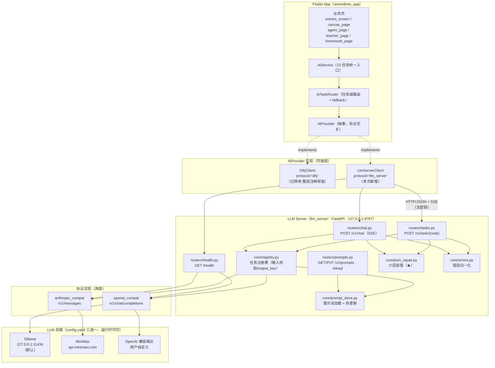
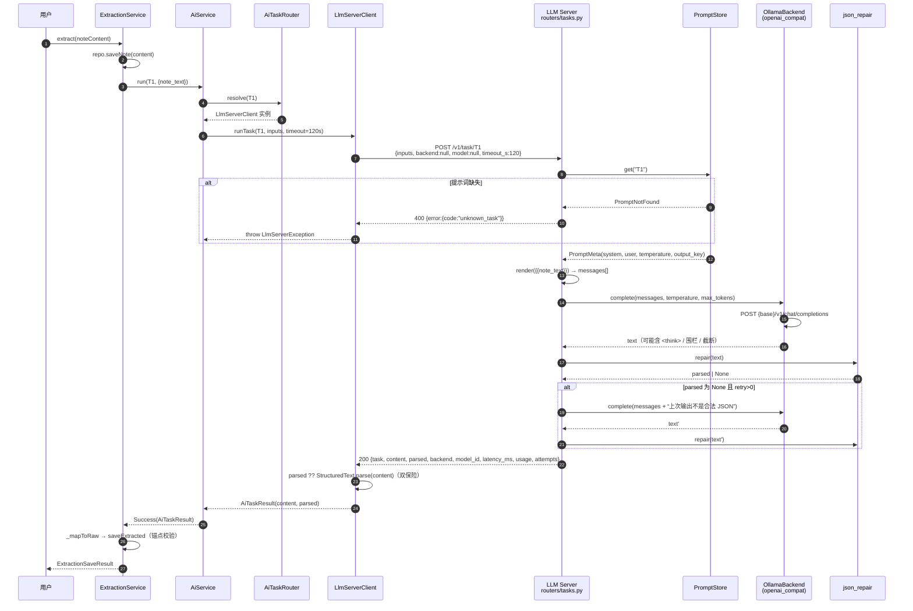
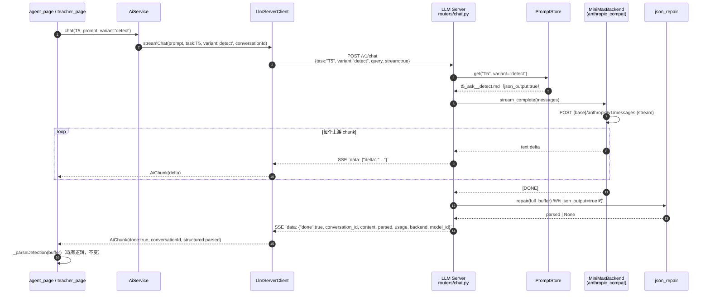
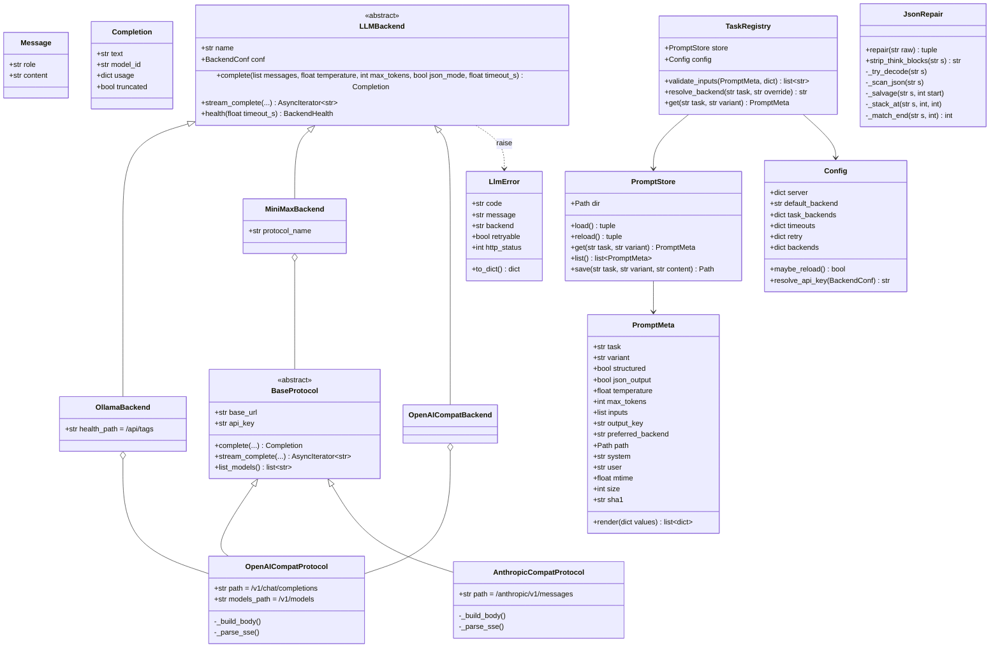
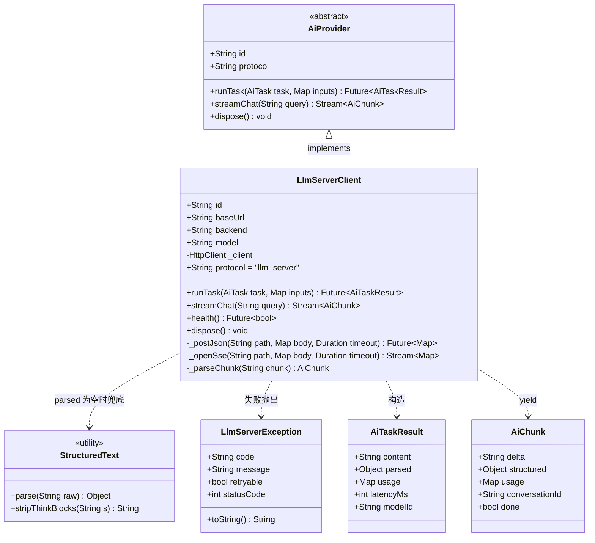
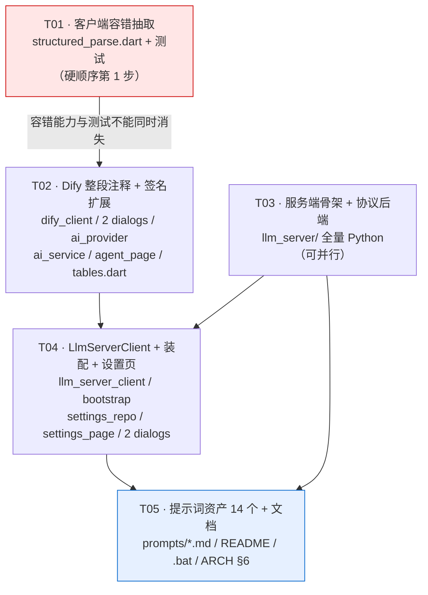

# AIMindTree「自研 LLM Server 替换 Dify 直连」系统架构设计与任务分解

| 项 | 内容 |
| --- | --- |
| 文档类型 | 系统设计 + 任务分解（可直接执行） |
| 上游输入 | `docs/PRD_LLM_SERVER.md`（增量 PRD，许清楚） |
| 关联文档 | `docs/ARCHITECTURE.md §6`、`docs/DIFY_WORKFLOW_BUILD_GUIDE.md`、`docs/PRD.md` |
| 工作区根 | `D:\AndroidStudioProjects\AIMindTree`（以下路径凡以 `/` 开头均为仓库相对路径） |
| 撰写 | 高见远（架构师） |
| 状态 | 已落盘，待工程师执行 |

> **阅读顺序**：§0 硬约束重申（**不可违反**）→ §1 总体架构 → §2 服务端设计 → §3 客户端改造 → §4 任务分解（**最重要**）→ §5 接口与数据结构 → §6 依赖 → §7 共享约定 → §8 待明确。

---

## 0. 硬约束重申（工程师必读，写在最前）

### 0.1 🔴 禁止修改任何 Drift 表结构

`aimindtree_app/lib/data/db/tables.dart` 中**所有** `@DataClassName`、类声明、字段声明、`.named()`、默认值、`primaryKey` 一律 **一个字符都不许改**。

原因（**沙箱事实，不是建议**）：Drift 依赖 `build_runner` 生成 `drift_database.g.dart`；本沙箱 `flutter` / `dart analyze` / `build_runner` / `flutter test` **全部被 WSL 黑名单拦截**。改了表 → 无法重新生成 `.g.dart` → `analyze_inproc` 直接编译不过 → 交付无法验证。

**只能改注释的位置（白名单，共 3 处）**：

| 文件 | 行范围 | 允许的动作 |
| --- | --- | --- |
| `aimindtree_app/lib/data/db/tables.dart` | 241-243（`AiProviders` 上方文档注释） | 补一行注释：`llm_server 场景：一条记录 = 一个 LLM Server 实例（服务端持密钥，本表不存密钥）` |
| `aimindtree_app/lib/data/db/tables.dart` | 249-250（`type` 列注释） | 补注释：`llm_server 场景复用为 backend 名（ollama/minimax/openai_compat/auto）` |
| `aimindtree_app/lib/data/db/tables.dart` | 252-253（`protocol` 列注释） | 补注释：`取值 openai / anthropic / dify(已停用) / llm_server` |
| `aimindtree_app/lib/data/db/tables.dart` | 260-261（`models` 列注释） | 补注释：`llm_server 场景：JSON 数组，最多 1 个元素 = model 覆盖，[] = 用后端默认` |

**推论（写死）**：`ai_providers.protocol` 沿用现有 `TextColumn`，新协议直接写字符串 `'llm_server'`，**不新增枚举列、不改表、无 migration**。

### 0.2 唯一门禁

```bash
cd aimindtree_app && D:/DevTools/flutter/bin/cache/dart-sdk/bin/dart.exe tool/analyze_inproc.dart
```

- 分析根 = `['lib', 'test']`（`tool/` **不在**门禁范围，但也要同步改，见 §4）。
- **error 和 warning 都算 fail**（`analyze_inproc.dart:95`）。
- `*.g.dart` 跳过，所以生成文件本身不会报错，但**引用了被删符号的业务代码会报错**。
- 高频踩坑（设计已在 §3.6 给出逐项规避方案）：
  - `unused_import`：注释掉 dify 代码后，调用方的 import 必须一并删/改。
  - `unused_element` / `unused_field`：私有符号无人引用即 warning。
  - `dead_code`：`return` 之后的语句。
  - `deprecated_member_use`：**不要**给保留的 Dify 方法加 `@Deprecated`（测试文件仍在调用，会全量告警）。

### 0.3 已拍板决策（本设计的输入约束，不再论证）

| # | 决策 | 落地方式 |
| --- | --- | --- |
| D1 | 服务端 Python + FastAPI，`127.0.0.1:8787` | §2 |
| D2 | 依赖只允许 `fastapi` / `uvicorn` / `httpx` / `pyyaml` | §6.1；LangChain 只留占位注释文件 |
| D3 | 后端 `ollama` / `minimax` / `openai_compat`，**默认 `ollama`** | §2.4 / §2.9 |
| D4 | 抽象**两类协议**实现：`openai_compat`（`/v1/chat/completions`）与 `anthropic_compat`（`/v1/messages`） | §2.5 |
| D5 | Dify 保留文件、整段注释；设置页 UI 隐藏 dify | §3.6 |
| D6 | 服务端持 Key（`.env` + `.gitignore`）；App 不传密钥、`api_key_ref` 留空、设置页无 Key 框 | §3.5 |
| D7 | `AiProvider.streamChat` 加**可选参数** `AiTask? task` / `String? variant` | §3.4 |
| D8 | T5 双形态用 `variant='detect'`，提示词 `t5_ask__detect.md` | §2.7 / §3.4 |
| D9 | 不依赖模型 JSON Mode，靠提示词约束 + 六层容错 | §2.6 |
| D10 | 客户端**保留一份**解析能力做双保险 | §3.2 |
| D11 | 不做「按任务强制走云端」，统一按 `config.yaml` 的 `default_backend` 走 | §2.9 |
| D12 | **PRD §C6（新增硬约束）**：表结构禁止改动；`type` = backend（白名单 `auto/ollama/minimax/openai_compat`）、`models` = JSON 数组且长度 ≤ 1、`api_key_ref` 恒空 | §3.7 |
| D13 | **PRD §C7（新增硬约束）**：Dify 停用分**两种口径**——口径 A 整段注释（仅 3 个文件）；口径 B 保留代码 + 普通停用注释、不加 `@Deprecated`（`addDifyProvider` / `testDify`） | §3.6 |
| D14 | **PRD A-13（新增）**：`variant` 收敛到唯一取值 `'detect'`；T8 **不加** variant | §3.4 |

### 0.4 环境事实

- Windows；托管 Python：`C:\Users\ASUS\.workbuddy\binaries\python\versions\3.13.12\python.exe`
- Bash 命令参数**只用 ASCII**（中文参数触发沙箱异常）；中文只出现在文件内容里。

---

## 1. 总体架构

### 1.1 分层架构图



### 1.2 请求时序图 · structured 任务（T1 知识点提取）



### 1.3 请求时序图 · chat 任务（T5 流式，含 detect 变体）



### 1.4 与 Dify 方案的对比：为什么上层业务零改动

| 维度 | Dify 方案（现状） | LLM Server 方案（本次） | 上层是否感知 |
| --- | --- | --- | --- |
| 抽象接口 | `AiProvider{runTask, streamChat}` | **同一个** `AiProvider`（只新增两个**可选**参数） | ❌ 不感知 |
| 任务枚举 | `AiTask` 13 项 + `structured` 标志 | **完全不动** | ❌ |
| 路由 | `AiTaskRouter.resolve` | **完全不动**（T3/T4 专属逻辑不变） | ❌ |
| 统一入口 | `AiService.run/chat` | 只加 1 行透传 `task/variant` | ❌ |
| 返回结构 | `AiTaskResult{content, parsed, usage, latencyMs, modelId}` | **逐字相同**，`parsed` 由服务端填 + 客户端兜底 | ❌ |
| 字段名契约 | `{knowledge_points:[{name,type,definition,source_quote,prerequisites,confidence}]}` | **由提示词契约保证，逐字相同** | ❌ |
| 业务页 | extract_screen / canvas / agent / teacher / homework | **零改动**（T5-detect 加 1 个参数，见 §3.4） | ❌ |

**结论**：变更被完全收敛在 `AiProvider` 实现层 + 设置页 + `ExtractionService.bootstrap` 三处，依赖的是「接口不变 + 字段名不变」两条契约，与协议无关。这也是 Dify 能整段注释保留、随时三步回退（PRD 附录 B）的根本原因。

---

## 2. 服务端设计（`llm_server/`）

### 2.1 完整目录树（每个文件一句话职责）

```
llm_server/                              # 仓库相对路径根
├── run.py                               # 一行启动入口：argparse(--host/--port/--config/--verbose) → uvicorn.run
├── server.py                            # FastAPI app 装配：挂载 4 个 router + 全局异常处理器 + CORS + 生命周期钩子
├── requirements.txt                     # 4 行：fastapi / uvicorn / httpx / pyyaml（含注释说明不引入 LangChain）
├── .env.example                         # 密钥模板：MINIMAX_API_KEY / OPENAI_API_KEY / OLLAMA_BASE_URL
├── .gitignore                           # 忽略 .env、__pycache__/、*.log
├── config.yaml                          # 默认后端 / 按任务覆盖 / 三后端连接参数 / 超时 / 服务端口（§2.9）
├── README.md                            # D-01：安装、一行启动、config 字段说明、curl 冒烟、FAQ
├── selftest.py                          # 无外网依赖自检：6 个坏样本 + 13 任务契约字段校验（PRD §8）
├── core/
│   ├── __init__.py                      # 空
│   ├── config.py                        # config.yaml + .env 加载、mtime 热加载、api_key 从环境变量解析
│   ├── errors.py                        # ★ S-11：LlmError 异常 + 12 个错误码 → 统一 {error:{...}} 响应
│   ├── json_repair.py                   # ★ §C2：六层容错移植（<think>/<thinking>/<reasoning> 含未闭合）
│   ├── prompt_store.py                  # ★ S-07/08/09：扫描 prompts/*.md、解析 front-matter、热更新、读写原文
│   ├── registry.py                      # ★ S-02：任务注册表（prompt 元信息 + 输入校验 + output_key + 后端选择）
│   └── logging.py                       # S-15：结构化一行日志 + --verbose 全量 prompt/response
├── backends/
│   ├── __init__.py                      # 后端工厂：create_backend(conf) → LLMBackend
│   ├── base.py                          # LLMBackend 抽象（complete / stream_complete / health）+ Message 数据类
│   ├── protocols/
│   │   ├── __init__.py                  # 协议工厂：create_protocol(name, conf)
│   │   ├── openai_compat.py             # 协议实现一：/v1/chat/completions（REST + SSE），/v1/models 探活
│   │   └── anthropic_compat.py          # 协议实现二：/v1/messages（REST + SSE），x-api-key + anthropic-version
│   ├── ollama.py                        # OllamaBackend：= openai_compat 协议 + /api/tags 探活 + format=json 选项
│   ├── minimax.py                       # MiniMaxBackend：按 config.protocol 选 openai/anthropic 协议（默认 anthropic）
│   ├── openai_compat.py                 # OpenAICompatBackend：用户自定义 OpenAI 兼容端点
│   └── langchain_adapter.py             # 仅占位注释（不实现、不引入依赖），说明「可选适配层预留」
├── routers/
│   ├── __init__.py                      # 空
│   ├── tasks.py                         # POST /v1/task/{task_code}（S-01/S-13/S-14）
│   ├── chat.py                          # POST /v1/chat（SSE；stream:false 降级）（S-03/S-04）
│   ├── prompts.py                       # GET /v1/prompts · GET|PUT /v1/prompts/{task} · POST /v1/prompts/reload（S-08/S-09）
│   ├── health.py                        # GET /health（S-10）
│   └── admin.py                         # POST /v1/admin/reload（config.yaml 手动热加载，S-06）
└── prompts/
    ├── index.yaml                       # 任务 → 文件 映射（含 variant 键）+ 期望 structured（启动校验用）
    ├── README.md                        # P-06：改哪个文件影响哪个功能 / 如何热更新 / 如何新增任务
    ├── t1_extract.md                    # T1 知识点提取（structured）
    ├── t2_normalize.md                  # T2 知识点规范化（structured）
    ├── t3_prerequisite.md               # T3 前置知识推断（structured）
    ├── t4_gap_analysis.md               # T4 知识缺口分析（structured）
    ├── t5_ask.md                        # T5 追问·自由问答（纯文本）
    ├── t5_ask__detect.md                # T5 追问·薄弱点检测变体（JSON）
    ├── t6_explain.md                    # T6 讲解（纯文本）
    ├── t7_socratic.md                   # T7 苏格拉底引导（纯文本）
    ├── t8_quiz.md                       # T8 出题（JSON 数组）
    ├── t9_grade.md                      # T9 批改与误区（structured）
    ├── t10_lecture.md                   # T10 讲义生成（Markdown）
    ├── t11_summary.md                   # T11 总结（纯文本）
    ├── t12_title_tags.md                # T12 标题与标签（structured）
    └── t13_similarity.md                # T13 知识点相似度（structured）
```

仓库外配套：`scripts/run_llm_server.bat`（Windows 双击启动）。

### 2.2 关键类图（Python 侧）



### 2.3 错误码表（S-11 · 统一响应 `{error:{code,message,backend,retryable}}`）

统一响应结构（**任何非 2xx 都是这个形状，绝不甩上游原始 HTML/JSON**）：

```json
{
  "error": {
    "code": "missing_input",
    "message": "缺少必填输入字段：note_text（T1 需要 note_text）",
    "backend": "ollama",
    "retryable": false
  }
}
```

| # | code | HTTP | retryable | 触发场景 | 中文文案示例 |
| --- | --- | --- | --- | --- | --- |
| 1 | `unknown_task` | 400 | ❌ | `task_code` 不在 13 个任务内 / 提示词文件缺失 | `未知任务代码：T99（已加载 14 个提示词，见 GET /v1/prompts）` |
| 2 | `missing_input` | 400 | ❌ | 请求 `inputs` 缺 front-matter 声明的字段 | `缺少必填输入字段：note_text（T1 需要 note_text）` |
| 3 | `prompt_not_found` | 500 | ❌ | 文件被删 / front-matter 解析失败 | `提示词 t1_extract.md 加载失败：front-matter 缺少 task 字段` |
| 4 | `backend_unknown` | 400 | ❌ | 请求 `backend` 不在 config 里 | `未配置的后端：foo（可用：ollama / minimax / openai_compat）` |
| 5 | `backend_unreachable` | 502 | ✅ | httpx ConnectError / DNS 失败 | `无法连接后端 ollama（http://127.0.0.1:11434）。本机模式请先启动 Ollama。` |
| 6 | `backend_timeout` | 504 | ✅ | 单次请求超过 `timeouts.structured_s` | `后端 ollama 在 120s 内未返回。可在 config.yaml 调大 timeouts.structured_s 或换更小的模型。` |
| 7 | `auth_failed` | 401 | ❌ | 上游 401/403 | `后端 minimax 鉴权失败：请检查 .env 里的 MINIMAX_API_KEY` |
| 8 | `rate_limited` | 429 | ✅ | 上游 429 | `后端 minimax 触发限流，请稍后重试` |
| 9 | `bad_json` | 502 | ✅ | 六层容错后 `parsed` 仍为 null（结构化任务） | `模型输出不是合法 JSON（已重试 1 次）。建议换更强的模型，或在 config.yaml 把该任务切到 minimax。` |
| 10 | `upstream_error` | 502 | ✅ | 上游 5xx / 协议解析失败 | `后端 minimax 返回异常（HTTP 500），已做归一化` |
| 11 | `invalid_request` | 400 | ❌ | body 不是 JSON / 字段类型错 | `请求体不是合法 JSON 对象` |
| 12 | `internal` | 500 | ❌ | 兜底未捕获异常 | `服务端内部错误（详见日志 llmserver.task）` |

`retryable` 判定规则（写死）：**超时 / 限流 / 不可达 / 上游错误 / bad_json = true；参数类 / 鉴权 / 配置类 / 未知任务 = false**。

### 2.4 多后端抽象（S-05 / D4）

**后端（backend）** 是用户在 `config.yaml` 里看到的三个可切换名字；**协议（protocol）** 是 HTTP 形态。二者解耦：

| backend | 默认 protocol | 端点 | 鉴权 | 探活 |
| --- | --- | --- | --- | --- |
| `ollama` | `openai_compat` | `{base_url}/v1/chat/completions` | 无 | `GET {base_url}/api/tags` |
| `minimax` | `anthropic_compat`（可切 `openai_compat`） | `{base_url}/anthropic/v1/messages` 或 `{base_url}/v1/chat/completions` | `x-api-key` / `Authorization: Bearer` | `GET {base_url}/v1/models` |
| `openai_compat` | `openai_compat` | `{base_url}/v1/chat/completions` | `Authorization: Bearer` | `GET {base_url}/v1/models` |

**统一契约（三个后端对外完全一致）**：

```python
class LLMBackend(ABC):
    name: str
    conf: BackendConf

    @abstractmethod
    async def complete(self, messages, temperature, max_tokens, json_mode=False, timeout_s=None) -> Completion: ...

    @abstractmethod
    async def stream_complete(self, messages, temperature, max_tokens, timeout_s=None) -> AsyncIterator[str]: ...

    @abstractmethod
    async def health(self, timeout_s=None) -> BackendHealth: ...
```

- `Completion{text, model_id, usage, truncated}`——**协议差异到这一层为止**，router 只见 `Completion`。
- `stream_complete` 只 yield **纯文本 delta**（`str`）；router 再统一包成 SSE。这样「流式如何统一成 SSE」只有一个实现点（`routers/chat.py::_sse`），三个后端零重复。
- `json_mode`：P0 只做「能带就带」——Ollama 传 `format:"json"`，OpenAI 兼容端点传 `response_format={"type":"json_object"}`；**失败不报错、结果不依赖它**（D9）。

**请求/响应映射（两个协议各自怎么映射）**

| 环节 | openai_compat | anthropic_compat |
| --- | --- | --- |
| 请求体 | `{"model","messages":[{"role","content"}],"temperature","max_tokens","stream":bool}` | `{"model","system":<str>,"messages":[{"role":"user"/"assistant","content"}],"max_tokens","temperature","stream":bool}` |
| 鉴权头 | `Authorization: Bearer <key>` | `x-api-key: <key>` + `anthropic-version: 2023-06-01` |
| 非流式取文本 | `choices[0].message.content` | `content[0].text`（`content` 为块数组） |
| 流式事件 | `data: {"choices":[{"delta":{"content":"…"}}]}` → `data: [DONE]` | `event: content_block_delta` → `data: {"type":"content_block_delta","delta":{"type":"text_delta","text":"…"}}` |
| 结束标记 | 行 `[DONE]` | `event: message_stop` |
| usage | `usage.prompt_tokens/completion_tokens` | `usage.input_tokens/output_tokens` → **统一重命名**为 `prompt_tokens/completion_tokens` |
| 模型列表 | `GET /v1/models` → `data[].id` | `GET /v1/models` → `data[].id`（不支持则返回 config 里的 `models`） |

**新增第四个后端** = 加一个 `backends/xxx.py`（继承 `LLMBackend`，内部复用某个 protocol）+ `config.yaml` 里加一段。**不改任何 router**。

### 2.5 提示词文件格式规范（P-03 · 用一个真实任务 T1 举例）

文件：`llm_server/prompts/t1_extract.md`

```markdown
---
task: T1
structured: true
json_output: true
temperature: 0.2
max_tokens: 4096
inputs: [note_text]
output_key: knowledge_points
preferred_backend: ollama
---

# SYSTEM
你是一名严谨的「知识点提取器」，服务于一款叫 AIMindTree 的 AI 知识笔记 App。
你的唯一任务：把用户给出的一段学习笔记，拆解为独立、可复用的「知识点」。

# USER
请提取下面这段笔记中的知识点。

# 笔记原文
{{note_text}}

# 输出要求（严格遵守）
1. 只输出一个 JSON 对象，不要任何解释、前后缀或 Markdown 代码块标记。
2. 结构固定为：
   {
     "knowledge_points": [
       {
         "name": "知识点名称（名词短语，≤ 20 字）",
         "type": "概念|公式|定理|方法|事实|误区",
         "definition": "一句话清晰定义（≤ 60 字）",
         "source_quote": "从原文中逐字摘抄的、能支撑该知识点的原句（必须能在原文中找到，否则留空字符串）",
         "prerequisites": ["学习本知识点前应先掌握的 0~3 个前置知识点名称，没有则为空数组"],
         "confidence": 0.0~1.0 的小数，表示你对这条提取的把握
       }
     ]
   }
3. source_quote 必须逐字出现在原文里；若原文没有明确支撑句，source_quote 给空字符串 ""，但知识点仍可保留。
4. 不要编造原文没有的定义；无法确认的放在 definition 里标注「（待确认）」。
5. prerequisites 只写「名称」，不要写解释。
6. 只输出 JSON，不要输出思考过程，不要用 ```json 围栏包裹。
```

**front-matter 字段定义（唯一真相源）**

| 字段 | 类型 | 必填 | 说明 |
| --- | --- | --- | --- |
| `task` | str | ✅ | 任务 code，`T1`…`T13`（大小写不敏感，服务端统一 upper） |
| `variant` | str\|null | ➖ | 变体名，如 `detect`；主形态省略或 `null` |
| `structured` | bool | ✅ | `true` → 走 `/v1/task/{code}`；`false` → 走 `/v1/chat` |
| `json_output` | bool | ✅ | 是否要求 JSON 输出。**structured 任务恒 true**；特例：T5-detect、T8 也 true |
| `temperature` | float | ✅ | 采样温度 |
| `max_tokens` | int | ✅ | 生成上限 |
| `inputs` | list[str] | ✅ | 输入变量名清单；structured 任务按 §C1；chat 任务恒为 `[query]` |
| `output_key` | str\|null | ➖ | 结构化输出的顶层 key（如 `knowledge_points`）；仅校验与日志用 |
| `preferred_backend` | str\|null | ➖ | 建议后端；**P0 不强制**（D11），仅在 `task_backends` 未配置时作为启动日志建议 |

**正文两节约定**

- 必须是且仅是 `# SYSTEM` 与 `# USER` 两个一级标题（大小写敏感，服务端按行首 `# SYSTEM` / `# USER` 切分）。
- `# SYSTEM` → `messages[0].role='system'`（anthropic 协议映射到顶层 `system` 字段）。
- `# USER` → `messages[1].role='user'`，**渲染 `{{变量名}}` 后**发送。
- 占位符 `{{name}}` 必须与 `inputs[]` **一一对应**：多一个/少一个 → 启动日志 WARN 并在 `GET /v1/prompts` 里标 `placeholders_mismatch:true`。
- 渲染策略：**纯字符串替换**（不做 HTML 转义、不递归、不执行模板语法），`{{note_text}}` 内容里的 `{{` 不会被二次解析。
- 收尾段（P-05）：**structured 任务 + T5-detect + T8** 文件末尾固定附加第 6 条「只输出 JSON，不要输出思考过程，不要用 ```json 围栏包裹」。

> `prompts/index.yaml` **只声明 `task → file` 映射**（不做元信息双份真相），元信息一律以 md 的 front-matter 为准；index 里多写的 `structured` 仅用于启动交叉校验、不一致时打 WARN。

### 2.6 六层 JSON 容错（`core/json_repair.py` · §C2 1:1 移植）

与 `dify_client.dart:61-225` **逐层对齐**，并新增「第 0 层」覆盖三种思考标记：

| 层 | 逻辑 | 对应 Dart 来源 | Python 侧要点 |
| --- | --- | --- | --- |
| 0 | **剥离思考块**：`<think>` / `<thinking>` / `<reasoning>`，**含未闭合形态**（正则 `r'<(think\|thinking\|reasoning)>[\s\S]*?(?:</(think\|thinking\|reasoning)>\|$)'`，`re.I`） | 本次新增（Dart 侧同样新增） | 未闭合时从标记处截到**末尾**再丢弃——宁可丢正文也不让思考块污染起点 |
| 1 | 整体 `json.loads` | `dify_client.dart:64-66`（`parseStructured` ①） | 失败进下一层 |
| 2 | 剥离**闭合**的 `<think>…</think>` 后再解 | `dify_client.dart:68-76`（②） | 与第 0 层互补（第 0 层已覆盖，此层保留以对齐 Dart 行为） |
| 3 | 剥离 ` ```json … ``` ` 围栏后再解 | `dify_client.dart:78-87`（③） | 正则 `r'```(?:json)?\s*([\s\S]*?)```'`，`re.I` |
| 4 | **括号配对扫描**：对每个 `{` / `[` 起点做字符串/转义感知配对，取第一个「能配对且能解码」的片段 | `dify_client.dart:89-91` + `115-135`（`_scanJson`）+ `193-225`（`_matchEnd`） | ⚠️ **绝不用「首 `{` → 末 `}`」硬切**（`dify_client.dart:57-59` 已写明踩坑结论） |
| 5 | **截断抢救**：配对失败时从尾部回退到最后一个完整元素，补未闭合括号再解；**绝不补全或编造内容** | `dify_client.dart:140-154`（`_salvage`）+ `158-189`（`_stackAt`） | ⚠️ 不得退而求其次解析**内层片段**（`{"gaps":[{"name":"力"}]}` 里内层 `{"name":"力"}` 合法但形状不对，会让调用方以为成功） |
| 6 | 最后退回首尾硬切 | `dify_client.dart:93-99`（⑤） | 尽力而为，失败返回 `(None, None)` |

返回签名：`repair(raw) -> (parsed: Any|None, cleaned: str)`；`cleaned` 回填到响应的 `content`（App 侧拿到的是**已剥离思考块**的文本，双保险仍会再跑一次）。

**自检样本（`selftest.py` 必须 6 个全绿）**：① 纯 JSON；② 闭合 `<think>`；③ 未闭合 `<think>` 且块内含 `{`（旧实现必挂的回归用例）；④ ` ```json ` 围栏；⑤ 前后杂文（`好的，结果如下：…`）；⑥ 截断（`{"gaps":[{"name":"力","level":1},{"name":"加速`）。⑦（新增）`<reasoning>` 未闭合。

### 2.7 提示词目录命名规范与 14 个文件清单

**规范**：`<任务小写>_<英文名>.md`；变体用**双下划线** `<任务小写>_<英文名>__<variant>.md`。

| # | 文件名 | 任务 | variant | structured | 契约（输出顶层） |
| --- | --- | --- | --- | --- | --- |
| 1 | `t1_extract.md` | T1 知识点提取 | — | ✅ | `knowledge_points[{name,type,definition,source_quote,prerequisites[],confidence}]` |
| 2 | `t2_normalize.md` | T2 知识点规范化 | — | ✅ | `normalized[{name,type,definition,merged_from}]` |
| 3 | `t3_prerequisite.md` | T3 前置知识推断 | — | ✅ | `prerequisites[{from,to,reason}]` |
| 4 | `t4_gap_analysis.md` | T4 知识缺口分析 | — | ✅ | `gaps[{name,type,definition,reason,level}]`（`level` 恒 1） |
| 5 | `t5_ask.md` | T5 追问·自由问答 | — | ❌ | 纯文本 |
| 6 | `t5_ask__detect.md` | T5 追问·薄弱点检测 | `detect` | ❌ | `{"needed":[{name,definition,reason}],"weak":[...]}` |
| 7 | `t6_explain.md` | T6 讲解 | — | ❌ | 纯文本 |
| 8 | `t7_socratic.md` | T7 苏格拉底引导 | — | ❌ | 纯文本 |
| 9 | `t8_quiz.md` | T8 出题 | — | ❌ | JSON 数组 `[{kpName,type,question,answer,difficulty}]` |
| 10 | `t9_grade.md` | T9 批改与误区 | — | ✅ | `{correct,reason,misconception,suggestion}` |
| 11 | `t10_lecture.md` | T10 讲义生成 | — | ❌ | Markdown |
| 12 | `t11_summary.md` | T11 总结 | — | ❌ | 纯文本 |
| 13 | `t12_title_tags.md` | T12 标题与标签 | — | ✅ | `{title,tags[]}` |
| 14 | `t13_similarity.md` | T13 知识点相似度 | — | ✅ | `similarities[{a,b,score}]` |

**内容来源（P-04，逐字搬运，字段不许改名）**

| 文件 | 来源 |
| --- | --- |
| `t1_extract.md` | `scripts/dify_t1_knowledge_extraction.yaml` 的 `prompt_template`（`{{#start.note_text#}}` → `{{note_text}}`） |
| `t3_prerequisite.md` | `scripts/dify_t3_prerequisite.yaml` 的 `prompt_template` |
| `t4_gap_analysis.md` | `scripts/dify_t4_gap_analysis.yaml` 的 `prompt_template` |
| `t5_ask__detect.md` | `aimindtree_app/lib/features/agent/agent_page.dart:197-203` 的 Dart 硬编码模板 |
| `t8_quiz.md` | `aimindtree_app/lib/features/homework/homework_page.dart:99-123` 的 `_buildPrompt()` |
| 其余 9 个 | 依据 `docs/DIFY_WORKFLOW_BUILD_GUIDE.md` §4 契约新撰 |

**T5/T8 的"不重复约束"设计决策**：`agent_page` 与 `homework_page` 目前把 JSON 契约**写进了 `query` 里**。为把改动压到最小，本次**不动这两处的 prompt 拼装**，只让 `t5_ask.md` / `t5_ask__detect.md` / `t8_quiz.md` 的 `# USER` 为 `{{query}}` + 收尾段。即：契约在 query 里出现一次、在提示词收尾段再强调一次，**幂等且不冲突**；即使 `variant` 传错，输出形状也不会退化。

### 2.8 路由清单

| 方法 | 路径 | 职责 | 需求号 |
| --- | --- | --- | --- |
| POST | `/v1/task/{task_code}` | 结构化任务（T1/T2/T3/T4/T9/T12/T13） | S-01 |
| POST | `/v1/chat` | 会话任务（T5/T6/T7/T8/T10/T11），SSE 或一次性 | S-03/S-04 |
| GET | `/v1/prompts` | 列出 14 个提示词的 `file/mtime/size/sha1/structured/output_key/inputs` | S-08 |
| GET | `/v1/prompts/{task}` | 取原文（支持 `?variant=detect`） | S-09 |
| PUT | `/v1/prompts/{task}` | 写回文件（支持 `?reload=true`） | S-09 |
| POST | `/v1/prompts/reload` | 重扫目录 | S-08 |
| GET | `/health` | 服务 + 各后端可达性 + 提示词加载数 | S-10 |
| POST | `/v1/admin/reload` | `config.yaml` 手动热加载 | S-06 |

### 2.9 `config.yaml` 完整示例

```yaml
# llm_server/config.yaml —— 全部字段均有默认值，最小化可只写 default_backend
server:
  host: 127.0.0.1
  port: 8787
  log_level: info          # debug|info|warning|error
  verbose: false           # true = 打印完整 prompt/response（S-15）
  cors_origins:
    - http://127.0.0.1
    - http://localhost

# 默认后端（D11：不做按任务强制，统一走这里；task_backends 留空）
default_backend: ollama

# 按任务覆盖（可选；未列出的任务走 default_backend）
task_backends: {}
# 例：  T1: minimax
#       T5: minimax

timeouts:
  structured_s: 120        # 与 App 侧 AiProvider.runTask.timeout 对齐（N-8）
  chat_s: 120
  connect_s: 10
  health_s: 5              # /health 里各后端探测（异步，不阻塞响应）

retry:
  structured_on_bad_json: 1   # 六层容错失败后原地重跑次数（S-13）

backends:
  ollama:
    type: ollama
    protocol: openai_compat
    base_url: http://127.0.0.1:11434
    api_key_env: ""            # 本地无需密钥
    default_model: qwen2.5:7b
    models: [qwen2.5:7b, llama3]
    extra:
      num_ctx: 8192
      json_mode_field: format   # P0 可选：Ollama 的 format=json

  minimax:
    type: minimax
    protocol: anthropic_compat   # 可改 openai_compat（Q9 未定，默认 anthropic）
    base_url: https://api.minimaxi.com
    anthropic_path: /anthropic/v1/messages
    openai_path: /v1/chat/completions
    api_key_env: MINIMAX_API_KEY
    default_model: MiniMax-Text-01
    anthropic_version: 2023-06-01
    extra:
      max_tokens: 4096

  openai_compat:
    type: openai_compat
    protocol: openai_compat
    base_url: https://api.openai.com/v1   # 或任意 OpenAI 兼容端点（DeepSeek/通义/Kimi/硅基流动…）
    api_key_env: OPENAI_API_KEY
    default_model: gpt-4o-mini
    models: []
```

`.env.example`：

```
MINIMAX_API_KEY=
OPENAI_API_KEY=
OLLAMA_BASE_URL=http://127.0.0.1:11434
```

`.gitignore`（`llm_server/.gitignore`）：

```
.env
__pycache__/
*.pyc
*.log
```

---

## 3. 客户端改造设计（Flutter）

### 3.1 `LlmServerClient` 类设计

文件：`aimindtree_app/lib/ai/clients/llm_server_client.dart`（**新增**）



**实现要点（写死，工程师照抄）**

| 点 | 约定 |
| --- | --- |
| 常量 | 文件顶部导出两个常量供装配/设置页复用：`const String kLlmServerProtocol = 'llm_server';`、`const String kLlmServerDefaultBaseUrl = 'http://127.0.0.1:8787';` |
| 构造函数 | `LlmServerClient({required String id, required String baseUrl, String backend = 'auto', String? model, HttpClient? client})`；`assert(baseUrl.isNotEmpty)` |
| `protocol` | `String get protocol => kLlmServerProtocol;`（**必须返回 `'llm_server'`**，bootstrap 靠它分支） |
| URL 拼接 | `_apiBase` = 去尾斜杠（同 `dify_client.dart:280-281` 的做法） |
| 请求头 | `Content-Type: application/json; charset=utf-8`（**必须显式 charset**，中文 body 否则按 latin1 编码抛 `Invalid argument`——`dify_client.dart:285-286` 的实测坑）；SSE 另加 `Accept: text/event-stream`、`Cache-Control: no-cache` |
| body 编码 | `req.add(utf8.encode(jsonEncode(body)))`（**必须 utf8.encode**，同上坑） |
| `runTask` | `POST {_apiBase}/v1/task/{task.code}`（code 已是 `T1` 大写，服务端 `upper()` 归一）；body `{"inputs":inputs,"backend":_backendOrNull,"model":model,"user":user,"timeout_s":timeout.inSeconds}`，**null 字段不写**（Dart 用 `if (x != null)` collection-if） |
| `runTask` 成功 | `AiTaskResult(content: content, parsed: parsed ?? StructuredText.parse(content), usage: usage, latencyMs: latencyMs, modelId: modelId)` |
| `runTask` 失败 | 非 2xx → 解析 `{error:{code,message,retryable}}` → `throw LlmServerException(...)`；解析不出就 `code:'upstream_error'` |
| `streamChat` | `POST {_apiBase}/v1/chat`，body `{"query":query,"task":task?.code,"variant":variant,"conversation_id":conversationId,"backend":...,"model":...,"stream":true,"user":user}` |
| SSE 解析 | `resp.transform(utf8.decoder).transform(const LineSplitter())`，只处理以 `data: ` 开头的行；`data:` 内容是 JSON → 有 `delta` 就 `yield AiChunk(delta:)`；有 `done:true` 就 `yield AiChunk(done:true, conversationId:..., usage:..., structured: parsed)` 并结束 |
| SSE 超时 | 对 line stream 用 `.timeout(timeout, onTimeout: (sink) => sink.addError(LlmServerException(...)))`——**每条数据到达都会重置计时器**，正好表达「卡住 timeout 就报错」 |
| 降级开关 | `const bool kLlmServerBlockingChat = false;`；置 `true` 时 `streamChat` 改走 `POST /v1/chat` + `stream:false`，一次性 `yield AiChunk(delta: content, done: true)`（A-03 的 P0 兜底） |
| 日志 | `static final AppLog _log = AppLog('llm_server');`（与 §7 日志前缀约定一致） |
| `health()` | `GET {_apiBase}/health`，2xx 返回 true；供设置页「测试连接」复用（也可只用 `SettingsRepository.testLlmServer`，二者保留其一即可，**为免 `unused_element` 建议只实现 `health()` 并让 repository 调它**——见 §3.6 说明） |

> ⚠️ `health()` 与 `SettingsRepository.testLlmServer()` 二选一保留：本设计**只保留 `SettingsRepository.testLlmServer(baseUrl)`**（返回 `String?` 错误文案，与现有 `testDify` 签名一致），`LlmServerClient` **不实现 `health()`**，避免私有/公有符号冗余触发门禁。上面类图里的 `health()` 仅在决定"由 client 探活"时实现。

### 3.2 `structured_parse.dart` 抽取方案（A-02 · 硬顺序第 1 步）

文件：`aimindtree_app/lib/ai/structured_parse.dart`（**新增**）

| 新符号 | 来源（dify_client.dart 行号） | 说明 |
| --- | --- | --- |
| `class StructuredText` | 新类（私有构造 `StructuredText._()`） | 工具类，只有静态方法 |
| `static Object? parse(String raw)` | `61-100`（`DifyResult.parseStructured`） | 六层入口，层序：0 剥思考块 → 1 直接解 → 2 剥闭合 think → 3 剥围栏 → 4 `_scanJson` →（内含 5 `_salvage`）→ 6 首尾硬切 |
| `static Object? _tryDecode(String s)` | `102-109` | 原样搬 |
| `static Object? _scanJson(String s)` | `115-135` | 原样搬（注释里的「绝不能解析内层片段」踩坑说明必须一起搬） |
| `static Object? _salvage(String s, int start)` | `140-154` | 原样搬 |
| `static List<String>? _stackAt(String s, int start, int end)` | `158-189` | 原样搬 |
| `static int _matchEnd(String s, int start)` | `193-225` | 原样搬 |
| `static String stripThinkBlocks(String s)` | **新增** | 覆盖 `<think>` / `<thinking>` / `<reasoning>` 含未闭合形态，与 `core/json_repair.py` 第 0 层**同一套正则** |

**只 import `dart:convert`**（`jsonDecode` / `utf8` 不需要）——**不要** import `ai_task.dart`（否则未使用即 `unused_import` warning）。

配套测试：`aimindtree_app/test/structured_parse_test.dart`（**新增**）
- 由 `test/dify_parse_structured_test.dart` **改名并改写**：`DifyResult.parseStructured` → `StructuredText.parse`，group 名改 `StructuredText.parse`。
- 保留原有 6 个坏样本断言，并**新增 2 个**：`<reasoning>` 未闭合、`{{ }}` 混杂场景。
- 断言要求（回归保护不许丢）：用例 ③「未闭合 `<think>` 且块内含 `{`」**必须** `isNotNull` 且 `gaps` 长度为 1（旧实现在此返回 null）。

> **为什么必须先做这一步**：`DifyResult.parseStructured` 是这套容错逻辑的**唯一载体**。若先注释 `dify_client.dart`，容错能力和它的回归测试会**同时消失**（Q11/硬顺序要求）。先抽出 → 测试改指向 → 再注释，链路上任何时刻都有一份可工作的解析能力。

### 3.3 逐层容错与服务端对齐（双保险 D10）

| 环节 | 谁解析 | 失败后果 |
| --- | --- | --- |
| 服务端 `json_repair.repair()` | 服务端 | 回填 `parsed`，并把**已剥离思考块的 `cleaned`** 作为 `content` 返回 |
| 客户端 `StructuredText.parse(content)` | App | 服务端 `parsed` 为空时兜底（§3.1 runTask 表格） |
| 业务页既有解析（如 `homework_page._parseQuestions`、`agent_page._parseDetection`） | App | 第三道，本次**不动** |

### 3.4 `streamChat` 签名变更的精确 diff

| # | 文件 | 行号 | 变更 |
| --- | --- | --- | --- |
| 1 | `aimindtree_app/lib/ai/ai_provider.dart` | 63 | 注释 `/// 端点协议：openai / anthropic / dify` → `/// 端点协议：openai / anthropic / dify（已停用，保留仅为回退）/ llm_server` |
| 2 | `aimindtree_app/lib/ai/ai_provider.dart` | 81-86 | `streamChat` 形参列表末尾**新增两行**：`AiTask? task,`（新增，Dify 实现忽略）+ `String? variant,`（新增，如 `detect`） |
| 3 | `aimindtree_app/lib/ai/ai_provider.dart` | 77-80 | 文档注释补一句：`[task]` / `[variant]` 为可选参数，仅供按任务装载提示词的实现使用；不传不影响既有实现 |
| 4 | `aimindtree_app/lib/ai/ai_service.dart` | 65-68 | `chat(...)` 形参列表新增 `String? variant,` |
| 5 | `aimindtree_app/lib/ai/ai_service.dart` | 74-75 | `yield* provider.streamChat(query, conversationId: conversationId, user: user, timeout: timeout);` → 追加 `task: task, variant: variant,` |
| 6 | `aimindtree_app/lib/features/agent/agent_page.dart` | 207 | `widget.service.ai.chat(AiTask.t5Ask, prompt)` → `widget.service.ai.chat(AiTask.t5Ask, prompt, variant: 'detect')` |

**兼容性论证**：新增的是**命名可选参数**，`agent_page` / `teacher_page` / `homework_page` 三个既有调用点（除 #6 显式加 variant）**零改动**即可编译通过；`ai_task_route_test.dart` 里的假 Provider 实现也无需改（可选参数不实现即忽略）。

> ✅ **PRD 冲突已裁决（PM 2026 修订，本设计按此执行）**：原 §1.2 把 `ai_service.dart` 列为「不改」，与 §C3 冲突。PM 已把 `ai_service.dart` 移入「要改」并标注「极小改动（§1.2 例外）：+2 行，仅透传，统一入口/重试/路由逻辑不动」，同时写明 **C3 是本 PRD 最高优先级约束，与「不改」清单冲突时以 C3 为准**。上表 #4/#5 即该裁决的落地。`agent_page.dart` #6 已由 PRD **A-13（P0）** 正式补录。

**`variant` 收敛规则（PRD §C3 裁决，写死）**

- `variant` 的取值**只有 `'detect'` 一个**（T5 薄弱点检测）。
- **T8 不加 variant**：`t8_quiz.md` 的 `# USER` 只做 `{{query}}` 透传 + JSON-only 收尾，JSON 契约仍留在 App 端 `_buildPrompt()` 拼的 query 里。
- `t5_ask__detect.md` / `t8_quiz.md` 的 `# USER` **都只是 `{{query}}` 透传 + JSON-only 收尾** → **即使 `variant` 传错或服务端未识别，输出形状也不会退化**，最坏等于「没加服务端提示词」，不会出现「自由问答被污染成 JSON」或反之。
- 该规则已列为 T02/T05 的验收标准（见 §4.1）。

### 3.5 密钥边界落地（C4）

| 位置 | 处置 |
| --- | --- |
| `llm_server/.env` | 服务端持 Key；`.gitignore` 忽略 |
| `ai_providers.api_key_ref`（llm_server 行） | **空串 `''`**（列有默认值，无需改表） |
| 设置页新增/编辑对话框 | **不渲染** API Key 输入框 |
| `SettingsRepository.addLlmServerProvider` | 不写 SecretStore |
| `ExtractionService.bootstrap` 的 llm_server 分支 | **不调用** `resolveApiKey`（与 dify 分支的关键差别） |

**必须清掉的现存问题**：`aimindtree_app/lib/ai/extraction_service.dart:37-45` 的 `LocalAiConfig` 里硬编码 Dify App Key `app-fhXwVvHFfVbVWRq3tRMOX8fd`（已入 Git）。本次随 `LocalAiConfig` 改造一并删除并作废（见 §3.7 表格）。

### 3.6 Dify 停用清单（PRD §C7 两种口径）+ 门禁风险规避

**PRD §C7 定义的两种口径（本设计严格执行）**

| 口径 | 含义 | 适用文件 |
| --- | --- | --- |
| **A · 整段注释** | 全部代码以 `// ` 注释形式保留，文件头写明回退说明 | 仅 3 个：`dify_client.dart`、`dify_add_dialog.dart`、`dify_edit_dialog.dart` |
| **B · 保留代码 + 停用注释** | 代码原样保留，**不加 `@Deprecated`**，仅在函数上方加普通 `//` 停用说明 | `settings_repository.dart` 的 `addDifyProvider` / `testDify` |

> PRD 的 A-09「整段注释」**仅指口径 A 的 3 个文件**；A-06 的验收标准已补「`test/settings_repository_test.dart` 的 14 处调用仍能编译」。

| # | 文件 | 行范围 | 动作 | 注释后的连带处理（**不做就会门禁失败**） |
| --- | --- | --- | --- | --- |
| 1 | `aimindtree_app/lib/ai/clients/dify_client.dart` | **18-466**（`import 'dart:convert';` 起至文件末） | 整段加 `// ` 注释；保留第 1-16 行文件头 doc，并在第 17 行 `library;` 之后插入「已停用」说明 | ① `extraction_service.dart:31` 的 import 必须改（见 #4）；② `test/dify_parse_structured_test.dart` 必须在 **T01** 已改名指向 `StructuredText`，否则 **编译 error**；③ `tool/smoke_ai_service.dart:18` 的 import 同步改 |
| 2 | `aimindtree_app/lib/features/settings/dify_add_dialog.dart` | **13-131**（`import 'package:flutter/material.dart';` 起至末） | 整段注释，文件头写回退说明 | `settings_page.dart:29` 的 import 必须改（见 #5） |
| 3 | `aimindtree_app/lib/features/settings/dify_edit_dialog.dart` | **9-143** | 同上 | `settings_page.dart:30` 的 import 必须改 |
| 4 | `aimindtree_app/lib/ai/extraction_service.dart` | 31 | `import 'clients/dify_client.dart';` → `import 'clients/llm_server_client.dart';` | 若 `llm_server_client.dart` 尚未创建会 error → 因此**必须与 T04 同一批提交**，或先改成注释、T04 再打开（**推荐前者**，见 §4 依赖） |
| 5 | `aimindtree_app/lib/features/settings/settings_page.dart` | 29-30 | 两个 dialog import → `llm_server_add_dialog.dart` / `llm_server_edit_dialog.dart` | 同 #4，需与 T04 同批 |
| 6 | `aimindtree_app/lib/data/repositories/settings_repository.dart` | 41-76（`addDifyProvider`）、174-191（`testDify`） | **口径 B：保留代码**，函数上方加普通 `//` 停用说明 | ① `test/settings_repository_test.dart` 仍在调用 `addDifyProvider`（14 处），注释掉 = 大面积 error；② **不得**加 `@Deprecated`（会触发 `deprecated_member_use` warning）；③ 只在函数上方加「已停用，仅供回退」注释 |
| 7 | `aimindtree_app/test/dify_parse_structured_test.dart` | 全文 | **改名**为 `test/structured_parse_test.dart` 并改写（T01 完成） | 改名后 `DifyResult` 引用全部替换为 `StructuredText` |
| 8 | `aimindtree_app/tool/smoke_ai_service.dart` | 3/6/18/27-36/40/70 | 改指向 `LlmServerClient`（不在门禁范围，但不同步会让端到端冒烟脚本失效） | — |
| 9 | `aimindtree_app/test/ai_task_route_test.dart` | 25 | `String get protocol => 'dify';` → `'llm_server'`（可选，P1） | 纯语义，不影响门禁 |

**门禁规避三条铁律**

1. **注释后不留悬空 import**：凡 import 了被注释文件的文件，同批次改掉。
2. **不留未引用的私有符号**：`dify_client.dart` 全部注释后，其 `_taskOutputKey` / `_tryDecode` 等私有符号随文件失效，不会被 `unused_element` 命中（注释不算声明）；但**若只注释一半**，剩下的私有符号无人引用 = warning。→ **要注释就整段注释**。
3. **保留但停用的公有 API 不加 `@Deprecated`**：只写注释（见 #6）。

### 3.7 客户端逐文件改动清单

| 文件 | 行号范围 | 改动 |
| --- | --- | --- |
| `lib/ai/clients/llm_server_client.dart` | 全文新增 | §3.1 |
| `lib/ai/structured_parse.dart` | 全文新增 | §3.2 |
| `lib/ai/ai_provider.dart` | 63、77-86 | §3.4 #1-#3 |
| `lib/ai/ai_service.dart` | 65-68、74-75 | §3.4 #4-#5 |
| `lib/ai/clients/dify_client.dart` | 18-466 | 整段注释（§3.6 #1） |
| `lib/ai/extraction_service.dart` | 31；33-45；206-229；246-248 | ① import 切换；② `LocalAiConfig` 改造（下表）；③ bootstrap 分支；④ 报错文案 |
| `lib/data/repositories/settings_repository.dart` | 38-76 后追加；158-169；171-191 后追加 | 新增 `addLlmServerProvider` / `testLlmServer`；`seedFromLocalIfEmpty` 改判 `protocol=='llm_server'` |
| `lib/features/settings/settings_page.dart` | 29-30；117-136；192-223；249-268；287-291；310-321；348-358；387-395；494-515 | dialog 替换 + FAB 文案 + 空态 + 说明区 + 路由区文案 + Provider 副标题 |
| `lib/features/settings/llm_server_add_dialog.dart` | 全文新增 | §3.8 |
| `lib/features/settings/llm_server_edit_dialog.dart` | 全文新增 | §3.8 |
| `lib/features/settings/dify_add_dialog.dart` | 13-131 | 整段注释 |
| `lib/features/settings/dify_edit_dialog.dart` | 9-143 | 整段注释 |
| `lib/data/db/tables.dart` | 241-243、249-250、252-253、260-261 | **只改注释** |
| `lib/features/agent/agent_page.dart` | 207 | 加 `variant: 'detect'` |
| `test/structured_parse_test.dart` | 新增（原 `dify_parse_structured_test.dart` 改名） | §3.2 |
| `test/settings_repository_test.dart` | 38-47、69 | seed 断言 `protocol=='dify'` → `'llm_server'` |
| `tool/smoke_ai_service.dart` | 3/6/18/27-36/40/70 | 改指向 `LlmServerClient` |

**`ExtractionService.bootstrap` 装配切换点定位**

| 位置 | 现内容 | 新内容 |
| --- | --- | --- |
| `extraction_service.dart:206-229` | `for (final row in enabledRows) { if (row.protocol == 'dify') {...DifyClient...} else { warn } }` | `if (row.protocol == kLlmServerProtocol) { final c = LlmServerClient(id: row.id, baseUrl: row.baseUrl, backend: _backendOf(row.type), model: _firstModel(row.models)); providers[c.id]=c; instantiated.add(row); } else { warn }` —— **必须走 helper，不得直接读 `row.type` / `row.models`** |
| `extraction_service.dart:189-197` | 计算 `dedicatedIds`（T3/T4 专属） | **不动**（T3/T4 语义仍成立：一个 llm_server 行也可被单独绑定） |
| `extraction_service.dart:246-248` | `'请到「设置」页添加并启用一个 Dify 提供商。'` | `'请到「设置」页添加并启用一个 LLM 服务（默认 http://127.0.0.1:8787）。'` |
| `extraction_service.dart:33-45` | `LocalAiConfig{baseUrl:'http://localhost:8080', appApiKey:'app-fhXwVvHFfVbVWRq3tRMOX8fd'}` | 见下表 |
| `extraction_service.dart:178-184` | `settings.seedFromLocalIfEmpty(config)` | 不变（seed 内部改判） |

```dart
// extraction_service.dart:37-45 改造后（硬编码 Key 一并清除）
class LocalAiConfig {
  const LocalAiConfig({
    this.baseUrl = kLlmServerDefaultBaseUrl, // 'http://127.0.0.1:8787'
    this.backend = 'auto',                   // auto = 跟随服务端 config.yaml
    this.model = '',                         // 空 = 用后端默认模型
  });

  final String baseUrl;
  final String backend;
  final String model;
}
```

> `appApiKey` 字段**删除**（最后一次使用点 `seedFromLocalIfEmpty` 已切到 `addLlmServerProvider`；`settings_repository.dart` 里 `addDifyProvider` 仍保留但由调用方自传 apiKey，不依赖本类）。

**持久化映射（PRD §C6 · 无表结构改动的前提下承载 backend / model）**

| UI 字段 | 落库列 | 取值 |
| --- | --- | --- |
| 显示名称 | `name` | 如 `本地 LLM 服务` |
| Base URL | `base_url` | `http://127.0.0.1:8787` |
| 后端 Backend | **`type`** | `auto` / `ollama` / `minimax` / `openai_compat` |
| 模型 Model | **`models`** | JSON 数组字符串：`'[]'`=后端默认；`'["qwen2.5:7b"]'`=覆盖 |
| 设为默认 | `is_default` | bool |
| 协议 | `protocol` | 恒 `'llm_server'` |
| 密钥 | `api_key_ref` | 恒 `''` |

> `type` 与 `models` 两列当前**无任何业务逻辑读取**（只在 `drift_database.g.dart` 与 insert 语句出现），复用它们零风险；语义已在 `tables.dart` 注释里写明（§0.1 白名单）。技术债登记为 PRD **Q15**：待 `build_runner` 可用后改为真正新增两列 + migration。

**读取时的容错规则（PRD §C6，写死）**

| 场景 | 处理 |
| --- | --- |
| `type` 取值不在白名单 `{auto, ollama, minimax, openai_compat}` | **按 `auto` 处理**（不报错、不崩溃） |
| `type` 为空串 | 按 `auto` 处理 |
| `models` 不是合法 JSON | 按 `[]`（后端默认模型）处理 |
| `models` 长度 > 1 | **只取第 0 个元素** |
| `models` 第 0 个元素非字符串 / 为空 | 按后端默认模型处理 |

> **解析 helper 的唯一实现约束（PM 确认，写死）**
> - 只有一份实现：`String _firstModel(String modelsJson)` 与 `String _backendOf(String type)` **都写在 `settings_repository.dart`**（`ExtractionService.bootstrap` 与设置页共用），任何其他文件不得自己解析这两列。
> - **默认值口径也必须是同一份**：白名单外 / 空串 → 一律 `auto`；`models` 非法 JSON / 长度>1 / 元素非字符串或空 → 一律「后端默认模型」。
> - 目的（PM 原话的风险点）：避免**设置页显示 `ollama`、bootstrap 实际走 `auto`** 这类「两处解析漂移」。设置页副标题显示什么，bootstrap 就必须按什么执行——二者读的是同一函数、同一返回值。
>
> **落点已验证依赖安全（勿再挪动）**：全仓只有 3 处 import `settings_repository.dart`——`main.dart:10`、`ai/extraction_service.dart:19`、`features/settings/settings_page.dart:24`；而 C6 的两个消费点（bootstrap 构造 `LlmServerClient`、设置页副标题）恰好是后两个，**均已有 import，helper 放这里不需要任何新增 import、不引入新的依赖方向**。
>
> ⚠️ **不要为了「更干净」把 helper 挪进新建的 util 文件**：`settings_repository.dart:13` 反向 import 了 `extraction_service.dart`（为取 `LocalAiConfig`），两者之间**本来就存在循环 import**——Dart 允许循环 import，现状可编译，无需处理。新建 util 再让两边 import，只是把这个已存在的环换个形状，**收益为零**。

### 3.8 设置页 UI 改版（A-07 / A-08）

**新增对话框字段布局**（`llm_server_add_dialog.dart` / `llm_server_edit_dialog.dart`）

| 顺序 | 字段 | 控件 | 默认 / 取值 | 校验 |
| --- | --- | --- | --- | --- |
| 1 | 显示名称 | TextField | `本地 LLM 服务` | 非空 |
| 2 | Base URL | TextField | `http://127.0.0.1:8787` | 必须以 `http://` 或 `https://` 开头 |
| 3 | 后端 Backend | DropdownButton | `跟随服务端默认`(auto) / `ollama` / `minimax` / `openai_compat` | 选 auto 则不传 `backend` |
| 4 | 模型 Model | TextField（可空） | 空 | 留空 = 后端默认；示例 `qwen2.5:7b` / `MiniMax-Text-01` |
| 5 | 设为默认 | Switch | 新增时 `true` | 对应 `is_default` |
| — | ~~API Key~~ | **不渲染** | — | 见 §3.5 |

对话框底部固定提示条：
> 后端与模型在服务端 `llm_server/config.yaml` 也可配置；此处为按 Provider 覆盖。改 Base URL / Backend / Model 后需重启 App 生效。

**Provider 卡片副标题**：`{base_url} · {backend} · {model or '后端默认'}`，`backend=auto` 显示「跟随服务端默认」。

**返回结构**（沿用现有 dialog 的结果类模式）：
- `LlmServerFormResult{displayName, baseUrl, backend, model, setDefault}`（新增）
- `LlmServerEditResult{displayName, baseUrl, backend, model}`（编辑；`bool get needsRestart => baseUrl!=初始 || backend!=初始 || model!=初始`）

**设置页其余文案改动**

| 位置 | 改后文案 |
| --- | --- |
| FAB（`settings_page.dart:290`） | `添加 LLM 服务` |
| 空态（`:315`） | `还没有 AI 服务。\n点右下角「添加 LLM 服务」创建一个。` |
| 路由区说明（`:390-393`） | `把任务绑到指定的 LLM 服务实例；T3 / T4 不绑就走本地兜底（AI 不参与）。绑定即时生效；新增 / 启用 Provider 仍需重启 App。` |
| 底部说明（`:351-356`） | `• 密钥仅保存在服务端 .env，不写入数据库；\n• 增删 / 启停 Provider 后需重启 App 才生效；\n• 任务路由绑定即时生效，无需重启；\n• 本地服务（127.0.0.1）仅本机可用；公网场景请使用已配置 CORS 的代理。` |
| `_test`（`:249-268`） | 去掉「密钥缺失」前置判断（llm_server 无密钥）；改为 `widget.settings.testLlmServer(row.baseUrl)` |
| 全文 | **面向用户的字符串不得出现 "Dify"**（代码注释允许保留） |

---

## 4. 任务分解（按实现顺序，硬顺序已体现）

> **硬顺序（不可颠倒）**：① 先抽 `structured_parse.dart`（含测试）→ ② 再注释 dify → ③ 再写 `llm_server_client` → ④ 再改装配与设置页 → ⑤ 最后搬运提示词文件与文档。
> 原因：① 是 ② 的前置（容错能力与回归测试不能同时消失）；服务端（T03）插在 ② 与 ③ 之间，使 ③/④ 落地后立刻可端到端冒烟。

### 4.1 任务表

| 编号 | 任务 | 涉及文件路径（仓库相对） | 依赖前置 | 验收标准 |
| --- | --- | --- | --- | --- |
| **T01** | **客户端容错抽取（硬顺序第 1 步）** | 新增 `aimindtree_app/lib/ai/structured_parse.dart`；新增 `aimindtree_app/test/structured_parse_test.dart`（由 `aimindtree_app/test/dify_parse_structured_test.dart` 改名改写，旧文件删除） | — | ① `StructuredText.parse` 六层逻辑与 `dify_client.dart:61-225` 逐层等价；② 新增 `stripThinkBlocks` 覆盖 `<think>`/`<thinking>`/`<reasoning>` 含未闭合；③ 测试 8 个用例（原 6 + 新 2）断言齐全；④ `analyze_inproc` 通过（0 error 0 warning） |
| **T02** | **Dify 停用（口径 A/B）+ 接口签名扩展** | `aimindtree_app/lib/ai/clients/dify_client.dart`（18-466 注释 · 口径 A）；`aimindtree_app/lib/features/settings/dify_add_dialog.dart`（13-131 注释 · 口径 A）；`aimindtree_app/lib/features/settings/dify_edit_dialog.dart`（9-143 注释 · 口径 A）；`aimindtree_app/lib/data/repositories/settings_repository.dart`（41-76、174-191 保留代码 + 停用注释 · **口径 B**）；`aimindtree_app/lib/ai/ai_provider.dart`（63、77-86）；`aimindtree_app/lib/ai/ai_service.dart`（65-68、74-75）；`aimindtree_app/lib/features/agent/agent_page.dart`（207 · A-13）；`aimindtree_app/lib/data/db/tables.dart`（241-243、249-253、260-261 **仅注释**） | **T01** | ① 口径 A 的三个文件仅剩注释，文件头有回退说明；② 口径 B 的 `addDifyProvider` / `testDify` 代码保留、**未加 `@Deprecated`**，且 `test/settings_repository_test.dart` 的 14 处调用仍能编译；③ `streamChat` 有 `AiTask? task` / `String? variant`；④ `AiService.chat` 透传 `task` / `variant`；⑤ `agent_page` 传 `variant:'detect'`，且 **prompt 拼装逻辑未动**；⑥ `tables.dart` 表结构 diff 为空（只多注释行），注释里可读到 `type` 白名单与 `models.length ≤ 1`；⑦ `analyze_inproc` 通过 |
| **T03** | **服务端骨架 + 两类协议后端适配器** | 新增 `llm_server/` 全部 Python：`run.py`、`server.py`、`requirements.txt`、`.env.example`、`.gitignore`、`config.yaml`、`selftest.py`、`core/{__init__,config,errors,json_repair,prompt_store,registry,logging}.py`、`backends/{__init__,base,ollama,minimax,openai_compat,langchain_adapter}.py`、`backends/protocols/{__init__,openai_compat,anthropic_compat}.py`、`routers/{__init__,tasks,chat,prompts,health,admin}.py`；**临时最小提示词集** `llm_server/prompts/{index.yaml,t1_extract.md,t5_ask.md,t5_ask__detect.md}` | —（可与 T01/T02 并行） | ① `python -m pip install -r llm_server/requirements.txt` 成功；② `python llm_server/run.py` 起在 `127.0.0.1:8787`；③ `GET /health` 返回 `{status:'ok', backends:[...], prompts_loaded:3}`；④ `python llm_server/selftest.py` 六层容错 6+1 个坏样本全绿；⑤ `POST /v1/task/T1` 用真实 Ollama 跑通，`parsed.knowledge_points` 字段名与 PRD §C1 逐字一致；⑥ `POST /v1/chat` SSE 逐字输出；⑦ `POST /v1/prompts/reload` 后改 md 立即生效 |
| **T04** | **LlmServerClient + 装配切换 + 设置页改版** | 新增 `aimindtree_app/lib/ai/clients/llm_server_client.dart`；新增 `aimindtree_app/lib/features/settings/llm_server_add_dialog.dart`、`llm_server_edit_dialog.dart`；改 `aimindtree_app/lib/ai/extraction_service.dart`（31、33-45、206-229、246-248）；改 `aimindtree_app/lib/data/repositories/settings_repository.dart`（新增 `addLlmServerProvider`/`testLlmServer`，改 158-169）；改 `aimindtree_app/lib/features/settings/settings_page.dart`（29-30、117-136、192-223、249-268、287-291、310-321、348-358、387-395、494-515）；改 `aimindtree_app/test/settings_repository_test.dart`（38-47、69）；改 `aimindtree_app/tool/smoke_ai_service.dart`（3/6/18/27-36/40/70） | **T02 + T03** | ① `LlmServerClient.protocol == 'llm_server'`；② 首次启动 seed 出 llm_server provider（`http://127.0.0.1:8787`，`api_key_ref=''`）；③ 设置页无 "Dify" 用户可见文案、无 Key 输入框；④ 端到端：App 跑通 T1 并落库（`tool/smoke_ai_service.dart` 改指向后跑通）；⑤ 「测试连接」服务端未起时报明确失败、起了报成功；⑥ `extraction_service.dart:37-45` 硬编码 Key 已消失；⑦ `analyze_inproc` 通过 |
| **T05** | **提示词资产收口 + 文档 + 端到端冒烟** | `llm_server/prompts/` 补齐 11 个 md（`t2_normalize.md`、`t3_prerequisite.md`、`t4_gap_analysis.md`、`t6_explain.md`、`t7_socratic.md`、`t8_quiz.md`、`t9_grade.md`、`t10_lecture.md`、`t11_summary.md`、`t12_title_tags.md`、`t13_similarity.md`）+ 定稿 `t1_extract.md`/`t5_ask.md`/`t5_ask__detect.md` + `index.yaml` + `prompts/README.md`；新增 `llm_server/README.md`、`scripts/run_llm_server.bat`；改 `docs/ARCHITECTURE.md`（§6，588-651 附近新增「LLM Server（第四协议）」小节并给 Dify 小节打「已停用」标记） | **T03 + T04** | ① 14 个提示词文件全部加载成功（`GET /v1/prompts` count=14）；② T1/T3/T4 从 yaml 原样搬运后输出契约字段逐字不变；③ T5-detect / T8 从 Dart 硬编码模板搬运后形状不变；④ 每个 structured + T5-detect + T8 文件末尾有 JSON-only 收尾段；⑤ `scripts/run_llm_server.bat` 双击可起服务；⑥ `docs/ARCHITECTURE.md §6` 反映真实链路；⑦ 端到端冒烟：T1/T3/T4/T5/T8 各一条通过；⑧ **variant 退化验证**：`t5_ask__detect.md` 与 `t8_quiz.md` 的 `# USER` 均为 `{{query}}` 透传 + JSON-only 收尾，T8 不带 variant；故意传错 variant 时输出形状不退化 |

> **不在本分解范围内的 PRD 条目（P1/P2，另行排期）**：A-11（全局文案清理，涉及 `ui/extract_screen.dart` / `teacher_page.dart` / `agent_page.dart` / `note_editor_page.dart` / `canvas_page.dart`）、A-12（回退开关 `kEnableDify` + `AIMINDTREE_AI_PROTOCOL`）、A-03 的 SSE 降级补齐、S-04/S-09/S-13/S-15 中的 P1 项。本次 5 个任务交付后主链路即可用，上述条目独立且互不影响。

### 4.2 依赖关系图



### 4.3 执行提示（给工程师）

1. **T01 与 T03 可并行**；T02 必须等 T01（否则测试指向 `DifyResult` 会编译 error）。
2. **T02 与 T04 之间存在"同批提交"约束**：T04 改 `extraction_service.dart:31` / `settings_page.dart:29-30` 会把 import 指向**尚不存在**的新文件。执行时**先建空壳**（`llm_server_client.dart` 只有类声明、`llm_server_add_dialog.dart` 只有类声明）再改调用方，或 T02+T04 合并提交。**推荐：T02 阶段就把两个新文件以最小可编译形态建出来**。
3. **每完成一个任务跑一次门禁**，不要攒到最后（门禁是唯一验收手段）。
4. 服务端验收不依赖 Flutter：`python llm_server/selftest.py` + curl 冒烟即可。

---

## 5. 接口与数据结构

### 5.1 `POST /v1/task/{task_code}`（S-01）

**请求**

```json
{
  "inputs": { "note_text": "牛顿第二定律：F=ma……" },
  "backend": "ollama",
  "model": "qwen2.5:7b",
  "user": "aimindtree-app",
  "timeout_s": 120,
  "temperature": 0.2
}
```

| 字段 | 类型 | 必填 | 说明 |
| --- | --- | --- | --- |
| `inputs` | object | ✅ | 与 front-matter `inputs[]` 对应；缺失 → `missing_input` |
| `backend` | string\|null | ➖ | 覆盖 `default_backend`；非法 → `backend_unknown` |
| `model` | string\|null | ➖ | 覆盖后端默认模型 |
| `user` | string | ➖ | 日志用，默认 `aimindtree-app` |
| `timeout_s` | int | ➖ | 默认取 `timeouts.structured_s`=120 |
| `temperature` | float | ➖ | 覆盖 front-matter |

**响应 200**

```json
{
  "task": "T1",
  "variant": null,
  "content": "{\"knowledge_points\":[{\"name\":\"牛顿第二定律\",...}]}",
  "parsed": { "knowledge_points": [ { "name": "牛顿第二定律", "type": "定理", "definition": "...", "source_quote": "...", "prerequisites": ["力"], "confidence": 0.92 } ] },
  "backend": "ollama",
  "model_id": "qwen2.5:7b",
  "latency_ms": 4137,
  "usage": { "prompt_tokens": 812, "completion_tokens": 431 },
  "attempts": 1,
  "output_key": "knowledge_points",
  "prompt_sha1": "3f2a…"
}
```

| 字段 | 说明 |
| --- | --- |
| `content` | 六层容错**剥离思考块后**的文本（可能仍非严格 JSON） |
| `parsed` | 修复结果；失败为 `null`（此时 `attempts` = 1 + 重试次数） |
| `attempts` | 实际调用次数（S-13） |
| `latency_ms` / `model_id` | 回填 App 侧 `AiTaskResult`（N-9） |

**响应 4xx/5xx**：§2.3 统一错误结构。

### 5.2 `POST /v1/chat`（S-03 / S-04）

**请求**

```json
{
  "task": "T5",
  "variant": "detect",
  "query": "……对话全文……",
  "conversation_id": null,
  "backend": null,
  "model": null,
  "stream": true,
  "user": "aimindtree-app",
  "timeout_s": 120
}
```

| 字段 | 说明 |
| --- | --- |
| `task` | `T5`/`T6`/`T7`/`T8`/`T10`/`T11`；为空时按「纯 chat、无任务提示词」处理（仅系统兜底人格） |
| `variant` | `detect`（T5 检测）等；决定加载 `t5_ask__detect.md` |
| `conversation_id` | 服务端**无状态**（Q4），该 id 仅做回显透传；为空则生成 `conv_<ulid>` 并在 `done` 事件返回 |
| `stream` | `true`（默认，SSE）/ `false`（一次性 JSON） |

**SSE 响应**（`text/event-stream`，每条一个 `data:` 行 + 空行）

```
data: {"delta":"薄"}

data: {"delta":"弱"}

data: {"done":true,"conversation_id":"conv_01J8…","content":"…整段文本…","parsed":{...}|null,"usage":{"prompt_tokens":12,"completion_tokens":34},"backend":"minimax","model_id":"MiniMax-Text-01","latency_ms":2311}
```

**`stream:false` 响应 200**

```json
{ "content": "…", "parsed": {...}|null, "conversation_id": "conv_01J8…", "usage": {...}, "backend": "minimax", "model_id": "MiniMax-Text-01", "latency_ms": 2311 }
```

> `json_output=true` 的任务（T5-detect / T8）才在终态跑 `repair()` 并填 `parsed`；其余填 `null`，避免无谓开销。

### 5.3 提示词管理（S-08 / S-09）

`GET /v1/prompts`

```json
{
  "count": 14,
  "prompts": [
    { "task": "T1", "variant": null, "file": "t1_extract.md", "mtime": 1750000000.0, "size": 1832,
      "sha1": "3f2a…", "structured": true, "json_output": true,
      "output_key": "knowledge_points", "inputs": ["note_text"], "placeholders_mismatch": false }
  ]
}
```

`GET /v1/prompts/{task}?variant=detect` → `{"task":"T5","variant":"detect","file":"t5_ask__detect.md","content":"---\ntask: T5\n…"}`

`PUT /v1/prompts/{task}?variant=detect&reload=true`
- body：`{"content":"<完整 md 原文>"}`
- 响应：`{"ok":true,"path":"llm_server/prompts/t5_ask__detect.md","reloaded":true,"loaded":14}`

`POST /v1/prompts/reload` → `{"ok":true,"loaded":14,"skipped":[],"errors":[]}`

### 5.4 `GET /health`（S-10）

```json
{
  "status": "ok",
  "version": "0.1.0",
  "uptime_s": 1234.5,
  "default_backend": "ollama",
  "task_backends": {},
  "prompts_loaded": 14,
  "backends": [
    { "name": "ollama", "reachable": true,  "base_url": "http://127.0.0.1:11434", "models": ["qwen2.5:7b","llama3"] },
    { "name": "minimax", "reachable": false, "base_url": "https://api.minimaxi.com", "models": [], "error": "auth_failed" },
    { "name": "openai_compat", "reachable": false, "base_url": "https://api.openai.com/v1", "models": [], "error": "backend_unreachable" }
  ]
}
```

> Ollama 没起时 `status` 仍为 `"ok"`（服务本身活着），只是 `backends[].reachable=false`（S-10）。后端探测用 `timeouts.health_s`=5s 且**并发**执行，保证 `/health` < 200ms 目标下不拖慢（N-7）。

### 5.5 关键数据结构（服务端）

```python
# core/prompt_store.py
@dataclass(frozen=True)
class PromptMeta:
    task: str                  # 'T1'
    variant: str | None        # None | 'detect'
    structured: bool
    json_output: bool
    temperature: float
    max_tokens: int
    inputs: list[str]
    output_key: str | None
    preferred_backend: str | None
    path: Path
    system: str
    user: str
    mtime: float
    size: int
    sha1: str

# backends/base.py
@dataclass(frozen=True)
class Message:
    role: str                  # system | user | assistant
    content: str

@dataclass(frozen=True)
class Completion:
    text: str
    model_id: str
    usage: dict | None
    truncated: bool

@dataclass(frozen=True)
class BackendHealth:
    name: str
    reachable: bool
    base_url: str
    models: list[str]
    error: str | None

# core/config.py
@dataclass(frozen=True)
class BackendConf:
    name: str
    type: str                  # ollama | minimax | openai_compat
    protocol: str              # openai_compat | anthropic_compat
    base_url: str
    api_key_env: str
    default_model: str
    models: list[str]
    extra: dict
```

### 5.6 关键数据结构（客户端）

```dart
// lib/ai/clients/llm_server_client.dart
const String kLlmServerProtocol = 'llm_server';
const String kLlmServerDefaultBaseUrl = 'http://127.0.0.1:8787';
const bool kLlmServerBlockingChat = false;

class LlmServerException implements Exception {
  const LlmServerException(this.message,
      {this.code = 'upstream_error', this.retryable = false, this.statusCode});
  final String message;
  final String code;
  final bool retryable;
  final int? statusCode;
  @override
  String toString() => 'LlmServerException($code/${statusCode ?? '-'}): $message';
}

class LlmServerClient implements AiProvider {
  LlmServerClient({
    required this.id,
    required this.baseUrl,
    this.backend = 'auto',
    this.model,
    HttpClient? client,
  })  : assert(baseUrl.isNotEmpty),
        _client = client ?? HttpClient();
  // ... 见 §3.1
}
```

---

## 6. 依赖包列表

### 6.1 服务端（**只允许这 4 个**）

```
fastapi>=0.110          # HTTP 框架 + 路由 + 依赖注入 + StreamingResponse（SSE）
uvicorn>=0.27           # ASGI 服务器（run.py 里 uvicorn.run）
httpx>=0.26             # 转发到 LLM 后端（同步/异步 + 流式 iter_lines）
pyyaml>=6.0             # config.yaml 与提示词 front-matter 解析
```

- `requirements.txt` 只有这 4 行（+ 注释说明「不引入 LangChain / openai SDK / anthropic SDK，协议差异已在 `backends/protocols/` 内自行实现」）。
- `pip install` 不需要编译工具链（S-16）。
- **LangChain**：只在 `llm_server/backends/langchain_adapter.py` 留占位注释（「可选适配层预留，本次不实现、不引入依赖」），不进 `requirements.txt`。

### 6.2 客户端

**不新增任何 Dart 依赖**（`aimindtree_app/pubspec.yaml` 不动）。确认依据：

| 需求 | 用什么 | 是否够用 |
| --- | --- | --- |
| HTTP 请求 | `dart:io` 的 `HttpClient`（现有 `dify_client.dart` 同款） | ✅ |
| JSON | `dart:convert` 的 `jsonEncode` / `jsonDecode` | ✅ |
| SSE 解析 | `dart:convert` 的 `LineSplitter` + `utf8` | ✅（只解析 `data:` 行，无需第三方） |
| UTF-8 body | `utf8.encode(...)`（现有踩坑结论，必须显式） | ✅ |
| 日志 | 现有 `lib/core/logger.dart` 的 `AppLog` | ✅ |

> 现有 `pubspec.yaml` 里的 `dio`（ARCH §6 提到）**本次不使用**——`HttpClient` 已在 `dify_client.dart` 验证可用，换 dio 反而要新增适配与 CancelToken 语义。

---

## 7. 共享知识 / 跨文件约定

| 类别 | 约定 | 落地点 |
| --- | --- | --- |
| 端口 | `8787`（避开 Ollama 11434 / Dify 8080） | `llm_server/config.yaml`、`kLlmServerDefaultBaseUrl`、`scripts/run_llm_server.bat` |
| 默认 Base URL | `http://127.0.0.1:8787`（**不要写 `localhost`**） | Dart 常量 + `LocalAiConfig` + 对话框默认值 |
| 协议字符串 | `llm_server`（`AiProvider.protocol`、DB `protocol` 列） | `kLlmServerProtocol` |
| Backend 取值 | `auto` / `ollama` / `minimax` / `openai_compat`；`auto` = 跟随服务端 | Dart `type` 列 + 服务端 `config.yaml` 键名 |
| 任务 code | 大写 `T1`…`T13`；服务端 `upper()` 归一，大小写不敏感 | 两端 |
| variant | 小写英文；`detect` 为当前唯一取值；文件名用**双下划线** `<name>__<variant>.md` | 提示词命名 + `AiProvider.streamChat` |
| 时间单位 | 网络字段统一 **毫秒**（`latency_ms`）；请求参数统一 **秒**（`timeout_s`） | 两端 |
| 结构化超时 | **120s**（与 `AiProvider.runTask.timeout` 对齐） | `config.yaml` + Dart 默认值 |
| 错误响应 | 恒为 `{"error":{"code","message","backend","retryable"}}` | `core/errors.py` + `LlmServerException` |
| retryable | 超时/限流/不可达/上游错/bad_json=`true`；参数/鉴权/配置/未知任务=`false` | §2.3 |
| 日志前缀（服务端） | `llmserver.task` / `llmserver.chat` / `llmserver.prompt` / `llmserver.backend` / `llmserver.config` | `core/logging.py` |
| 日志前缀（客户端） | `AppLog('llm_server')` → `[llm_server] …` | `llm_server_client.dart` |
| 请求头 | `Content-Type: application/json; charset=utf-8`（**必须带 charset**）；SSE 加 `Accept: text/event-stream` | 两端 |
| body 编码 | **必须** `utf8.encode(jsonEncode(body))`（中文否则抛 `Invalid argument`） | Dart 侧 |
| 密钥 | 服务端 `.env`（`.gitignore`）；App `api_key_ref=''`；设置页无 Key 框 | §3.5 |
| DB 列复用 | `protocol='llm_server'`、`type=<backend>`、`models='["model"]' or '[]'`、`api_key_ref=''` | §3.7 |
| 列解析唯一实现 | `_backendOf()` / `_firstModel()` **只在 `settings_repository.dart` 实现一份**，bootstrap 与设置页共用；默认值口径同源（白名单外→`auto`） | §3.7 |
| 提示词真相源 | **md 的 front-matter 为唯一真相源**；`index.yaml` 只做 task→file 映射 | §2.5 |
| 占位符 | `{{name}}`，纯字符串替换，与 `inputs[]` 一一对应 | §2.5 |
| JSON-only 收尾段 | 只加在 structured 任务 + `t5_ask__detect.md` + `t8_quiz.md` | §2.5 / P-05 |
| 门禁 | `cd aimindtree_app && D:/DevTools/flutter/bin/cache/dart-sdk/bin/dart.exe tool/analyze_inproc.dart`（error+warning 都 fail） | 每次任务收尾必跑 |
| Python 路径 | `C:\Users\ASUS\.workbuddy\binaries\python\versions\3.13.12\python.exe` | 所有脚本 / `.bat` |
| Bash 参数 | **只用 ASCII** | 所有命令 |

---

## 8. 待明确事项

| # | 事项 | 影响 | 建议 / 现状 |
| --- | --- | --- | --- |
| ~~Q-A~~ ✅ **已裁决** | ~~PRD §1.2 把 `ai_service.dart` 列为「不改」，与 §C3 冲突~~ | 低（改动 2 行） | PM 已修订：`ai_service.dart` 移入「要改」，标注「+2 行仅透传」；**C3 为最高优先级，冲突时以 C3 为准**。本设计 §3.4 已按此执行 |
| ~~Q-B~~ ✅ **已裁决** | ~~`agent_page.dart` 未在 PRD 改动清单中~~ | 低 | PM 已新增 **A-13（P0）**：`agent_page.dart:207` 补 `variant:'detect'`，prompt 拼装不动。已列入 T02 |
| ~~Q-C~~ ✅ **已裁决** | ~~backend / model 的持久化位置~~ | 中 | PM 已升格为 **§C6 硬约束**，采用 `type` / `models` 两列复用 + 白名单/容错规则（§3.7）；技术债登记为 **Q15**（build_runner 可用后改真正加两列） |
| ~~Q-F~~ ✅ **已裁决** | ~~`test/settings_repository_test.dart` 里 14 处 `addDifyProvider` 如何处置~~ | 中 | PM 已升格为 **§C7**：口径 A（整段注释，仅 3 个文件）/ 口径 B（保留代码 + 普通停用注释，不加 `@Deprecated`）。本设计 §3.6 已按此执行 |
| ~~Q-G~~ ✅ **已裁决** | ~~T8 是否需要 `variant='quiz'`~~ | 低 | PM 已裁决 **T8 不加 variant**，`variant` 收敛到唯一取值 `'detect'`；退化安全规则见 §3.4 |
| Q-D | **MiniMax 端点形态未定**（Q9）：Coding Plan Key 走 `/anthropic` 还是 `/v1`。本设计默认 `anthropic_compat`，`config.yaml` 可一行切 `openai_compat`。 | 中（决定 `MiniMaxBackend` 默认路径） | 需用户提供 Key 与实际文档后确认；**默认已能跑，不阻塞 T03** |
| Q-E | **服务进程拉起方式**（Q5）：P0 手动（`run.py` + `.bat`）。用户体感是「要额外开一个窗口」。 | 中（N-3「一行可跑」的体感） | P2 再考虑 App 内 spawn 子进程 |
| Q-F | **`test/settings_repository_test.dart` 里 14 处 `addDifyProvider` 调用**：本设计保留该方法（不注释、不加 `@Deprecated`），只改 seed 断言。是否改为统一走 `addLlmServerProvider`？ | 中（改动面大） | 建议**保留**（回退需要 + 门禁安全）；仅把 seed 相关断言改成 llm_server |
| Q-H | **T03 交付的"临时最小提示词集"（3 个）与 T05 的 14 个**：T05 会定稿 `t1_extract.md` 等。是否允许 T03 阶段先放搬运初稿？ | 低 | 允许；T05 定稿时以 `scripts/` 三个 yaml 为准再校一遍 |
| Q-I | **Ollama 未在用户机器上安装 / 未拉模型**：T03 验收要求「真实 Ollama 跑通 T1」。 | 高（阻塞 T03 验收） | 若无法安装，退化为「用 `openai_compat` 指向任意可用端点 + `selftest.py` 全绿」作为替代验收；**请工程师开始前先确认 Ollama 可用性** |
| Q-J | **端口 8787 是否被占用**（Q6）。 | 低 | `run.py --port` 可改；改了需同步 App 默认 Base URL |
| Q-K | **Windows 上 `uvicorn` 的 reload 与信号处理**：`run.py` 用 `uvicorn.run(reload=False)` 更稳。 | 低 | 已按 `reload=False` 设计，热更新走 `/v1/prompts/reload` 与 `/v1/admin/reload` |
| Q-L | **附录 B 回退步骤需按 §C7 口径区分**：回退时口径 A 的三个文件是「去掉注释符」，口径 B 的两个方法是「去掉停用注释」。PRD 已同步修订，工程师执行时不要一刀切。 | 低（只影响回退操作） | 已在 §3.6 表格标明口径；回退演练时按口径逐文件核对 |
