# Dify 工作流搭建教学（含 mermaid 节点图）

> 配套文档：`docs/DIFY_WORKFLOW_REMAINING.md`（剩余工作清单）。
> 本文教你**在本地 Dify（`http://localhost:8080`）从零把每个工作流 / 聊天应用搭出来**，
> 给出**节点图（mermaid）**、**精确输入→输出契约**、**分步搭建**与**验收冒烟**。
> 所有字段名以 App 实际代码为准（`aimindtree_app/lib/ai/*`）。

---

## 0. 总览

### 0.1 App 怎么调 Dify：路由模型

应用按 `AiTask.structured` 标志分两类端点；路由先查 `ai_task_routes`，
**T3/T4 未绑定直接失败（禁止回落 T1）**，其余任务未绑定则回落「默认 provider」。

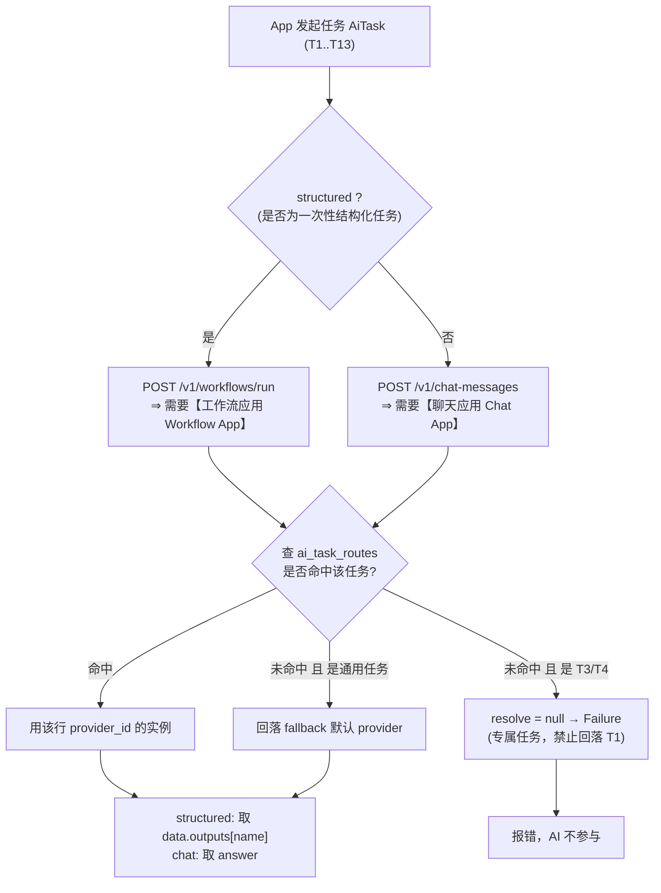

### 0.2 一个 Dify 应用 = 一行 `ai_providers`

Dify 的 Service API Key **按应用签发**：想在 Dify 建几个应用，App 侧就要加几条 provider，
并在需要时用 `ai_task_routes` 把任务绑到对应 provider。

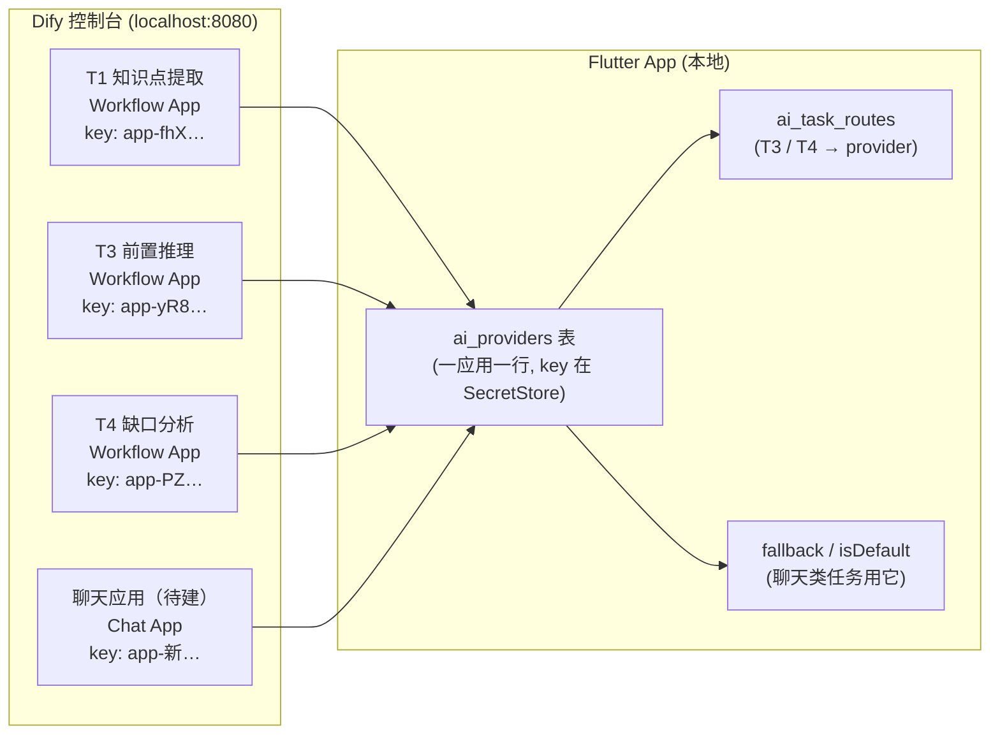

---

## 1. 通用约定（所有工作流都适用）

1. **应用类型别建错**：`structured=true`（T1/T2/T3/T4/T9/T12/T13）→ **工作流应用**；
   `structured=false`（T5/T6/T7/T8/T10/T11）→ **聊天应用**。建错类型 = 端点必错。
2. **导入 DSL / 手画后必做两件事**：
   - 打开**每个 LLM 节点**，手动选一个你**已配置的模型**（DSL 里是占位 `ollama / llama3`，不改会报节点错误）；
   - 点右上角 **「发布 / 更新发布」**——`/v1/workflows/run` **只跑已发布版本**，只保存不发布会 404。
3. **End 输出变量名 = 契约**：App 靠变量名取值（见各任务表）。名字对不上 → 字段取不到。
4. **`<think>` 容错**：推理模型（DeepSeek-R1 / Qwen 等）会在 JSON 前吐 `<think>…</think>`（可能不闭合）。
   App 端 `DifyResult.parseStructured` 已做多层容错（剥思考块 → 剥 ```json → 括号配对扫描 → 截断抢救）。
   仍建议在 LLM 提示词末尾要求「只输出 JSON，不要思考过程」。
5. **输入字段要用「段落（Paragraph）」不要「短文本」**：短文本是 Dify 平台级 **256 字符**硬上限，
   长笔记会 400（`must be less than 256 characters`）。
6. **T3 的 `points` 是「JSON 字符串」**（输入类型 string/paragraph），不是数组——直接发数组会被 400。
7. **T4 的 `depth_instruction` 必填**（缺了返回 400），任何档位都要带。
8. **聊天应用收不到具名 inputs**：`DifyClient.chatMessages` 恒发 `inputs: {}`，一切内容都塞在 `query` 里。
9. **改 Provider / 新增 Provider 后需重启 App**（bootstrap 一次性实例化）；**任务路由绑定即时生效**。

---

## 2. 已可用工作流（T1 / T3 / T4）——核对，不必重画

### T1 知识点提取（Workflow App）

- **用途 / 触发点**：笔记原文 → 结构化知识点（带 `source_quote` 锚点，入库前做锚点校验防幻觉）。
  触发：`lib/ai/extraction_service.dart:85`（提取 Tab、AI 助手「加入知识树」）。
- **应用类型 + 端点**：**Workflow App** → `POST /v1/workflows/run`。
- **节点图**：


- **输入 → 输出契约**：

| 方向 | 字段 | 说明 |
|---|---|---|
| 输入 | `inputs.note_text` | 段落文本，笔记原文 |
| 输出 | `data.outputs.knowledge_points` | **JSON 字符串**：`{"knowledge_points":[{"name","type","definition","source_quote","prerequisites":[],"confidence"}]}` |

- **搭建步骤**：控制台 → 创建应用 → 导入 `scripts/dify_t1_knowledge_extraction.yaml`；
  LLM 节点选实际模型；`note_text` 确认类型为**段落**；**发布**；访问 API 生成 Key。
- **验收冒烟**：

```bash
DIFY_API_KEY="app-xxxx" bash scripts/test_dify_workflow.sh
# 期望输出：✅ 知识点提取成功，条数 = N
```

### T3 前置知识推断（Workflow App，**专属绑定**）

- **用途 / 触发点**：一组知识点 → 它们之间的有向前置边（DAG）。触发：画布「自动连线」
  （`lib/ai/auto_graph_service.dart` `autoLink`）。
- **应用类型 + 端点**：**Workflow App** → `/v1/workflows/run`。
- **节点图**：

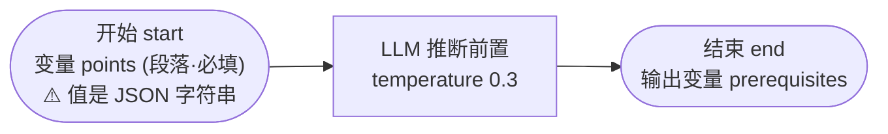

- **输入 → 输出契约**：

| 方向 | 字段 | 说明 |
|---|---|---|
| 输入 | `inputs.points` | **字符串**（App 用 `jsonEncode` 序列化）。每条含 `{id,name,type,definition}`；按组连线时追加 `{group,group_order,foundation_level}` |
| 输出 | `data.outputs.prerequisites` | JSON 字符串：`{"prerequisites":[{"from","to","reason"}]}`；`from/to` 用输入里的 id 或 name；`reason` ≤40 字 |

- **绑定**：**专属任务** —— 设置 →「AI 任务路由」把 `T3 前置知识推断` 绑到一个 provider；
  **不绑 = `resolve` 返回 null → 直接 Failure**（无本地兜底）。
- **验收冒烟**：`DIFY_T3_API_KEY="app-xxxx" bash scripts/test_dify_t3_t4.sh`（与 T4 一起跑）。

### T4 知识缺口分析 / 深度补前置（Workflow App，**专属绑定**）

- **用途 / 触发点**：单个目标知识点 → 理解它**直接**需要的前置（仅建议、不入库）。
  **多层递归由客户端驱动**，Dify 端每次只算 1 层（`level` 恒为 1）。
  触发：画布点节点 →「补充前置知识」（`auto_graph_service.dart` `autoPrerequisites`）。
- **应用类型 + 端点**：**Workflow App** → `/v1/workflows/run`。
- **节点图**：

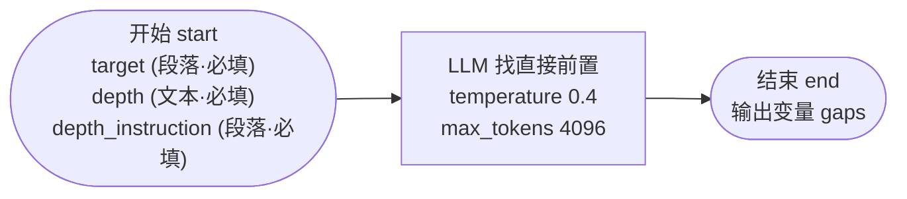

- **输入 → 输出契约**：

| 方向 | 字段 | 说明 |
|---|---|---|
| 输入 | `inputs.target` | `"<name> | <type> | <definition>"` |
| 输入 | `inputs.depth` | `low` / `medium` / `high` / `custom` |
| 输入 | `inputs.depth_instruction` | **必填**（非 custom 档也带学段文案） |
| 输出 | `data.outputs.gaps` | JSON 字符串：`{"gaps":[{"name","type","definition","reason","level"}]}`，`level` 恒为 1 |

- **绑定**：**专属任务** —— 设置 → 绑定 `T4 知识缺口分析`；不绑 = Failure。
- **验收冒烟**：`DIFY_T4_API_KEY="app-xxxx" bash scripts/test_dify_t3_t4.sh`（应返回若干 gaps 且 `level==1`）。

---

## 3. 待搭建：聊天类应用（T5 / T6 / T8）——🔴 P0，让功能真正能跑

> **核心事实**：T5/T6/T8 走 `/v1/chat-messages`，需要 **Chat App**。
> 但它们**不在「可路由任务集」**（`kRoutableTasks` 只有 T1/T3/T4），所以只能靠
> **默认 provider / fallback** 指向聊天应用。当前默认 provider 是 T1 的**工作流应用** → 三个功能现在**跑不通**。

### T5 追问 / 对话（Chat App）

- **用途 / 触发点**：自由问答 + 知识点追问。
  触发：`features/agent/agent_page.dart:131`（问答）、`features/teacher/teacher_page.dart:141`（追问）。
  **⚠️ 复用点**：AI 助手每轮回答后会**再调一次 T5** 让模型只输出 JSON
  `{"needed":[{"name","definition","reason"}],"weak":[...]}` 做「薄弱点检测」（`agent_page.dart:206`）。
- **应用类型 + 端点**：**Chat App** → `POST /v1/chat-messages`。
- **节点图**（聊天应用的编排画布）：

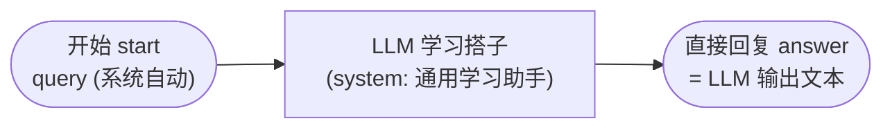

- **输入 → 输出契约**：

| 方向 | 字段 | 说明 |
|---|---|---|
| 输入 | `query` | 纯文本（用户问题；或「检测」提示词，内含对话记录 + 输出 JSON 要求） |
| 输出 | `answer` | 纯文本。检测场景须能输出 `{"needed":[…],"weak":[…]}` 的 JSON |

- **系统提示词建议**：通用学习助手；**明确说明「当用户要求只输出 JSON 时，严格只输出 JSON」**，
  否则检测场景会掺解释文字（App 会尝试正则提取，但越干净越好）。
- **搭建步骤**：创建「聊天助手 / Chat App」→ 写 system 提示词 → 选模型 → **发布** → 生成 Key。
- **验收冒烟**（见 §5 curl）。

### T6 讲解（Chat App）

- **用途 / 触发点**：针对单个知识点生成通俗讲解。触发：`features/teacher/teacher_page.dart:99`
  （老师模式「讲解」Tab 打开时自动生成，可「重新生成」）。query 里已含 `知识点名称/定义/原文`。
- **应用类型 + 端点**：**Chat App** → `/v1/chat-messages`。
- **节点图**：同 T5（开始 → LLM → 直接回复）。
- **契约**：输入 `query`（含 KP 信息的纯文本）→ 输出 `answer`（纯文本讲解）。
- **提示词建议**：通俗、循序渐进、点出易混淆概念。可与 T5 **共用同一个 Chat 应用**（App 侧只发 query）。

### T8 出题（Chat App）

- **用途 / 触发点**：作业模式——为一组薄弱点出题。触发：`features/homework/homework_page.dart:187`
  （`ai.chat(AiTask.t8Quiz, _buildPrompt())`）。**注意 `t8Quiz` 是 chat 类**（走 chat-messages，不是 workflows/run）。
- **应用类型 + 端点**：**Chat App** → `/v1/chat-messages`。
- **节点图**：同 T5（开始 → LLM → 直接回复）。
- **契约**：

| 方向 | 字段 | 说明 |
|---|---|---|
| 输入 | `query` | 纯文本：含各薄弱点「名称 / 定义 / 原文出处」+ 出题要求（数量、题型、难度） |
| 输出 | `answer` | 文本；App `_parseQuestions` 解析出 **JSON 数组** |

- **要求 App 能解析的输出**（务必让模型只输出这个数组）：
  ```json
  [{"kpName":"知识点名称","type":"short","question":"题目","answer":"参考答案","difficulty":2}]
  ```
  - `type ∈ choice | fill | short | calc | proof`
  - `difficulty ∈ 1(易) | 2(中) | 3(难)`
  - App 容错：去 ```json 围栏；优先取 `[...]` 数组，否则取对象里的 `questions/items/data/list` 字段。
- **搭建步骤**：可**复用 T5/T6 的同一个 Chat 应用**；在 system 提示词里说明「被要求出题时只输出 JSON 数组」。
- **验收冒烟**：见 §5，或直接 App 作业页点「AI 生成」。

---

## 4. 待搭建：未接线任务（T2 / T7 / T9 / T10 / T11 / T12 / T13）——🟢 P2

> **先补 Flutter 接线，再建 Dify**：这些任务 App 里**只有枚举、没有任何 UI 调用**。
> 只建 Dify 不触发；必须先在 Flutter 侧加入口 + 调 `runTask`/`chat` + 解析输出 + 落库/展示，再建应用。

各任务的应用类型（按 `structured` 标志）与建议契约如下。

### T2 知识点规范化（Workflow App）

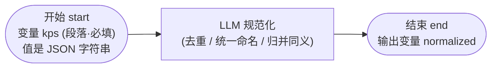

- 输入 `inputs.kps`（JSON 字符串）→ 输出 `data.outputs.normalized`（JSON：规范化后的知识点列表）。
- End 变量名需与**新写的 Flutter 解析器**一致（当前无解析器，可自定）。

### T7 苏格拉底引导（Chat App）

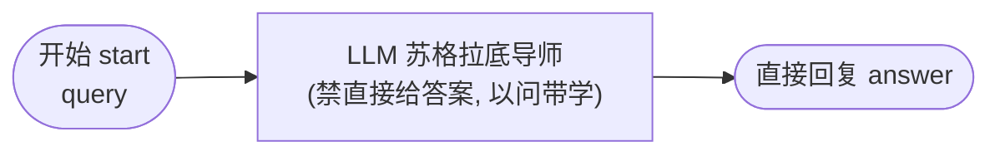

- 输入 `query` → 输出 `answer`（纯文本，多轮引导）。

### T9 批改与误区（Workflow App）

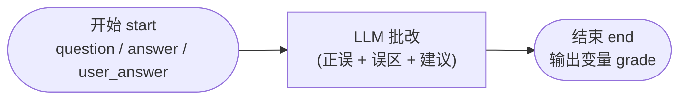

- 输入 `inputs.{question,answer,user_answer}` → 输出 `data.outputs.grade`（JSON：`{correct, reason, misconception, suggestion}`）。

### T10 讲义生成（Chat App）


- 输入 `query`（会话上下文）→ 输出 `answer`（Markdown 讲义）。

### T11 总结（Chat App）

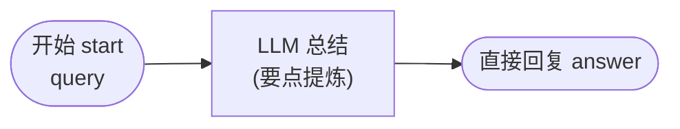

- 输入 `query`（笔记/会话内容）→ 输出 `answer`（纯文本总结）。

### T12 标题与标签（Workflow App）

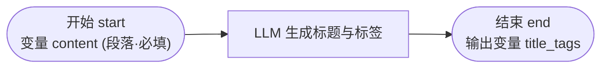

- 输入 `inputs.content` → 输出 `data.outputs.title_tags`（JSON：`{"title":"…","tags":["…"]}`）。

### T13 知识点相似度（Workflow App）


- 输入 `inputs.pairs`（JSON 字符串：`[[a,b],…]`）→ 输出 `data.outputs.similarities`（JSON：`[{a,b,score}]`）。

---

## 5. 最小可用 Chat 应用配置（让 T5 / T6 / T8 立刻能跑）

因为 T5/T6/T8 **不可路由**，唯一办法是让**默认/回落 provider 指向一个 Chat App**。

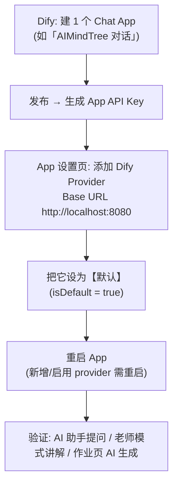

**分步**：

1. Dify 控制台 → 创建应用 → 选 **「聊天助手 / Chat App」**（不要选工作流）；
2. 写 system 提示词（通用学习助手，并要求「被要求时只输出 JSON」）；选模型；
3. **发布** → 进入「访问 API」→ 生成并复制 **App API Key**（`app-…`）；
4. App →「设置」→ 右下角「添加 Dify」→ 填显示名 / `http://localhost:8080` / 该 Key；
5. 在 provider 列表把它设为**默认**（`isDefault = true`）（或让 fallback 指向它）；
6. **重启 App**；
7. 验证：AI 助手发一句提问（T5 出文本）、老师模式看讲解（T6）、作业页点「AI 生成」（T8）。

> **更干净的替代（可选，需改代码）**：把 T5/T6/T8 也加入「可路由任务集」（`ai_task.dart` 白名单 +
> `settings_page.dart kRoutableTasks`），各自绑独立应用，就不必共享一个 chat 应用。

---

## 6. 两个必踩的坑（务必对照自检）

1. **fallback 目前是「工作流应用」** → 所有聊天类任务（T5/T6/T7/T8/T10/T11）调 `/v1/chat-messages` 必失败。
   解法：见 §5，建 Chat App 并设为默认。
2. **T3/T4 未在 `ai_task_routes` 绑定 = 直接 Failure**（无本地启发式兜底）。
   解法：设置页「AI 任务路由」把 T3、T4 各绑一个 provider。

补充：
- DSL 导入后**必须发布**；每个 LLM 节点**必须手动选实际模型**（占位 `ollama/llama3`）。
- 结构化输出有 `<think>` 容错，但 **End 输出变量名必须与契约一致**，否则取不到值。

---

## 7. 验收冒烟速查（curl）

**工作流应用**（T1/T3/T4…）：

```bash
curl -s -X POST http://localhost:8080/v1/workflows/run \
  -H "Authorization: Bearer app-xxxx" -H "Content-Type: application/json" \
  -d '{"inputs":{"note_text":"牛顿第一定律：任何物体都保持匀速直线运动或静止状态，直到外力迫使它改变运动状态为止。"},"response_mode":"blocking","user":"aimindtree-app"}'
# 期望：{"data":{"outputs":{"knowledge_points":"{...}"},...}}，status=succeeded
```

**聊天应用**（T5/T6/T8…）：

```bash
curl -s -X POST http://localhost:8080/v1/chat-messages \
  -H "Authorization: Bearer app-xxxx" -H "Content-Type: application/json" \
  -d '{"inputs":{},"query":"用一句话解释什么是惯性","response_mode":"blocking","conversation_id":"","user":"aimindtree-app"}'
# 期望：{"answer":"...","conversation_id":"..."}
```

现成脚本：`scripts/test_dify_t3_t4.sh`（T3/T4）、`scripts/test_dify_workflow.sh|ps1`（T1）、
`aimindtree_app/tool/smoke_ai_service.dart`（T1 纯 Dart 端到端）。

---

## 8. 参考位置

- DSL 样例：`scripts/dify_t1_knowledge_extraction.yaml`、`scripts/dify_t3_prerequisite.yaml`、`scripts/dify_t4_gap_analysis.yaml`
- 冒烟脚本：`scripts/test_dify_t3_t4.sh`、`scripts/test_dify_workflow.sh|ps1`、`aimindtree_app/tool/smoke_ai_service.dart`
- 文档：`docs/DIFY_WORKFLOW_REMAINING.md`（剩余工作）、`docs/WORKFLOW_T3_T4_GUIDE.md`（T3/T4 画法+绑定）、
  `docs/DIFY_KNOWLEDGE_WORKFLOW.md`（T1 交接单）、`docs/ARCHITECTURE.md §6`（13 任务与路由模型）
- App 侧代码：`aimindtree_app/lib/ai/ai_task.dart`、`ai_task_router.dart`、`ai_service.dart`、
  `clients/dify_client.dart`、`auto_graph_service.dart`、`extraction_service.dart`；
  `lib/data/db/tables.dart`（`AiProviders` / `AiTaskRoutes`）；`lib/features/settings/settings_page.dart`（绑定 UI）
