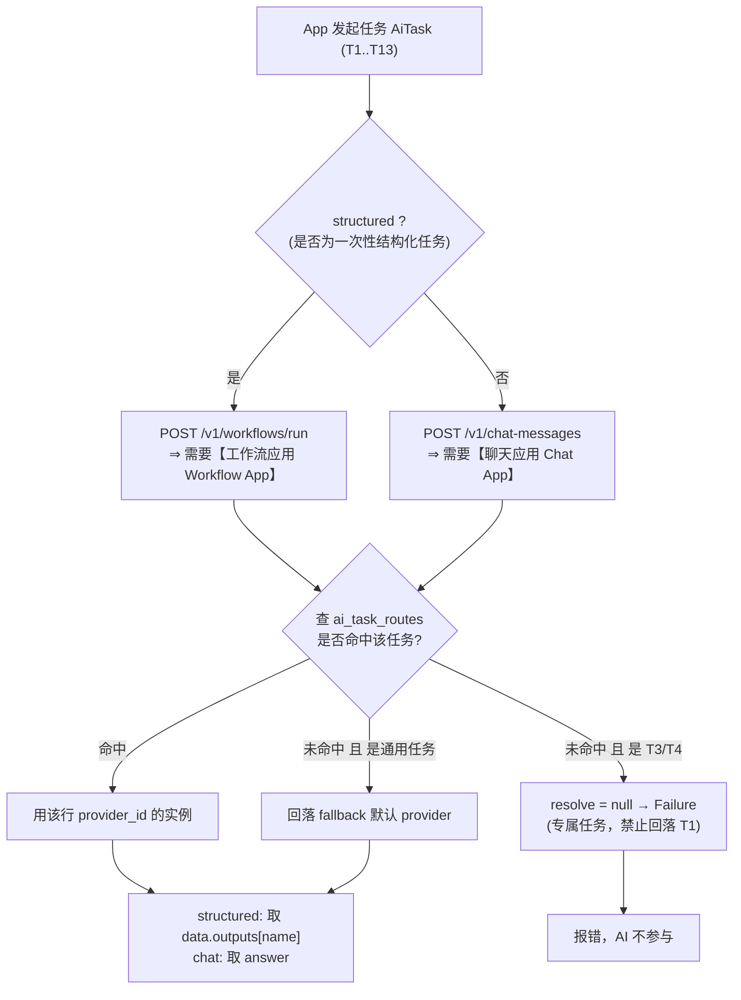
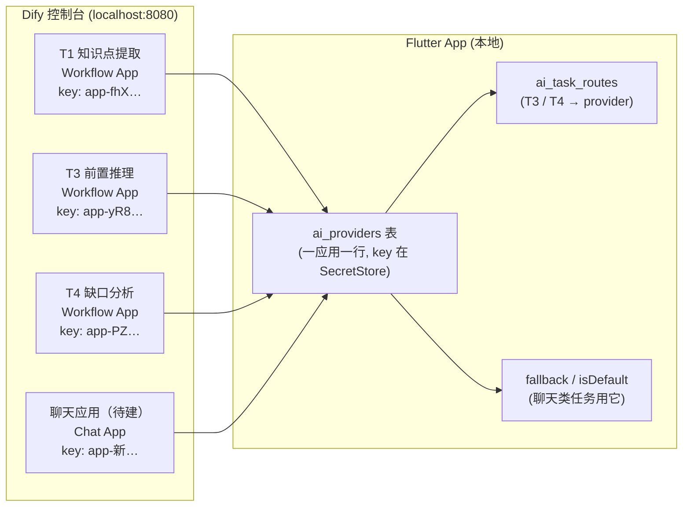
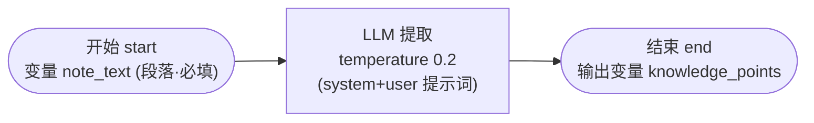
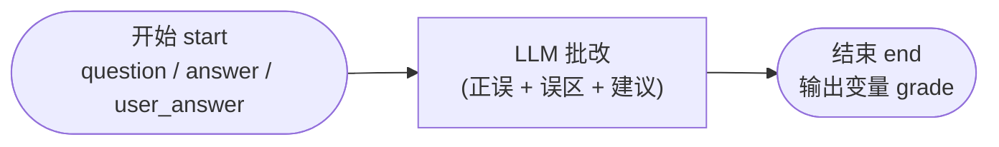
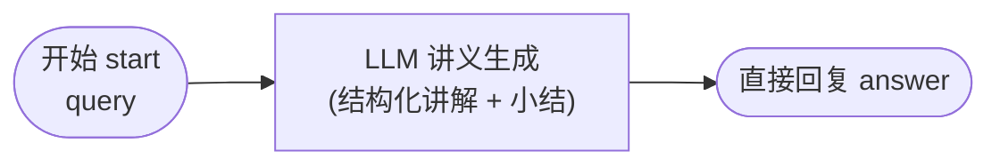
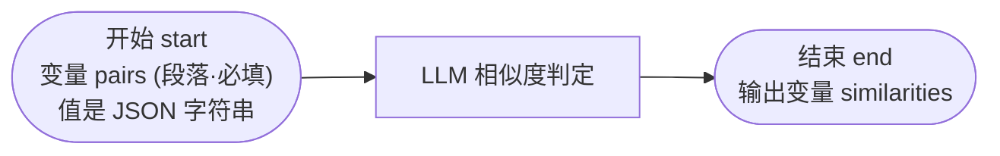
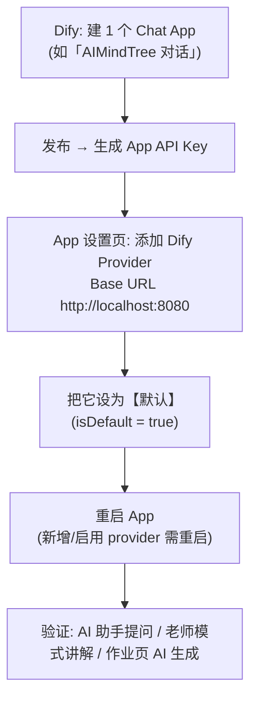

# Dify 工作流搭建教学（含 mermaid 节点图）

> 配套文档：`docs/DIFY_WORKFLOW_REMAINING.md`（剩余工作清单）。
> 本文教你**在本地 Dify（`http://localhost:8080`）从零把每个工作流 / 聊天应用搭出来**，
> 给出**节点图（mermaid）**、**精确输入→输出契约**、**完整提示词（system + user，可直接粘贴）**、
> **分步搭建**与**验收冒烟**。
> 所有字段名以 App 实际代码为准（`aimindtree_app/lib/ai/*`）。
>
> **提示词速用**：§2（T1/T3/T4）的提示词 = 现有 DSL 内已含，导入即生效；§3（T5/T6/T8）、
> §4（T2/T7/T9–T13）的提示词为**可直接复制粘贴**的成品，粘进对应 LLM / Chat 节点的
> system（工作流另有 user 模板）即可。凡输出 JSON 的，末尾都已写明「只输出 JSON，不要思考过程」。

---

## 0. 总览

### 0.1 App 怎么调 Dify：路由模型

应用按 `AiTask.structured` 标志分两类端点；路由先查 `ai_task_routes`，
**T3/T4 未绑定直接失败（禁止回落 T1）**，其余任务未绑定则回落「默认 provider」。



### 0.2 一个 Dify 应用 = 一行 `ai_providers`

Dify 的 Service API Key **按应用签发**：想在 Dify 建几个应用，App 侧就要加几条 provider，
并在需要时用 `ai_task_routes` 把任务绑到对应 provider。



---

## 1. 通用约定（所有工作流都适用）

1. **应用类型别建错**：`structured=true`（T1/T2/T3/T4/T9/T12/T13）→ **工作流应用**；
   `structured=false`（T5/T6/T7/T8/T10/T11）→ **聊天应用**。建错类型 = 端点必错。
2. **导入 DSL / 手画后必做两件事**：
   - 打开**每个 LLM 节点**，手动选一个你**已配置的模型**（DSL 里是占位 `ollama / llama3`，不改会报节点错误）；
   - 点右上角 **「发布 / 更新发布」**——`/v1/workflows/run` **只跑已发布版本**，只保存不发布会 404。
3. **End 输出变量名 = 契约**：App 靠变量名取值（见各任务表）。名字对不上 → 字段取不到。
4. **`<think>` 容错**：推理模型（DeepSeek-R1 / Qwen 等）会在 JSON 前吐 `<think>…</think>`（可能不闭合）。
   App 端 `DifyResult.parseStructured` 已做多层容错（剥思考块 → 剥 ```json → 括号配对扫描 → 截断抢救）。
   仍建议在 LLM 提示词末尾要求「只输出 JSON，不要思考过程」。
5. **输入字段要用「段落（Paragraph）」不要「短文本」**：短文本是 Dify 平台级 **256 字符**硬上限，
   长笔记会 400（`must be less than 256 characters`）。
6. **T3 的 `points` 是「JSON 字符串」**（输入类型 string/paragraph），不是数组——直接发数组会被 400。
7. **T4 的 `depth_instruction` 必填**（缺了返回 400），任何档位都要带。
8. **聊天应用收不到具名 inputs**：`DifyClient.chatMessages` 恒发 `inputs: {}`，一切内容都塞在 `query` 里。
9. **改 Provider / 新增 Provider 后需重启 App**（bootstrap 一次性实例化）；**任务路由绑定即时生效**。
10. **聊天应用的 system 提示词都必须含一段「JSON 模式」条款**（T5 检测、T8 出题都靠它）：
    当用户要求「只输出 JSON」时严格只输出 JSON，不写思考过程、不套 ``` 围栏，输出须可被 `JSON.parse` 直接解析。
    §3 的 T5/T8 提示词里已内置这段；自建其他 Chat 应用（T7/T10/T11）如也要求 JSON 输出，照抄即可。

---

## 2. 已可用工作流（T1 / T3 / T4）——核对，不必重画

### T1 知识点提取（Workflow App）

- **用途 / 触发点**：笔记原文 → 结构化知识点（带 `source_quote` 锚点，入库前做锚点校验防幻觉）。
  触发：`lib/ai/extraction_service.dart:85`（提取 Tab、AI 助手「加入知识树」）。
- **应用类型 + 端点**：**Workflow App** → `POST /v1/workflows/run`。
- **节点图**：



- **输入 → 输出契约**：

| 方向 | 字段 | 说明 |
|---|---|---|
| 输入 | `inputs.note_text` | 段落文本，笔记原文 |
| 输出 | `data.outputs.knowledge_points` | **JSON 字符串**：`{"knowledge_points":[{"name","type","definition","source_quote","prerequisites":[],"confidence"}]}` |

- **完整提示词（＝ DSL 内已有的，导入后无需手填；仅当手画时照抄）**：

  **LLM 节点 · system**：
  ```
  你是一名严谨的「知识点提取器」，服务于一款叫 AIMindTree 的 AI 知识笔记 App。
  你的唯一任务：把用户给出的一段学习笔记，拆解为独立、可复用的「知识点」。
  ```

  **LLM 节点 · user**（`{{#start.note_text#}}` 为变量占位，照抄即可）：
  ```
  请提取下面这段笔记中的知识点。

  # 笔记原文
  {{#start.note_text#}}

  # 输出要求（严格遵守）
  1. 只输出一个 JSON 对象，不要任何解释、前后缀或 Markdown 代码块标记。
  2. 结构固定为：
  {
    "knowledge_points": [
      {
        "name": "知识点名称（名词短语，≤ 20 字）",
        "type": "概念|公式|定理|方法|事实|误区",
        "definition": "一句话清晰定义（≤ 60 字）",
        "source_quote": "从原文中逐字摘抄的、能支撑该知识点的原句（必须能在原文中找到，否则留空字符串）",
        "prerequisites": ["学习本知识点前应先掌握的 0~3 个前置知识点名称，没有则为空数组"],
        "confidence": 0.0~1.0 的小数，表示你对这条提取的把握
      }
    ]
  }
  3. source_quote 必须逐字出现在原文里；若原文没有明确支撑句，source_quote 给空字符串 ""，但知识点仍可保留。
  4. 不要编造原文没有的定义；无法确认的放在 definition 里标注「（待确认）」。
  5. prerequisites 只写「名称」，不要写解释。
  ```

  > 建议 `temperature: 0.2`。`source_quote` 是 App 端**锚点铁律**的校验依据：解析后必须能在原文 `indexOf` 命中，命中不了的点会被判为幻觉剔除。

- **搭建步骤**：控制台 → 创建应用 → 导入 `scripts/dify_t1_knowledge_extraction.yaml`；
  LLM 节点选实际模型；`note_text` 确认类型为**段落**；**发布**；访问 API 生成 Key。
- **验收冒烟**：

```bash
DIFY_API_KEY="app-xxxx" bash scripts/test_dify_workflow.sh
# 期望输出：✅ 知识点提取成功，条数 = N
```

### T3 前置知识推断（Workflow App，**专属绑定**）

- **用途 / 触发点**：一组知识点 → 它们之间的有向前置边（DAG）。触发：画布「自动连线」
  （`lib/ai/auto_graph_service.dart` `autoLink`）。
- **应用类型 + 端点**：**Workflow App** → `/v1/workflows/run`。
- **节点图**：


- **输入 → 输出契约**：

| 方向 | 字段 | 说明 |
|---|---|---|
| 输入 | `inputs.points` | **字符串**（App 用 `jsonEncode` 序列化）。每条含 `{id,name,type,definition}`；按组连线时追加 `{group,group_order,foundation_level}` |
| 输出 | `data.outputs.prerequisites` | JSON 字符串：`{"prerequisites":[{"from","to","reason"}]}`；`from/to` 用输入里的 id 或 name；`reason` ≤40 字 |

- **完整提示词（＝ DSL 内已有的，导入后无需手填）**：

  **LLM 节点 · system**（`temperature: 0.3`，`max_tokens: 2048`）：
  ```
  你是一名严谨的「知识图谱工程师」，服务于一款叫 AIMindTree 的 AI 知识笔记 App。
  给定一组知识点（每条含 id / name / type / definition），你的唯一任务是推断它们之间
  的「前置关系」：若要先掌握 from 才能掌握 to，则存在一条 from → to 的边。
  ```

  **LLM 节点 · user**（`{{#start.points#}}` 为变量占位）：
  ```
  请分析下面这组知识点，推断前置关系。

  # 知识点
  {{#start.points#}}

  # 输出要求（严格遵守）
  1. 只输出一个 JSON 对象，不要任何解释、前后缀或 Markdown 代码块标记。
  2. 结构固定为：
  {
    "prerequisites": [
      {
        "from": "前置知识点的 id 或 name",
        "to": "后继知识点的 id 或 name",
        "reason": "一句话说明为什么 from 是 to 的前置（≤ 40 字）"
      }
    ]
  }
  3. from / to 必须使用输入里给出的 id 或 name（不要编造新知识点）。
  4. 关系应当是有向无环的（DAG），不要出现循环依赖。
  5. 只输出你确有把握的关系；把握低的不输出。
  ```

  > **两处 App 侧硬约束**（提示词已覆盖，但要知道原理）：
  > ① `_mergeAndPersist` 对同一 `from` **只保留首条边** → 每个知识点**出度 ≤ 1**（「最多一个后继」）；
  > ② 建边前跑 `_hasPath` 防环。所以即使模型多给了边，多余的也会被丢弃。

- **绑定**：**专属任务** —— 设置 →「AI 任务路由」把 `T3 前置知识推断` 绑到一个 provider；
  **不绑 = `resolve` 返回 null → 直接 Failure**（无本地兜底）。
- **验收冒烟**：`DIFY_T3_API_KEY="app-xxxx" bash scripts/test_dify_t3_t4.sh`（与 T4 一起跑）。

### T4 知识缺口分析 / 深度补前置（Workflow App，**专属绑定**）

- **用途 / 触发点**：单个目标知识点 → 理解它**直接**需要的前置（仅建议、不入库）。
  **多层递归由客户端驱动**，Dify 端每次只算 1 层（`level` 恒为 1）。
  触发：画布点节点 →「补充前置知识」（`auto_graph_service.dart` `autoPrerequisites`）。
- **应用类型 + 端点**：**Workflow App** → `/v1/workflows/run`。
- **节点图**：


- **输入 → 输出契约**：

| 方向 | 字段 | 说明 |
|---|---|---|
| 输入 | `inputs.target` | `"<name> | <type> | <definition>"` |
| 输入 | `inputs.depth` | `low` / `medium` / `high` / `custom` |
| 输入 | `inputs.depth_instruction` | **必填**（非 custom 档也带学段文案） |
| 输出 | `data.outputs.gaps` | JSON 字符串：`{"gaps":[{"name","type","definition","reason","level"}]}`，`level` 恒为 1 |

- **完整提示词（＝ DSL 内已有的，导入后无需手填）**：

  **LLM 节点 · system**（`temperature: 0.4`，`max_tokens: 4096`）：
  ```
  你是一名严谨的「学习路径规划师」，服务于一款叫 AIMindTree 的 AI 知识笔记 App。
  给定**单个目标知识点**，你的任务是列出理解它**直接需要**的前置知识点（即 level=1，
  只往前推一层，不要做多跳递归）。
  ```

  **LLM 节点 · user**（`{{#start.target#}}` / `{{#start.depth#}}` / `{{#start.depth_instruction#}}`）：
  ```
  请分析下面这个**单个目标知识点**，找出掌握它之前应当先掌握的直接前置知识点。

  # 目标知识点
  {{#start.target#}}

  # 深度档位
  {{#start.depth#}}
  （low=大学/高中入门级，只列最近一层；medium=初中/高中基础；high=小学/常识级，可更基础；
  custom=由下方自定义指令决定）

  
  # 自定义深度指令
  {{#start.depth_instruction#}}
  

  # 输出要求（严格遵守）
  1. 只输出一个 JSON 对象，不要任何解释、前后缀或 Markdown 代码块标记。
  2. 结构固定为：
  {
    "gaps": [
      {
        "name": "前置知识点的名称（名词短语，≤ 20 字）",
        "type": "概念|公式|定理|方法|事实|误区",
        "definition": "一句话定义（≤ 60 字）",
        "reason": "为什么需要先掌握它才能理解目标（≤ 40 字）",
        "level": 1
      }
    ]
  }
  3. 只输出**直接**前置（再往前的基础不要列，客户端会递归展开）；最多 15 条。
  4. name 必须是具体概念，不要用「基础知识」之类空泛词；不要编造目标里没有依据的前置。
  5. 每条 reason 要说明为何先于目标掌握。
  ```

  > 注意：`depth_instruction` **无论什么档位都必须传**（App 端会带上学段文案），缺失会 400。

- **绑定**：**专属任务** —— 设置 → 绑定 `T4 知识缺口分析`；不绑 = Failure。
- **验收冒烟**：`DIFY_T4_API_KEY="app-xxxx" bash scripts/test_dify_t3_t4.sh`（应返回若干 gaps 且 `level==1`）。

---

## 3. 待搭建：聊天类应用（T5 / T6 / T8）——🔴 P0，让功能真正能跑

> **核心事实**：T5/T6/T8 走 `/v1/chat-messages`，需要 **Chat App**。
> 但它们**不在「可路由任务集」**（`kRoutableTasks` 只有 T1/T3/T4），所以只能靠
> **默认 provider / fallback** 指向聊天应用。当前默认 provider 是 T1 的**工作流应用** → 三个功能现在**跑不通**。

### T5 追问 / 对话（Chat App）

- **用途 / 触发点**：自由问答 + 知识点追问。
  触发：`features/agent/agent_page.dart:131`（问答）、`features/teacher/teacher_page.dart:141`（追问）。
  **⚠️ 复用点**：AI 助手每轮回答后会**再调一次 T5** 让模型只输出 JSON
  `{"needed":[{"name","definition","reason"}],"weak":[...]}` 做「薄弱点检测」（`agent_page.dart:206`）。
- **应用类型 + 端点**：**Chat App** → `POST /v1/chat-messages`。
- **节点图**（聊天应用的编排画布）：


- **输入 → 输出契约**：

| 方向 | 字段 | 说明 |
|---|---|---|
| 输入 | `query` | 纯文本（用户问题；或「检测」提示词，内含对话记录 + 输出 JSON 要求） |
| 输出 | `answer` | 纯文本。检测场景须能输出 `{"needed":[…],"weak":[…]}` 的 JSON |

- **完整提示词**：

  **Chat App · system**（App 只发 `query`，不填 user 模板；`{{#sys.query#}}` 由平台自动接管）：
  ```
  你是 AIMindTree 的「学习搭子」——一个耐心、专业、面向中文学习者的通用学习助手。

  ## 你能做什么
  - 回答各学科的知识问题，兼顾准确性与可理解性；
  - 当用户给出「知识点名称 / 定义 / 来源原文」上下文时，紧扣该知识点作答，不要跑题、不要编造上下文里没有的数据；
  - 讲解遵循「先直觉 → 再定义 → 后例子/反例」的顺序。

  ## 输出风格
  - 默认使用简洁、结构化的中文；需要时用短列表或小标题，不要啰嗦。
  - 不确定的内容要明确说「不确定」，绝不编造事实、公式、数据或引文。
  - 数学公式用行内 LaTeX，如 $F = ma$。

  ## 【最重要】JSON 模式
  当用户消息中出现「只输出一个 JSON」「只输出 JSON」「不要任何解释」「不要代码块」等要求时，
  你必须**严格只输出该 JSON 本身**：不写思考过程、不写解释、不套 Markdown 代码块围栏（```）。
  JSON 必须可被 `JSON.parse` 直接解析。

  ## 对话上下文
  后续消息有时会以「下面是用户与 AI 助手的对话……」开头，并要求你识别知识点。
  此时请只按该条消息内部给出的 JSON 结构输出，忽略本段风格要求。
  ```

  > **检测场景的契约**（App 端 `agent_page.dart` 每轮问答后自动追加的 `query`；system 里「JSON 模式」条款就是为它服务）：
  > App 会要求输出 `{"needed":[{"name":"","definition":"","reason":""}],"weak":[{"name":"","definition":"","reason":""}]}`。
  > `needed`＝对话涉及、应掌握的知识点；`weak`＝用户明显薄弱/混淆/答错的知识点。解析失败会被静默忽略。

- **搭建步骤**：创建「聊天助手 / Chat App」→ 写 system 提示词 → 选模型 → **发布** → 生成 Key。
- **验收冒烟**（见 §5 curl）。

### T6 讲解（Chat App）

- **用途 / 触发点**：针对单个知识点生成通俗讲解。触发：`features/teacher/teacher_page.dart:99`
  （老师模式「讲解」Tab 打开时自动生成，可「重新生成」）。query 里已含 `知识点名称/定义/原文`。
- **应用类型 + 端点**：**Chat App** → `/v1/chat-messages`。
- **节点图**：同 T5（开始 → LLM → 直接回复）。
- **契约**：输入 `query`（含 KP 信息的纯文本）→ 输出 `answer`（纯文本讲解）。
- **完整提示词**（可与 T5 共用同一个 Chat App；若单独建，用下面这份）：

  **Chat App · system**：
  ```
  你是 AIMindTree 的「讲解老师」，面向中文初学者，专门把一个知识点讲透。

  用户每条消息会给出一个知识点，包含：知识点名称与类型、定义、来源原文。
  你的任务：用**通俗、循序渐进**的方式讲解它，帮助零基础的人建立直观理解。

  ## 讲解结构（按此顺序，用小标题或分段）
  1. 一句话直觉：用生活化比喻/画面先说「它大概是什么」。
  2. 正式定义：给出准确、简洁的定义。
  3. 为什么重要 / 用在哪：给 1~2 个具体应用场景或例子。
  4. 易混淆点：明确点出它容易和哪些概念搞混、区别在哪。
  5. 一句话小结。

  ## 约束
  - 只依据用户给出的名称/定义/原文讲解，不要编造原文没有的数据或事实；需要补充常识时可补，但要合理且标注清楚。
  - 语言通俗，避免堆砌术语；必须用到的术语要顺带解释。
  - 数学公式用行内 LaTeX，如 $v = at$。
  - 直接输出讲解正文，不要寒暄、不要复述题目、不要问「要不要继续」。
  ```

### T8 出题（Chat App）

- **用途 / 触发点**：作业模式——为一组薄弱点出题。触发：`features/homework/homework_page.dart:187`
  （`ai.chat(AiTask.t8Quiz, _buildPrompt())`）。**注意 `t8Quiz` 是 chat 类**（走 chat-messages，不是 workflows/run）。
- **应用类型 + 端点**：**Chat App** → `/v1/chat-messages`。
- **节点图**：同 T5（开始 → LLM → 直接回复）。
- **契约**：

| 方向 | 字段 | 说明 |
|---|---|---|
| 输入 | `query` | 纯文本：含各薄弱点「名称 / 定义 / 原文出处」+ 出题要求（数量、题型、难度） |
| 输出 | `answer` | 文本；App `_parseQuestions` 解析出 **JSON 数组** |

- **要求 App 能解析的输出**（务必让模型只输出这个数组）：
  ```json
  [{"kpName":"知识点名称","type":"short","question":"题目","answer":"参考答案","difficulty":2}]
  ```
  - `type ∈ choice | fill | short | calc | proof`
  - `difficulty ∈ 1(易) | 2(中) | 3(难)`
  - App 容错：去 ```json 围栏；优先取 `[...]` 数组，否则取对象里的 `questions/items/data/list` 字段。
- **完整提示词**（可复用 T5/T6 的同一个 Chat App，把下面这段并入 system 即可；也可单独建）：

  **Chat App · system**：
  ```
  你是 AIMindTree 的「出题老师」，依据学生薄弱知识点出练习题，帮助学生巩固。

  ## 依据
  用户消息会给出一组薄弱点，每个含：知识点名称、可选的定义、可选的「原文出处」。
  你必须**以原文为依据**出题，不要编造原文里没有的概念、数据或条件。

  ## 出题要求
  - 为每个薄弱点出 1~2 道题；
  - 题型从 choice（选择）/ fill（填空）/ short（简答）/ calc（计算）/ proof（证明或推导）中挑选最合适的；
  - difficulty 取值 1（易）/ 2（中）/ 3（难）；
  - choice 题的选项与题干都写在 question 字段里，answer 给出正确项；
  - calc / proof 题的 answer 给关键步骤与最终答案。

  ## 输出格式（最重要）
  只输出一个 **JSON 数组**，不要任何解释、不要 Markdown 代码块围栏（```）。
  数组元素格式：
  {"kpName":"知识点名称","type":"short","question":"题目","answer":"参考答案或评分要点","difficulty":2}
  - kpName 必须与用户给出的薄弱点名称一致；
  - type 只能用 choice / fill / short / calc / proof；
  - 整个输出必须能被 JSON.parse 直接解析。
  ```

- **搭建步骤**：可**复用 T5/T6 的同一个 Chat 应用**；在 system 提示词里说明「被要求出题时只输出 JSON 数组」。
- **验收冒烟**：见 §5，或直接 App 作业页点「AI 生成」。

---

## 4. 待搭建：未接线任务（T2 / T7 / T9 / T10 / T11 / T12 / T13）——🟢 P2

> **先补 Flutter 接线，再建 Dify**：这些任务 App 里**只有枚举、没有任何 UI 调用**。
> 只建 Dify 不触发；必须先在 Flutter 侧加入口 + 调 `runTask`/`chat` + 解析输出 + 落库/展示，再建应用。

各任务的应用类型（按 `structured` 标志）与建议契约如下。

### T2 知识点规范化（Workflow App）


- 输入 `inputs.kps`（JSON 字符串）→ 输出 `data.outputs.normalized`（JSON：规范化后的知识点列表）。
- End 变量名需与**新写的 Flutter 解析器**一致（当前无解析器，可自定）。
- **完整提示词**：

  **LLM · system**（建议 `temperature: 0.1`）：
  ```
  你是一名严谨的「知识点规范化器」，服务于 AIMindTree。
  你的任务：把一组可能重复、命名不一、颗粒度不一的知识点，规范化成一套干净、去重后的知识点集合。
  只做「归并与统一」，不新增原集合中不存在的新知识领域，也不编造定义。
  ```

  **LLM · user**（`{{#start.kps#}}`＝JSON 字符串）：
  ```
  请规范化下面这组知识点。

  # 原始知识点（JSON 数组，每项含 name/type/definition）
  {{#start.kps#}}

  # 规范化规则
  1. 同义或近义的知识点**合并为一条**，采用最通用、最规范的名称；
  2. 统一命名风格（名词短语，去掉「的」「关于」等冗余词）；
  3. 类型统一到：概念|公式|定理|方法|事实|误区；
  4. 合并时定义取最准确的一条，不要拼凑；
  5. 不新增原集合没有的知识点。

  # 输出要求（严格遵守）
  1. 只输出一个 JSON 对象，不要任何解释、前后缀或 Markdown 代码块标记。
  2. 结构固定为：
  {
    "normalized": [
      {
        "name": "规范化后的名称（≤ 20 字）",
        "type": "概念|公式|定理|方法|事实|误区",
        "definition": "一句话定义（≤ 60 字）",
        "merged_from": ["被合并进来的原始名称列表，未合并则为空数组"]
      }
    ]
  }
  ```

### T7 苏格拉底引导（Chat App）


- 输入 `query` → 输出 `answer`（纯文本，多轮引导）。
- **完整提示词**：

  **Chat App · system**：
  ```
  你是 AIMindTree 的「苏格拉底导师」。你的目标不是给答案，而是通过提问，引导学生**自己想通**。

  ## 核心规则
  - **绝不直接给出最终答案或结论**；即使在多轮之后，也只在学生自己说出正确方向后给予确认与补充。
  - 每一轮**只问一个**聚焦的问题，难度循序渐进。
  - 学生答错或含糊时，不要直接纠正，而是给一个更小、更具体的问题，或举一个反例让其自我发现矛盾。
  - 学生卡住时，可给「提示」但不给答案：提示要留出思考空间（如「想想边界情况下会发生什么？」）。
  - 语言简洁、友好、鼓励；每次回复控制在 3~5 句以内。

  ## 节奏
  1. 先确认学生已经理解到哪里；
  2. 再问一个能引出下一步的概念性问题；
  3. 根据回答继续追问，直到学生自己能总结出结论，最后帮其把结论讲清楚。

  直接输出你想问的话，不要输出分析过程，不要复述对方的原话。
  ```

### T9 批改与误区（Workflow App）



- 输入 `inputs.{question,answer,user_answer}` → 输出 `data.outputs.grade`（JSON：`{correct, reason, misconception, suggestion}`）。
- **完整提示词**：

  **LLM · system**（建议 `temperature: 0.2`）：
  ```
  你是一名严谨、公正的「批改老师」，服务于 AIMindTree。
  给定一道题、标准答案、学生的作答，你要判定学生答案的对错，并诊断其可能的误区。
  只依据题面与标准答案判断，不要脑补题目没有的条件。
  ```

  **LLM · user**：
  ```
  请批改下面这道题的学生作答。

  # 题目
  {{#start.question#}}

  # 标准答案
  {{#start.answer#}}

  # 学生作答
  {{#start.user_answer#}}

  # 输出要求（严格遵守）
  1. 只输出一个 JSON 对象，不要任何解释、前后缀或 Markdown 代码块标记。
  2. 结构固定为：
  {
    "correct": true 或 false（学生答案是否正确/基本正确）,
    "reason": "判定理由，说明对在哪或错在哪（≤ 80 字）",
    "misconception": "学生暴露出的知识误区（若答对且无误区则给空字符串）",
    "suggestion": "针对该误区的改进建议（≤ 80 字）"
  }
  ```

### T10 讲义生成（Chat App）



- 输入 `query`（会话上下文）→ 输出 `answer`（Markdown 讲义）。
- **完整提示词**：

  **Chat App · system**：
  ```
  你是 AIMindTree 的「讲义撰写老师」。给定一段学习内容或会话上下文，你要把它整理成一份可复用的 Markdown 讲义。

  ## 讲义结构
  1. 一级标题：主题名；
  2. 「本节要点」：3~6 条要点清单；
  3. 「核心内容」：按逻辑分小节（## 二级标题）展开，每节配定义 + 例子/推导；
  4. 「易错点」：列出常见误区；
  5. 「一句话小结」；
  6. 「自测题」：2~3 道，附答案。

  ## 约束
  - 使用规范 Markdown（标题、有序/无序列表、代码块、表格按需）。
  - 只依据给定上下文整理，不编造事实或数据；需要补常识要合理。
  - 数学公式用 LaTeX（行内 $...$，块级 $$...$$）。
  - 直接输出讲义正文，不要问「要不要继续」、不要复述要求。
  ```

### T11 总结（Chat App）


- 输入 `query`（笔记/会话内容）→ 输出 `answer`（纯文本总结）。
- **完整提示词**：

  **Chat App · system**：
  ```
  你是 AIMindTree 的「要点总结器」。给定一段笔记或对话，你要提炼出精炼、忠实的总结。

  ## 输出格式
  - 先用一句话概括主题；
  - 再给 3~7 条要点（无序列表），每条一句话、尽量保留关键概念与数字；
  - 如内容含明确的结论/步骤，用有序列表单独列出。

  ## 约束
  - 只做压缩与提炼，**不新增原文没有的信息**，不做评价或发散。
  - 语言简洁；要点之间不重复。
  - 直接输出总结正文，不要寒暄、不要复述原文。
  ```

### T12 标题与标签（Workflow App）


- 输入 `inputs.content` → 输出 `data.outputs.title_tags`（JSON：`{"title":"…","tags":["…"]}`）。
- **完整提示词**：

  **LLM · system**（建议 `temperature: 0.3`）：
  ```
  你是 AIMindTree 的「标题与标签生成器」。
  给定一段笔记正文，你要生成一个能概括全文的标题，以及一组便于检索的标签。
  ```

  **LLM · user**：
  ```
  请为下面这段笔记生成标题与标签。

  # 笔记正文
  {{#start.content#}}

  # 输出要求（严格遵守）
  1. 只输出一个 JSON 对象，不要任何解释、前后缀或 Markdown 代码块标记。
  2. 结构固定为：
  {
    "title": "概括全文的标题（≤ 20 字，不要标点结尾）",
    "tags": ["3~6 个关键词标签，每个 2~6 字，覆盖主题/学科/方法"]
  }
  3. 标签不要与标题完全重复，不要使用「笔记」「学习」这类无信息量的泛词。
  ```

### T13 知识点相似度（Workflow App）



- 输入 `inputs.pairs`（JSON 字符串：`[[a,b],…]`）→ 输出 `data.outputs.similarities`（JSON：`[{a,b,score}]`）。
- **完整提示词**：

  **LLM · system**（建议 `temperature: 0.1`）：
  ```
  你是一名严谨的「语义相似度判定器」，服务于 AIMindTree。
  给定若干「知识点两两配对」，你要判断每一对的语义相似度，输出 0~1 的小数。
  只做语义判断，不新增、不解释。
  ```

  **LLM · user**：
  ```
  请判断下面每一对知识点的相似度。

  # 知识点配对（JSON 数组，每项为 [A, B] 两个知识点名称）
  {{#start.pairs#}}

  # 判定标准
  - 1.0：同一概念的不同叫法（几乎等价）；
  - 0.8~0.99：强相关 / 一个是另一个的特例或等价表述；
  - 0.4~0.79：有关联但不等同（同一领域、从属或邻近）；
  - 0.0~0.39：基本无关。
  - 相似度应反映「是否可用同一张卡片表示」，而非仅仅同领域。

  # 输出要求（严格遵守）
  1. 只输出一个 JSON 对象，不要任何解释、前后缀或 Markdown 代码块标记。
  2. 结构固定为：
  {
    "similarities": [
      { "a": "配对里的第一个名称", "b": "配对里的第二个名称", "score": 0.0~1.0 }
    ]
  }
  3. 必须为输入的每一对都输出一项，a/b 原样照抄，不要漏项或改序。
  ```

---

## 5. 最小可用 Chat 应用配置（让 T5 / T6 / T8 立刻能跑）

因为 T5/T6/T8 **不可路由**，唯一办法是让**默认/回落 provider 指向一个 Chat App**。



**分步**：

1. Dify 控制台 → 创建应用 → 选 **「聊天助手 / Chat App」**（不要选工作流）；
2. 写 system 提示词（通用学习助手，并要求「被要求时只输出 JSON」）；选模型；
3. **发布** → 进入「访问 API」→ 生成并复制 **App API Key**（`app-…`）；
4. App →「设置」→ 右下角「添加 Dify」→ 填显示名 / `http://localhost:8080` / 该 Key；
5. 在 provider 列表把它设为**默认**（`isDefault = true`）（或让 fallback 指向它）；
6. **重启 App**；
7. 验证：AI 助手发一句提问（T5 出文本）、老师模式看讲解（T6）、作业页点「AI 生成」（T8）。

> **更干净的替代（可选，需改代码）**：把 T5/T6/T8 也加入「可路由任务集」（`ai_task.dart` 白名单 +
> `settings_page.dart kRoutableTasks`），各自绑独立应用，就不必共享一个 chat 应用。

---

## 6. 两个必踩的坑（务必对照自检）

1. **fallback 目前是「工作流应用」** → 所有聊天类任务（T5/T6/T7/T8/T10/T11）调 `/v1/chat-messages` 必失败。
   解法：见 §5，建 Chat App 并设为默认。
2. **T3/T4 未在 `ai_task_routes` 绑定 = 直接 Failure**（无本地启发式兜底）。
   解法：设置页「AI 任务路由」把 T3、T4 各绑一个 provider。

补充：
- DSL 导入后**必须发布**；每个 LLM 节点**必须手动选实际模型**（占位 `ollama/llama3`）。
- 结构化输出有 `<think>` 容错，但 **End 输出变量名必须与契约一致**，否则取不到值。

---

## 7. 验收冒烟速查（curl）

**工作流应用**（T1/T3/T4…）：

```bash
curl -s -X POST http://localhost:8080/v1/workflows/run \
  -H "Authorization: Bearer app-xxxx" -H "Content-Type: application/json" \
  -d '{"inputs":{"note_text":"牛顿第一定律：任何物体都保持匀速直线运动或静止状态，直到外力迫使它改变运动状态为止。"},"response_mode":"blocking","user":"aimindtree-app"}'
# 期望：{"data":{"outputs":{"knowledge_points":"{...}"},...}}，status=succeeded
```

**聊天应用**（T5/T6/T8…）：

```bash
curl -s -X POST http://localhost:8080/v1/chat-messages \
  -H "Authorization: Bearer app-xxxx" -H "Content-Type: application/json" \
  -d '{"inputs":{},"query":"用一句话解释什么是惯性","response_mode":"blocking","conversation_id":"","user":"aimindtree-app"}'
# 期望：{"answer":"...","conversation_id":"..."}
```

现成脚本：`scripts/test_dify_t3_t4.sh`（T3/T4）、`scripts/test_dify_workflow.sh|ps1`（T1）、
`aimindtree_app/tool/smoke_ai_service.dart`（T1 纯 Dart 端到端）。

---

## 8. 参考位置

- DSL 样例：`scripts/dify_t1_knowledge_extraction.yaml`、`scripts/dify_t3_prerequisite.yaml`、`scripts/dify_t4_gap_analysis.yaml`
- 冒烟脚本：`scripts/test_dify_t3_t4.sh`、`scripts/test_dify_workflow.sh|ps1`、`aimindtree_app/tool/smoke_ai_service.dart`
- 文档：`docs/DIFY_WORKFLOW_REMAINING.md`（剩余工作）、`docs/WORKFLOW_T3_T4_GUIDE.md`（T3/T4 画法+绑定）、
  `docs/DIFY_KNOWLEDGE_WORKFLOW.md`（T1 交接单）、`docs/ARCHITECTURE.md §6`（13 任务与路由模型）
- App 侧代码：`aimindtree_app/lib/ai/ai_task.dart`、`ai_task_router.dart`、`ai_service.dart`、
  `clients/dify_client.dart`、`auto_graph_service.dart`、`extraction_service.dart`；
  `lib/data/db/tables.dart`（`AiProviders` / `AiTaskRoutes`）；`lib/features/settings/settings_page.dart`（绑定 UI）
