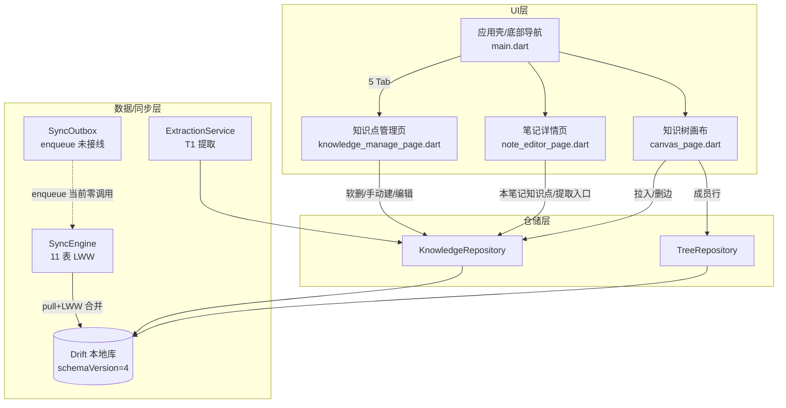
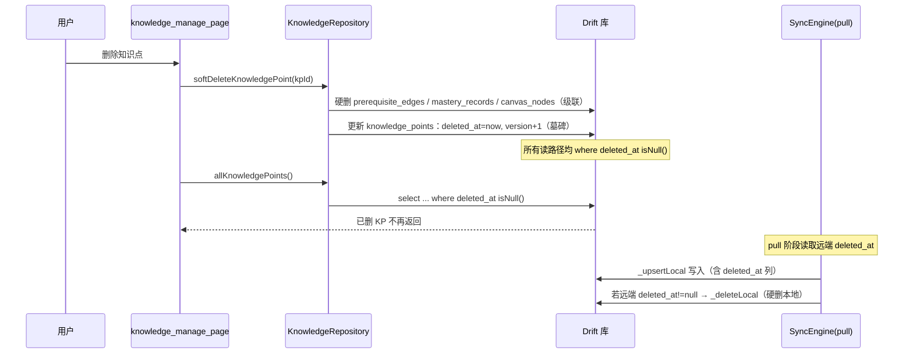

# AIMindTree 知识点管理 — P2 架构评估文档

> 本文档是 **评估性 / 分析性** 文档。依据 PRD §3.3 的约定，**P2 仅出评估、排期与架构说明，不在本期实施任何代码**。文中所有断言均带 `文件:行` 锚点；凡无法从既有代码证实者，标注「需工程师确认」而非臆造。

---

## 文档元信息

| 项 | 内容 |
|----|------|
| 文档名 | KP_MANAGEMENT_DESIGN.md |
| 文档性质 | P2 架构评估（只分析、不实现、不提交） |
| 版本 | v1.0（初稿） |
| 作者 | 软件架构师（Bob） |
| 关联 PRD | `docs/KP_MANAGEMENT_PRD.md`（产品拍板权威源） |
| 关联设计文档 | `docs/DESIGN_LLM_SERVER.md`、`docs/DESIGN_ADMIN_CONSOLE.md`（风格与铁律参照） |
| 分析基准提交 | `6efe805` feat(P1) 全量；`c41a755` fix(P0-5)；`e389f18` fix(P0-3)；`fa081a4` fix(P0-4)；`1718f63` fix(P0-1/2) |
| 技术栈 | Flutter Windows 桌面端（`aimindtree_app/`，Drift + SQLite 本地库）+ Python `llm_server/`（FastAPI，本期未涉及） |
| 适用范围 | P2-1 关系重构迁移与兼容、P2-2 同步影响；不含任何源码改动 |

### 修订记录

| 版本 | 日期 | 修订人 | 说明 |
|------|------|--------|------|
| v1.0 | — | Bob | 初稿：P1 复盘 + P2-1/P2-2 评估 + 待确认问题 |

---

## §0 评估范围与硬约束

| 约束 | 说明 | 来源 |
|------|------|------|
| 不实现 | 本文档不产生任何改动提交；所有「步骤」均为评估用描述 | 任务约定 |
| 锚点可溯 | 每条关键结论带 `文件:行`；未经代码证实者写「需工程师确认」 | 任务约定 |
| 产品权威 | 决策以 PRD 为准；架构师只评估「能否落地、代价多大、风险几何」 | PRD §1 |
| 铁律不破 | 锚点铁律、软删铁律、DropdownButton 实例替换铁律、禁 UI 直写表铁律延续 | PRD 附录 B |

---

## §1 P1 已实现架构复盘

### §1.1 组件关系图（已落地）

**关键结论**：P1 在「不新增表」前提下，把「知识点↔笔记↔知识树」三向关系全部收敛到既有 `knowledge_points` / `prerequisite_edges` / `canvas_nodes` 三张表（PRD §4.1、§P2-1 范围句③）。`source_note_id` 以**空串哨兵**表达「无来源笔记」，零 schema 变更（PRD §4.3 决策）。

### §1.2 核心数据流（软删 + 同步 payload 构造）

> 同步方向说明：上述序列仅覆盖「本地写入」与「pull 合并」。**local→server 的 push 链路当前因 SyncOutbox 未接线而实际处于惰性状态**，见 §4.5。

### §1.3 P1 各子项落地与验收状态

| PRD 子项 | 入口 / 文件 | 关键方法（文件:行） | 落地要点 | PRD 验收 |
|----------|------------|---------------------|----------|----------|
| P1-1 知识点管理页 | `lib/features/knowledge/knowledge_manage_page.dart` | `_sourceLabel`(:104) 判 `sourceNoteId.isEmpty`→「无来源笔记」；`_originFilter=='no_note'`(:62)；`softDeleteKnowledgePoint`(:313-346) | 列表/筛选/软删/手动建编辑齐备 | ✅ 达成 |
| P1-2 批量删笔记 | `lib/main.dart` | `_deleteSelected`(:402-456)、`_deleteNote`(:343-376) → `repo.deleteNote` | 摊开影响面（KP 数 / 树数）统一方案 | ✅ 达成（Q5 仍待拍板） |
| P1-3 Tab 改造 | `lib/main.dart` | `destinations`(:187-211) 5 个：笔记/知识点/知识树/设置/AI助手 | 「提取」Tab 原位替换为「知识点」Tab（5-Tab 推荐方案） | ✅ 采用 5-Tab；Q4 表单已隐含决策 |
| P1-4 知识树拉入知识点 | `lib/features/canvas/canvas_page.dart` + `lib/data/repositories/tree_repository.dart` | `_addKnowledgePoints`、`addPoints`(幂等跳过已有)、DropdownButton 实例替换防护 | 成员行仍落 `canvas_nodes`，不入新表 | ✅ 达成（铁律 `dd19a40` 回归点保留） |
| P1-5 笔记详情知识点区 | `lib/features/notes/note_editor_page.dart` | `_buildKpSection`(:166-204) 用 `pointsForNote`(:80)、`_onExtract`(T1) | 提取入口落点 PRD §4.4 | ✅ 达成 |
| P1-6 追问复用老师模式 | 复用 `TeacherPage` / `agent_tools` | agent 读 KP 经 `pointsByIds`/`allKnowledgePoints`（见 §2 审计） | 不新增对话类型 | ✅ 达成（需工程师确认 TeacherPage 复用细节） |

### §1.4 P0-3 软删铁律审计结论（Grep 实证）

对所有 KP / 笔记 / 成员 / 边 查询点的 `deleted_at isNull()` 过滤做全量扫描：

| 查询点 | 位置 | 过滤 |
|--------|------|------|
| `allKnowledgePoints` | `knowledge_repository.dart:599` | `where deleted_at isNull()` ✅ |
| `pointsForNote` | `knowledge_repository.dart:608` | `sourceNoteId.equals(noteId) & deleted_at isNull()` ✅ |
| `pointIdsOfNote` | `knowledge_repository.dart:616` | 同上 ✅ |
| `pointsByIds` | `knowledge_repository.dart:625` | `id.isIn(ids) & deleted_at isNull()` ✅ |
| `listNotes` | `knowledge_repository.dart:636` | `deleted_at isNull()` ✅ |
| 笔记列表 UI | `main.dart:250` 注释 + 列表过滤 | 软删过滤 ✅ |
| AI 检索 | `agent_tools.dart:224/244/270/340` | 经 `pointsByIds`/`allKnowledgePoints` ✅ |
| `tree_repository.sourceNoteIdsOf` | `tree_repository.dart:79-81` | **未过滤**（仅内部聚合成员 KP 的来源笔记集合，低风险）⚠️ |

**结论**：PRD §3.1 中 P0-3 所列「删除后仍可见」的读路径缺口，在已提交 P1 代码中**已闭环**。唯一未过滤点 `sourceNoteIdsOf` 仅用于删除笔记时的「影响范围提示」，不向用户复现已删实体，风险低，可登记技术债延后处理。

---

## §2 P2-1 关系重构迁移与兼容策略评估

### §2.1 现状事实（已落实，零 schema 变更）

| 事实 | 证据 | 含义 |
|------|------|------|
| `source_note_id` 为 **NOT NULL** 文本列 | `tables.dart:64` `text().named('source_note_id')()`（无 `.nullable()`） | 历史上必须填真实笔记 ULID |
| 空串哨兵已落地 | `knowledge_repository.dart:517` `String sourceNoteId = ''`（手动建默认）；`:104`/` :62` UI 判空 | 「无来源笔记」用 `''` 表达 |
| 锚点对哨兵友好 | `sourceStart/End = -1`、`sourceQuote` 对 `user_manual` 豁免（PRD §4.2） | 手动知识点不触发幻觉铁律 |
| payload 兼容 | `sync_engine.dart:418/437` 读写 `source_note_id`，空串按「无来源」 | 同步协议无变化 |

> 现状即 PRD §4.3 所采纳方案。本节评估的「可空化」是 PRD 明示的 **P2 评估项**（PRD §3.3 P2-1 范围句③），本期不做。

### §2.2 可空化迁移方案拆解（评估用，非本期实现）

若未来要将 `source_note_id` 改为 `nullable()`，涉及四块硬成本：

| 成本项 | 说明 | 证据 / 约束 |
|--------|------|-------------|
| ① `schemaVersion` +1 | 当前 `=4`（`drift_database.dart:40`），迁移需升到 `5` | 既有迁移范式见 `drift_database.dart:45-58`（onUpgrade 用 `m.createTable`/`m.addColumn`） |
| ② 手工复刻 `.g.dart` | 沙箱禁跑 `build_runner`（WSL 黑名单），任何表变更都需**人工**同步 `drift_database.g.dart` 中该列的 `VerificationMeta`/构造/序列化/companion/companion watch 等多处 | 见 `drift_database.g.dart:1189-1910` 中 `sourceNoteId` 出现约 40 处 |
| ③ SQLite 12 步表重建 | SQLite 不支持 `DROP COLUMN`/`ALTER COLUMN`；NOT NULL→nullable 必须「建新表→搬数据→删旧表→改名」 | 见 §2.3 模板 |
| ④ 旧库无损验证 | v4→v5 升级须保证 24 行既有 KP（均有真实 `source_note_id`）零丢失、语义不变 | 需工程师确认既有数据量 |

### §2.3 12 步 SQLite 表重建模板（评估用描述，非生产脚本）

> 下列为 SQLite 在旧版本下变更列约束的**通用流程**；落到本项目须由工程师据 `drift_database.g.dart` 实际列集补全并验证。

1. `BEGIN TRANSACTION;`
2. 创建新表 `knowledge_points_new`（含全部列，仅 `source_note_id` 改为可空）；
3. `INSERT INTO knowledge_points_new SELECT * FROM knowledge_points;`（列序一致则直拷；不一致须显式列映射）；
4. 对 `source_note_id=''` 的历史哨兵行，可顺手 `UPDATE ... SET source_note_id=NULL`（可选，需产品确认语义）；
5. 为 `knowledge_points_new` 重建索引 / 触发器；
6. `DROP TABLE knowledge_points;`
7. `ALTER TABLE knowledge_points_new RENAME TO knowledge_points;`
8. 重建视图 / 外键引用；
9. 跑 `PRAGMA integrity_check;`
10. 抽样比对行数 / `source_note_id` 分布与旧表一致；
11. `COMMIT;`
12. 保留 v4 完整备份，供回滚。

### §2.4 回滚方案

- **迁移前**：冷备整个 `*.db`（v4）。
- **迁移中失败**：`ROLLBACK`（§2.3 第 1/11 步事务包裹）。
- **迁移后回归**：若 v5 行为异常，用 v4 备份整体替换并降级 `schemaVersion` 回 4（需确认 Drift 是否允许降级——**需工程师确认**）。

### §2.5 成本 / 风险表

| 维度 | 空串哨兵（现状，保留） | 可空化（P2 评估） |
|------|----------------------|------------------|
| schema 变更 | 无 | v4→v5 + 12 步重建 |
| `.g.dart` 改动 | 无 | 约 40 处人工复刻（易错） |
| 旧数据风险 | 零（哨兵对旧数据无影响，PRD §P2-1 兼容句） | 需无损验证 |
| 查询成本 | `sourceNoteId.isEmpty` 判空（O(1)） | `IS NULL` 判空（等价） |
| 协议变更 | 无 | 无 |
| 风险等级 | 低 | 中（手工复刻 + 重建事务） |

### §2.6 排期估算（人日）

| 活动 | 估算 | 说明 |
|------|------|------|
| 列变更 + 迁移函数 | 0.5 d | onUpgrade 范式现成 |
| `.g.dart` 手工复刻 | 1.0 d | 易错、需逐处比对 |
| 12 步重建脚本 + 事务 | 0.5 d | |
| 旧库无损验证 + 回归测试 | 1.0 d | 含多设备同步回归 |
| 回滚演练 | 0.5 d | |
| **合计** | **≈ 3.5 人日** | 不含联调同步 |

### §2.7 架构师结论（P2-1）

**建议：本期保留空串哨兵，暂缓 `source_note_id` 可空化迁移。**

理由：
1. PRD §4.3 已产品拍板采用哨兵，且「对旧数据零影响、同步协议无变化」已被代码证实（§2.1）；
2. 可空化净收益仅为「语义更优雅」，代价是 v4→v5 重建 + 手工 `.g.dart` 复刻 + 旧库验证（≈3.5 人日、中等风险）；
3. 哨兵与 ULID 主键天然不冲突（PRD §4.3 风险缓解），无正确性隐患。

**触发可空化的条件（未来）**：当出现「需要 SQL 层 `IS NULL` 语义才能简洁表达的需求」（如统计「无来源」比例作为一等查询）且收益 > 3.5 人日成本时，再立项。

---

## §3 P2-2 同步影响评估

### §3.1 SyncEngine 覆盖表枚举（11 表）

`SyncEngine` 经 `_readLocalRow` / `_upsertLocal` / `_deleteLocal` 三处 `switch` 覆盖下列 11 张表（`sync_engine.dart:214-246` / `286-318` / `326-358`，三者 case 完全一致）：

`notebooks` · `notes` · `knowledge_points` · `prerequisite_edges` · `mastery_records` · `cards` · `canvases` · `canvas_nodes` · `canvas_edges` · `ai_sessions` · `ai_messages`

**明确排除**（`sync_engine.dart:10-11`）：`ai_providers`、`ai_task_routes`（S4 本地表，密钥不同步）。

> 与 PRD 附录 A 锚点「LWW 覆盖 11 表」一致。

### §3.2 删除传播策略 vs PRD §4.1 矩阵

| 实体 | PRD §4.1 定义 | 代码实际 | 是否跨设备传播 | 备注 |
|------|---------------|----------|----------------|------|
| 知识点 (KP) | 软删（墓碑 + version++） | `softDeleteKnowledgePoint`(:477-498) 写 `deleted_at` + `version+1` | ✅ 是（pull 经 `_merge`→`_deleteLocal`，:174-178） | 删除权威信号 |
| `canvas_nodes` 成员行 | 硬删（沿用 `deleteNote/deleteTree` 先例） | `softDeleteKnowledgePoint`(:489-491) 硬删；`TreeRepository.removePoints/deleteTree` 硬删 | ❌ 否（无 tombstone，远端无信号） | **已知限制** |
| `prerequisite_edges` 边 | PRD 写「软删」；代码为硬删 | `deletePrerequisiteEdge`(:293-295) 硬删无 tombstone；`softDeleteKnowledgePoint`(:484-486) 也硬删 | ❌ 否 | 术语与实现偏差，结果同为「移除」 |
| `mastery_records` | 保留 | `softDeleteKnowledgePoint`(:487) 硬删（级联清） | ❌ 否（非同步焦点） | |
| 笔记 | 软删 | `deleteNote`(:451) 写 `deleted_at`+version | ✅ 是 | |
| 知识树 | 硬删成员行 | `deleteTree` 硬删 `canvas_nodes` | ❌ 否 | |

### §3.3 多设备 LWW 行为

- 冲突判定：`_compare`（`sync_engine.dart:195`）以 `baseVersion` 为主、`updated_at` 为辅。
- 墓碑合并：`_merge`(:174) 当 `env.deletedAt != null` → `_deleteLocal`（本地硬删，:178）。
- 即：**含 `deleted_at` 的远端行在 pull 时会被合并为本地删除**。这正是 KP / 笔记能跨设备消失的机制。
- 成员行 / 边因本地是硬删、不写 `deleted_at`，故**不会产生可传播的墓碑** → 其他设备看不到「该成员/边被删」。

### §3.4 已知限制确认（PRD §3.3 P2-2 待评估③）

**确认成立**：「成员行（`canvas_nodes`）与前置边（`prerequisite_edges`）的删除不跨设备传播」。根因是这些删除走硬删（`knowledge_repository.dart:293-295`、`:484-491`、`TreeRepository.removePoints/deleteTree`），不写 `deleted_at` 墓碑，而 SyncEngine 仅对带 `deleted_at` 的远端行执行 `_deleteLocal`。

**影响面**：设备 A 删除某树成员 / 某前置边后，设备 B 仍保留该行（除非 B 自身也执行硬删）。属 PRD §4.1 已登记的技术债（「成员行硬删 / KP 软删不对称」）。

### §3.5 新风险：SyncOutbox 未接线（push 惰性）

- `SyncOutboxRepo.enqueue` 定义于 `sync_outbox.dart:30`，但全仓**零调用**（Grep 仅命中无关的 `logger.enqueue` 与 `remote_log_forwarder.enqueue`）。
- 即：本地写入（含 KP 软删墓碑）**不会**经 outbox 入队，SyncEngine 的 push 读到空队列 → **local→server 上行链路当前实际惰性/空转**。
- 后果：即使 KP 软删写了 `deleted_at`，若 push 不工作，远端也不会收到墓碑，跨设备删除传播在「上行」一侧失效（仅「下行 pull」在有数据时生效）。
- **此风险超出 P2 范围但必须在联调前拍板**：要么补齐 outbox 接线（写入仓储时 `enqueue`），要么在文档中明确「同步上行暂未启用」。

### §3.6 架构师结论（P2-2）

1. P2 关系重构**未新增任何表**，KP 软删天然被 SyncEngine 覆盖（PRD §P2-2 初步结论成立）；
2. 「硬删成员行 / 边不跨设备传播」作为**已知限制**确认，建议写入代码注释与本文档 §附录 B；
3. 与 PRD §4.1 矩阵**不冲突**——矩阵本身已把成员行/边定为硬删并登记技术债；
4. **新增阻断级风险**：SyncOutbox 未接线导致上行同步空转，需用户/主理人决策（见 §4 Q 补充）。

---

## §4 Q1–Q5 待确认问题 + 架构师建议

| 编号 | PRD 问题 | 现状证据 | 架构师建议 |
|------|----------|----------|------------|
| Q1 | 删除矩阵「成员硬删 / KP 软删」不对称 + 不可恢复是否接受？ | 代码已落地（:477-491, :293-295）；无回收站 | **接受**。不对称是为控制同步风险（KP 墓碑是权威信号）；不可恢复符合 P0-3「删除即消失」预期。回收站列为 P2 候选 |
| Q2 | 「删了还能看到」复现路径？ | P0-3 已在 `e389f18` 修复，§1.4 审计全绿 | 复现路径已随 P0-3 闭环；若仍复现，优先查 `tree_repository.sourceNoteIdsOf`(:79-81) 未过滤点 |
| Q3 | 报「未连接」时 llm_server 是否在跑？ | P0-4 已在 `fa081a4` 修复状态误报 | 属运行部署问题，非架构问题；建议统一用 `scripts\run_windows_fast.bat` 启动 |
| Q4 | 入口 5-Tab（推荐）还是 4-Tab？ | 已提交代码为 5-Tab（`main.dart:187-211`） | **维持已落地的 5-Tab**（「知识点」独立 Tab）。4-Tab 收纳方案会增加知识树页复杂度，收益不足 |
| Q5 | 批量删笔记「同时删知识点」是否一把梭？ | `main.dart:402-456` 弹窗摊开影响面后统一执行 `deleteNote` | 建议**一把梭**（批次内统一），符合当前实现；若未来需逐篇不同选择，属交互增强，不在本期 |

### §4.1 用户拍板记录（2026-10-22）

| 编号 | 决策 | 说明 |
|------|------|------|
| Q4 | ✅ 维持已落地 5-Tab | 用户确认「知识点」独立 Tab，不再评估 4-Tab 收纳方案 |
| Q5 | ✅ 拍板「一把梭」 | 批量删笔记时批次内统一「同时删知识点」，与当前实现一致 |
| Q1 | ⏳ 待用户理解后拍板 | 成员行/边硬删（不跨设备）+ KP 软删不对称，且无回收站；见正文解释 |
| Q-SYNC | ⏳ 待用户理解后拍板 | SyncOutbox 未接线 → 上行同步空转；见正文解释 |

> Q2/Q3 已由 P0-3/P0-4 修复闭环，无需再拍板。

### 架构师补充（非 PRD 原 Q，但需拍板）

- **Q-SYNC**：SyncOutbox 未接线（§3.5），上行同步是否本期启用？建议作为 P2 收尾或独立缺陷立项，避免在验收时被误判为「同步可用」。

---

## 附录 A：代码锚点表

| 锚点 | 含义 |
|------|------|
| `lib/data/db/tables.dart:14-31` | `SyncMeta` mixin（含 `deleted_at` nullable，:27） |
| `lib/data/db/tables.dart:54-73` | `KnowledgePoints` 表；`source_note_id` NOT NULL 于 :64 |
| `lib/data/db/drift_database.dart:40` | `schemaVersion => 4` |
| `lib/data/db/drift_database.dart:45-58` | `onUpgrade` 迁移范式（`m.createTable`/`m.addColumn`） |
| `lib/data/repositories/knowledge_repository.dart:293-295` | `deletePrerequisiteEdge` 硬删、无墓碑 |
| `lib/data/repositories/knowledge_repository.dart:403-451` | `deleteNote` 软删笔记 + 按需硬删子表 |
| `lib/data/repositories/knowledge_repository.dart:477-505` | `softDeleteKnowledgePoint` 级联硬删 + KP 墓碑 |
| `lib/data/repositories/knowledge_repository.dart:513-527` | `createManualKnowledgePoint` 哨兵默认 `''` |
| `lib/data/repositories/knowledge_repository.dart:597-636` | 全部 KP/笔记读路径 `deleted_at isNull()` 过滤 |
| `lib/data/repositories/tree_repository.dart:76-82` | `sourceNoteIdsOf` 未过滤（内部聚合，低风险） |
| `lib/features/knowledge/knowledge_manage_page.dart:62,104` | 哨兵判空 UI |
| `lib/features/knowledge/knowledge_manage_page.dart:313-346` | 软删交互 |
| `lib/main.dart:187-211` | 5-Tab 导航（笔记/知识点/知识树/设置/AI助手） |
| `lib/main.dart:250,402-456` | 软删注释 + 批量删影响面 |
| `lib/data/sync/sync_engine.dart:10-11` | 排除 `ai_providers`/`ai_task_routes` |
| `lib/data/sync/sync_engine.dart:214-358` | 11 表 `_readLocalRow`/`_upsertLocal`/`_deleteLocal` |
| `lib/data/sync/sync_engine.dart:174-178` | `_merge`：远端 `deleted_at!=null` → 本地硬删 |
| `lib/data/sync/sync_engine.dart:195` | LWW `_compare` |
| `lib/data/sync/sync_outbox.dart:30` | `enqueue` 定义，**全仓零调用** |
| `lib/ai/agent_tools.dart:253` | KP 经 `pointsByIds`/`allKnowledgePoints` 读（软删尊重） |

## 附录 B：与既有项目铁律兼容性声明

| 铁律 | 兼容性 |
|------|--------|
| 锚点铁律（AI 提取须逐字命中原文） | ✅ 保留；手动 / tutor 来源按 PRD §4.2 豁免，仅 Repository 层按 `origin` 判定 |
| 软删铁律（`deleted_at isNull()` 全量过滤） | ✅ P0-3 已落地到所有用户可见 KP/笔记读路径（§1.4）；仅 `sourceNoteIdsOf` 内部聚合点未过滤（低风险） |
| DropdownButton 实例替换铁律 | ✅ P1-4 保留 `dd19a40` 修复语义（按 id 从新列表取实例） |
| 禁止 UI 直写表（统一走 Repository） | ✅ 哨兵常量收口于 `createManualKnowledgePoint`（:517），所有写入口径可控，PRD §4.3 风险缓解成立 |
| 成员行硬删不跨设备传播（已知限制） | ⚠️ 确认存在（§3.4），建议显式注释标注，符合 PRD §4.1 技术债登记 |
| 同步上行可用性 | ⚠️ 新增风险：SyncOutbox 未接线（§3.5），需用户拍板 |

---

*文档完。本评估不含任何源码改动与提交。*
