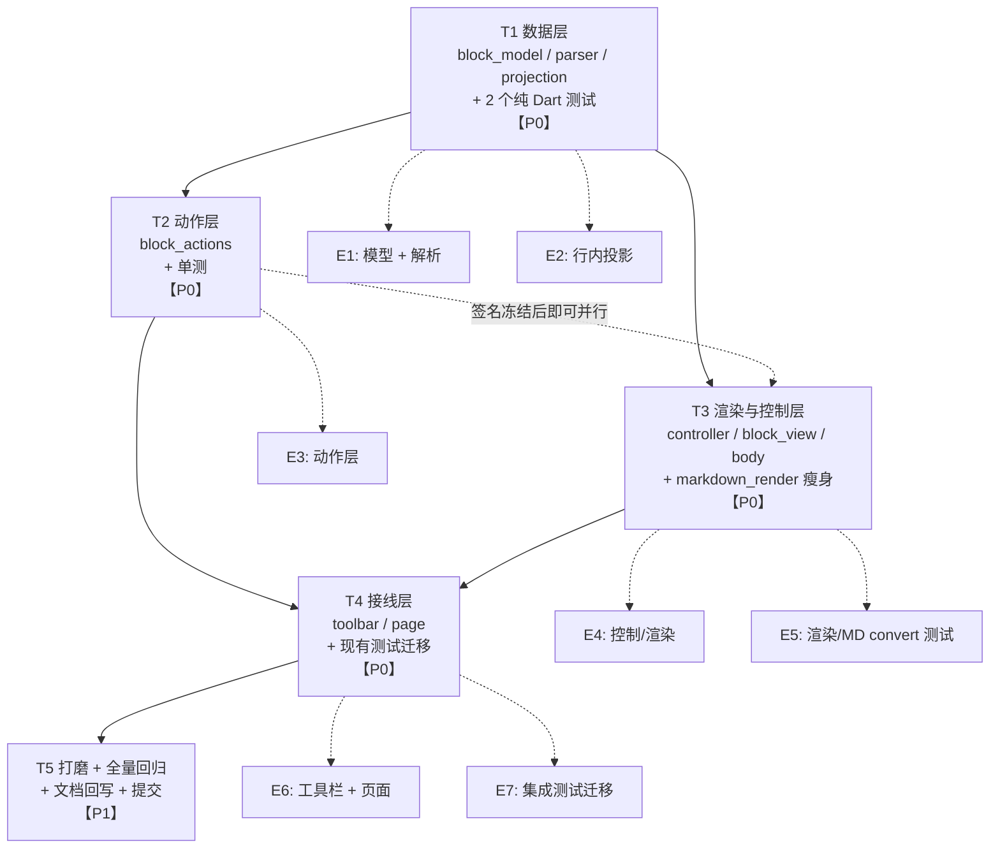
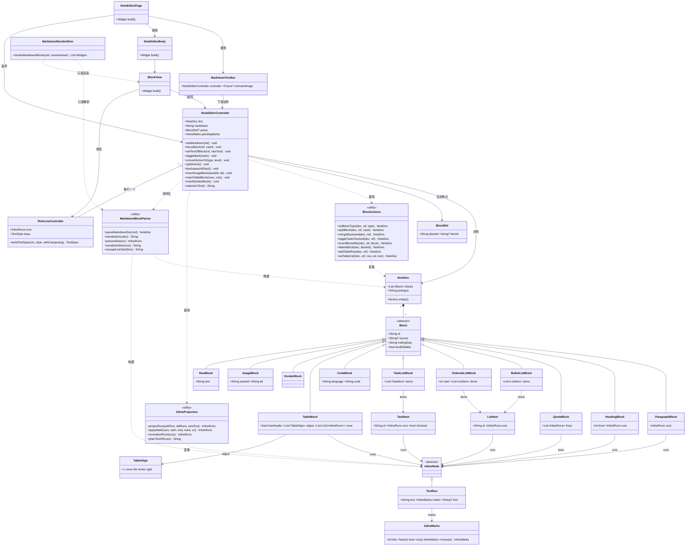

# 笔记编辑器 WYSIWYG 改造：系统设计与任务分解

> 文档版本 v1.0 ｜ 作者：软件架构师（高见远）
> 仓库根：`D:\AndroidStudioProjects\AIMindTree` ｜ Flutter 应用：`aimindtree_app/`
> 路线：**A —— 自研块级 WYSIWYG，零新增第三方依赖**
> 配套图：`docs/note_editor_wysiwyg_class.mermaid`、`docs/note_editor_wysiwyg_sequence.mermaid`

---

## 0. 决策速览（TL;DR）

| # | 议题 | 结论 |
|---|---|---|
| D1 | 数据模型 | 「扁平 Block 序列 + 扁平 TextRun 片段序列」，**不是**树、也不是「纯文本+标记位」；每个 Block 自带 `source`（原文片段）用于 byte-exact 直通 |
| D2 | 持久化格式 | **不变**，`content_md` 继续存 Markdown 纯文本（硬约束，见 §1.3） |
| D3 | 无损红线 | 三级降级：①未编辑块 → 原文直通；②可建模块 → 规范化序列化（幂等）；③不可建模 → `RawBlock` 原文兜底 + 解析 per-chunk try/catch |
| D4 | 编辑单元 | **块就地编辑**：点哪块哪块变成 `TextField`，内容是**纯文本**（不含 `#`/`-`/`>`/`**`），敲字时用自定义 `buildTextSpan` 维持加粗等视觉样式 |
| D5 | 跨块选区 | **v1 不支持**（Flutter `EditableText` 天然无法跨控件选区）；用「选区被块边界钳制 + 工具栏禁用态 + 全文复制出口」三条避免困惑 |
| D6 | `markdown_actions.dart` | **保留不删，UI 层替换**：7 个纯函数与 `extractHeadings` 全部保留（其单测全绿），但工具栏/页面改走新的 `block_actions.dart`；`markdown_actions.dart` 降级为「源码级工具库 + 未来源码模式的复用资产」 |
| D7 | `markdown_render.dart` | **保留导出符号 `renderMarkdownBlocks`**（兼容 `test/markdown_render_test.dart` 与未来只读调用方），内部瘦身为「`parseMarkdownDoc` → 渲染新模型块」的 shim |
| D8 | `markdown_toolbar.dart` | 入参 `TextEditingController` → **`NoteEditorController`**（去掉 `focusNode`，焦点归 controller 管）；19 个按钮的 **tooltip 文案一个字不改**（两个现有测试依赖） |
| D9 | 脏标记 | **即时序列化**：每次文档变更 → `serializeDoc()` → 与 `_lastBody` 比较 → 不同才置脏；`_save()` 只改一行（取 `controller.markdown`），其余不动 |
| D10 | 两个渲染缺口 | `~~删除线~~` 与 `- [ ] 任务列表` 在**新渲染器**里补齐（不改旧文件后再迁移，而是直接一步到位） |
| D11 | 任务数 | **5 个有序任务**：T1 数据层 / T2 动作层 / T3 渲染层 / T4 接线层 / T5 打磨回归 |

---

## 1. 目标、非目标与硬约束

### 1.1 用户原话拆解

> 「笔记界面不要搞成一边编辑一边显示 markdown，直接做成显示 markdown 结果但不能使用 markdown 代码编辑 markdown，相当于只有使用工具栏里面那些方式点了就直接显示不用搞两个框。」

| # | 需求 | 验收口径 |
|---|---|---|
| N1 | 去掉双框 | 页面里不再有 `Row` + 两个 `Expanded` 的 1:1 分屏（`note_editor_page.dart:625-671` 整体删除） |
| N2 | 主体就是渲染结果 | 正文区 $= 渲染后的富文本$，不是源码 |
| N3 | 不能手敲 Markdown | 任何时候编辑态里都看不到 `# `、`- `、`> `、`**`、`| --- |` 等标记字符 |
| N4 | 格式化只能走工具栏 | 选中 → 点按钮 → **立刻**看到效果（无需切 playground、无需刷新） |

### 1.2 非目标（本轮明确不做）

- 不做 **多级缩进/嵌套列表**（现有渲染器也不支持 → v1 降级为「懒 continuation 行」，内容不丢）
- 不做 **块拖拽排序**（T5 可选，可先「上移/下移」按钮）
- 不做 **协同编辑 / CRDT**
- 不做 **可见的 Markdown 源码编辑框**（这是 N3 的反面；但保留一个**隐藏的源码出口**，见 §12 待确认 Q2）
- 不引入 `flutter_quill` / `super_editor` / `appflowy_editor` / `markdown` / `flutter_markdown`

### 1.3 硬约束（不可协商）

1. **`content_md` 必须继续存 Markdown 纯文本字符串**（`lib/data/db/tables.dart:46`）。
   理由 —— 以下调用点全部按纯文本处理，改成块模型/JSON 的代价不可接受：
   - `lib/main.dart:305/392/589-591`（列表卡片摘要，截断 80 字）
   - `lib/features/canvas/canvas_page.dart:155/544/2744`（`${picked.contentMd}\n\n$md` 拼接）、`:3001`、`:3050`
   - `lib/ai/agent_tools.dart:452/474/475/517-578`（AI 工具参数就是 Markdown）
   - `lib/ai/extraction_service.dart:248/277/304`（把 contentMd 当 note_text 送 LLM）
   - `lib/data/sync/sync_row_map.dart:32/96/170`、`lib/data/sync/sync_engine.dart:1000/1119/1271`
2. **零新增第三方依赖**（`aimindtree_app/pubspec.yaml:30-47` 保持不动）。
3. **任何情况下不能丢用户内容**（数据安全红线，见 §4）。
4. **`test/markdown_render_test.dart` 现有 10 条用例语义全部保持通过**（`expect(find.byType(Table), findsOneWidget)` 一条需要改断言靶子，见 §6.4 与 T3 验收）。
5. **两个现有测试的 tooltip 不能改**：`插入图片（选本地图片，存入笔记附件）`、`划词提取`、`提取知识点 (T1)`。

> ⚠️ 依据 `docs/COLLABORATION.md` §3：**行号不是稳定锚点**。本文档所有行号仅用于本次定位，实施时请以**符号名**为准（`_buildKpSection`、`_save`、`MarkdownToolbar`…）。

---

## 2. 总体架构

### 2.1 实施路径（为什么要「块级」而不是「整篇一个 TextField」）

| 候选方案 | 否决理由 |
|---|---|
| 整篇一个 `TextField` + 自定义 `buildTextSpan` 全文实时渲染 | 标题字号/列表符号/表格/图片需要**行高与内嵌 Widget**，单个 `EditableText` 做不到；且中文输入法全文重排性能不可控 |
| 每个拆分 grain = 一行(paragraph line) | 同为「块级」，但会让「一个引用/一个代码块/一张表格」被拆成一堆碎行，争议多的 unordered/ordered list 无法成组。**块级**才最接近所见即所得 |
| 引入第三方富文本编辑器 | 违背硬约束 1/2（要重写序列化、引入依赖），且现有 7 个纯函数 + 1900 行渲染器资产浪费 |
| **块级自研（选定）** | ①复用现有 554 行渲染资产与 `AssetResolver` 契约；②(T89S) 每个块是一个标准 `TextField`，原生支持输入法/选区/光标；③Markdown 仍是唯一持久化格式；④零依赖 |

### 2.2 分层图

```
┌────────────────────────────────────────────────────────────────────┐
│ UI 层                                                              │
│   note_editor_page.dart   （页面壳体：标题 / AppBar / 知识点 / 状态栏）│
│   note_editor_body.dart   （滚动容器：SingleChildScrollView+Column） │
│   block_view.dart         （单块 Widget：只读态 ⇄ 编辑态）           │
│   markdown_toolbar.dart   （工具栏：19 个按钮 → controller 动作）     │
├────────────────────────────────────────────────────────────────────┤
│ 控制层                                                             │
│   note_editor_controller.dart  ChangeNotifier：NoteDoc 状态机 +     │
│                            每块 TextEditingController/FocusNode 注册 │
│                            + 序列化缓存 + 光标/焦点编排              │
├────────────────────────────────────────────────────────────────────┤
│ 纯逻辑层（不 import flutter/material.dart，可 100% 单测）            │
│   block_actions.dart      块级动作（分裂/合并/换类型/表格增删）       │
│   inline_projection.dart  打字时的格式投影 + mark 应用               │
│   markdown_block_parser.dart  md ⇄ NoteDoc                        │
│   block_model.dart         NoteDoc / Block / InlineNode / InlineMarks│
├────────────────────────────────────────────────────────────────────┤
│ 兼容层                                                              │
│   markdown_render.dart    renderMarkdownBlocks 兼容 shim（只导出）   │
│   markdown_actions.dart   保留不动（历史纯函数 + extractHeadings）    │
└────────────────────────────────────────────────────────────────────┘
```

**分层铁律**：箭头只能从上往下依赖。`block_model.dart` **不 import flutter**；`markdown_block_parser.dart` / `inline_projection.dart` / `block_actions.dart` 允许只 import `dart:typed_data` + `block_model.dart`（行内片段的构建/等价比较等能力都在这层，不依赖 Widget）。

---

## 3. 核心数据模型

### 3.1 类型清单（`lib/features/notes/block_model.dart` 新增）

```dart
/// 笔记文档 = 顶层块序列 + 原文「前言空白」（保证 byte-exact 还原）。
class NoteDoc {
  NoteDoc({required this.blocks, this.prologue = ''});
  final List<Block> blocks;
  final String prologue;              // 正文开头的纯空白行（可能没有）
  factory NoteDoc.empty() => NoteDoc(blocks: [ParagraphBlock.empty()]);
}

/// 块定位句柄（列表组块内部还要能定位到 item）。
class BlockRef {
  const BlockRef(this.blockId, {this.itemId});
  final String blockId;
  final String? itemId;               // 列表/任务列表的条目 id
}
```

```dart
sealed class Block {
  Block({required this.id, this.source, this.trailingGap = '\n\n'});

  final String id;                    // 会话内稳定；UI 层用作 ValueKey
  /// 解析时的原文片段（不含块间分隔符）。non-null = 「未被编辑」→ 序列化时原文直通；
  /// null = 「被用户改过 / 用户新建」→ 走规范化序列化。这是 §4 无损红线的落点。
  final String? source;
  /// 本块与下一块之间的原始分隔（'' / '\n' / '\n\n'），保证整篇 byte-exact。
  final String trailingGap;

  bool get textEditable;              // false = 图片/分割线/Raw（但有别的编辑入口）
}
```

| 块类型 | 字段 | Markdown 形态 |
|---|---|---|
| `ParagraphBlock` | `InlineRuns runs` | 纯文本（可含软换行 `\n`） |
| `HeadingBlock` | `int level(1..6)`, `InlineRuns runs` | `#{level} …` |
| `QuoteBlock` | `List<InlineRuns> lines` | `> …`（多行合并成一块） |
| `BulletListBlock` | `List<ListItem> items` | `- …` |
| `OrderedListBlock` | `int start`, `List<ListItem> items` | `n. …` |
| `TaskListBlock` | `List<TaskItem> items` | `- [ ] / - [x] …` |
| `CodeBlock` | `String language`, `String code` | ` ```lang\n…\n``` ` |
| `TableBlock` | `bool hasHeader`, `List<TableAlign> aligns`, `List<List<InlineRuns>> rows` | GFM 表格 |
| `DividerBlock` | — | `---` |
| `ImageBlock` | `String assetId`, `String alt` | `` |
| `RawBlock` | `String text` | 原样输出（消防通道） |

```dart
class ListItem { String id; InlineRuns runs; }
class TaskItem { String id; InlineRuns runs; bool checked; }
enum TableAlign { none, left, center, right }
```

### 3.2 行内格式怎么存？——选择「扁平 TextRun 序列」

候选方案对比：

| 方案 | 描述 | 判定 |
|---|---|---|
| A. 文本 + 标记位（`Text(token)`, `BoldToken` 虚拟字符） | 编辑态里要靠特殊字符承载格式 | ❌ 会在编辑态暴露 `**` 等符号，直接违背 N3 |
| B. 富文本树（`Paragraph(children:[Link(children:[Bold(text)])])`） | 表达力强 | ❌ 每次按键都要做树 diff/区间重算，成本高、连通性易错 |
| **C. 扁平 run 序列（选定）** | `List<TextRun>`，每个 run 自带一套 **`InlineMarks` 位标记 + 可选 href** | ✅ |

**选择 C 的三条理由**：

1. **N3/N4 的硬要求**：编辑态的文本是 `plainTextOf(runs)` 的纯字符串，格式信息活在旁边的字段里 → 编辑器里看不见任何 Markdown 标记，点工具栏就是改 `marks`。
2. **编辑不用担心数据结构重构**：任何一次按键只需要做「字符串维度的编辑 + 格式投影」（§3.4），不需要树 reconcile。
3. **覆盖度足够**：真实笔记里的组合 99% 是「加粗/斜体/代码/删除线/链接」的**单层**组合。`[**粗链接**](url)` 这种嵌套，退化成「一个同时带 `bold` 与 `href` 的 run」即可无损表达（§3.3 的规则 R5）。真正的多层嵌套（图片套链接）本轮不建模 → 走降级。

```dart
/// 行内节点（扁平）。
sealed class InlineNode { const InlineNode(); }

typedef InlineRuns = List<InlineNode>;

/// 文本片段：text 是**纯文本**，绝不含 Markdown 标记字符。
class TextRun extends InlineNode {
  const TextRun(this.text, {this.marks = InlineMarks.none, this.href});
  final String text;
  final InlineMarks marks;   // 粗/斜/码/删除线 的按位组合
  final String? href;        // 非空 = 链接；渲染时 text 即链接文案
}

/// 位标记（int bitmask 包装，方便等值比较与 copy）。
class InlineMarks {
  const InlineMarks._(this.bits);
  static const none   = InlineMarks._(0);
  static const bold   = InlineMarks._(1);
  static const italic = InlineMarks._(2);
  static const code   = InlineMarks._(4);
  static const strike = InlineMarks._(8);
  final int bits;
  bool has(InlineMarks m) => (bits & m.bits) == m.bits;
  InlineMarks operator |(InlineMarks o) => InlineMarks._(bits | o.bits);
  InlineMarks operator -(InlineMarks o) => InlineMarks._(bits & ~o.bits);
  // == / hashCode / toString 必须实现
}
```

**刻意不建模的产物清单（遇到就降级，见 §4）**：
`<html>` 标签、脚注 `[^1]`、定义列表、脚注引用、表格单元格合并、数学公式 `$math$`、多层嵌套列表缩进、**行内图片混排**（见 R6）、setext 标题（`===` / `---` 下划线形式的标题）。

> **R6（重要决定）**：行内图片**不在 `InlineNode` 里建模**。解析阶段一旦在段落里发现 ``，就把这一段**切**成 `Paragraph / ImageBlock / Paragraph …` 的块序列（见 §4.2 规则 R6）。
> 好处：编辑态里不需要处理 `U+FFFC` 对象占位符，`projectRuns` 只需处理纯文本；坏处：图文混排的行会变成「图独占一行」。可接受 —— 工具栏插入的图片本来就是独占行；Notion/Typora 落地上也更常见。
> 对现有测试：`正文开头  正文结尾` 这条用例断言的是「两个正文段都渲染出来 + 有 broken_image + 有『图片未同步』」，切成三段后**全部仍然成立**。

### 3.3 序列化 / 反序列化规则（契约）

| 规则 | 内容 |
|---|---|
| R1 | 空文档 → `''`；只含一个空段落的文档 → 也序列化成 `''`（避免新笔记落库出现空行垃圾） |
| R2 | 块之间用 `trailingGap` 连接（来自解析时的原文），新建/插入的块默认 `'\n\n'` |
| R3 | 标题按级别生成 `'#' * level + ' '`；列表项序号按 `start + i`；任务项 `- [ ] ` / `- [x] ` |
| R4 | 代码块语言**必须往返保留**（修复现网缺陷：`markdown_render.dart:319` 把 language 剥掉丢了）；无语言时输出裸 ` ``` ` |
| R5 | 行内：先按「相邻相同 `marks+href` 归并」再输出；mark 优先级 `code > bold > italic > strike`（`**粗斜**` → `***x***`，code 不与其他叠加，遇到叠加则拆 run） |
| R6 | 图片统统变成独立 `ImageBlock`，行内图片在**解析阶段**被切开 |
| R7 | 表格对齐在新模型里被**保留并输出**（`| :-- |` / `| :-: |` / `| --: |`），修复现网「表格不支持对齐」的短板（优先级 P1，低成本） |
| R8 | 用户手打的字面特殊字符必须转义：`\ * _ `` ` `` [ ]` 以及**行首的** `# - * + > |` 与 `数字.`，且只在「不转义就会被二次解析成别的块」时才转义 |
| R9 | 解析必须 `\r\n → \n` 归一化；归一化的输入与输出相等是唯一允许的 byte 差异 |

**R8 转义的严格界定（很重要，别过度转义）**：

```dart
/// 只在「不转义就会被重新解析成别的块」时转义，避免把用户原文改得满目疮痍。
String escapeLineStart(String line, String serialized) {
  // 仅当 line 以 block-start 符号开头（可能带前导空格）时，在该符号前插一个 '\'
}
```
- 只有**用户真正编辑过的块**才会走 canonical 序列化 → 才会触发转义 → 影响面极小（§4 D3）。
- 未编辑的块走 `source` 直通，原文一个字节都不动。

### 3.4 打字时的格式投影（`lib/features/notes/inline_projection.dart` 新增）

编辑某块时，`TextField` 里放的是 `plainTextOf(runs)`；用户按键后文本变了，需要把旧的格式「投影」到新文本上：

```dart
/// 旧纯文本 + 旧 run 序列 + 新纯文本 → 新 run 序列（保留未改动区间的格式）。
///
/// 算法（O(n)，每个按键一次，块级文本量足够小）：
///   1. 求 oldText/newText 的公共前缀 p；
///   2. 在剩余部分求公共后缀 s；
///   3. 头部 [0,p) 的 runs 原样保留（可能要裁剪最后一段）；
///   4. 尾部 [len-s,len) 的 runs 原样保留；
///   5. 中间的新增部分继承「插入点所在 run」的 marks+href（这就是编辑器的标准行为）；
///   6. normalizeRuns()：合并相邻同属性 run、丢弃空文本 run。
List<InlineNode> projectRuns(String oldText, InlineRuns oldRuns, String newText);

/// 给 [start,end) 区间加/取消某个 mark（工具栏入口）。
List<InlineNode> applyMark(InlineRuns runs, int start, int end, InlineMarks mark, {required bool on});

/// 归并 + 丢弃空 run；同时保证 plainText 与 text 长度严格对齐（便于 assert）。
List<InlineNode> normalizeRuns(InlineRuns runs);

String plainTextOf(InlineRuns runs);
```

**必须配套的防御机制**：因为 `onChanged` 触发前 Flutter 可能已经用**旧的 runs**渲染过一次新文本，所以 `buildTextSpan`（§5.2）必须做长度**钳制**，超出部分按 base 样式回退 —— 绝不允许 `RangeError`。

### 3.5 类图

见 `docs/note_editor_wysiwyg_class.mermaid`（同时贴在 §14）。

---

## 4. Markdown ↔ 块模型：无损红线与降级策略（重点）

这是本次改造的**数据安全红线**。用户笔记里有 AI 生成的内容、画布拼接的内容、同步对端推来的内容，解析器必须对所有输入「既不崩、也不丢」。

### 4.1 三级降级（必须全部实现）

| 级别 | 条件 | 行为 | 保证 |
|---|---|---|---|
| **L1 原文直通** | Block 未被用户编辑（`source != null`） | `serializeDoc` 直接输出 `source` + `trailingGap` | **整篇未编辑 → `serializeDoc(parseMd(md)) == md` 字节级相等** |
| **L2 规范化序列化** | Block 被编辑过（`source == null`） | 走 §3.3 规则生成 | 幂等：`parse(serialize(parse(md))) ≡ parse(md)`（结构相等） |
| **L3 原文兜底 `RawBlock`** | 解析器对某段**完全无法建模**或解析抛异常 | 该段整体装进 `RawBlock(text: 原文)`，编辑态是等宽纯文本框 + 「此块含不支持格式」提示条 | **字符保真**：原文一行不少 |

**L1 的隐藏红利（务必向团队强调）**：
> 打开一篇笔记、什么都不改、点保存 —— 落库的 `content_md` 与原文**逐字节相同**。
> 否则每次开笔记都会因为「重新格式化」产生假差异 → `version` 自增 → 同步时对端无谓冲突。这是带同步功能的应用的硬性要求。

### 4.2 解析器必须遵守的 8 条完备性规则

（`lib/features/notes/markdown_block_parser.dart`）

| # | 规则 |
|---|---|
| P1 | **逐行扫描，每行有且仅有一个归属块** —— 不允许任何一行被「漏读」或「读两次」；`while` 循环里每个分支都必须推进游标 `i` |
| P2 | **不 `trimRight`**：`markdown_render.dart:175` 现在会对段落行做 `trimRight()`（丢行尾空格）。新解析器必须保留原样（渲染时才允许裁剪视觉空白） |
| P3 | 段落的「懒 continuation」：接续行（不匹配任何 block-start 且上一段是段落）并入同一段落，原文保留 `\n` 软换行；`\` 结尾的行也并入（软换行） |
| P4 | **列表续行**：列表内部的缩进行（不匹配 `- ` / `n. `）附到前一个 item 的文本里（序列化时还原成两空格缩进），不做嵌套狱正义妥协 —— 只是「保留原文全部字符」 |
| P5 | **未闭合围栏**：```` ```abc ```` 到 EOF 没有收尾 → 判为一个 `CodeBlock`（内容 = 剩余所有行），并在序列化时补一个 ```` ``` ````；这是唯一允许的「输出 != 输入」的结构补齐（内容一字不少），且幂等 |
| P6 | **含图片的段落切开**：按 R6 切成 `P / Image / P …` 序列 |
| P7 | **每个块组 build 外面包 `try/catch`**，catch 到任何异常 → 该组的原始行组成 `RawBlock`（解析永远不崩、永不静默吞文本） |
| P8 | 表格识别只在「当前行以 `|` 开头且下一行是合法分隔行」时触发；否则当段落（含转义，见 R8）。这条容错口径对现有测试「随便一段｜没有分隔行｜」仍然成立 |

### 4.3 完备性怎么验证（测试策略）

除了常规用例，**必须**有一条「== 收集.Wrapping harness 的**：

```dart
// test/block_model_parse_test.dart
// 语料：30 条真实/刁钻 Markdown（中文、含 Emoji、含 CRLF、含行尾空格、含转义、
//       未闭合围栏、嵌套缩进、"数字." 开头、《我是硝酸Special chars》…）
test('任何语料：解析→序列化→再解析 幂等，且字符无丢失', () {
  for (final md in kCorpus) {
    final normalized = md.replaceAll('\r\n', '\n');
    final d1 = parseMarkdownDoc(normalized);
    expect(serializeDoc(d1), normalized, reason: 'L1 直通必须字节相等');
    final d2 = parseMarkdownDoc(serializeDoc(d1));
    expect(structuralEquals(d1, d2), isTrue, reason: '必须幂等');
    expect(stripNoise(serializeDoc(d1)), stripNoise(normalized), reason: '禁止丢字符');
  }
});
```
其中 `stripNoise` 去掉所有空白与 Markdown 标点，只比较「实质字符」——这样即使某处置换了 `*`/`-`，也能抓到真正的丢字。

> ⚠️ 依据 `docs/COLLABORATION.md` §4：**护栏必须证明它会红**。T1 收工前必须做一次反证：故意把 P1 的游标 `i++` 删掉一处（或把 `trimRight` 加回来），上面这条 `expect` **必须变红**，截图入 `commit message`。

---

## 5. 编辑交互规格（落地到按键）

### 5.1 状态机

```
        ┌──────────────────────────────────────────┐
        │  READ（默认）：整篇按 BlockView 渲染       │
        │  看不到任何 Markdown 标记（N2/N3）         │
        └──────────────┬───────────────────────────┘
                       │ 用户点某块（tap）
                       ▼
        ┌──────────────────────────────────────────┐
        │  EDIT(block=n)：该块换成 TextField        │
        │  · 文本 = plainTextOf(runs)（纯文本）     │
        │  · 样式 = 自定义 buildTextSpan（§5.2）    │
        │  · 同一块的「行」(列表项/引用行)各自独立   │
        └──────────────┬───────────────────────────┘
                       │ 失焦 / 点其它块 / 点空白
                       ▼
              commit 到 NoteDoc → 立刻重新渲染（N4）
```

- **一次只有一个活动行**：`controller.active: BlockRef?`（含 `itemId`）。
- 失焦时：**不清空 blocks**，只是回到 READ；序列化与 commit 在按键时已实时完成，失焦只做 UI 切换。
- 点整个滚动区底部的空白 → 追加空段落并聚焦（永不出现「没地方点」的死区）。

### 5.2 编辑态还能看到加粗/斜体（真 WYSIWYG 的关键）

用一个 `TextEditingController` 子类覆写 `buildTextSpan`：

```dart
class RichLineController extends TextEditingController {
  RichLineController({required this.base, List<InlineNode> runs = const []});

  final TextStyle base;
  InlineRuns runs = const [];            // set 后必须 notifyListeners()

  @override
  TextSpan buildTextSpan({required BuildContext context,
      TextStyle? style, required bool withComposing}) {
    // 0) 输入法组字期间：一律回退到父类实现（避免组字过程中错位/错字）
    if (withComposing && value.composing.isValid && !value.composing.isCollapsed) {
      return super.buildTextSpan(context: context, style: style, withComposing: withComposing);
    }
    // 1) 长度不一致（打字瞬间的一帧）→ 钳制到安全范围，超出部分用 base，绝不 RangeError
    // 2) 逐 run 生成 TextSpan（styleFor(marks, base)）
  }
}
```

| 注意 | 说明 |
|---|---|
| 时机 | `onChanged` 里先 `projectRuns()` 再写回 `runs`，然后 `notifyListeners()`（同帧生效） |
| 长度钳制 | 必须 —— 否则会是生产崩溃来源（记为 R-1） |
| IME | 中文输入法组合期回退 —— 记为 R-6，T5 真机验证 |

### 5.3 回车（Enter）行为矩阵

| 当前所在 | 行为 |
|---|---|
| 段落 | 按光标**分裂**成两个段落（后半为空 → 产生空段落） |
| 标题 | 下方新建**段落**并聚焦（避免连写标题） |
| 引用行 | 同一 `QuoteBlock` 内**新增一行**；若当前行是空行 → 该行退出引用成为段落，并在下方再插一个空段落 |
| 无序 / 有序 / 任务列表项 | 同一 list block 内**分裂成两项**；若当前项是**空项** → 「列表收尾」：该项降级为独立段落并聚焦其中 |
| 代码块 | 插入换行（软）；**在最后一个空行上再按 Enter** → 退出代码块转成段落（并提供工具栏「转段落」作为第二出口） |
| 表格 | 光标跳下一单元格；最后一行最后一格 → **追加一行** |
| 图片 / 分割线 / RawBlock | 块不是编辑态；若在相邻位置则下方插入空段落并聚焦（RawBlock 内部回车 = 插换行） |
| `Shift+Enter` | 除表格/代码块外，一律在当前块内插入软换行 `\n`（不分裂） |

**实现方式（重要，别走原生按键拦截的坑）**：
> 用 **`onChanged` 里检测文本中新增了 `\n`** 来做分裂判定 —— 这样桌面/移动端/输入法的换行都能覆盖；检测到 `\n` 后：先把 `\n` 撤掉（还原上一帧文本），再执行上表的语义动作。
> 是否按了 Shift：在 `onChanged` 里读 `HardwareKeyboard.instance` 的 Shift 按下状态（此时 KeyDown 还在处理链上）。若不可靠 → Fallback：在祖先 `Focus(onKeyEvent:)` 里只**观察**（不消费）并在 Enter 时置一个 `_shiftOnEnter` 标记。记为 R-7，T5 必须在桌面 + Android 两边实测。

### 5.4 退格（Backspace）在行首

| 场景（光标在本行 0 位、无选区） | 行为 |
|---|---|
| 列表 / 任务列表中的**非首项** | 删除本项，光标落到**前一项末尾**（不跨块合并） |
| 列表 / 任务列表的**首项** | **降级**：该 item 从列表里脱离，成为独立段落（内容保留），不合并 |
| 标题 / 引用第一行 / 代码块 / RawBlock | **降级为段落**（保留文本）。第二次退格才走合并 |
| 引用的**非首行** | **并入上一行**（与「列表非首项并进前一项」同款：块结构、行数、marks 全不变，拼接 == 原文）。这是设计 §5.4 的原意，落地由 `block_actions.mergeBackward`（`itemIndex`）承担 |
| 段落，上一个是段落 / 列表 / 引用 / 标题 | **合并**进上一个块末尾（列表→成为其新末项；引用→成为其新末行；标题/段落→文本拼接） |
| 段落，上一个是代码块 / 表格 / 分割线 / 图片 / RawBlock | **删除上一个块**（等价于选中删除），光标留在当前段落头 |
| 段落且没有上一个块 | 无操作（不触发 `Navigator.pop`） |
| 表格单元格空 | 不跨单元格合并，无操作 |

**为什么不直接「一律合并」**：Notion 式**两级退格（先降级、再合并）**让用户有撤销岔路口，避免「标题退格一下就被吃进上一段」的惊吓。

**实现**：退格在 offset 0 时**不产生 onChange**，所以这里**必须**拦截按键：祖先 `Focus(onKeyEvent:)` 在 `LogicalKeyboardKey.backspace`（KeyUp 用它判断是否已消费）满足条件时返回 `KeyEventResult.handled` 并执行上表动作。软键盘（Android 输入法）可能绕过 → 降级为无操作（可接受，记为 R-8）。

### 5.5 跨块选区：明确不支持，并怎样避免用户困惑

**结论：v1 不支持跨多重 `TextField` 的选区**（Flutter 原生做不到，自研跨块选区要重写入选区/渲染/IME，代价远超本轮预算）。

用四条把困惑压到最低：

1. **物理钳制**：拖选经过块边界时，选区自动停在本块边界 —— 用户看到的是「选到这块就停了」，不会出现「看起来选了 3 块但格式化只作用 1 块」的幻觉。
2. **工具栏禁用态**：活动行是代码块/表格/RawBlock 时，**行内格式 5 个按钮置灰**（而不是隐藏），tooltip 追加说明「代码块/表格不支持行内格式」。隐藏会让用户以为功能没了，置灰 + 说明才是正确 UX。
3. **`Ctrl/Cmd+A` 语义**改为「选中本块全文」，`SnackBar` 提示一句「已选中本段；若要整篇请在右上角菜单用『复制全文』」。
4. **整篇出口**：AppBar 溢出菜单加「复制全文」（= `controller.markdown` 进剪贴板），给跨块搬运留一条路。

### 5.6 工具栏切换块类型后如何保持光标

因为每个动作都定位到 `(blockId, itemId)`，不会因为全文重算而丢失锚点：

```
用户点 H2 → controller.convertActiveTo(BlockType.heading, level: 2)
  ├─ 1) oldRef = controller.active；caret = 当前 selection.extent（块内偏移）
  ├─ 2) doc = BlockActions.setBlockType(doc, oldRef, Heading)
  ├─ 3) commit() → serializeDoc → 通知 UI
  └─ 4) focusNodeFor(newRef).requestFocus() 并把 selection 设成 collapsed(offset: caret')
        caret' = caret.clamp(0, plainTextOf(newRuns).length)   // 内容不变 → 通常完全一致
```
- 标题→列表→引用这类互转**只改类型不改文本**，所以 `caret' == caret` 严格成立。
- 一个 `QuoteBlock` 多行 → 转段落时，只有光标所在行变成段落，其余行仍留在原 quote 块里（主块占用原 id → 光标不丢）。落地签名：`setBlockType(doc, at, type, {headingLevel, itemIndex})`，`itemIndex` 即光标所在行号。
  - **块顺序（as-built，`_liftFromQuote`）**：`itemIndex == 0` → **主块在前、残余引用在后**；`itemIndex > 0` → **残余引用在前、主块在后**。两种排法都由「最后一块接管原块的 `trailingGap`、中间那块用 `_gapOf`」保证分隔不串味。参考实现期控制器曾**一律**把残余排前面，导致「首行转标题」顺序是反的；`8230f54` 改走纯函数后与本节描述一致。

### 5.7 非纯文本块的编辑入口

| 块 | 编辑入口 | 编辑形态 |
|---|---|---|
| `ImageBlock` | 单击图片 → `Stack` 浮层出现 3 个按钮：**替换图片 / 删除 / 改替代文字** | 异步：`AssetResolver` 字节一次到位；替换走页面现有 `onInsertImage` 流水线（换 `assetId`） |
| `CodeBlock` | 单击 → 变多等宽 `TextField`（内容即 `code`） | 右上角语言 chip（`DropdownButton`）：dart/java/python/js/sql/自定义/无；语言**回写到围栏的语言标注**（修复现网丢弃语言的缺陷） |
| `TableBlock` | 单击 → 进入表格编辑态：表体上方出现小工具条（加行/加列/删行/删列/表头开关/列左中右），每个单元格是独立 `TextField` | 见 §6.4：渲染改用 `Row/Column` 承载，避免 `Table` widget 与输入框的尺寸打架 |
| `DividerBlock` | 单击 → 高亮 + 删除按钮 | 无文本可编辑 |
| `RawBlock` | 单击 → 等宽纯文本框 + 顶部黄色提示「此块含不支持的格式，按原文编辑」 | 直接编辑 `text`，`source` 恒等于 `text` |

---

## 6. 接线设计

### 6.1 工具栏入参改造（`markdown_toolbar.dart`）

**结论：替换 —— UI 层全部改走 `NoteEditorController`；`markdown_actions.dart` 文件保留不删。**

```dart
class MarkdownToolbar extends StatelessWidget {   // 类名保留（对外符号不变）
  const MarkdownToolbar({
    super.key,
    required this.controller,        // ← 原来是 TextEditingController
    this.onInsertImage,              // 语义不变
    this.padding = const EdgeInsets.symmetric(horizontal: 4),
  });

  final NoteEditorController controller;          // 焦点由 controller 编排，故删掉 focusNode 入参
  final Future<void> Function()? onInsertImage;
  final EdgeInsetsGeometry padding;
}
```

| 原依赖 | 去向 | 理由 |
|---|---|---|
| 7 个纯函数（`wrapInline` / `toggleLinePrefix` / `insertFence` / `insertLink` / `insertTable` / `insertImage` / `insertDivider`） | **不再被 UI 调用**，降级为源码级工具库 | 它们是「以整篇 Markdown 字符串为操作对象」的实现，与新「以块为单位」的模型粒度不同；强行加适配层会出现「改一段—重解析整篇—光标靠猜恢复」的脆弱链路 |
| `extractHeadings` | **页面不再调用**（目录改从 Block 派生），函数保留 | 文件头注释改为「历史实现 / 供源码模式与单测复用」；`test/markdown_actions_test.dart` 一行不改、全绿继续担任回归网 |
| `kAssetUrlPrefix` | 继续被新解析器引用 | 常量不变，风险为零 |

> 保留文件会不会有 dead-code 告警？不会 —— 它们是 public 顶层符号，`analyzer` 不报 `unused_element`；且 `test/markdown_actions_test.dart` 仍在 import。

**19 个按钮的新行为表**：

| 按钮 | 行为 | 不可用条件（置灰） |
|---|---|---|
| 加粗 / 斜体 / 行内代码 / 删除线 | `controller.toggleMark(m)`；**无选区时 = 开关**格式（`pendingMarks`），按钮呈按下态，后续输入自动带上该样式 | 活动行是 code / table / image / divider / raw |
| H1–H6 | `controller.convertActiveTo(heading, level: n)`；再点同一级 → 回落段落 | 同上 |
| 无序 / 有序 / 引用 / 任务列表 | `controller.convertActiveTo(...)`；同一类型再点 → 回落段落 | 同上 |
| 代码块 | `controller.convertActiveToCode()`（已在代码块 → 转回段落，需 `确认` 吗？不需要，可撤销） | image / divider |
| 链接 | 有选区 → 弹「链接」小对话框（文案 + 网址）→ `controller.setLink()`；无选区 → 同左，文案默认选中词 | 同加粗 |
| 插入图片 | **回调不变**，`tooltip` 一字不改 | — |
| 表格 | `controller.insertTableBlock(rows: 2, cols: 2)` → 进入表格编辑、聚焦首个单元格 | — |
| 分割线 | `controller.insertDividerBlock()` | — |

> 变更点：原来的「占位文案」（`粗体文字` / `在此输入代码` / `列1`）被**格式开关态**取代 —— 因为 N3 禁止在编辑区注入任何 Markdown，注入占位中文標点同样会污染内容。这是 UX 的改良。

### 6.2 渲染层升级（`markdown_render.dart`）

**结论：保留导出符号 `renderMarkdownBlocks` 与 `AssetResolver`，内部瘦身为兼容 shim。**

```dart
library;
import 'block_model.dart' show AssetResolver, NoteDoc;      // AssetResolver 改在 block_model 定义
import 'markdown_block_parser.dart' show parseMarkdownDoc;
import 'block_view.dart' show ReadOnlyDocView;

export 'block_model.dart' show AssetResolver;               // 保证老 import 方式继续可用

/// 【兼容 shim】保留旧签名，语义与旧实现保持一致：
///  - 空正文 → 返回空列表（test/markdown_render_test.dart 的「空正文不产生任何块」依赖此行为）；
///  - 只读，不可编辑。
List<Widget> renderMarkdownBlocks(String md, {required AssetResolver resolveAsset}) {
  final doc = parseMarkdownDoc(md);
  return ReadOnlyDocView.buildChildren(doc: doc, resolveAsset: resolveAsset);
}
```

| 关注点 | 处置 |
|---|---|
| 旧 `renderMarkdownBlocks` 的 10 条测试 | 全部继续通过 ✓ |
| 旧 554 行的渲染代码 | **搬迁**到 `block_view.dart`（还在同一 Git 历史里可追溯），在 read 态复用同一套字号/间距/配色，**视觉零跳变** |
| 为何保留这个符号 | ①现有测试不改动通过；②未来任何「只读展示 Markdown」的页面（知识卡片、AI 回答气泡）可直接复用；③若本次改造出大事需要一个「只读兜底」开关，成本为零 |
| 文件路径 | 仍是 `lib/features/notes/markdown_render.dart` —— 不再包含任何解析实现，`flutter analyze` 后此文件预计 < 60 行 |

### 6.3 两个现有渲染缺口的补法

| 缺口 | 现状 | 补法（在新解析器/渲染器里一步到位） |
|---|---|---|
| `~~删除线~~` | `_kInline`（`markdown_render.dart:53-59`）没有 `~~` 分支 → 原样显示 `~~文字~~` | ①行内解析增加 `~~…~~` 分支；②`InlineMarks.strike`；③渲染 `TextDecoration.lineThrough`；④补全后工具栏「删除线」按钮（`markdown_toolbar.dart:72-77`）才第一次真正生效 |
| `- [ ] 任务列表` | 被 `_kUlItem`（`:48`）当普通无序列表吃掉 → 渲染成 `• [ ] 待办` | ①**列表 FAMILY 正则必须把 `- [ ] ` / `- [x] ` 排在 `[-*+]\s+` 之前**（`markdown_actions.dart:320-326` 已踩过同一个坑，直接抄它的顺序）；②新类型 `TaskListBlock`，渲染 `Checkbox` + 文本，`checked=true` 时给删除线 + 灰字；③点击**直接勾选**（无需进编辑态），写回 `- [x] ` |

验收口径（T3）：`- [ ] 待办` 渲染结果里**不允许出现** `• [ ]` 或 `[ ]` 原文；`~~ x ~~` 的 span 必须有 `TextDecoration.lineThrough`。

### 6.4 表格渲染的选型（会影响一条现有断言）

现状 `_buildTable`（`markdown_render.dart:336-381`）用 Flutter `Table` widget + `FlexColumnWidth` 做等宽列。
问题：`Table` 的每个 cell 会被套一层 `RenderTable` 的布局，`TextField` 放进去很难控制高度与光标滚动 → 表格要支持单元格编辑就必须换容器。

**建议方案（P1）**：统一改用 **`Column` + `Row` + `Expanded(flex:1)` + 每格 `Container(decoration: Border)`** 承载单元格，只读态与编辑态**共用同一套布局**（无切换跳变）。

代价：现有断言 `expect(find.byType(Table), findsOneWidget)`（`test/markdown_render_test.dart:159`）会失效。
处理：**引入具名 Widget `MarkdownTableView`**（所有表格实例都用它），断言改成 `find.byType(MarkdownTableView)`。这条属于「改造必然导致」，已在 T3 验收清单里显式列出，不属于回归逃逸。

### 6.5 图片 / `AssetResolver` 在新模型里怎么接

```
ImageBlock(assetId, alt)
   └─> BlockView 渲染：FutureBuilder<Uint8List?>(future: resolveAsset(assetId))
         ├─ waiting  → _imageShell('加载中…')     （沿用 markdown_render.dart:457）
         ├─ null/空  → _missingImageBox(alt)      （沿用 :488，永远是安全的降级）
         └─ bytes    → Image.memory(errorBuilder: → _missingImageBox)
```
- `AssetResolver` typedef 搬到 `block_model.dart`，`markdown_render.dart` 用 `export ... show` 再导出 → 老 import 方式零改动。
- **异步字节不参与着色与简化预览**：这是本地 paylicbase64 解码 + LRU，本来就 async，现状就是这样接的，保持不动。
- 缺失时**绝不让整篇崩**（现有 Kanehira 留在 `_missingImageBox`，这条语义必须做进新渲染器，并保留 `找到 broken_image` 的断言 + `tester.takeException() isNull`）。

### 6.6 其它已有短板：本轮顺带修吗？

| 短板 | 建议 | 优先级 | 理由 |
|---|---|---|---|
| 标题字号只有 3 档（1→20 / 2→17 / 3~6→15，`markdown_render.dart:241-245`） | **本轮不动**（保持 20/17/15） | P2 | 现有测试硬断言了 `fontSizeOf('小节') == 15`，改了就会红；且 4~6 级在笔记里极罕见。若后续要改，请单独开一轮并同步更新该断言。**折中方案**：给 h4~h6 加一点点视觉区分（字重/字距/颜色），不改 fontSize，从而不碰断言 |
| 表格不支持对齐（`:50` 解析了但丢弃） | **本轮修**（`TableBlock.aligns` 往返 + 渲染 `TextAlign`） | P1 | 成本极低（字段 + 一行 `textAlign`），且 lanes 就在这次改动的解析/序列化范围内，属于「顺手不留债」 |
| 代码块语言被丢弃（`:44` 解析了但不用） | **本轮修**（`CodeBlock.language` 往返 + 语言选择器） | P1 | 同上，且之前调研里被明确点名 |
| 图片只认 `aimindtree-asset://`、其它 URL 降为纯文本 | **本轮保持** | P2 | 现有 DB 表设计与「附件去重 / 孤儿回收」全靠这个协议，放开外链会带来孤儿图片与隐私问题 |
| 嵌套缩进不支持 | **本轮不修**（走 P4 懒 continuation 保留字符） | P2 | 需要真正的多级 item 模型，属于下一轮范围 |

---

## 7. 保存与脏标记

### 7.1 结论：即时序列化，`_save()` 只改一行

| 选项 | 判定 |
|---|---|
| A. 每次块变更即时序列化，`_save()` 基本不动 | ✅ 选定（采用其精神，实现上把 `_bodyCtrl` 换成 `controller.markdown`） |
| B. 只在保存时序列化 | ❌ 会让「内容在 controller 里、落到 `_bodyCtrl` 在保存那一刻」之间存在 window；一旦保存失败/APP 被杀，改动就丢了；也不好在页面这一层做统一的脏状态判定 |

具体落法（**比 A 更干净一步**）：彻底删除 `_bodyCtrl: TextEditingController`，改成一个 `String _bodyMarkdown` + 一个 controller 监听器：

```dart
// initState
_lastTitle = ''; _lastBody = '';
_titleCtrl.addListener( ... );           // 保持 :83-88 不动
_controller.addListener(() {
  final md = _controller.markdown;       // controller 内部缓存，只在真的变了才 notify
  if (md != _lastBody) {
    _lastBody = md;
    setState(() => _dirty = true);
  }
});

// _load() —— 语义与 :112-127 完全对齐
_lastBody = row.contentMd;               // 先同步 baseline，下面赋值不会误标脏
_controller.setMarkdown(row.contentMd);  // 内部不 notify（或 notify 后 md 与 _lastBody 相等 → 也不脏）
_dirty = false;

// _save() —— 只改这一行
final content = _controller.markdown;    // 原：_bodyCtrl.text
```

| 原 `_bodyCtrl` 用处（行号） | 迁移去向 |
|---|---|
| `_load()` `:117` | `_controller.setMarkdown(row.contentMd)` |
| `_save()` `:372`（取正文） / `:374`（自动取首行标题） | `_controller.markdown` |
| `_save()` `:402` `extractAssetIds(content)` | 不变（`content` 仍是 Markdown 字符串） |
| `_insertImage()` `:214-225` | `controller.insertImageBlock(assetId, name)`（+ `_save()` 逻辑不变） |
| `_selectionText()` `:239-248` | `_controller.selectionText()`（读活动行的 selection；无活动行 → `''` → 走原有的「请先选中」提示） |
| `_jumpToHeading()` `:512-518` | `_controller.focusBlock(ref)` |
| `_onExtract()` `:439` | `_controller.markdown` |
| `build()` `:661` 预览 | 删除（整个分屏 :625-671 删除） |
| `dispose()` `:101` | 改为 `_controller.dispose()` |
| AppBar/状态栏显示「●未保存」 `:681-683` | 不变（仍由 `_dirty` 驱动） |

### 7.2 「不能因为渲染/焦点变化误标脏」——怎么保证

| 风险 | 防线 |
|---|---|
| 进入/退出编辑态是否算改动？ | **不算**：这类操作只切 `active`，不碰 `NoteDoc` → `serializeDoc` 结果不变 → `md == _lastBody` → 不置脏 |
| 加载后是否立刻变脏？ | 沿用现有写法：**先写 `_lastBody` 再 `setMarkdown`**（与 `:112-117` 完全同款） |
| 「打开一篇旧笔记，什么都不改」会不会因为重新格式化而变脏？ | **不会** —— 靠 §4 L1 `source` 直通，`serializeDoc(parseMd(md)) == md` 字节相等。<br>⚠️ 这条是「**打开就变脏**」的唯一根因，务必用 T1 的语料测试锁死 |
| 目录跳转（原 `:516` 的 `setState(_dirty = false)` 兜底） | 不再需要 —— 跳转不产生文本变更，自然不脏。兜底那行可删（删它不违反任何现有断言） |
| 多选字词库触发 `_selectionText()` 多次调用 | 纯读，不改 model |

### 7.3 目录（大纲）的来源改造

`_openToc()` 原来用 `extractHeadings(_bodyCtrl.text)` → 改为**从 Doc 派生**：

```dart
_openToc() {
  setState(() => _tocHeadings = <HeadingRef>[
    for (final b in _controller.doc.blocks.whereType<HeadingBlock>())
      (level: b.level, title: plainTextOf(b.runs), ref: BlockRef(b.id)),
  ]);
  _scaffoldKey.currentState?.openEndDrawer();
}
```
好处：a) 天然跳过代码块里的假标题；b) 点击直接定位到块（不用再拿字符偏移去猜）；c) `MarkdownHeading.offset` 这套字符偏移机制不再需要（但 `markdown_actions.dart` 保留，`extractHeadings` 仍被它的单测覆盖）。

> `test/note_editor_selection_test.dart:242-256` 的源码守卫清单里**没有** `extractHeadings`，所以删掉这个调用不影响那 9 条 `contains` 断言 ✓。

---

## 8. 文件清单与所有权

| 文件 | 动作 | 归属任务 | 独占责任人（建议） |
|---|---|---|---|
| `lib/features/notes/block_model.dart` | 新增 | T1 | E1 |
| `lib/features/notes/markdown_block_parser.dart` | 新增 | T1 | E1 |
| `lib/features/notes/inline_projection.dart` | 新增 | T1 | E2 |
| `test/block_model_parse_test.dart` | 新增 | T1 | E1 |
| `test/inline_projection_test.dart` | 新增 | T1 | E2 |
| `lib/features/notes/block_actions.dart` | 新增 | T2 | E3 |
| `test/block_actions_test.dart` | 新增 | T2 | E3 |
| `lib/features/notes/note_editor_controller.dart` | 新增 | T3 | E4 |
| `lib/features/notes/block_view.dart` | 新增 | T3 | E4 |
| `lib/features/notes/note_editor_body.dart` | 新增 | T3 | E4 |
| `test/note_editor_controller_test.dart` | 新增 | T3 | E5 |
| `lib/features/notes/markdown_render.dart` | **改写**（瘦身为 shim） | T3 | E4 |
| `test/markdown_render_test.dart` | **改写**（+2 用例，-1 断言靶子） | T3 | E5 |
| `lib/features/notes/markdown_toolbar.dart` | **改写** | T4 | E6 |
| `lib/features/notes/note_editor_page.dart` | **改写** | T4 | E6 |
| `test/note_editor_wysiwyg_test.dart` | 新增 | T4 | E7 |
| `test/note_editor_selection_test.dart` | **改写**（定位方式） | T4 | E7 |
| `test/note_editor_image_test.dart` | 可能微调 | T4 | E7 |
| `lib/features/notes/markdown_actions.dart` | **不动** | — | — |
| `test/markdown_actions_test.dart` | **不动** | — | — |
| `lib/main.dart` | 大概率不动（构造签名不变） | T5（如需） | E6 |
| `docs/NOTE_EDITOR_WYSIWYG_DESIGN.md` | 回写实现差异 | T5 | 架构师 |

**并行边界**：
- T1 内部 E1/E2 可并行（先冻结 `InlineNode`/`InlineRuns` 签名再分头写）。
- **T2 与 T3 可并行**（文件完全不重叠）：T3 依赖 T2 的 `block_actions` API，因此 **T2 必须先冻结 `block_actions.dart` 的函数签名（可先只有签名 + `throw UnimplementedError`）**，T3 才能开工 —— 这是本轮最重要的并行前提。
- T4 必须等 T2+T3 都合。T5 串行收尾（会触碰 T3 已交付的文件，禁止与 T3 并行改同一文件）。

---

## 9. 所需第三方包

**无新增。** `aimindtree_app/pubspec.yaml` 的 `dependencies` / `dev_dependencies` 一节一个字符都不改。

实现依赖的 Flutter 内置能力清单（供工程师确认环境）：
- `TextEditingController.buildTextSpan` 覆写（Flutter stable 全平台可用）
- `Focus(onKeyEvent:)` + `HardwareKeyboard`（当前 SDK `^3.13.2` 已稳定）
- `Scrollable.ensureVisible`（焦点滚动）
- `FutureBuilder` + `Image.memory`（沿用现网实现）

---

## 10. 任务分解（有序，5 个）

> 依赖图中 `T1 ──> T2 ──┐` 表示必须先行。虚线表示「签名冻结即可并行」。

### T1 — 数据层：块模型 + Markdown 双向解析 + 行内投影 【P0】

- **涉及文件**（全部新增，`lib/` 现有文件一个字节不动）
  - `lib/features/notes/block_model.dart`（NoteDoc / Block 全系 / InlineNode / InlineMarks / AssetResolver / BlockRef）
  - `lib/features/notes/markdown_block_parser.dart`（`parseMarkdownDoc` / `serializeDoc` / `parseInline` / `serializeInline` / `escapeLineStart`）
  - `lib/features/notes/inline_projection.dart`（`projectRuns` / `applyMark` / `normalizeRuns` / `plainTextOf`）
  - `test/block_model_parse_test.dart`
  - `test/inline_projection_test.dart`
- **依赖**：无（本轮地基）
- **实现顺序**
  1. `block_model.dart` 全部类型 + `== / hashCode / toString`（调试与断言全靠它们）
  2. `serializeDoc`（先写序列化，因为幂等测试的参照物清楚）
  3. `parseMarkdownDoc` 按 §4.2 的 P1–P8 八条规则
  4. 语料（30 条）与字节相等 / 幂等 / 不丢字符 三条总测试
  5. `inline_projection.dart`（独立分支，可与 2–4 并行）
- **验收标准（可测）**
  - `serializeDoc(parseMarkdownDoc(md)) == md.replaceAll('\r\n','\n')` 对全部语料成立（**L1 直通**）
  - `structuralEquals(parse(s), parse(s'))` 幂等（先 `serialize` 再 `parse`）
  - `stripNoise` 字符保真：所有语料不丢一个实质字符
  - 未闭合围栏 → 补齐围栏且内容零丢失，且幂等
  - 含 `` 的段落 → 被切成 `P/Image/P`，且 `renderMarkdownBlocks` 仍渲染出全部文本
  - `~~删除线~~` → `TextRun(marks: strike)`；`- [ ] x` → `TaskListBlock`（不被当 `- `）
  - 表格对齐往返保留；代码块语言往返保留
  - `flutter test test/block_model_parse_test.dart test/inline_projection_test.dart` 全绿；`flutter analyze lib/features/notes` 0 error
  - **反向验证**（`docs/COLLABORATION.md` §4）：把 P1 游标或 P2 的 `trimRight` 改坏一处，总测试必须变红，并在交付说明里写明验红了哪一条

### T2 — 动作层：块级纯函数 【P0】

- **涉及文件**
  - `lib/features/notes/block_actions.dart`（新增）
  - `test/block_actions_test.dart`（新增）
  - （只读依赖）`lib/features/notes/block_model.dart`
- **依赖**：T1
- **必须与 T2 同步交付**：**先冻结 `block_actions.dart` 的函数签名**（T3 靠它并行开工）。建议 T2 开工第一天就把「签名 + `UnimplementedError`」推上去。
- **实现顺序**：`toggleMark/applyMarkRange` → `convertBlockType`（含回落段落的 toggle 语义）→ `splitBlock`（含列表收尾/引用续行）→ `mergeBackward`（含降级两级语义）→ `insertBlockAfter/deleteBlock` → 表格行列增删 → `updateTaskChecked`
- **验收标准**
  - 每个动作 ≥ 6 个用例：正常 / 边界 / 边界外 / 已就该状态重复操作 / 空文档 / length-clamp
  - `convertBlockType` 之后再 `serializeDoc` 不抛，且字符不丢
  - `splitBlock` 后两个块的 `plainText` 拼接 == 原 `plainText`
  - `mergeBackward` 对代码块/表格/分割线/图片的做法是「删除上一块」，且删除后 Doc 仍然可序列化
  - 表格增删行列后列数对齐（短行补空串），`serializeDoc` 输出仍是合法 GFM
  - 反向验证：把 `splitBlock` 的裁剪下标改坏一处，测试必须红

**落地后实际公开签名（`924c76a`，T3/T4/T5 一律照此调用）**

```dart
// 定位：块用 BlockRef(blockId, itemId: 列表项 id)；引用行没有 id，靠 itemIndex 传行号。
({NoteDoc doc, BlockRef caret}) splitBlock(NoteDoc doc, BlockRef at,
    {int? caretOffset, int? itemIndex});
({NoteDoc doc, BlockRef caret}) mergeBackward(NoteDoc doc, BlockRef at,
    {int? itemIndex});
NoteDoc setBlockType(NoteDoc doc, BlockRef at, BlockType type,
    {int? headingLevel, int? itemIndex});
NoteDoc toggleTaskItem(NoteDoc doc, BlockRef at, String itemId, bool done);
InlineRuns applyInlineMark(InlineRuns runs, int start, int end, InlineMarks mark,
    {required bool on});                      // 纯转发 inline_projection.applyMark
NoteDoc insertTableRow(NoteDoc doc, BlockRef table, int afterRow);
NoteDoc removeTableRow(NoteDoc doc, BlockRef table, int row);
NoteDoc insertTableColumn(NoteDoc doc, BlockRef table, int afterCol);
NoteDoc removeTableColumn(NoteDoc doc, BlockRef table, int col);
```

> 与原设计的命名差异（以代码为准）：`convertBlockType` → **`setBlockType`**、`updateTaskChecked` → **`toggleTaskItem`**、`toggleMark/applyMarkRange` → **`applyInlineMark`**；表格是 4 个函数（行/列 × 增/删），**没有**独立的 `setTableCell`。
>
> **为什么表格没有 `setTableCell`（分层理由，不是漏写）**：表格四函数只做**结构**（增删行列、补齐 `aligns`、保证「每行列数 == 最大列数」，纯 `List` 操作），不碰单元格里的行内片段；而单元格**文本写入**属于内容编辑，必须与段落/列表项走**同一条 L1 管线**（`projectRuns` 投影 → 重造 `TableBlock` 且 `source = null` → 走规范化序列化）。两类职责混在一个文件里，会出现第二套 `source` 处理逻辑，所以单元格写入留在控制器（`setTextOfBlock` + `tableCellRef(blockId,row,col)`）。
>
> 收敛口子（**暂不实现**，避免死代码）：将来若控制器那条路径开始重复 L1 逻辑（重造 `TableBlock` / 置 `source = null` / 失败回退），再补纯函数 `setTableCellRuns(NoteDoc doc, BlockRef table, int row, int col, InlineRuns runs)`，签名与表格四函数同族、不破坏现有调用。
>
> `setBlockType` **不含**「同一类型再点一次回落段落」的开关语义（那是工具栏/T3 的事，否则函数不再幂等）；`splitBlock` / `mergeBackward` 返回 `({doc, caret})` 记录，caret 只给块级锚点，块内偏移由调用方按语义推导（`BlockRef` 装不下偏移）。

**实际交付（commit `31ac7f3` + `924c76a`，`block_actions_test.dart` 71 条）**

| 提交 | 内容 | 测试 |
| --- | --- | --- |
| `31ac7f3` | T2 主体：`splitBlock` / `mergeBackward` / `setBlockType` / 表格四函数 / 任务勾选 / 行内标记 | 67 |
| `924c76a` | T2b：**引用非首行退格**（`mergeBackward` 改两级：非首行并入上一行，块结构/行数/marks 不变，拼接 == 原文）+ **`setBlockType` 新增 `itemIndex`**（只抬光标所在行，残余引用按阅读顺序排在主块前/后，主块占原 id 故光标不丢） | 71 |

**反向验红记录（两次，均已改回）**：①把段落分裂裁剪改成 `_slice(runs, off + 1, len)`（丢 1 字）→ 4 条红；②把引用非首行分支的 `_concat(lines[li-1], lines[li])` 改成 `lines[li]`（丢上一行）→ 2 条红。

### T3 — 渲染与控制层：NoteEditorController + BlockView + markdown_render 瘦身 【P0】

- **涉及文件**
  - `lib/features/notes/note_editor_controller.dart`（新增，ChangeNotifier）
  - `lib/features/notes/block_view.dart`（新增：只读态 + 编辑态 + 各块编辑入口）
  - `lib/features/notes/note_editor_body.dart`（新增：`SingleChildScrollView + Column` 容器 + 点击空白追加段落）
  - `lib/features/notes/markdown_render.dart`（**改写**：兼容 shim，最终 < 60 行，导出 `renderMarkdownBlocks` / `AssetResolver`）
  - `lib/features/notes/markdown_toolbar.dart` ← **本任务不改**（留给 T4）
  - `test/note_editor_controller_test.dart`（新增）
  - `test/markdown_render_test.dart`（**改写**：保留原 10 条语义 + `find.byType(Table)` → `find.byType(MarkdownTableView)` + 新增删除线/任务列表/图片 Blob 三条）
- **依赖**：T1 + T2（T2 只需签名冻结即可并行）
- **实现顺序**：迁移渲染代码到 `block_view.dart`（保留全部现有 style 常量）→ `NoteEditorController` → `note_editor_body.dart` → 瘦身 `markdown_render.dart` → 补齐删除线/任务列表 → 表格改 `Row/Column` + `MarkdownTableView` → 测试
  - ⚠️ **as-built 与原设计不一致**：最终**保留 Flutter `Table` widget**（换取既有 `find.byType(Table)` 断言原样通过），未引入 `MarkdownTableView`；单元格编辑态用 `TextField` 覆盖单格。取舍理由与后续代价见本文档「实施结果与偏差 §3 第 2 条」。
- **验收标准**
  - `flutter test test/markdown_render_test.dart` 全绿：**原有 10 条语义一条不少**；新增「删除线有 `lineThrough`」「`- [ ] ` 不渲染出 `• [ ]` 且出现 `Checkbox`」「图片缺失时 `broken_image` + 整篇不崩」
  - `test/note_editor_controller_test.dart` 覆盖：`setMarkdown → markdown` 恒等；`convertActiveTo` 后 markdown 变化且字符不丢；`NoteDoc.empty()` 序列化为 `''`；`focusBlock` 后 `active` 正确
  - **不引入 `VerticalDivider`**（旧分屏的分隔线不再存在于任何形态）
  - `flutter analyze lib test` 0 error 0 warning
  - 手工：`NoteEditorBody` 加载一段含全部 10 种块的 Markdown，视觉与改造前的预览栏一致（字号/间距/表格等宽/代码块灰底）

### T4 — 接线层：工具栏 + 页面 + 现有测试迁移 【P0】

- **涉及文件**
  - `lib/features/notes/markdown_toolbar.dart`（**改写**：入参改 `NoteEditorController`，19 按钮新行为，tooltip 不变，禁用态）
  - `lib/features/notes/note_editor_page.dart`（**改写**：删 `:625-671` 分屏 → `NoteEditorBody`；删除 `_bodyCtrl`；`_save` 一行改 `controller.markdown`；`_selectionText`/`_insertImage`/`_jumpToHeading`/`_openToc` 迁移；AppBar 溢出菜单加「复制全文」）
  - `test/note_editor_selection_test.dart`（**改写**：`find.byType(TextField).at(1)` → 用新的正文入口 Key；9 条源码守卫一个字都不能少）
  - `test/note_editor_image_test.dart`（大概率不动；若 `NoteEditorBody` 影响滚动/ pump 才微调）
  - `test/note_editor_wysiwyg_test.dart`（新增）
- **依赖**：T3（且 T2 已合入）
- **实现顺序**：先改测试定位方式（保证旧测试先绿）→ 改 `markdown_toolbar.dart` → 改 `note_editor_page.dart` → 新增 WYSIWYG 集成测试 → 人工冒烟
- **验收标准**
  - `flutter test test/note_editor_selection_test.dart` 全绿，**含第 242-256 行的 9 条源码守卫断言**
  - `flutter test test/note_editor_image_test.dart` 全绿（tooltip 未变）
  - 新增 `note_editor_wysiwyg_test.dart` 必须包含：
    1. 页面里不存在 `hintText` 含「Markdown 原文」的输入框（= N1/N2 达成）
    2. 输入 `标题` → 点「二级标题」→ 渲染出 17pt 加粗文本，且 editable 文本与渲染文本都**不含 `#`**
    3. 输入 `abc` → 全选该块 → 点「加粗」→ 出现 `FontWeight.bold` 的 span 且文本不含 `*`
    4. 列表里输入 `- a` → Enter → 两个列表项 → `_controller.markdown` 含 `- a\n- b`
    5. 标题块行首退格 → 变段落；再退格 → 合并到上一段
    6. 加载一段既有 Markdown → 什么都不做 → 点保存 → 从 DB 读回的 `content_md` 与原字符串**完全相同**（L1 红线端到端）
    7. 点「提取知识点」→ 送 LLM 的正文是 Markdown 字符串（AI 链路不被破坏）
  - 桌面 + Android 模拟器人工冒烟：中文输入法拼音输入连续 20 字不错字不错位

### T5 — 交互打磨 + 全量回归 + 收尾提交 【P1】

- **涉及文件**
  - `lib/features/notes/block_view.dart`（焦点滚动 `ensureVisible`、图片浮层/表格工具条/代码块语言 chip 的可用性打磨、禁用态 tooltip 文案）
  - `lib/features/notes/note_editor_controller.dart`（按键策略兜底、跨块上移/下移可选、Esc 退出当前块）
  - `test/note_editor_wysiwyg_test.dart`（补 IME/焦点/滚动用例）
  - `docs/NOTE_EDITOR_WYSIWYG_DESIGN.md`（回写「实现与设计不一致处」清单）
  - （可选）`lib/main.dart` —— 若发现 `Navigator.pop(true)` 缺失导致列表不刷新，顺带修
- **依赖**：T4
- **实现顺序**：打磨 → 补测试 → **全量回归** → 文档回写 → 提交
- **验收标准**
  - 全量 `flutter test` 绿（禁止用 `-n` 挑单个文件门禁）
  - `flutter analyze lib test` 0 error 0 warning
  - `git status --porcelain` 里**不允许出现 `??` 行**（`docs/COLLABORATION.md` §2）
  - 黄 Checklist：桌面 Enter/Shift+Enter/退格/Tab(表格)/输入法/长文滚动/`Ctrl+A`提示/图片替换删除/表格增删行列 —— 逐条人工过一遍并记录下来

### 10.6 任务依赖图



### 10.7 共享知识（所有工程师必读）

1. **`content_md` 永远是 Markdown 纯文本** —— 任何时刻的 UI 状态都必须能 `serializeDoc` 出来给 AI/画布/同步用。禁止偷懒直接在 UI 状态里夹带私有数据。
2. **未编辑块必须 byte-exact 直通** —— 这是「打开不保存不脏」与「同步不打架」的根，任何实现捷径（比如重新 join 一遍解析结果）都会破掉它。
3. **注释一律用中文**（仓库既有规矩）。新增文件都要有 `library;` 与文件头注释，文件头要写清「这个文件管什么 / 不管什么」。
4. **每个块的 `TextEditingController` / `FocusNode` 必须注册在 `NoteEditorController` 里，由它统一 `dispose()`** —— 块 Widget 内部的 `State` 不许自己 new 一个 controller，否则每次重建都会泄漏（T5 必须自查这一条）。
5. **`MarkdownToolbar` 的 tooltip 字符串是测试契约** —— 改一个字就可能让两个测试红；要改必须先问。
6. 行纪律：`docs/COLLABORATION.md` 的 4 条（不抹别人改动 / 临时探针 `test/tmp_*.dart` 用完删 / 门禁要在干净工作树跑 / 护栏要证明会红）。
7. 所有块 Widget 在 `build()` 里不允许做重解析（解析只在 `setMarkdown` 与 `onChanged` 投影时发生）。
8. 任何 `catch` 里禁止「静默吞掉用户文本」：解析异常必须走 `RawBlock`。

---

## 11. 程序调用流

见 `docs/note_editor_wysiwyg_sequence.mermaid`（同时贴在 §14），覆盖四条主链路：
① 加载笔记 → READ 态；② 点工具栏「加粗」→ 立即渲染（N4 的核心）；③ Enter 分裂 / 退格降级；④ 保存（含 `content_md` 落库与附件 reconcile）。

---

## 12. 风险清单

| # | 风险 | 概率/影响 | 缓解措施 | 责任任务 |
|---|---|---|---|---|
| R-1 | `buildTextSpan` 渲染时的 runs 与实际文本一时不一致 → `RangeError` 崩溃 | 中/高 | 强制长度钳制 + 超出部分回退 base 样式；`projectRuns` 自适应长度差；增加一致性 assert（debug 断言，release 不抛） | T3 |
| R-2 | 中文输入法（拼音/五笔）组字期样式的投影错位或错字 | 中/高 | 组字期（`composing.isValid && !isCollapsed`）统一回退到父类 `buildTextSpan`；T5 真机专项 | T3/T5 |
| R-3 | 一句话之内忘了 byte-exact 直通 → 「打开未保存变脏」+ 同步虚假冲突 | 中/高 | T1 的 ~30 条语料字节相等测试 + T4 端到端用例 6 | T1/T4 |
| R-4 | 解析丢字符（最难被发现的缺陷类型） | 中/**极高** | P1 游标完备性 + P7 per-chunk try/catch + `stripNoise` 字符保真测试 + 反向验证 | T1 |
| R-5 | 表格编辑（多 `TextField` + 布局 + Tab 焦点）是缺陷密度最高的一块 | 中/中 | 把表格单独作为一个可裁剪单元：若 T3 时间不够，**降级为「活动态以纯文本编辑表格 Markdown 原文」**（内容不丢、功能可用） | T3 |
| R-6 | `test/note_editor_selection_test.dart` 用 `TextField.at(1)` 定位 → 必失效 | 高/低（已列入计划） | T4 第一步就是改测试定位方式；同时在集成测试里加稳定 Key | T4 |
| R-7 | `Shift+Enter` 的 Shift 状态探测在部分平台不可靠 | 中/低 | Fallback：祖先 `Focus(onKeyEvent:)` 仅观察并置标记 | T5 |
| R-8 | Android 软键盘退格/回车可能绕过硬件按键事件 | 中/低 | 退格情形降级为无操作；换行用 `onChanged` 检测机制（天然兼容软键盘） | T3/T5 |
| R-9 | 老笔记里确有用户的神级 Markdown（脚注/HTML/数学公式）→ 被 Sel 进去 / 降级 | 中/中 | 降级到段落 + 转义；极端情形落到 `RawBlock`，用户仍可按原文编辑；建议在有降级块的笔记打开时于状态栏温和提示一次 | T1/T4 |
| R-10 | 图片被切成独立块后，用户觉得「图文不在一行了」而抱怨 | 中/低 | 这是本轮已知且被接受的行为变更（§3.2 R6）；需在交付说明里明示，待用户确认（Q1） | — |
| R-11 | 多个工程师并行 → 同时在 `lib/features/notes/` 下改同一文件导致互相覆盖 | 中/中 | §8 文件所有权表；跨文件接口（尤其 `block_actions` 签名）先冻结再并行 | 全部 |
| R-12 | 长笔记（>500 块）用 `SingleChildScrollView + Column` 全量 build 导致卡顿 | 低/中 | v1 接受（与原预览栏同样的全量 build）；T5 若实测卡则换 `ListView` + keepAlive 策略 | T5 |
| R-13 | `_dirty` 误判（焦点切换导致「●未保存」乱闪） | 低/中 | §7.2 五道防线 + T4 用例 6 | T1/T4 |

### 12.1 需要用户 / team-lead 拍板的问题

| # | 问题 | 我的建议 | 不选的后果 |
|---|---|---|---|
| Q1 | **图文混排行被拆成「图独占一行」**（R6 决定） | 接受 —— 换取行内模型大幅简化 | 若要保留真行内链接图片，必须引入 `U+FFFC` 对象字符方案，T1/T2 各加约 30% 工作量与不少 bug 面 |
| Q2 | 是否要保留一个**隐藏的「Markdown 源码」出口**（AppBar 溢出菜单 → 确认弹窗 → 全屏源码编辑）？ | 建议**加**（P2，放在 T5）：①给习惯了 Markdown 的用户留后路；②WYSIWYG 出任何意外时有一条急救通道；③直接复用现有 `TextField` + `markdown_actions.dart` 的 7 个纯函数，成本极低 | 不加则高级用户会抱怨「不能手写 `#` 了」 |
| Q3 | 表格编辑要不要放进本轮？ | 放进 T3/T4 但**允许裁剪**（保底降级为「以原文编辑表格」） | 不进则表格只能看不能编辑，用户会认为功能倒退 |
| Q4 | 4~6 级标题要不要做视觉区分（不动 fontSize）？ | 做一点点颜色/字距区分即可，成本 10 分钟 | 不做则 H4/H5/H6 长得一样（现状就是这样） |
| Q5 | 是否需要「块上移/下移」按钮？ | 放 T5 作为「若时间允许」 | 没有排序能力时，用户只能用退格/回车移动内容 |

---

## 13. Anything UNCLEAR（本设计已自行假设、需复核的点）

| # | 假设 | 依据 | 若不成立的影响 |
|---|---|---|---|
| A1 | 假设 `NoteEditorPage` 的构造签名（`service`/`db`/`noteId`）不变 → `lib/main.dart:319` 无需改动 | 已读源码确认 | 无 |
| A2 | 假设 `MarkdownHeading` / `extractHeadings` 除编辑页外**没有其它调用点** | 全仓 grep：只有 `note_editor_page.dart:506` | 若有遗漏调用点，它仍能工作（文件没删） |
| A3 | 假设 `renderMarkdownBlocks` 除编辑页外**无生产调用点**（只有测试） | 全仓 grep 确认 | 保留符号已是最稳策略 |
| A4 | 假设旧笔记里几乎没有「图文混排同一行」之外的 exotic Markdown；若真有，全部能落进段落+转义 | 未见反证 | 由 R-9 的 `RawBlock` 兜底 |
| A5 | 假设团队接受 ≤5 个粗粒度任务（每个含 3+ 文件、可再细分给多人） | 架构角色的分解上限规则 + team-lead 要求「多工程师并行」 | 若需要更细粒度，可在每个 T 内部按 §8 的 E1–E7 责任人切分 |
| A6 | 假设现有 662 条测试（`flutter test`）在改造前是全绿的基线 | 团队既有规矩 | 若基线本身有红，需先单独确认，不要混进本轮 |

---

## 14. 附录：图

### 14.1 类图（`docs/note_editor_wysiwyg_class.mermaid`）



### 14.2 时序图（`docs/note_editor_wysiwyg_sequence.mermaid`）

```mermaid
sequenceDiagram
    autonumber
    actor U as 用户
    participant P as NoteEditorPage
    participant C as NoteEditorController
    participant PA as MarkdownBlockParser
    participant B as BlockView
    participant RC as RichLineController
    participant A as BlockActions
    participant PR as InlineProjection
    participant DB as AppDatabase

    Note over P,C: ① 加载（一次性）
    P->>DB: select notes / contentMd
    DB-->>P: row.contentMd
    P->>C: setMarkdown(row.contentMd)
    C->>PA: parseMarkdownDoc(md)
    PA-->>C: NoteDoc(每块带 source=原文片段)
    C->>P: notifyListeners()
    P->>P: _lastBody = row.contentMd（先同步 baseline，避免误标脏）
    P->>B: 渲染 READ 态（看不到 Markdown 标记）

    Note over U,RC: ② 就地编辑某个块
    U->>B: tap 某个段落
    B->>C: focusBlock(ref)
    C->>RC: 取/建 controller, text = plainTextOf(runs)
    C-->>B: active = ref
    B->>RC: TextField 进入编辑态（style 由 buildTextSpan 提供）
    U->>RC: 按键输入
    RC->>C: onChanged(newText)
    C->>PR: projectRuns(oldText, oldRuns, newText)
    PR-->>C: 新 runs（保留未改动区间的格式）
    C->>C: 写回 block 且 source = null（标记为已编辑）
    C->>PA: serializeDoc(doc)
    PA-->>C: md（未编辑的块走 source 直通）
    C-->>P: notifyListeners() → md != _lastBody → _dirty = true

    Note over U,DB: ③ 工具栏加粗（N4：点了就立刻看到）
    U->>U: 在块内选中一段文字
    U->>P: tap「加粗」按钮
    P->>C: toggleMark(bold)
    C->>C: ref = active, sel = selectionOf(ref)
    C->>PR: applyMark(runs, sel.start, sel.end, bold, on)
    PR-->>C: 新 runs
    C->>A: replaceBlockRuns(doc, ref, newRuns)
    A-->>C: 新 NoteDoc
    C->>PA: serializeDoc(doc)
    PA-->>C: md
    C->>RC: requestFocus + selection 保持（caret 不变）
    C-->>B: notifyListeners()
    B-->>U: 立刻渲染出加粗效果（编辑态与只读态一致）

    Note over U,DB: ④ Enter 分裂 / 行首退格
    U->>RC: Enter
    RC->>C: onChanged 检测到新增 \n
    C->>C: 先回滚 \n
    C->>A: splitBlock(doc, ref, caret)
    A-->>C: 两个块（同级同类型）
    C->>RC: focus 新块 / caret = 0
    U->>RC: Backspace（caret=0）
    RC->>C: onKeyEvent 拦截（caret=0 且无选区；此时不会产生 onChange）
    C->>A: mergeBackward(doc, ref) 或先降级为段落
    A-->>C: 新 NoteDoc
    C-->>B: notifyListeners()

    Note over U,DB: ⑤ 保存（content_md 仍是 Markdown 纯文本）
    U->>P: tap「保存」
    P->>C: markdown
    C-->>P: md
    P->>DB: repo.saveNote(Note(contentMd: md, ...))
    DB-->>P: Note(version+1)
    P->>DB: assets.reconcileForNote(id, extractAssetIds(md))
    P->>P: _lastBody = md; _dirty = false
```

### 14.3 附录：`NoteEditorController` 的对外面（as-built，`8230f54`）

> 供后来者判断「改这个功能该调哪个方法」，避免去翻 1500 行实现。**签名逐个按 `8230f54` 源码核对，不是凭记忆写的**（抽法见本节末）。共 **41 个公开成员**：9 个 getter + 1 个 setter + 31 个方法 / 工厂。

```dart
// 读 / 状态
NoteDoc get doc;   String get markdown;   BlockRef? get active;   bool get isEditing;
Block? get activeBlock;   InlineMarks get pendingMarks;   bool get hasSelection;
bool get activeSupportsInlineMarks;   AssetResolver? get resolveAsset;   set resolveAsset(AssetResolver?);
Block? blockOf(BlockRef);   String textOf(BlockRef);   InlineRuns runsOf(BlockRef);
bool isMarkOn(InlineMarks);
TextSelection? selectionOf(BlockRef);   int caretOf(BlockRef);   String selectionText();
RichLineController lineControllerFor(BlockRef);   FocusNode focusNodeFor(BlockRef);

// 生命周期 / 焦点 / 释放
factory NoteEditorController({String markdown, AssetResolver? resolveAsset});
void setMarkdown(String md);   void load(String md);   void blur();
void focusBlock(BlockRef, {int? caret});   void dispose();

// 行内编辑（打字管线：projectRuns → 提交 → L2）
void onLineChanged(BlockRef, String newText);   void clearPendingMarks();
void markSoftBreak();                  // 无参，作用于当前行
void toggleMark(InlineMarks);
void setLink(String label, String url);
void setLinkOn(BlockRef, String label, String url, {int? start, int? end});

// 块级语义（全部委托 block_actions）
void convertActiveTo(BlockType type, {int level = 1});   // 是 level，不是 headingLevel/itemIndex
void convertActiveToCode();   void splitActive();   bool backspaceAtStart();
void toggleTaskItem(BlockRef);         // 只有 ref，itemId/done 由块内状态决定

// 插入
void insertImageBlock(String assetId, {String alt = ''});
void insertTableBlock({int rows = 2, int cols = 2});   void insertDividerBlock();
void appendParagraphAndFocus();   void appendTableRow(BlockRef);
```

`RichLineController`（编辑态行控制器）的公开面只有四项：`applyRuns` / `syncRunsQuiet` / `setBaseQuiet` / `buildTextSpan`（`buildTextSpan` 是 override，见偏差 7）。

> **对外没有 doc setter**。写回统一走控制器私有 `_commit(NoteDoc)`（`:1135`，内部重算 id 索引与序列化缓存），所以「页面层自己调 `block_actions` 拿个新 `NoteDoc` 再塞回去」这条路**目前不存在**。要新增块级能力，正确姿势是：`block_actions` 写纯函数 → 控制器加一个薄委托方法（内部 `_commit`）→ 页面层只调控制器。这也是 T5a/T5c 收敛的结论，别在页面层开旁路。
>
> 抽签名的命令（想知道某天有没有被动过，跑这个就行）：
> ```bash
> git show <rev>:aimindtree_app/lib/features/notes/note_editor_controller.dart \
>   | awk 'NR>=260 && NR<=1215' \
>   | grep -nE "^  [A-Za-z_][A-Za-z0-9_<>,? ]* (get )?[a-zA-Z][A-Za-z0-9_]*[\(=]|^  set [a-zA-Z]+\("
> ```

---

## 15. 交付清单核对

- [x] §1 目标 / 非目标 / 硬约束
- [x] §2 实施路径与分层（含备选方案否决理由）
- [x] §3 核心数据模型（块类型清单 + 行内方案选型 + 序列化规则 + 打字投影）
- [x] §4 Markdown 双向序列化与**无损红线三级降级**
- [x] §5 编辑交互规格（状态机 / 回车矩阵 / 退格矩阵 / 跨块选区 / 光标保持 / 非文本块入口）
- [x] §6 接线设计（工具栏入参、渲染层升级、两个缺口、图片 AssetResolver、短板取舍）
- [x] §7 保存与脏标记（即时序列化 + `_bodyCtrl` 迁移表 + 五道防线）
- [x] §8 文件清单与所有权（并行边界）
- [x] §9 所需第三方包（零新增）
- [x] §10 任务分解 T1–T5（依赖 / 顺序 / 可测验收）+ 依赖图 + 共享知识
- [x] §11 程序调用流
- [x] §12 风险清单 + 5 个待拍板问题
- [x] §13 Anything UNCLEAR：本设计自行做的假设表
- [x] §14 类图 / 时序图

---

## 实施结果与偏差（T1–T5 落地记录）

### 1. 提交链（master，本地，未 push）

| 任务 | commit | 内容 |
| --- | --- | --- |
| 设计基线 | `24f96b7` | 本文档（§1–§15） |
| T1 数据层 | `2d55e88` | `block_model.dart` / `markdown_block_parser.dart` / `inline_projection.dart` |
| T2 动作层 | `31ac7f3` | `block_actions.dart`（`splitBlock` / `mergeBackward` / `setBlockType` / 表格增删行列） |
| T2b 动作层补强 | `924c76a` | 引用非首行退格改两级 + `setBlockType` 增 `itemIndex`（只抬光标所在行），收回两处能力缺口 |
| T3 渲染与控制层 | `2ff5ea1` | `note_editor_controller.dart` / `block_view.dart` / `note_editor_body.dart`，`markdown_render.dart` 瘦身为 shim |
| T4 接线层 | `8a9be67` | 去掉左右双框，工具栏 / 页面改接 `NoteEditorController` |
| T3 补丁 | `86c2754` | `_isValidRef` 收紧（多行块拒绝块级 ref）+ 2 条回归 |
| T4 补丁 | `0e59e96` | 第 ⑧ 条守卫：目录跳转必须真的落到标题块 |
| T5a 收敛 | `fe3e276` | 控制器块级原语改走 `block_actions`，删掉双实现。`git show --numstat`：controller **+197 / −525**（净 −328），测试 **+54 / −0** |
| T5c 收尾 | `8230f54` | 删掉控制器里 `_mergeQuoteLineUp` / `_extractQuoteLineAsBlock`（连带 `_makeBlock` / `_idPrefixOf`），委托 `mergeBackward(itemIndex:)` / `setBlockType(itemIndex:)`；修掉 `_liftFromQuote` 残余引用顺序反了（首行被抬出时）。`git show --numstat`：controller +33 / −149，测试 +18 / −0 |
| 文档回写（doc-only） | `d9bb2e0` / `01e8fe0` / `090f917` / `0f6f488` | 实施结果与偏差回写、测试数表格修正（只保留可复核的阶段）、共享 worktree 的 git 红线与代理坑；**全量 `flutter test` 必须串行化**（并发抢 `build/native_assets/windows/sqlite3.dll` 会报一句 `Flutter failed to delete a file` 后**静默退场**，无失败无报错，极易被读成「全绿」）、测试基线表更新到 883 |

### 2. 测试

| 阶段 | 全量测试数 |
| --- | --- |
| 改造前基线 | 759 |
| T3 合并后（T1+T2+T3） | 865 |
| T4 | 872 |
| T3 补丁 | 874 |
| T4 补丁 | 875 |
| T5a | **878**（全绿） |
| T2b | **882**（全绿） |
| T5c | **883**（全绿；+1 为 T3 新增的 `引用首行退格：降级成段落，其余行仍留在引用里`） |

闸门：`dart run tool/analyze_inproc.dart` → 155 文件 0 error / 0 warning（3 条既有 `withOpacity` info）；`flutter test` → 883/883（`8230f54`/T5c 后）；L1 字节直通保持（20 条语料逐字节相等 + 端到端「打开不动 → 保存字节相同」用例）。

> 注 1（代理坑）：本机 `http_proxy/https_proxy` 会拦住 `flutter_tester` 的本地 WebSocket（报 `Invalid WebSocket upgrade request`），跑测试需先 `env -u http_proxy -u https_proxy -u HTTP_PROXY -u HTTPS_PROXY flutter test`。计数以最后一行 `+NNN: All tests passed!` 为准，不要读中间的 `+NNN` 进度行（并发跑会重复打印，容易读错）。
>
> 注 2（并发坑，`0f6f488`）：**同一个 worktree 里不要并发跑全量 `flutter test`**。两个 runner 会抢 `build/native_assets/windows/sqlite3.dll`，后启动的那个只吐一句 `Flutter failed to delete a file` 就**静默退出** —— 没有编译错误、没有测试失败，输出看着像正常结束，实际一条用例都没跑。跑之前先确认进程数：`tasklist | grep -c "dart.exe\|flutter_tester"` 应为 0。见 `docs/COLLABORATION.md` §9。

### 3. 关键偏差（与设计原文的差异，均是落地时的取舍）

1. **块级语义只有一份实现（T5a + T5c 收尾 `8230f54` 收敛完毕）**。Enter 分裂 / 行首退格 / 换类型 / 任务勾选 / 表格加行全部委托 `block_actions`，控制器只剩行引用与 caret 映射、焦点编排、序列化缓存。参考实现期曾在控制器里保留的**引用块两处**能力缺口，已先在纯函数层补齐（`924c76a`/T2b：`mergeBackward` 的引用非首行「并入上一行」、`setBlockType` 的 `itemIndex`），再于 `8230f54` 删掉控制器侧的 `_mergeQuoteLineUp` / `_extractQuoteLineAsBlock`（连带 `_makeBlock` / `_idPrefixOf`）。引用行号一律从 `BlockRef.itemId` 的 `'q:<n>'` 解码后**走 `itemIndex` 传入**，不把编码串当 `itemId` 传（这是本轮最后清掉的一个坑）。**唯一保留本地的边界是表格单元格 Enter**：`splitBlock` 的表格分支只做「表尾追加行」，单元格间跳格是控制器职责（`_enterTable`），T2 的注释里本来就这么划。顺带把两处与设计不符的旧行为改正并加测试锁住：段落跟在列表后退格 = 成为列表新末项（§5.4）、无序/有序/任务互转 = 整块保留且条目 id 全复用（§5.6）。
   - **「委托语义等价」的可引证证据**：控制器里四条端到端用例 —— `引用第二行退格：并入上一行`、`引用首行退格：降级成段落，其余行仍留在引用里`（`8230f54` 补的，此前首行那半条没有端到端守卫）、`多行引用：分裂的是光标那一行（行号必须走 itemIndex，不能当 itemId 传）`、`引用多行只把光标那一行拎出来（其余行留在原块）` —— **测试一行未改，实现从控制器本地换成 `block_actions` 纯函数，仍然全绿**。它们以前守的是控制器本地实现、现在守的是 `block_actions`，是「行为契约没变、只换了实现位置」最直接的证据（强于口头声明「我照语义对齐了」）。控制器测试单文件 42 条全绿。
   - **「签名未变」的口径（可复现，别只看人嘴）**：对 `8a9be67` 与 `8230f54` 两个 rev 各抽一遍类体方法签名行再 `diff` —— `NoteEditorController` 的**公开成员零新增、零删除、零改签名**；删掉的 15 个符号全是私有（含私有类 `_ListShape` 及其 `rebuild`），新增的 3 个也全是私有（`_splitTargetOf` / `_rowRefFor` / `_caretInMergedRow`）。**库级唯一变化**：删掉一个无引用的顶层公开助手 `textToRuns`（原 T3 用于「代码块 / 原文降级成段落」，`fe3e276` 改走 `block_actions` 后成死代码，`lib/` + `test/` 全仓零调用点，删前已 `grep` 确认）。所以准确的表述是「控制器公开面不变」，不是「一个签名都没动」。
2. **表格仍用 Flutter `Table` widget**，未换 `MarkdownTableView`：换取既有 `find.byType(Table)` 断言原样通过，单元格编辑态用 `TextField` 覆盖单格。
   - **不影响 T2 的块级语义**：`block_actions` 对渲染完全无感——它只读写 `TableBlock` 的 `rows` / `aligns` / `hasHeader` 数据，import 只有 `block_model` / `inline_projection(show applyMark)` / `markdown_block_parser(show serializeInline)`，**不 import flutter**。将来换 `MarkdownTableView`（做单元格 Tab 跳转、表格工具条、列宽拖拽）**不需要改 `block_actions` 一行**，只动 `block_view.dart` + 控制器的焦点编排。
3. **目录仍用 `extractHeadings(markdown)` 的字符偏移**做数据源，再映射成「块引用」；没有另建块级大纲模型。
4. **链接对话框在页面内自实现**（`_showLinkDialog`），没有复用系统组件；确认后走 `setLinkOn(ref, label, url, start:, end:)`（T4 新增），避免对话框抢焦点导致 `active` 变 null。
5. **行内格式覆盖 `buildTextSpan`**：编辑态文本是纯文本（看不到 `#` / `-` / `>` / `**`），但加粗 / 斜体 / 行内代码 / 删除线照样带样式；组字期回退父类，runs 落后一帧时按长度钳制，避免 RangeError。
6. **补齐两个历史渲染缺口**：删除线（`lineThrough`）与 `- [ ]` 任务列表（Checkbox），两者在只读态与编辑态共用同一套样式函数。
7. **「编辑态仍显示行内格式」在 widget 测试层拿不到直接证据（T4 发现，重要）**。控制器 `RichLineController.buildTextSpan` 在 Flutter widget 测试里**一律返回 plain `TextSpan`** —— `TextField` 是自己拼 `EditableText` 再套样式，测试拿不到控制器层的 mark 信息。所以 §7 第 5 条那条能力**在 widget 层无法被断言**。T4 做了反向验证：把 `buildTextSpan` 临时改成返回普通 `TextSpan` → **3 条红**，证明这段代码确实活着、只是测试抓不到。因此这条能力的唯一证据是 `note_editor_controller_test.dart` 里对 `InlineMarks` 的断言（判断文本里有没有 `**` 星号），属**间接证明，不是视觉证明**。真机目视仍待做（见 §4 延后项）。
8. **已知限制 · 表格单元格内不显示行内格式**：单元格编辑态**不走 `RichLineController`**（复用 `Table` 里 Cell 的 `TextField`，绑定的是 `EditableText.buildTextSpan`），所以单元格里看不到加粗 / 斜体 / 删除线。**分期取舍，不是 bug**。与本条 2「单元格文本写入不在 `block_actions`」是同一根因的两面：它走的是**内容编辑管线**，不是块级结构语义。
9. **测试规则 · 行内格式必须按「行级 ref」断言（T4 提炼，写给后来者）**：列表项用真实 `itemId`、引用行用 `'q:<n>'`、表格用 `'t:<row>:<col>'`。**用块级 `BlockRef` 断言会把前面几行也算进去，断言会假绿。** 这条与偏差 8 是配套的——块级 ref 在 `_isValidRef` 收紧后本身也会被拒绝。

### 4. 延后项（本轮未做；带触发条件的条目见末尾）

- 图片块、分割线的**点击浮层**（替换图片 / 删除）尚未实现，只做了插入；
- 代码块**语言选择器**（当前显示语言标注，不可切换）；
- 表格单元格 **Tab 跳转**（当前只支持 Enter 跳格，且不拦 Tab）；
- **Ctrl+A 提示**（全选范围 = 当前行，未给用户提示）；
- **Enter / Shift+Enter / Backspace 与中文输入法组字**在桌面 + Android 真机上的逐条确认（设计 §12 R-8：软键盘可能绕过 `onKeyEvent`）；
- 长文滚动性能、图片替换删除、表格行列增删的**工具条入口**（控制器已提供 `appendTableRow`；删行列走 `block_actions` 的 `removeTableRow/removeTableColumn`，UI 未接）。
- **表格换 `MarkdownTableView`**（含单元格 Tab 跳转 / 表格工具条 / 列宽拖拽）。触发条件：**要做上述任一交互时**。
  - 代价已核实为**纯渲染层**：`block_actions` 对它完全无感（只读写 `TableBlock` 的 `rows`/`aligns`/`hasHeader`，**不 import flutter**，见偏差 2），换掉**不需要改 `block_actions` 一行**，只动 `block_view.dart` + 控制器焦点编排。
- **性能四象限**（`block_view` 只读态/编辑态的重建粒度，即哪些块该按 `active` 精确重建、哪些该整列重建）。触发条件：**笔记 ≥ 3000 行 或 单块 > 50 行**。
- ⚠️ 上面两条都属**性能 / 呈现层优化**：真正动手要重新打开 **L1 字节直通**（20 条语料逐字节 + 端到端用例守着）与 **caret 映射**（`_isValidRef` + 行级 ref 端到端用例守着）这两条**已验证红线**，当前收益不匹配风险，因此只记不排期。

### 5. 交付清单核对（补充）

- [x] 编辑器为真 WYSIWYG：编辑态无任何 Markdown 标记符，样式保留
- [x] 打开不改 → 保存字节相同（L1 直通），不产生脏标记、不触发同步假冲突
- [x] Enter 分裂 / Notion 式两级退格 / 换类型 / 任务勾选 / 表格加行
- [x] 块级语义单一实现（`block_actions`），控制器只留状态与焦点编排
- [ ] 真机 IME 与点击浮层类交互（见 §4 延后项）
