# AIMindTree 产品需求文档（PRD）

| 项目 | 内容 |
| --- | --- |
| 产品名 | AIMindTree（暂定） |
| 文档版本 | v1.3（Q1 追加：iOS 云端 Mac 构建） |
| 作者 | 许清楚（Xu）· 产品经理 |
| 语言 | 简体中文 |
| 目标技术栈 | Flutter（一套代码覆盖 iOS / Android / Windows / macOS / Linux / Web） |
| 当前阶段 | 方案阶段（本次交付：PRD + 架构设计 + 任务拆解，**不含代码**） |
| 源文件 | `D:\AndroidStudioProjects\AIMindTree`（现为空壳 Gradle Kotlin JVM 工程，可推倒重来） |
| 变更记录 | v1.1：用户已拍板 Q1/Q2/Q3/Q5/Q10 —— iOS 受 Mac/开发者账号约束（排期风险）；后端选 Supabase；新增 MiniMax 供应商（端点类型可配）；卡片模式改为每端用户手动可选画布/抽屉；本地模型=桌面端场景 |
| 变更记录 | v1.2：新增 Dify 多应用绑定需求（5.8 H13，P0 仅单应用但数据结构预留多应用/多 Key，P1 开放按任务绑定界面）与待确认问题 Q15（Dify Key 按应用签发） |
| 变更记录 | v1.3：Q1 追加——iOS 交付改走云端 Mac 构建服务（Codemagic / Bitrise / GitHub Actions macOS runner），无 Mac 不再是阻塞项，但 iOS 交互式调试与上架仍受限。 |

---

## 0. 原始需求复述

> 一款笔记工具，但是能提取知识点，可以用 AI 生成前置知识需求，可以老师模式啥的，画布那样管理的，追问可以直接贴个小卡片在旁边的。

已确认的三个决策：

1. **平台**：跨全端（iOS / Android / 桌面三系统 / Web），所有端数据互通；使用 Flutter 一套代码打全端。
2. **AI 接入**：云端大模型与本地模型**都要支持**，用户在设置里配置切换（供应商、模型名、API Key、Base URL、本地模型地址）。AI 能力必须**可插拔**，不绑死任何一家。
3. **本次交付**：只要方案（PRD + 架构设计 + 任务拆解），不要代码。

---

## 1. 产品定位

### 1.1 一句话定位

> **AIMindTree 是一款「把笔记长成知识树」的 AI 学习笔记本** —— 你只管写笔记，AI 负责把笔记拆成知识点、补全「要懂这个你得先懂什么」的前置路径、当老师考你，而你的每一次追问都会变成一张贴在画布上的小卡片，永久沉淀为知识结构的一部分。

### 1.2 它到底是什么

传统笔记工具的底层隐喻是**「文件柜」**：你写内容，你负责组织。AIMindTree 的底层隐喻是**「知识树」**：你写内容，**AI 负责长出结构**，你负责修剪。

关键转变有三个：

| 转变 | 从 | 到 |
| --- | --- | --- |
| 内容 → 结构 | 笔记是一整块文本 | 笔记是「知识点的容器」，知识点是一等公民实体 |
| 记录 → 诊断 | 记下你学过的东西 | 推断出你**还没学**的东西（前置知识缺口） |
| 问答 → 沉淀 | AI 回答是流式文字，看完即散 | AI 回答是画布上的卡片，可折叠、可连线、可再追问、可导出 |

### 1.3 与现有品类的差别

| 对比对象 | 它的核心 | AIMindTree 的差异 |
| --- | --- | --- |
| **Notion** | 文档 + 数据库的万能容器，结构是用户手搭的 | Notion 的内容是**平的**、结构是**死的**（页面树/表格由人维护）；AIMindTree 的结构由 AI 从内容里长出来，且组织的维度是「知识依赖」而非「项目/任务」 |
| **Obsidian** | 双向链接 + 本地 Markdown + 插件生态 | Obsidian 的图谱是**「发生过什么」的回放**（你链接了什么就显示什么），是手敲的；AIMindTree 的依赖图是**「你该学什么」的处方**，由 AI 推断、用户确认，且带掌握状态 |
| **XMind / 幕布 / 思维导图** | 手动整理已知信息，节点靠手敲 | 思维导图整理的是**你已经知道的**；AIMindTree 主打发现**你不知道的**（前置缺口）。节点不是你敲出来的，是从笔记里抽出来的、AI 补全的 |
| **ChatGPT / 豆包 / Kimi 等 AI 问答** | 通用对话，无边界、无沉淀 | 通用问答不知道你学过什么、不知道你在问哪一段、问完不留下结构。AIMindTree 的 AI **有锚点**（绑定具体笔记/知识点）、**有记忆**（掌握状态）、**有产出物**（知识点实体 / 卡片 / 讲义，永久沉淀在画布上）、**有教学策略**（老师模式不是聊天，是有目标的循环） |
| **Anki / 复习类** | 间隔重复记忆 | Anki 假设你已经有了卡片；AIMindTree 解决「卡片从哪来」和「卡片的先后顺序是什么」（前置知识树天然给出学习顺序）。二者互补，P1 可导出 Anki |

> **一句话差别总结**：别人帮你**记**知识，AIMindTree 帮你搞清楚**知识之间的关系，以及你缺哪一块**。

---

## 2. 目标用户与场景

### 2.1 用户画像

#### 画像 A（核心）：理工科备考学生 ——「陈默，21 岁，华南理工大三自动化」

- **特征**：专业课难度大、知识链条长（不懂链式法则 → 听不懂反向传播 → 学不会神经网络）；笔记量大且以公式、定理、算法、推导为主。
- **现状**：用 Notion / 平板手写 / Markdown 记笔记，期末对着几百页笔记无从下手；遇到看不懂的地方，不知道是「没看懂」还是「缺前置知识」，往往硬啃或者放弃。
- **痛点**：
  1. 笔记 ≠ 知识结构。写完了但脑子里是散的。
  2. 卡住时不知道卡在哪一环，缺少「回溯到前置知识」的路径。
  3. 问 AI 只能得到一次性答案，问完就散，下次还得重新描述上下文。
- **期望**：写完笔记就能看到「这章有 12 个知识点，其中 5 个你还没掌握，要掌握它们你得先补 3 个前置知识」。

#### 画像 B（次核心）：跨专业自学者 ——「转码自学者」

- **特征**：非科班转 CS / 转 AI，跟着网课和教材自学，没有课程大纲兜底。
- **痛点**：学习顺序全靠猜，经常跳进一个知识点发现全是没见过的术语；没有老师可以问。
- **期望**：给我一条可执行的学习路径，以及随时能问的「老师」。

#### 画像 C（次核心）：人文社科考研党

- **特征**：需要记忆大量概念、人物、流派、时间线、事件因果。
- **痛点**：知识点之间关系靠死记，缺乏结构化。
- **期望**：把一章拆成结构化知识点 + 时间线/因果依赖图，老师模式抽背。

#### 画像 D（远期 / P2）：高校助教与讲师

- 用前置知识树做学情诊断（"这班学生 60% 没掌握拉格朗日乘子法，所以听不懂 SVM"）。
- 用画布备课、生成讲义与练习题。**P0/P1 不作为目标用户**，但架构上需预留。

### 2.2 典型使用场景故事

**场景 1：期末复习，从笔记到缺口清单（陈默 / 桌面端）**
> 陈默把「反向传播算法」的课堂笔记粘进 AIMindTree，点了「提取知识点」，AI 抽出 9 个知识点：链式法则、偏导数、计算图、损失函数、梯度下降、前向传播、反向传播、激活函数导数、权重更新。他逐个标记掌握状态，只有「计算图」和「链式法则」标为「未掌握」。他点开「反向传播」→「生成前置知识」，画布上向左长出一层前置节点，系统立刻提示：**「要掌握『反向传播』，你有 2 个前置知识未掌握：链式法则、计算图」**。他点击「生成学习路径」，得到顺序：偏导数 → 链式法则 → 计算图 → 反向传播。20 分钟的复习计划就这么定下来了。

**场景 2：读论文/教材卡住，追问变成卡片（陈默 / 桌面端）**
> 陈默读教材时看到一句话「由于 Jacobian 矩阵是稀疏的，因此可以逐层计算梯度」，没懂。他选中这句话 → 右键「追问」→ 输入「为什么稀疏就能逐层算？」→ 3 秒后，**一张卡片出现在原文节点的右侧，一条虚线连回原文**。卡片上写着解释 + 一个小例子。他还想追问「那 Jacobian 是什么」，直接在卡片上点「继续追问」，第二张卡片贴在它旁边。第二天复习时，他展开这条卡片链，当时的思考过程完整保留。

**场景 3：老师模式抽背（陈默 / 手机端，食堂排队）**
> 陈默在地铁上打开 App，选中「SVM 的对偶问题」，进入老师模式，选难度「标准」。AI 先给一段 200 字的讲解，接着问：「为什么要引入对偶问题？直接解原问题不行吗？」他打了两句话，AI 回：「方向对了一半 —— 你提到了『计算复杂度』，但漏掉了关键一点：核技巧需要在对偶形式下才能生效。再想想？」来回 6 轮后，他点「生成练习题」，AI 出了 3 道题，他做完点「提交」，AI 批改并指出误区。最后点「生成讲义」，一张讲义卡片贴在了画布上。他把「SVM 对偶问题」标记为「已掌握」。

**场景 4：跨端续写（陈默 / 手机 + 宿舍电脑）**
> 晚自习在图书馆用手机记了三条零散想法（离线，地铁上没信号）。回到宿舍打开 Windows 电脑，3 秒内三条内容出现在画布上，位置都还在。他继续在电脑上补全推导、生成知识点，睡前用平板看一遍。

**场景 5：整理一整个学期的知识树（期末周）**
> 陈默把 12 章笔记都导入，画布上有 200+ 知识点节点。他勾选「显示未掌握」，画布上只剩 30 个高亮节点。他用框选把「最优化」相关的知识点框成一组，命名为「最优化专题」，导出为一张 PNG 贴在桌面当壁纸复习。

---

## 3. 核心概念模型

### 3.1 一句话解释每个概念

| 概念 | 定义 | 用户视角的"它是什么" |
| --- | --- | --- |
| **笔记 Note** | 用户撰写或导入的 Markdown 文档，是内容的基底 | 我写的原文。它是知识点的**来源**，也是画布上的一个节点 |
| **知识点 KnowledgePoint** | 从笔记中抽取的**结构化实体**（概念 / 定义 / 公式 / 定理 / 人物 / 事件 / 方法 / 代码），带类型、定义、来源锚点、掌握状态 | 一个**可以单独操作的东西**：可以标记"我会了/我不会"、可以查它依赖谁、可以拿它去问老师。它不是一段高亮文本，是一个对象 |
| **前置依赖 PrerequisiteEdge** | 有向边：`前置知识点 → 目标知识点`，意为「要掌握后者，需要先掌握前者」 | 「要搞懂 A，你得先会 B」这条关系。由 AI 推断或用户手动连 |
| **知识缺口 KnowledgeGap** | 对某知识点做依赖树遍历，其中掌握状态 ≠ 已掌握 的节点集合 | 「你还差 3 个知识点才能学懂这个」 |
| **卡片 Card** | AI 生成的内容载体，有类型（追问回答 / 讲解 / 练习 / 讲义 / 总结），**挂在画布上、贴着它的源对象** | 一次 AI 回答凝固成的一张便签，永久留在这里，能折叠、能拖走、能再追问 |
| **画布节点 CanvasNode** | 画布上可自由摆放的元素，是 Note / KnowledgePoint / Card / Group 的**多态容器**，持有坐标与尺寸 | 画布上的一个"方块"。它显示什么，取决于它包的是笔记、知识点还是卡片 |
| **画布连线 CanvasEdge** | 两类：①**语义连线**（表达前置依赖，有方向有含义）②**附着连线**（卡片 ↔ 源对象，虚线，表达"这张卡是冲着它来的"） | 实线 = 知识关系，虚线 = 归属关系 |
| **AI 会话 AISession** | 一次 AI 交互的上下文容器。分两种：`ChatSession`（追问类，短，可多轮）与 `TutorSession`（老师模式，有教学目标、难度、策略、轮次记录） | 追问的上下文；老师模式下的一节课 |
| **掌握状态 Mastery** | 用户对某知识点的自评 + 系统推断：未标注 / 未掌握 / 学习中 / 已掌握 / 已放弃 | 我会不会这个 |
| **画布 Canvas** | 一个笔记本下的无限画布，承载节点与连线 | 我的知识地图 |

### 3.2 实体关系图（ER）

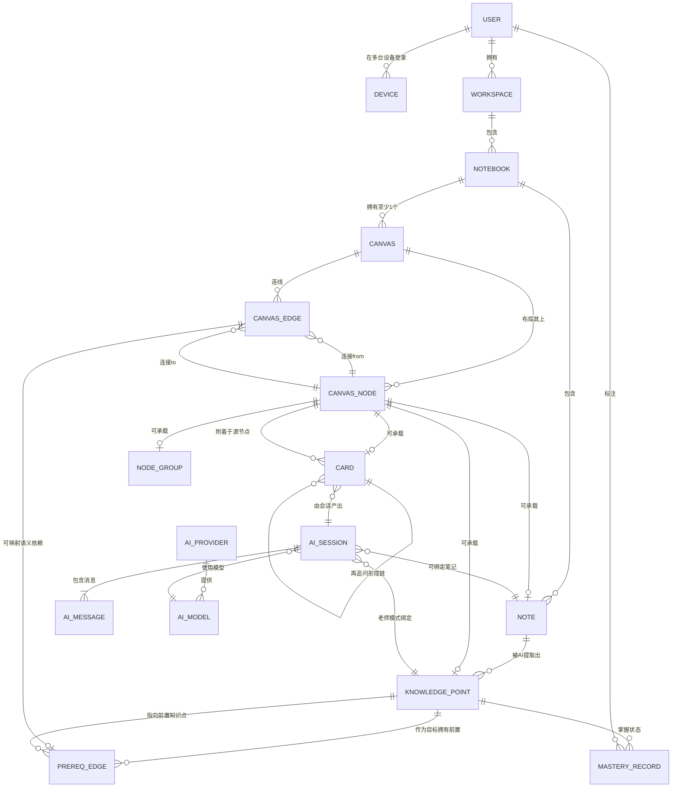

### 3.3 分层心智模型

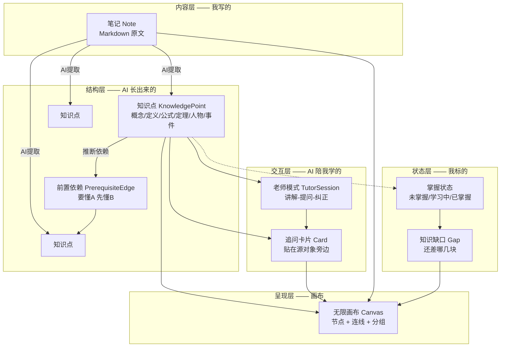

**这个模型的三条关键规则（给架构师）**：

1. **知识点必须有来源锚点**：每个 AI 抽取的知识点都要记录 `sourceNoteId + 文本区间（start/end offset 或段落 id + 引号原文）`。没有来源的知识点是"幻觉风险最高"的，UI 上要弱化并允许用户一键删除。
2. **卡片是 append-only 的生成物**：AI 产出一旦生成即为内容，用户只能编辑副本或触发"重新生成"（产生新版本），不覆盖原文。这让同步冲突大幅减少。
3. **画布节点是视图，不是数据**：Note / KnowledgePoint / Card 的数据与它们在画布上的位置分离。同一个知识点可以出现在一个画布上（P0 限定一个节点只属于一个画布，P1 支持跨画布引用）。

### 3.4 关键状态机

**知识点掌握状态**

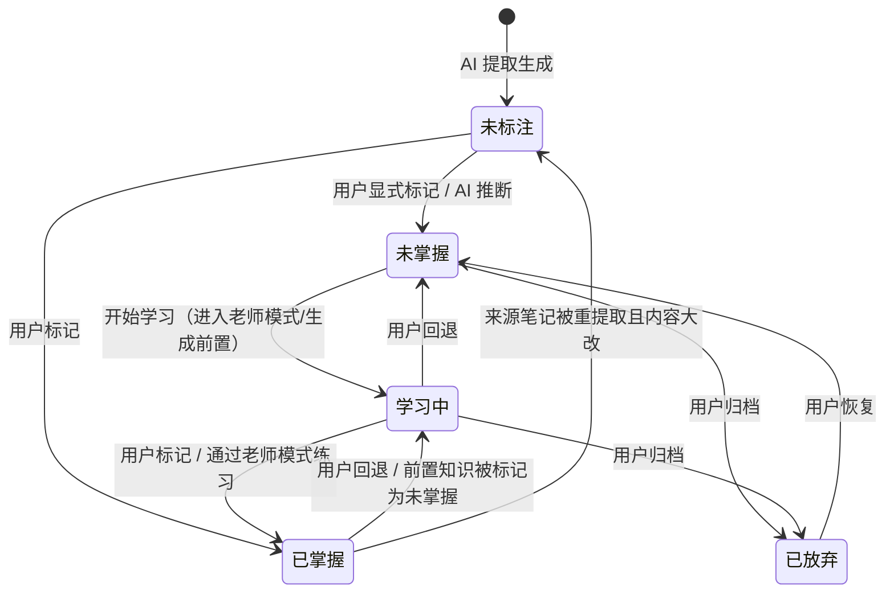

> **级联规则（重要）**：若知识点 A 依赖 B，当 B 被标记为「未掌握」时，**A 的「已掌握」状态自动降级为「学习中」**，并在画布上给 A 打一个「前置不足」的橙色角标。这条规则让知识图谱"活"起来，也是「知识缺口自动发现」的基础。

**卡片生命周期**

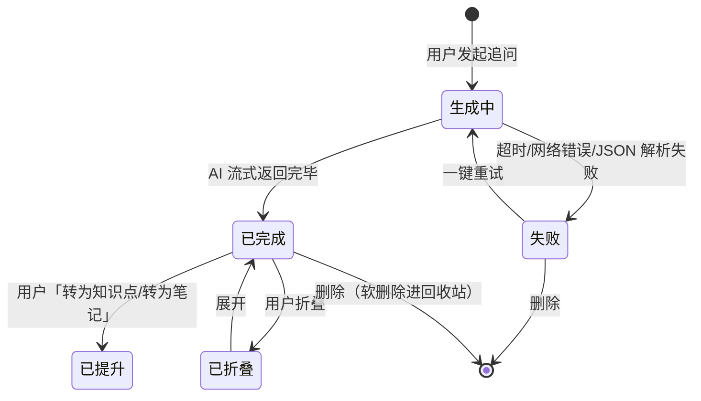

**同步状态（单条数据记录）**

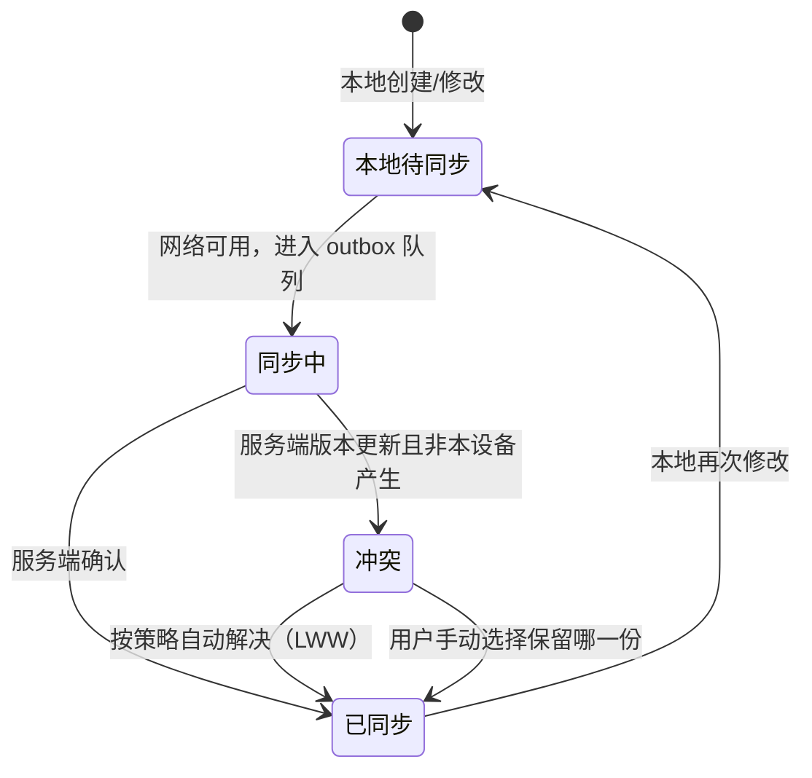

---

## 4. 用户故事（按 Epic）

### Epic A：账户与多端同步

- A-1 作为多设备用户，我希望用同一个账号在手机和电脑上登录，以便看到完全相同的一份笔记和画布。
- A-2 作为在地铁/飞机上学习的用户，我希望没网时也能写笔记、标掌握状态，以便联网后自动补传不丢内容。
- A-3 作为用户，我希望在两台设备同时改了同一段笔记时不被静默覆盖，以便我的劳动成果不会莫名其妙消失。

### Epic B：笔记

- B-1 作为用户，我希望用 Markdown 快速记笔记，以便专注内容而非排版。
- B-2 作为用户，我希望写完后一键触发 AI，而不必手动复制粘贴到别的工具，以便流程不中断。
- B-3 作为用户，我希望选中一段话就地对它提问，以便不用重新描述上下文。
- B-4 作为用户，我希望笔记被知识点引用时能一键跳回原文并高亮，以便核对 AI 有没有理解错。

### Epic C：知识点提取

- C-1 作为用户，我希望 AI 自动从笔记里抽出知识点，以便省去手动拆分的功夫。
- C-2 作为用户，我希望在入库前勾选/修改/删除 AI 抽出的知识点，以便我对内容有最终控制权（AI 会抽错）。
- C-3 作为用户，我希望知识点被分类（概念/公式/定理/人物/事件），以便按类型筛选和复习。
- C-4 作为用户，我希望手动新建 AI 没抽到的知识点，以便补齐遗漏。

### Epic D：前置知识与知识缺口

- D-1 作为遇到难点的用户，我希望知道「要搞懂这个我得先会什么」，以便不再盲目硬啃。
- D-2 作为用户，我希望 AI 生成的前置知识也变成真实节点（可以标记掌握、可以追问、可以再展开前置），以便它不只是几行建议文字。
- D-3 作为复习中的用户，我希望看到「你还差 3 个前置知识」这样的明确提示，以便量化我的差距。
- D-4 作为用户，我希望系统在我标记某个前置为「未掌握」时，自动提醒「依赖它的 X、Y 两个知识点现在站不住了」，以便我发现连锁问题。
- D-5 作为用户，我希望手动纠正 AI 推断错的前置关系，以便图谱越来越准。

### Epic E：画布

- E-1 作为用户，我希望在无限画布上自由摆放笔记和知识点，以便按我自己的方式组织。
- E-2 作为用户，我希望缩放平移、框选、多选、拖拽，以便处理几十上百个节点。
- E-3 作为用户，我希望折叠不需要的节点，以便画布不变成一坨乱麻。
- E-4 作为用户，我希望按「未掌握」筛选，只看我还不会的，以便聚焦。

### Epic F：追问卡片

- F-1 作为读不懂的用户，我希望对任意内容发起追问并立刻得到答案，以便不中断阅读。
- F-2 作为用户，我希望 AI 的回答变成一张贴在原文旁边的卡片，而不是弹窗，以便我**同时**看到原文和答案，且答案不消失。
- F-3 作为用户，我希望能对卡片继续追问，形成一串卡片链，以便完整保留我的思考过程。
- F-4 作为用户，我希望卡片可以折叠成一行摘要、可以拖走、可以删除，以便它不霸占我的画布。
- F-5 作为用户，我希望好的卡片能一键「转为知识点」或「转为笔记」，以便有价值的 AI 产出被沉淀下来。

### Epic G：老师模式

- G-1 作为自学者，我希望 AI 扮演老师教我某个知识点，而不是只丢给我一段百科解释，以便我真的学会。
- G-2 作为用户，我希望老师能**先考我、再讲**，以便暴露我的问题，而不是让我产生"我看懂了"的错觉。
- G-3 作为用户，我希望可以选择难度（小白/标准/进阶），以便讲解匹配我的水平。
- G-4 作为用户，我希望老师指出我的**具体误区**而不只是说"不对"，以便我知道错在哪。
- G-5 作为用户，我希望一轮教学结束后能生成练习题和一份讲义，以便复习和自测。
- G-6 作为用户，我希望老师**记得我前面答错了什么**，以便它针对性地继续追问，而不是每次从头开始。

### Epic H：AI 配置

- H-1 作为用户，我希望在设置里填 API Key / Base URL / 模型名来接入我自己的模型，以便费用可控、不被绑死。
- H-2 作为注重隐私/想离线用的用户，我希望填一个本地模型地址（如 Ollama），以便不联网也能用 AI。
- H-3 作为用户，我希望有「测试连接」按钮，以便一眼知道配置对不对。
- H-4 作为用户，我希望不同任务可以用不同模型（简单的用便宜的/本地的，难的用强的），以便省钱。

### Epic I：平台与体验

- I-1 作为学生，我希望手机上能快速记录、电脑上能深度整理，以便适配不同场景。
- I-2 作为用户，我希望宽屏（桌面/平板）和窄屏（手机）各有合适的布局，以便在小屏上也能用。

---

## 5. 需求池

优先级定义：
- **P0（Must have）**：第一版最小闭环必须有。砍掉则产品不成立。
- **P1（Should have）**：体验完整度关键项，第二版补齐。
- **P2（Nice to have）**：远期/锦上添花。

### 5.1 Epic A：账户与多端同步

| ID | 功能点 | 描述 | 优先级 | 验收标准 |
| --- | --- | --- | --- | --- |
| A1 | 注册 / 登录 | 邮箱 + 密码注册登录；支持记住登录态 | P0 | 新用户 60s 内完成注册并进入空白画布；断网重开 App 仍保持登录 |
| A2 | 多端数据同步 | 笔记、知识点、卡片、画布节点位置、掌握状态、AI 配置（可选）跨端一致 | P0 | A 设备编辑后，B 设备在线状态下 ≤10s 内可见变更 |
| A3 | 离线可用 | 全量数据落本地库，离线可新建/编辑/标记；网络恢复后自动补传 | P0 | 飞行模式编辑 10 条内容 → 恢复网络 30s 内全部同步成功且无丢失 |
| A4 | 冲突处理 | 见第 9 章策略：LWW + 冲突副本保留 + UI 提示 | P0 | 双端同时改同一笔记正文，不丢数据；用户能看到"检测到冲突"入口 |
| A5 | 同步状态可视化 | 设置页显示"上次同步时间 / 待同步 N 条 / 同步失败原因" | P0 | 断网时显示"离线，N 条待同步"；恢复后自动转"已同步" |
| A6 | 回收站（软删除） | 删除内容进入回收站，30 天内可恢复 | P1 | — |
| A7 | 笔记历史版本 | 保留最近 30 个快照，可查看/回滚 | P1 | — |
| A8 | 第三方登录（微信/Apple/Google） | — | P2 | — |
| A9 | 团队/协作空间 | 多人共享画布 | P2 | — |

### 5.2 Epic B：笔记

| ID | 功能点 | 描述 | 优先级 | 验收标准 |
| --- | --- | --- | --- | --- |
| B1 | 笔记 CRUD | 新建/重命名/删除/移动笔记本与笔记 | P0 | — |
| B2 | Markdown 编辑 | 源码编辑 + 分屏实时预览；支持标题、列表、代码块、公式（KaTeX）、表格、引用、加粗 | P0 | 输入 `$$E=mc^2$$` 预览区正确渲染；代码块高亮 |
| B3 | 笔记内 AI 触发 | 工具栏/右键菜单提供「提取知识点」「追问选中文本」「总结」 | P0 | 选中 200 字文本点追问，3s 内出结果 |
| B4 | 知识点来源回跳 | 点击知识点的"来源"，跳转笔记并滚动+高亮对应文本 | P0 | 定位准确率 100%（基于保存的锚点） |
| B5 | 全笔记 AI 触发 | 不选中文本时，默认对全文操作 | P0 | — |
| B6 | 所见即所得富文本编辑 | Notion 式块编辑 | P1 | — |
| B7 | Markdown / 纯文本导入导出 | 批量导入 .md 文件；单篇导出 | P1 | — |
| B8 | 图片粘贴与附件 | — | P2 | — |
| B9 | PDF / 网页 / 图片 OCR 导入 | — | P2 | — |
| B10 | 手写 / 涂鸦 / 手写笔压感 | — | P2 | — |

### 5.3 Epic C：知识点

| ID | 功能点 | 描述 | 优先级 | 验收标准 |
| --- | --- | --- | --- | --- |
| C1 | AI 知识点提取 | 对整篇笔记或选中文本，AI 抽取结构化知识点（名称/类型/定义/原文引用） | P0 | 1000 字技术笔记抽出 5-12 个知识点，输出合法 JSON，非法时自动重试 ≤2 次并兜底 |
| C2 | 提取结果预览确认 | 侧栏列出候选，可勾选、改名、改类型、删除后再入库 | P0 | 用户取消勾选的知识点不落库 |
| C3 | 知识点实体化 | 独立 ID；详情面板展示类型/定义/来源/前置/后继/掌握状态 | P0 | — |
| C4 | 掌握状态标记 | 三态（未掌握 / 学习中 / 已掌握），支持在画布节点上直接点选 | P0 | 标记后立即同步；级联降级规则生效 |
| C5 | 知识点手动 CRUD | 手动新建/编辑/删除，来源标记为 `manual` | P0 | 手动知识点不参与自动重提取覆盖 |
| C6 | 知识点类型体系 | 内置：概念、定义、公式、定理、人物、事件、方法、代码、结论 | P0 | 提取结果中类型字段合法率 ≥95% |
| C7 | 知识点筛选与搜索 | 按类型/掌握状态/来源笔记筛选；关键词搜索 | P1 | — |
| C8 | 增量重提取 | 笔记改动后提示"有 N 处新增内容，是否重新提取" | P1 | — |
| C9 | 跨笔记知识点合并去重 | 同名/同义知识点全局归并与合并提示 | P1 | — |
| C10 | 知识点语义检索（向量） | — | P2 | — |
| C11 | 自定义知识点类型 | — | P2 | — |

### 5.4 Epic D：前置知识与知识缺口

| ID | 功能点 | 描述 | 优先级 | 验收标准 |
| --- | --- | --- | --- | --- |
| D1 | AI 生成前置知识 | 选中一个知识点，AI 推断其直接前置（默认 1 层，最多 2 层），生成真实知识点节点 | P0 | 返回 2-6 个前置；每个含名称和"为什么需要它"一句话理由 |
| D2 | 前置关系可视化 | 画布上以**有向实线**连接，箭头方向 = 学习顺序（前置 → 目标） | P0 | 连线方向正确，鼠标悬停显示理由 |
| D3 | 知识缺口提示 | 计算目标知识点依赖树中未掌握节点，UI 显示「要掌握 X，你还差 N 个前置知识：A、B、C」 | P0 | 数量与依赖树遍历结果一致；点击缺口项可在画布中定位 |
| D4 | 手动增删前置边 | 用户可连线/断线，来源标记为 `manual`，优先级高于 AI 推断 | P0 | 手动边不会被 AI 重生成覆盖 |
| D5 | 前置不足级联提醒 | 前置被标为未掌握时，依赖它的知识点显示橙色「前置不足」角标 | P0 | 级联在 2 层内生效且不卡 UI |
| D6 | 前置树逐级展开 | 对前置节点继续"生成前置"，递归展开 | P1 | 支持 ≥3 层 |
| D7 | 学习路径推荐 | 按拓扑排序输出「先学 A → B → C → 目标」 | P1 | 输出顺序无环且符合依赖 |
| D8 | 缺失前置自动补全为可学习节点 | 前置知识点若笔记中没有内容，提供「生成讲解卡片」一键补齐 | P1 | — |
| D9 | 循环依赖检测 | — | P2 | — |
| D10 | 公共学科知识图谱（内置/社区共享前置库） | — | P2 | — |

### 5.5 Epic E：画布

| ID | 功能点 | 描述 | 优先级 | 验收标准 |
| --- | --- | --- | --- | --- |
| E1 | 无限画布基础操作 | 平移、缩放（滚轮/双指）、框选、多选、撤销重做 | P0 | 300 节点下平移缩放 ≥50fps |
| E2 | 节点拖拽与折叠 | 自由拖拽；节点可折叠为一行标题 | P0 | 拖拽跟手，无抖动 |
| E3 | 三类节点渲染 | 笔记节点（标题+摘要）、知识点节点（名称+类型角标+掌握状态色）、卡片节点（AI 标识+内容） | P0 | 三类节点视觉可区分 |
| E4 | 自动布局（追问卡片） | 新卡片沿源节点右侧/下方树状排布，自动避让已占区域 | P0 | 连续追问 5 次，卡片不重叠且均在源节点可视范围内 |
| E5 | 附着连线（虚线） | 卡片与源对象之间自动画虚线 | P0 | 拖动卡片时连线跟随 |
| E6 | 语义连线（实线） | 前置依赖以有向实线渲染 | P0 | — |
| E7 | 掌握状态视觉编码 | 未掌握=红 / 学习中=黄 / 已掌握=绿 / 未标注=灰 | P0 | — |
| E8 | 手动连线（自定义关系） | — | P1 | — |
| E9 | 节点分组 / 自由文本便签 | — | P1 | — |
| E10 | 聚焦模式 | 只高亮选中节点的 N 度邻居，其余淡化 | P1 | — |
| E11 | 小地图 / 缩略图导航 | — | P1 | — |
| E12 | 画布导出 PNG / PDF / OPML / XMind | — | P2 | — |
| E13 | 自动全局布局（力导向/树形一键整理） | — | P2 | — |

### 5.6 Epic F：追问卡片

| ID | 功能点 | 描述 | 优先级 | 验收标准 |
| --- | --- | --- | --- | --- |
| F1 | 万能追问入口 | 对**笔记（全文或选中文本）/ 知识点 / 任意卡片**发起追问 | P0 | 三类对象均可唤起输入框 |
| F2 | 卡片化输出 | AI 回答生成为画布卡片节点，自动贴在源对象旁边，虚线连接 | P0 | 从发起到卡片出现 ≤5s（云端模型首字 ≤1.5s） |
| F3 | 卡片交互 | 折叠/展开、拖动、删除、复制内容 | P0 | 折叠后仅显示一行摘要 |
| F4 | 追问链 | 对卡片再追问 → 新卡片贴在该卡片旁，形成链；链上可回溯 | P0 | 支持 ≥5 层链，视觉上呈树状展开 |
| F5 | 上下文自动携带 | 追问时自动携带：源对象内容 + 源笔记相关段落 + 父卡片链（最近 3 张） | P0 | 追问「那它和 X 有什么区别」时，AI 能正确理解"它"指代 |
| F6 | 卡片转知识点 / 转笔记 | — | P1 | — |
| F7 | 侧栏平铺阅读模式 | 将选中链的卡片以对话列表形式在右侧栏线性展示 | P1 | 手机端默认此模式 |
| F8 | 重新生成 / 编辑 / 版本对比 | — | P2 | — |
| F9 | 卡片引用来源标注 | 卡片上显示"本回答基于：笔记《X》第 3 段 + 知识点 Y" | P2 | — |

### 5.7 Epic G：老师模式

| ID | 功能点 | 描述 | 优先级 | 验收标准 |
| --- | --- | --- | --- | --- |
| G1 | 进入老师模式 | 从知识点详情 / 画布节点右键进入，绑定该知识点为教学目标 | P0 | 会话标题显示知识点名 |
| G2 | 最小教学循环 | 讲解 → 提问 → 用户作答 → 点评纠正 → 进阶提问 | P0 | AI 的首轮回复中必须包含「讲解 + 至少 1 个提问」 |
| G3 | 难度档位 | 三档：小白（零基础类比）/ 标准（教材级）/ 进阶（推导与边界） | P0 | 三档输出深度有肉眼可辨差异 |
| G4 | 生成练习题 | 一键生成 3-5 题（选择 / 简答 / 计算），含答案与解析（默认折叠） | P0 | 题目与讲解内容强相关，非泛泛而谈 |
| G5 | 苏格拉底式追问 | AI 被约束为「不直接给答案，用反问引导」 | P0 | 在苏格拉底模式下，AI 回复中直接给出最终答案的比例 ≤20%（人工抽检 20 条） |
| G6 | 误区诊断 | 用户作答后，AI 判断正误并指出**具体**误区 | P0 | 输出包含「你的问题在于：___」字段 |
| G7 | 会话内学习状态 | 当前会话记录已讲过的点、答错的题，后续提问优先围绕薄弱点 | P0 | 第 5 轮时能复述用户第 2 轮的错误 |
| G8 | 生成讲义卡片 | 会话结束时一键生成结构化讲义，作为卡片贴到画布知识点旁 | P1 | — |
| G9 | 自动批改 | AI 对用户作答打分 + 逐题点评 | P1 | — |
| G10 | 多种教学策略 | 速成型 / 刷题型 / 费曼式（让我讲给你听） | P2 | — |
| G11 | 跨会话学习画像 | 长期跟踪某知识点的掌握曲线 | P2 | — |
| G12 | 语音对话 | — | P2 | — |

### 5.8 Epic H：AI 供应商配置

| ID | 功能点 | 描述 | 优先级 | 验收标准 |
| --- | --- | --- | --- | --- |
| H1 | 供应商管理 | 增删改供应商（名称、类型、Base URL、API Key、模型列表） | P0 | 新增后立即可用 |
| H2 | OpenAI 兼容协议适配 | 统一走 `/chat/completions` 兼容协议，覆盖 OpenAI / DeepSeek / 通义 / 智谱 / Moonshot / 硅基流动等 | P0 | 至少实测通过 2 家云端供应商 |
| H3 | 本地模型支持 | 支持 Ollama / llama.cpp / LM Studio 的本地端点（含无 Key 场景） | P0 | 填 `http://localhost:11434/v1` 可用 |
| H4 | 测试连接 | 「测试连接」按钮，返回延迟与模型列表 | P0 | 3s 内给出成功/失败及原因 |
| H5 | 默认模型设置 | 全局默认模型 | P0 | — |
| H6 | 任务级模型路由 | 不同 AI 任务绑定不同模型（如：提取用强模型，追问用便宜模型） | P1 | — |
| H7 | API Key 本地安全存储 | 使用系统安全存储（Keychain / Keystore / 加密本地库）；**默认不上传云端** | P0 | 数据库导出文件中不含明文 Key |
| H8 | 失败降级与重试 | 主模型失败自动切备用模型；结构化输出解析失败自动重试 2 次 | P0 | 主模型 500 错误时，5s 内自动用备用模型完成 |
| H9 | 用量统计与成本估算 | — | P2 | — |
| H10 | 模型下载与量化管理 | — | P2 | — |
| H11 | 流式输出 | AI 回答边生成边显示 | P1 | 首字延迟 ≤1.5s |
| H12 | **MiniMax 供应商支持（已决策 · v1.1）** | 用户持有 MiniMax Coding Plan Key，须作为可选供应商接入；**允许用户选择端点类型**：`OpenAI 兼容端点` 与 `Anthropic 兼容端点` 二选一 | P0 | 用户能在设置中新增「MiniMax」供应商并切换端点类型；Coding Plan 的 Key 默认走 Anthropic 兼容端点 |
| H13 | **Dify 多应用绑定**（v1.2） | Dify 的 Service API Key **按应用签发**（一把 Key 只调一个应用，非一把 Key 通吃所有任务）；需支持为不同 AI 任务绑定不同 Dify 应用（各自端点 + 各自 Key）。**P0 收口**：仅支持「配置一个 Dify 应用，所有 Dify 任务走它」，但设置页文案与数据结构须预留「一个 Dify 供应商可含多应用/多 Key」，不得写死「一供应商一把 Key」。**P1**：提供「按任务绑定 Dify 应用」界面（任务 → 应用/端点/Key） | P1（数据结构 P0，界面 P1） | P0：新增 Dify 供应商时可配置端点 + Key，且数据模型允许该供应商挂载多个应用条目（即使 UI 仅暴露一个）；P1：设置页可按 AI 任务（提取/前置/追问/出题/讲解等）分别选定 Dify 应用、端点与 Key，切换即时生效 |

**MiniMax 供应商说明（v1.1 已决策）**：MiniMax 同时提供 **OpenAI 兼容端点** 与 **Anthropic 兼容端点** 两套协议。用户持有的 Coding Plan Key 通常面向编程工具场景，**默认走 Anthropic 兼容端点**。产品层面要求（交给架构师建模）：**不得假设所有供应商只有一种协议**，供应商配置必须包含「端点类型」字段，调用层按端点类型选择对应适配器（OpenAI 风格 `/chat/completions` 或 Anthropic 风格 Messages API），而非写死某一种。H2 的统一抽象应覆盖本端点类型分支。

### 5.9 Epic I：平台与适配

| ID | 功能点 | 描述 | 优先级 | 验收标准 |
| --- | --- | --- | --- | --- |
| I1 | Android | 手机端可用，含窄屏布局 | P0 | 主流 Android 机型冷启动 <2s |
| I2 | Windows | 桌面端可用，含宽屏三栏布局 | P0 | — |
| I3 | Web | 浏览器可用（部署为静态站点） | P0 | Chrome 打开即用 |
| I4 | macOS | — | P1 | — |
| I5 | iOS | — | P1（依赖 Apple 开发者账号 + macOS 构建机） | — |
| I6 | Linux | — | P1 | — |
| I7 | 响应式布局 | 宽屏（≥1024px）三栏；中屏（768-1024）两栏；窄屏（<768）单栏 + 底部抽屉 | P0（先覆盖 Android + Win + Web） | 三端均无明显布局破版 |
| I8 | 快捷键 / 命令面板 | — | P2 | — |

### 5.10 P0 MVP 边界：做什么 / 不做什么

**✅ P0 做（最小闭环 = 「写笔记 → 抽知识点 → 补前置 → 老师教 → 追问卡片 → 标记掌握 → 跨端可见」）**

1. 邮箱注册登录 + 三端（Android / Windows / Web）数据同步 + 离线可写 + LWW 冲突兜底
2. Markdown 笔记编辑 + 分屏预览 + 选中/全文触发 AI
3. AI 知识点提取（结构化 JSON）+ 预览勾选入库 + 来源锚点回跳
4. 掌握状态三态标记 + 前置不足级联提醒
5. AI 生成前置知识（≤2 层）+ 知识缺口提示 + 手动增删前置边
6. 无限画布：平移缩放、拖拽、折叠、三类节点、自动布局、实线（依赖）/虚线（附着）
7. 追问卡片：万能追问入口 → 卡片贴附 → 追问链（≥5 层）→ 折叠/拖动/删除
8. 老师模式最小版：绑定知识点、三档难度、讲解→提问→纠正循环、生成练习题、会话内状态
9. AI 供应商：OpenAI 兼容协议 + 本地端点 + 测试连接 + 默认模型 + 失败降级 + Key 本地安全存储
10. 布局响应式覆盖：桌面 / 手机 / Web

**❌ P0 明确砍掉（写在文档里，防止范围蔓延）**

| 砍掉的 | 原因 |
| --- | --- |
| 所见即所得富文本块编辑 | 用 Markdown 源码 + 分屏预览替代，工作量差一个量级 |
| 图片 / 附件 / PDF / OCR / 网页剪藏 | 与核心闭环无关，P1/P2 |
| 跨笔记知识点合并去重（全局知识库） | 需要实体对齐能力，AI 质量与性能代价都高 |
| 向量检索 / 语义搜索 | P0 只做关键词搜索（甚至可只在 P1） |
| 间隔重复复习（SRS）/ Anki 导出 | 价值高但独立性强，P1 更合适 |
| 全局力导向自动布局 | 手动 + 追问卡片局部自动布局够用 |
| 团队协作 / 分享链接 | 需要权限体系与实时协同，代价极高 |
| iOS / macOS / Linux 首发 | iOS **通过云端 Mac 构建服务交付**：用户 2026-09-04 追加表态「iOS 可以走云端 Mac 构建」，因此**无 Mac 不再阻塞 iOS 交付**。云端 macOS runner（Codemagic / Bitrise / GitHub Actions macOS runner）可在 CI 中编译出 .ipa / .app，无需购买 Mac 硬件，并支持自动化出包。但须明确边界：**云端构建只能出包，不能替代本地交互式调试**——iOS 上的实时调试/热重载、画布手势/键盘/安全区等原生插件行为的实机验证仍只能在真机或 Mac 上做，排查 iOS 特有问题成本显著升高；**App Store 上架仍须 Apple 开发者账号（约 ¥688/年），这笔钱省不掉**，且上传需用云端构建出的 .ipa（Windows 上的 Transporter 仅能上传已构建好的包，不替代构建）。结论：iOS **不阻塞 P0**（P0 仍为 Android + Windows + Web 三端首发），性质从「没 Mac 就做不了」变为「可以做，代价是调试体验受限 + 需 CI 成本」；建议标为 **P1：P0 三端跑通后再接云端 iOS 构建流水线**。macOS / Linux 为 P1。详见 12. Q1 与 13. 风险表。 |
| 语音输入 / 语音对话 | P2 |
| 内置模型下载与量化管理 | 本地模型走"用户自己起 Ollama 服务"的路线，App 只填地址 |
| 插件系统 / 模板市场 / 多语言 | P2 |
| 字符级 CRDT 实时协同 | 单人使用场景，LWW + 冲突副本足够 |
| 笔记历史版本 / 回收站 | 有价值但非闭环必需 → P1（**注：软删除 tombstone 机制需在 P0 架构中预留**，否则 P1 加回收站要返工） |

> **P0 规模估算**：约 45-50 个功能点，其中 AI 相关 12 个。建议按 6 个迭代推进（见任务拆解文档）。

> **iOS 排期说明（v1.1）**：Flutter 代码本身跨端通用，Windows 上编写的 iOS 相关代码不会失效；但**编译、模拟器调试、真机测试、App Store 上架全部需要 macOS + Xcode**，且上架必须 Apple 开发者账号（约 ¥688/年）。因此 iOS 的交付时间取决于「何时有 Mac + 开发者账号」，而不是开发工作量。P0 策略：Android + Windows + Web 三端跑通闭环，iOS 仅保持代码兼容，不阻塞主流程（详见 13. 风险与依赖）。

---

## 6. 核心交互流程

### 6.1 流程一：新建笔记 → 触发知识点提取 → 知识点落到画布

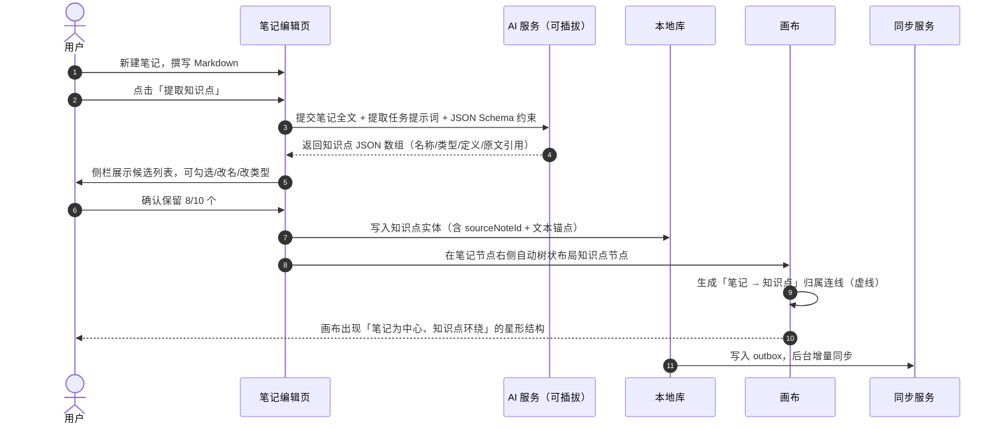

**关键设计点**：
- 提取**必须**经过用户确认才入库。AI 会抽错，用户需要"最终否决权"，否则画布会被垃圾节点污染。
- 已在画布上的知识点，重复提取时按名称+类型做去重，提示"已存在，是否更新定义"而不是新建重复节点。

### 6.2 流程二：选中知识点 → 生成前置知识 → 缺口提示

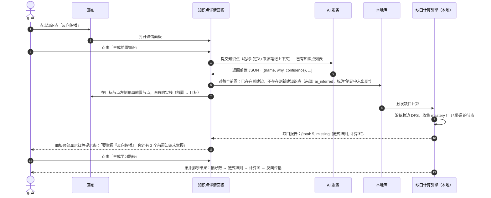

**关键设计点**：
- AI 返回的每个前置必须带 **`why`（为什么需要它）** 字段，这是可信度的基础，也是悬停连线时显示的内容。
- AI 必须能**引用笔记中已存在的知识点**作为前置（在建边而非新建节点），所以提示词要把"候选已有知识点列表"一起送进去。否则图谱会碎片化。
- 缺口计算是**纯本地逻辑**（图遍历），不消耗 AI，可以实时响应，标记状态后立刻重算。
- 反向级联：当前置被标为未掌握，依赖它的「已掌握」节点自动降级为「学习中」+ 橙色角标。

### 6.3 流程三：进入老师模式 → 教学对话 → 生成讲义 / 练习

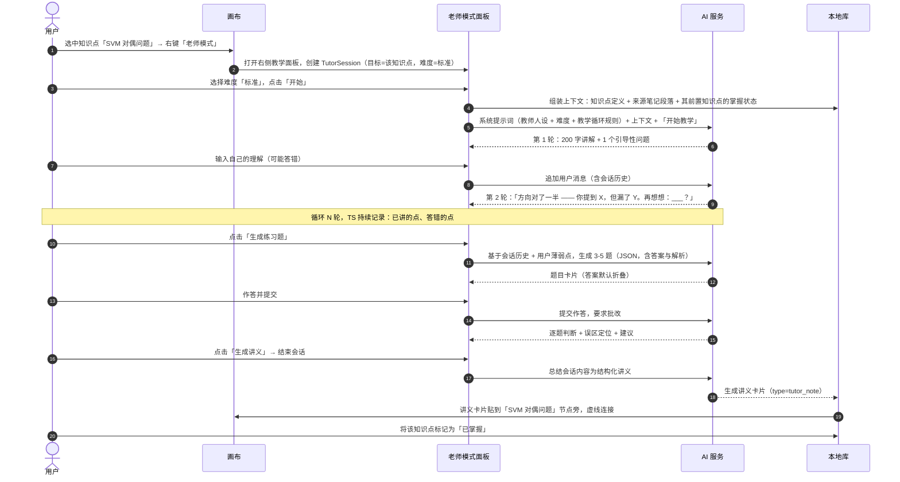

**关键设计点（老师模式 ≠ 普通 AI 问答）**：

| 维度 | 普通 AI 问答 | 老师模式 |
| --- | --- | --- |
| 目标 | 回答当前问题 | 让用户**学会**某个具体知识点（会话绑定教学目标） |
| 姿态 | 有问必答，尽量完整 | **主动提问**、故意留白、不一次讲完 |
| 答案 | 直接给 | 苏格拉底模式下给线索/反问，逼用户先输出 |
| 反馈 | 通常不评价用户 | 判断正误 + 定位**具体误区** + 针对性再问 |
| 难度 | 无 | 三档，影响术语密度、类比使用、推导深度 |
| 记忆 | 仅上下文窗口 | 会话内维护「已讲 / 已错 / 待巩固」状态，优先围绕薄弱点 |
| 产出 | 一段文字 | 讲解 + 练习 + 批改 + 讲义（可沉淀为画布卡片） |
| 终止条件 | 用户不问了 | 用户标记「已掌握」或主动结束 |

### 6.4 流程四：选中任意对象 → 追问 → 生成贴附小卡片 → 卡片再追问形成链

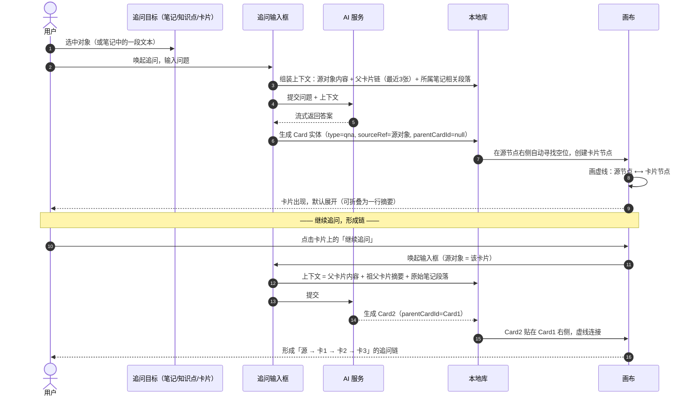

**追问链的空间布局规则**：

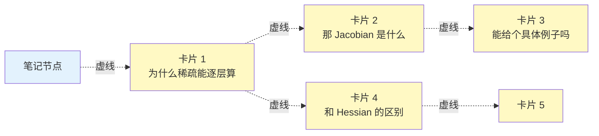

- 卡片沿 **X 轴向右** 生长（每一层追问向右偏移 `cardWidth + gap`），同层的多张卡片沿 **Y 轴向下** 排列。
- 若右侧已被占用，自动下移一行；若源节点靠近画布右边缘且右侧空间不足，则改为向**左下**生长。
- 每次生成后，视口自动**平滑平移**使新卡片可见（不自动缩放，避免眩晕）。
- 提供「整理此链」按钮：一键把选中的卡片链重排为规整树形。

### 6.5 流程五：多端同步（A 设备编辑 → B 设备看到）

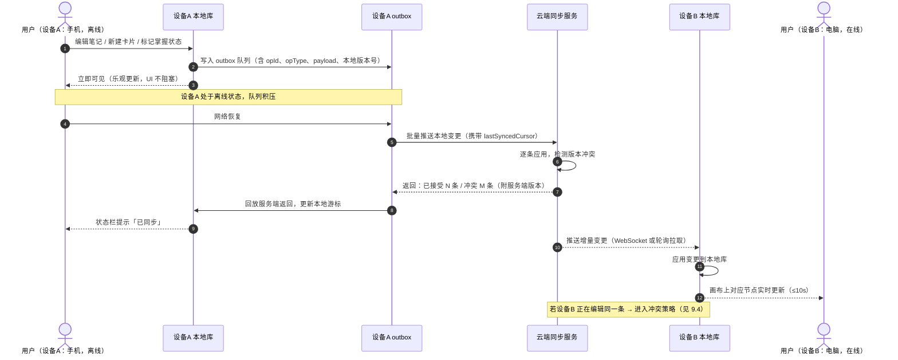

---

## 7. 关键界面结构

### 7.1 全局布局骨架

**宽屏（桌面 / 平板横屏，≥1024px）—— 三栏**

```
┌────────────┬──────────────────────────────────────┬──────────────────┐
│  侧边栏     │              主区                      │   上下文面板      │
│  (240px)   │          （画布 / 笔记编辑）             │   (可折叠, 400px) │
│            │                                        │                  │
│ · 工作区    │  ┌──────────────────────────────────┐  │  内容随选中对象   │
│ · 笔记本树  │  │                                  │  │  变化：          │
│   - 笔记1  │  │         无限画布                  │  │  · 知识点详情    │
│   - 笔记2  │  │                                  │  │  · 追问面板      │
│ · 筛选器    │  │   [节点] ──→ [节点]              │  │  · 老师模式      │
│   - 未掌握  │  │      ╎                           │  │  · 卡片列表      │
│   - 类型    │  │   [卡片]                         │  │                  │
│ · 搜索     │  └──────────────────────────────────┘  │                  │
│ · 设置     │                                        │                  │
└────────────┴──────────────────────────────────────┴──────────────────┘
   顶部：全局工具栏（新建 / 撤销重做 / AI 模型指示器 / 同步状态 / 搜索）
   底部：缩放控件 + 节点计数 + 缺口统计条
```

**窄屏（手机，<768px）—— 单栏 + 底部抽屉**

```
┌──────────────────────────────┐
│ 顶栏：汉堡菜单 / 标题 / AI 状态 │
├──────────────────────────────┤
│                              │
│        画布 / 笔记编辑         │
│        （全屏主区）            │
│                              │
│                              │
├──────────────────────────────┤
│ 底部抽屉（可上滑展开）          │
│  ▔▔▔▔  ▎ 详情 / 追问 / 老师   │
└──────────────────────────────┘
```

### 7.2 画布页（主页面）

| 区域 | 内容 |
| --- | --- |
| **顶栏** | 笔记本面包屑 / 新建笔记 / 撤销重做 / 当前 AI 模型指示器（点击可临时切换）/ 同步状态灯 / 搜索 / 设置 |
| **左侧栏** | 笔记本与笔记树；筛选器（按掌握状态、按类型、按来源）；搜索入口 |
| **中央画布** | 无限画布。节点三类：笔记节点（文档图标 + 标题 + 首 2 行摘要）、知识点节点（名称 + 类型角标 + 掌握状态色条）、卡片节点（AI 星标 + 内容，黄色底区分）。连线两类：实线有向（前置依赖，灰色/蓝色）、虚线（附着关系，浅灰） |
| **右下浮动控件** | 缩放 +/-、适应画布、定位回中心、小地图（P1） |
| **底部状态条** | 「共 128 个知识点 · 未掌握 23 · 待补前置 7」+ 一键「只看未掌握」 |
| **右键/长按菜单** | 对节点：查看详情 / 追问 / 老师模式 / 生成前置知识 / 标记掌握 / 折叠 / 删除 / 转为笔记。对空白处：新建笔记 / 新建知识点 / 粘贴 / 整理布局 |
| **右侧上下文面板** | 点击节点后展开，见 7.3–7.5 |

**节点视觉规范（P0）**：
- 知识点节点尺寸默认 200×80，掌握状态用左侧 4px 竖条颜色编码（红/黄/绿/灰）。
- 前置不足的知识点：右上角橙色三角警示角标。
- AI 推断而来、笔记中未出现过的知识点：虚线边框，表示"来源存疑"。
- 卡片节点：淡黄背景 + 左上角 AI 图标 + 右上角折叠按钮。

### 7.3 笔记编辑页

宽屏为左右分屏（左编辑 / 右预览），窄屏为编辑/预览切换 Tab。

| 区域 | 内容 |
| --- | --- |
| 顶栏 | 返回画布 / 标题（可编辑）/ 字数 / AI 工具栏 / 更多 |
| AI 工具栏 | 「提取知识点」「总结」「追问选中」；未选中文本时对全文操作 |
| 编辑区 | Markdown 源码编辑（等宽字体，语法高亮，支持 KaTeX 公式） |
| 预览区 | 实时渲染 |
| 提取结果抽屉 | 触发提取后从右侧滑出：候选知识点列表（复选框 + 名称可编辑 + 类型下拉 + 「查看原文」）+ 底部「全部保留 / 仅保留选中 / 取消」 |

### 7.4 知识点详情面板（右侧栏）

```
┌─────────────────────────────────────┐
│ ⬤ 反向传播            [概念▾]        │  ← 名称（可编辑）+ 类型下拉
│ ┌─────────────────────────────────┐ │
│ │ ⚠ 要掌握它，你还有 2 个前置未掌握  │ │  ← 缺口提示条（红色，仅当有缺口）
│ └─────────────────────────────────┘ │
│ 掌握状态：[未掌握][学习中][已掌握]      │  ← 三态分段控件
├─────────────────────────────────────┤
│ 定义                                 │
│ 一种高效计算神经网络梯度的算法，利用   │  ← 可编辑，AI 生成
│ 链式法则从输出层向输入层逐层传播误差。 │
│                        [重新生成]     │
├─────────────────────────────────────┤
│ 来源                                 │
│ 📄 《神经网络笔记》第 12 段  [跳转]    │  ← 点击跳转并高亮
├─────────────────────────────────────┤
│ 前置知识 (3)              [重新生成]  │
│  ⬤ 链式法则      未掌握  [断开关联]   │
│  ⬤ 计算图        未掌握  [断开关联]   │
│  ⬤ 偏导数        已掌握  [断开关联]   │
│  + 手动添加前置                       │
├─────────────────────────────────────┤
│ 后继知识 (1)                         │
│  ⬤ 神经网络训练流程                   │
├─────────────────────────────────────┤
│ [追问]  [老师模式]  [生成前置知识]     │  ← 主操作区
│ [在画布中定位]  [删除]                │
└─────────────────────────────────────┘
```

### 7.5 追问面板与老师模式面板

面板占据右侧上下文栏（宽屏 400-480px，窄屏为全屏页）。两者**共用同一套消息流 UI**，区别在于系统提示词、可用操作与顶部状态条。

```
┌──────────────────────────────────────┐
│ 老师模式 · SVM 对偶问题    [难度:标准▾]│  ← 顶部：模式 + 目标 + 难度选择
│ 已讲 3 点 · 答错 1 · 第 6 轮          │  ← 教学状态条（仅老师模式）
├──────────────────────────────────────┤
│                                      │
│  AI: （讲解 200 字）                  │
│      所以要引入对偶问题，核心有两个      │
│      原因……                          │
│      先问你：为什么不直接解原问题？      │
│                                      │
│            ┌────────────────────┐    │
│            │ 因为维度太高算不动   │    │  ← 用户消息（右对齐）
│            └────────────────────┘    │
│                                      │
│  AI: 方向对了一半。你提到计算复杂度，   │
│      但漏了关键一点 —— 核技巧只能在    │
│      对偶形式下生效。再想想？          │
│                                      │
├──────────────────────────────────────┤
│ [生成练习题][生成讲义][结束并标记掌握]  │  ← 老师模式专属操作条
├──────────────────────────────────────┤
│ 输入消息……                    [发送]  │
└──────────────────────────────────────┘
```

追问面板（非老师模式）顶部显示「来源：📄 笔记《X》第 3 段 / ⬤ 知识点 Y / 💬 卡片 Z」，底部操作条为「转为知识点 / 转为笔记 / 在画布中定位」。

### 7.6 设置页

| 分组 | 项 |
| --- | --- |
| 账户 | 头像 / 邮箱 / 退出登录 / 注销账号 |
| **AI 模型** | 供应商列表（卡片式，显示名称 + 类型图标 + 状态灯）；新增供应商表单（名称、类型下拉[OpenAI兼容/本地Ollama/本地llama.cpp/自定义]、Base URL、API Key[密码框]、模型名[可多选/手动填写]）；每项提供「测试连接」；全局默认模型下拉；[P1] 任务级模型路由表 |
| 同步 | 上次同步时间 / 待同步条目数 / 立即同步按钮 / 失败日志 / 离线数据占用 |
| 外观 | 主题（浅色/深色/跟随系统）、画布网格开关、字体大小 |
| 数据 | 本地存储占用、导出全部数据（Markdown + JSON）、清空缓存、回收站 |
| 关于 | 版本、隐私政策、AI 数据处理说明、开源许可 |

### 7.7 ⭐ 关键判断：卡片贴在哪里？（方案对比）

用户原话是「追问可以直接贴个小卡片在旁边的」。这句话指向画布，但"旁边"有两种实现。这里给出专业判断。

#### 方案 A：卡片作为画布节点，贴在源对象旁（画布贴附）

- **做法**：AI 回答生成一个真实的画布节点，位置在源节点右侧，虚线连接，可拖动、折叠、再追问。
- ✅ 优势：
  1. **空间位置本身是信息**。一张卡片贴在某段原文旁，天然的语义是"这段的补充"，用户不需要额外标签就懂。空间记忆是极强的记忆线索。
  2. **可并列、可对比**。多张卡片可以同时展开在眼前比较；侧栏堆叠做不到。
  3. **不消失、不遮挡**。侧栏是稀缺资源（同时只能显示一个上下文），切走就没了；画布上的卡片一直在。
  4. **可导出、可分享**。整个画布（含卡片）能导出成一张图，这对学生复习/发笔记极其有价值。
  5. **符合"知识树"隐喻**。卡片是长在树上的叶子，不是聊天记录。
- ❌ 风险：
  1. **画布炸开 / 变乱**。追问 20 次就是 20 个节点，容易糊成一团。
  2. **小屏放不下**。手机上画布空间本就紧张。
  3. **生成即"污染"**。用户只是随口一问，却永久留下一个节点，心理负担。

#### 方案 B：卡片在右侧边栏/底部抽屉流式堆叠（侧栏堆叠）

- **做法**：AI 回答出现在右侧栏的对话列表里，像聊天记录一样向下累积。
- ✅ 优势：不占画布空间、实现简单、线性阅读体验好、小屏友好。
- ❌ 劣势：
  1. **上下文与产出分离**。我看到答案，但看不到它对应的原文（要切走上下文面板才能看画布）。
  2. **切走即失**。选中另一个节点，这些答案就消失了（需要重新打开历史）。
  3. **无法并列**。
  4. **与"知识沉淀"的定位冲突** —— 又变成了一次性聊天。

#### ✅ 推荐方案：两种模式用户手动可选（已决策 · v1.1）

用户拍板（Q5）：**不管在哪个端，用户都能手动选择「画布模式」或「抽屉模式」**，不再按屏幕宽度强制切换。

| 对比 | 画布模式（方案 A） | 抽屉模式（方案 B） |
| --- | --- | --- |
| 卡片位置 | 作为画布节点贴在源对象旁，虚线连接 | 在右侧栏 / 底部抽屉以对话列表平铺 |
| 适用 | 想对比 / 导出 / 长期沉淀 / 利用空间记忆 | 小屏、想清爽、随口一问 |
| 默认推荐 | 桌面 / 平板（≥1024px） | 手机（<768px） |

**关键产品规则（v1.1 拍板）**：

1. **默认值是「按屏幕宽度的推荐」，但必须是可覆盖的用户偏好，不是强制行为**：首次进入按宽度给默认值，之后以用户最近一次选择为准。
2. **双向切换不丢数据**：抽屉模式下产生的卡片，切到画布模式后应出现在「源节点的合理空位」（沿用 6.4 的自动布局规则），不丢失、不堆在原点 (0,0)；反向，画布模式收进抽屉后原坐标保留，切回画布时还原原位。
3. **切换入口两处**：① 画布工具栏「视图切换」按钮（画布模式 ⇄ 抽屉模式，全局仅决定**新生成卡片**的默认 dockState；已有卡片保留各自状态，另提供「应用到全部」批量操作）；② 单张卡片上的「贴到画布 / 收进抽屉」操作（单卡生效，支持混合使用）。
4. **混合使用场景**：桌面用户可「画布上留几张重要卡片，其余收进抽屉」——全局默认画布，对单张不重要卡片用「收进抽屉」，兼顾沉淀与清爽。
5. **偏好是设备本地配置（S3 设备本地，见 9.1，不跨端同步）**：模式依赖设备形态，同账号在手机与桌面本就该能各选各的；屏宽算出的推荐值不持久化，仅用户手动覆盖后才写入本机。未来若产品要求「我在哪都偏好抽屉」，再升级为 S2。

**针对方案 A 三大风险的缓解措施（仍必须一起做，否则画布会失控）**：

1. **默认折叠为摘要胶囊**：新卡片生成时默认展开，但可一键折叠成「💬 为什么稀疏能逐层算」一行。折叠态宽度收窄为 160px。设置里可改默认为折叠。
2. **自动布局 + 避让**：沿源节点右侧树状生长、自动避让已占区域（见 6.4 的布局规则）。
3. **聚焦模式（P1）/ 淡化非相关节点**：选中某节点时，其 N 度邻居外的节点自动淡化到 20% 透明度。
4. **「提问但不留卡片」的选项**：追问输入框旁有开关「仅查看，不生成卡片」，满足"随口一问"的需求。
5. **一键整理**：右键「整理此链」「隐藏此链」「删除此链」。
6. **卡片可提升为知识点/笔记**：有价值的产出沉淀下来，垃圾卡片随手可删。

> **结论（v1.1）**：卡片默认贴在画布上（产品灵魂），但**形态由用户在每个端手动选择**，不按屏幕宽度强制。两种模式可双向无损切换、可单卡混合，偏好按设备本地保存（S3），各端互不影响。既保住「贴旁边」的交互灵魂，又尊重不同端 / 不同场景的体验诉求。

---

## 8. AI 能力矩阵

### 8.1 任务清单

| ID | AI 任务 | 触发时机 | 输入 | 输出格式 | 云端/本地建议 | 模型能力要求 | 提示词要点 | 失败降级 |
| --- | --- | --- | --- | --- | --- | --- | --- | --- |
| **T1** | **知识点提取** | 用户点「提取知识点」 | 笔记全文（≤8k tokens，超出按段落切分并合并去重） | **结构化 JSON**：`[{name, type, definition, quote, confidence}]` | **云端优先**（抽取质量是产品地基）；本地 ≥14B 且支持 JSON 约束时可跑 | 中高。需要理解学科语义、区分主次、稳定输出 JSON | ① 明确类型枚举，禁止自由发挥 ② 要求 `quote` 必须是原文逐字摘录（用于锚点定位与幻觉校验） ③ 要求 `definition` ≤60 字 ④ 给出 few-shot 示例 ⑤ 限制数量 5-15 | 解析失败重试 2 次；仍失败则退化为"让模型输出 Markdown 列表 + 正则解析"；最终失败提示用户换更强模型 |
| **T2** | **知识点规范化** | 提取后（可合并进 T1） | T1 输出 + 已有知识点列表 | JSON：`{mappings:[{new, existingId, action: merge/new}]}` | 云端；P0 可用**规则兜底**（名称精确匹配 + 编辑距离）替代 | 中 | 保守合并，宁可重复不可错合 | 退化为规则匹配 |
| **T3** | **⭐ 前置知识推断** | 用户点「生成前置知识」 | 目标知识点（名+定义+来源段落）+ 已有知识点候选列表 + 学科上下文 | **结构化 JSON**：`[{prereqName, why, isExisting, existingId, layer, confidence}]` | **必须用强云端模型**（这是产品最差异化的能力，弱模型会输出"空气"） | **最高**。需要学科知识 + 因果推理能力。建议 GPT-4o / DeepSeek-R1 / QwQ 级别 | ① 先让模型自言自语列出「要理解 X 需要哪些先修概念」（CoT），再输出 JSON ② 强制从候选列表中优先选已有知识点（`isExisting=true`），避免图谱碎片化 ③ `why` 必须说明因果，如"因为 X 的推导直接使用了链式法则" ④ 限制 2-6 个，只给**直接前置**，不要间接 ⑤ 要求输出 `confidence`，<0.5 的 UI 上弱化显示 | 失败则提示"该模型能力不足，建议切换到更强模型"，绝不静默返回垃圾 |
| **T4** | 知识缺口分析 | 掌握状态变更后 | 依赖图 + 掌握状态 | — | **纯本地计算，不用 AI**（图 DFS 遍历） | 无 | — | — |
| **T5** | **追问回答** | 用户发起追问 | 源对象内容 + 父卡片链（最近 3 张摘要）+ 相关笔记段落 + 用户问题 | **Markdown**（非 JSON，需流式输出体验） | 云端/本地**均可**（用户自选，这是最高频任务，本地 7B 也能用） | 低中。关键是上下文组装质量而非模型推理能力 | ① 明确回答的"锚点"，开头先复述问题中的指代词（如"你说的『它』指 X"） ② 限制长度 ≤300 字，鼓励举例 ③ 若上下文不足，明确说"笔记中没有提到，以下是通用解释" ④ 禁止复述源对象内容 | 换备用模型；失败保留输入框内容供重试 |
| **T6** | **老师模式讲解** | 进入老师模式 / 每轮对话 | 目标知识点 + 难度档 + 会话历史 + 已讲/已错记录 + 前置掌握状态 | Markdown（讲解部分）+ 内嵌 1 个提问 | 云端优先；本地 ≥14B 勉强可用（教学策略遵循能力弱） | **高**。需要严格遵循人设与教学策略、控制信息释放节奏 | ① 人设：严厉但耐心的老师，不说"很好的问题！" ② **禁止一次讲完**，每轮只讲一个层次 ③ 每轮必须以一个问题结尾 ④ 难度档位决定术语密度与类比使用 ⑤ 注入"已讲过：A、B；用户答错：C"，要求围绕 C 继续 | 换备用模型 |
| **T7** | **苏格拉底追问** | 苏格拉底模式下的每轮 | 同 T6 | Markdown | 云端优先 | 高。需要"忍住不给答案" | ① **明确禁止**：直接给出最终答案、使用"答案是" ② 要求用反问/提示/分解子问题引导 ③ 若用户连续 3 轮卡住，才允许给出部分答案 | — |
| **T8** | **生成练习题** | 老师模式内点「生成练习题」 | 会话历史 + 目标知识点 + 用户薄弱点 + 难度 | **结构化 JSON**：`[{type: choice/short/code, question, options[], answer, explanation}]` | 云端优先 | 中高。需要出题质量与答案正确性 | ① 题目必须针对用户答错的点 ② 答案与解析分开字段，便于默认折叠 ③ 选择题干扰项要有典型性（来自常见误区）④ 不给超纲题 | 解析失败重试 2 次；退化为 Markdown 输出直接渲染 |
| **T9** | **作答批改与误区诊断** | 用户提交练习作答 | 题目 + 标准答案 + 用户作答 | **结构化 JSON**：`[{qIndex, correct: bool, userProblem, suggestion}]` | 云端优先 | 中高。判断正误容易，**定位误区难** | ① 要求 `userProblem` 必须具体（"混淆了梯度下降与随机梯度下降的更新粒度"），禁止"理解不深"这类空话 ② 要求引用用户原话作为证据 | 退化为对话式批改（Markdown） |
| **T10** | **生成讲义** | 老师模式结束 | 完整会话历史 + 目标知识点 | Markdown（标题层级结构） | 云端/本地均可 | 中 | ① 按「核心结论 / 推导 / 常见误区 / 与其他知识的联系」四段式 ② 保留会话中出现的具体例子 | — |
| **T11** | 笔记总结 | 用户点「总结」 | 笔记全文 | Markdown（≤200 字 + 3-5 个要点） | 云端/本地均可 | 低 | — | — |
| **T12** | 标题/标签生成 | 新建笔记时（P2） | 笔记前 200 字 | JSON | 本地即可 | 低 | — | — |
| **T13** | 知识点相似度计算（P2） | 合并去重 | 两个知识点 | 分数 | 云端 embedding 或本地规则 | — | — | — |

### 8.2 结构化输出的工程约定（给架构师）

1. **统一抽象**：`AiTask` 接口，入参 `{taskType, promptVars, context, responseFormat: text|json, jsonSchema}`，出参 `{content, parsed, usage, latency, modelId}`。所有任务走同一入口，便于埋点、降级、缓存与模型路由。
2. **JSON 可靠性三层保障**（这是学生项目最容易翻车的地方）：
   - 第 1 层：优先使用模型的 **JSON Mode / Structured Output / function calling**（OpenAI 兼容协议普遍支持）。
   - 第 2 层：不支持时，在提示词中给 Schema + few-shot，并要求"只输出 JSON，无 markdown 代码块包裹"；输出后用正则剥离 ` ```json ` 围栏。
   - 第 3 层：解析失败 → 自动重试 ≤2 次（第二次追加"你上次的输出不是合法 JSON，错误是：___"）→ 仍失败则降级为文本输出 + 正则提取，或提示用户切换模型。
3. **本地模型特别处理**：本地 7B 模型 JSON 遵循能力差，建议：① UI 上标记「当前模型可能不支持结构化输出，建议切换」；② 服务端（App 内）做 schema 校验与字段补全；③ 本地模型优先执行 T5/T10/T11 这类纯文本任务，T1/T3/T8 建议强制云端。
4. **上下文预算**：单次请求的上下文控制在 8k tokens 内。超出时按「源对象 > 父卡片链摘要 > 笔记相关段落（按相关度截断）」的优先级裁剪。
5. **缓存**：同一 `sourceHash + question` 的追问结果本地缓存 7 天，重复提问秒回（省钱且体验好）。
6. **可观测性**：每次 AI 调用记录 `{taskType, modelId, latency, tokens, success, parsedOk, retryCount}`，用于第 10 章的 AI 质量指标与成本优化。
7. **MiniMax 端点类型（v1.1 已决策）**：MiniMax 同时提供 OpenAI 兼容与 Anthropic 兼容两套端点，用户 Coding Plan Key 默认走 Anthropic 兼容端点。供应商配置必须包含「端点类型」字段，调用层据此分派对应适配器（OpenAI 风格 `/chat/completions` 或 Anthropic 风格 Messages API），**不得假设所有供应商只有一种协议**。这与 5.8 的 H12 一致。

---

## 9. 多端同步的产品级定义

> 技术选型（CRDT / OT / 增量同步协议 / 后端栈）交给架构师，本章只定义**产品行为契约**。

### 9.1 数据分级

| 级别 | 数据 | 是否同步 | 说明 |
| --- | --- | --- | --- |
| **S1 核心内容（必须同步）** | 笔记本/笔记结构、笔记正文、知识点（含定义、类型、来源锚点）、前置依赖边、卡片（内容、父子关系）、画布节点坐标与折叠状态、画布连线、掌握状态、AI 会话历史 | ✅ | 用户资产，任何设备必须一致 |
| **S2 用户配置（选择性同步）** | 主题、字号、画布网格开关、编辑器偏好、默认难度 | ✅（低优先级，最后同步） | 丢了不影响数据，但同步了体验好 |
| **S3 设备本地（禁止同步）** | 窗口大小/位置、最近打开的笔记、滚动位置、本地缓存、日志、**卡片视图模式（画布/抽屉，见 7.7）** | ❌ | 设备相关；模式依赖设备形态，同账号在手机与桌面各选各的，不跨端强制统一 |
| **S4 敏感（默认不同步）** | **AI 供应商的 API Key** | ❌ 默认不同步 | 安全优先。用户可在设置里显式开启「同步我的模型配置」（端到端加密），P2。理由：Key 泄露 = 钱被刷，产品必须默认保守 |
| **S5 大数据（延后同步）** | 图片/附件（P1+）、AI 调用日志 | 异步后台同步 | 不阻塞主流程 |

### 9.2 同步时效目标

| 场景 | 目标 |
| --- | --- |
| 本地编辑 → 上传完成 | ≤3s（在线） |
| A 设备变更 → B 设备可见 | ≤10s（B 在线） |
| B 设备冷启动 → 拉取增量完成 | ≤5s（增量），首次全量 ≤30s（1000 节点量级） |
| 离线积压 → 恢复网络后补传 | 后台自动，≤60s 内清空 outbox（1000 条内） |

### 9.3 离线行为

- **默认离线优先（Offline-First）**：所有操作先写本地库并立即反映到 UI（乐观更新），再异步同步。**任何网络状态下 App 都完全可用**（除 AI 调用与登录）。
- 离线时顶栏同步状态灯显示橙色「离线 · N 条待同步」。
- 离线期间的 AI 调用：直接失败并提示「当前离线，AI 功能不可用（如使用本地模型请先启动本地服务）」。不做 AI 请求排队（会积压成灾难）。
- 离线期间创建的实体 ID 在客户端生成（ULID，含时间戳，全局有序且无中心化依赖），回传后不冲突。
- 未登录状态下允许本地使用（游客模式），登录后本地数据合并到账号 —— **建议 P1 支持，P0 可要求必须登录**。

### 9.4 冲突策略（产品契约）

| 数据类型 | 冲突场景 | 策略 | 用户感知 |
| --- | --- | --- | --- |
| **笔记正文** | 双端同时编辑 | **块级 LWW（最后写入胜）** + 冲突时自动保留另一份为「冲突副本」附注记 | 顶部提示「检测到冲突，已保留两份」并给出并排对比入口。**绝不静默丢弃** |
| **知识点 / 卡片内容** | 双端同时编辑同一知识点 | 内容类 AI 产出为 append-only，用户编辑生成新版本；冲突时保留最新版本 + 旧版本进历史 | 静默处理，仅在历史中可见 |
| **掌握状态** | 双端标记不同状态 | **LWW**（以服务端时间戳最新者为准） | 静默 |
| **画布节点坐标** | 双端拖动同一节点 | **LWW** | 静默。坐标是低价值数据，不值得为它弹窗 |
| **前置依赖边** | 一端删除，另一端新增 | 删除优先于新增（保守，避免关系爆炸）；但被删的边保留在历史中可恢复 | 静默 |
| **删除 vs 编辑** | 一端删除，另一端编辑 | **软删除（tombstone）优先**，编辑内容保留在回收站中，30 天内可恢复 | 提示「X 已被删除，已放入回收站」 |
| **创建 vs 创建** | 双端创建同名知识点 | 允许重复存在，P1 的合并去重功能处理 | 静默 |

**明确不做**：字符级实时协同（CRDT/OT）。理由：单人跨端使用场景中，同一时刻在两台设备编辑同一段笔记的概率极低；字符级协同的实现与测试成本是 LWW 的 10 倍以上，对学生项目不划算。**但架构上需预留** —— 数据模型要带版本号与更新时间戳，同步层要能与业务层解耦，以便未来替换同步引擎。

### 9.5 数据一致性兜底

- 每次同步后客户端本地计算数据校验和，与服务端比对（可按笔记本粒度）；不一致时触发全量拉取修复。
- 提供「强制全量同步」入口（设置页），用于自救。

### 9.6 隐私与数据处理说明（必须在设置页明示）

- 笔记正文在调用云端 AI 时会**按任务需要的最小片段**发送给用户自己配置的 AI 供应商。产品方（我们）的服务器只做同步中转，**不调用 AI、不读取笔记语义内容**。
- 这一点是产品的重要卖点，必须在设置页与首次 AI 调用时向用户明示。

---

## 10. 关键指标

### 10.1 北极星指标（建议）

> **周有效学习人数（Weekly Effective Learners, WEL）**
> 定义：一周内至少完成 **1 次「知识点掌握状态正向流转」** 的活跃用户数。
> 正向流转 = 某知识点从 `未掌握/未标注/学习中` → `已掌握`。

**为什么选它**：

1. 学习类产品的终极价值是「用户真的学会了东西」，而不是记了多少字、开了多少次 App。掌握状态流转是这一点最直接的代理指标。
2. 它能**天然驱动完整链路**：要产生一次流转，用户必须至少走过「提取知识点 → 了解它 → （补前置 / 老师模式教）→ 标记掌握」中的大部分环节。指标涨 = 核心闭环被跑通。
3. 它**抗虚荣**：灌水笔记、导 1000 篇 Markdown 都不会让它涨，反而会暴露"用户只是收藏家"。
4. 它**可分解**：WEL = 活跃用户 × 流转转化率，可分别归因到"提取质量""老师模式效果""标记入口是否好找"。

### 10.2 分层指标

| 层级 | 指标 | 目标（上线 3 个月） | 说明 |
| --- | --- | --- | --- |
| **激活** | 新用户 7 日内完成首次知识点提取率 | ≥60% | 提取是价值的第一道门 |
| 激活 | 首次提取后 24h 内生成首个前置/追问/老师会话率 | ≥40% | 验证闭环是否顺 |
| **参与** | 人均周知识点数 | ≥15 | — |
| 参与 | 人均周追问卡片数 | ≥8 | 追问是最高频的 AI 动作 |
| 参与 | 人均周老师模式会话数 | ≥2 | — |
| 参与 | 人均周活跃天数 | ≥3 | — |
| **核心价值** | 人均周掌握状态正向流转次数 | ≥5 | 北极星的分解项 |
| 核心价值 | **知识缺口收敛率** | 用户标记的知识点中，其依赖树的未掌握占比 周环比下降 ≥10% | 证明"补前置"真的在起作用，是差异化的验证 |
| 核心价值 | 老师模式会话平均轮次 | ≥6 轮 | <3 轮说明教学没吸引力或体验有断点 |
| 核心价值 | 老师模式后标记「已掌握」的转化率 | ≥30% | 教学是否真的有用 |
| **留存** | 次周留存 W1 | ≥35%（学习工具有天然周周期，可按周看） | — |
| 留存 | W4 留存 | ≥20% | — |
| **AI 质量** | 知识点提取采纳率（用户保留数 / AI 生成数） | ≥70% | <50% 说明提示词/模型有问题 |
| AI 质量 | 卡片再追问率 | 25%-45% 为健康区间 | 过高 = 首次回答质量差；过低 = 追问没价值 |
| AI 质量 | 结构化输出解析成功率 | ≥98% | 直接影响稳定性 |
| AI 质量 | AI 任务失败率（含超时） | <2% | — |
| AI 质量 | 首 token 延迟（云端） | p50 <1.5s，p90 <4s | — |
| **性能** | 画布 300 节点渲染帧率 | ≥50fps | — |
| 性能 | App 冷启动 | <2s | — |
| 性能 | 同步成功率 | ≥99.5% | — |

### 10.3 反指标（需要盯着的坏信号）

- **人均知识点数很高但掌握状态标记率极低** → 用户在"收藏"而非"学习"，需强化标记入口与提醒。
- **提取采纳率 <50%** → 提示词或模型不行，优先修。
- **卡片再追问率 >60%** → 首次回答质量差，用户被迫追问。
- **老师模式平均轮次 <3** → 老师模式沦为摆设。

---

## 11. 数据模型速览（供架构师参考，最终以架构设计为准）

> 本章是**产品侧的字段要求**，不是最终技术方案。标记为 ⭐ 的是产品强约束。

| 实体 | 关键字段 |
| --- | --- |
| **User** | id, email, passwordHash(服务端), createdAt, settings |
| **Device** | id, userId, platform, deviceName, lastActiveAt, lastSyncedCursor |
| **Workspace / Notebook** | id, userId, name, parentId, sortOrder, deletedAt |
| **Note** | id, notebookId, title, contentMd, contentHash, createdAt, updatedAt, version, deletedAt |
| **KnowledgePoint** ⭐ | id, notebookId, name, type(enum), definition, **sourceNoteId, sourceStart, sourceEnd, sourceQuote**, origin(ai_extracted / ai_inferred / manual / card_promoted), confidence, createdAt, updatedAt, version, deletedAt |
| **PrerequisiteEdge** ⭐ | id, fromKpId(前置), toKpId(目标), reason(why), origin(ai/manual), confidence, createdAt, deletedAt |
| **MasteryRecord** ⭐ | id, kpId, userId, status(unknown/not_mastered/learning/mastered/abandoned), updatedAt, source(self/ai/tutor_cascade) |
| **Card** ⭐ | id, type(qna/explanation/exercise/tutor_note/summary), contentMd, **sourceRef{type, id}**, parentCardId, sessionId, modelId, createdAt, deletedAt |
| **Canvas** | id, notebookId, name, viewport{x,y,zoom}, createdAt |
| **CanvasNode** ⭐ | id, canvasId, targetType(note/knowledgePoint/card/group), targetId, x, y, w, h, z, collapsed, style, deletedAt |
| **CanvasEdge** | id, canvasId, fromNodeId, toNodeId, edgeType(semantic_prereq / attachment / manual), prereqEdgeId?, deletedAt |
| **AISession** | id, type(chat/tutor), targetRef{type,id}, title, modelId, messages[], difficulty?, tutorState{taught[], mistakes[], roundCount}, createdAt, updatedAt |
| **AIMessage** | id, sessionId, role, contentMd, tokens, latencyMs, modelId, createdAt |
| **AIProvider** | id, userId, name, type(openai_compatible/ollama/llama_cpp/custom), baseUrl, apiKeyRef(本地安全存储引用), models[], isDefault, enabled |
| **SyncMeta** | entityType, entityId, version, updatedAt, deviceId, deletedAt(tombstone) |

**产品强约束（⭐）说明**：

1. **知识点必须带来源锚点**（`sourceNoteId + sourceStart/End + sourceQuote`）。没有锚点的 AI 知识点是幻觉风险最高的，UI 必须弱化显示并允许一键删除。这是产品可信度的地基。
2. **Card 的 `sourceRef` 是多肽引用**（可指向 note / knowledgePoint / card），这是"万能追问入口"的数据基础。
3. **Card 的 `parentCardId`** 构成追问链，是线性回溯的依据。
4. **所有实体必须带 `updatedAt` + `version` + `deletedAt`（软删除）**。P0 可以不做回收站 UI，但 tombstone 机制必须有，否则 P1 加回收站和冲突恢复都要返工。
5. **ID 建议用 ULID**（客户端可生成、时间有序、无中心化依赖），这是离线优先的前提。

---

## 12. 待确认问题（需用户拍板）

> v1.1 状态：**Q1 / Q2 / Q3 / Q5 / Q10 已决策**（见各行「✅ 已决策」标注与 12.1 汇总）；其余 Q4 / Q6 / Q7 / Q8 / Q9 / Q11 / Q12 / Q13 / Q14 / Q15 暂按推荐项推进，用户可后续推翻。

| # | 问题 | 选项 | **我的推荐** | 理由 |
| --- | --- | --- | --- | --- |
| **Q1 ✅ 已决策（2026-09-02，v1.3 追加）** | **P0 首发平台范围？** | A. Android + Windows + Web（三端）<br>B. 全六端一次上<br>C. 只做 Android | **A（三端首发，iOS 走云端 Mac 构建）** | **用户拍板（2026-09-02）**：无 Mac、无 Apple 开发者账号，但希望用 Flutter 做 iOS；写代码不受影响（Flutter 跨端代码通用）。<br>**v1.3 追加（2026-09-04）**：用户表态「iOS 可以走云端 Mac 构建」——**无 Mac 不再是阻塞项**。据此更新 iOS 路线：<br>• P0 仍为 **Android + Windows + Web 三端首发**，iOS 代码保持兼容。<br>• iOS 出包改走云端 macOS 构建服务（Codemagic / Bitrise / GitHub Actions macOS runner）：可在 CI 中编译出 .ipa / .app，**无需购买 Mac 硬件**，并支持自动化出包。<br>• **云端构建解决不了的（务必区分）**：① iOS 上的交互式调试与热重载——云端 CI 只能出包，没法实时调试，遇 iOS 特有问题（渲染差异/手势/原生插件 bug）排查成本显著升高；② iOS 特有插件行为的实机验证（画布手势/键盘/安全区适配）在云端构建流程里验证不了；③ **App Store 上架仍需 Apple 开发者账号（约 ¥688/年），这笔钱省不掉**；上传须用云端构建出的 .ipa（Windows 上的 Transporter 仅能上传已构建好的包，不替代构建）。<br>• **优先级结论**：iOS 不阻塞 P0，性质从「没 Mac 就做不了」变为「可以做，代价是调试体验受限 + 需 CI 成本」；建议标 **P1：P0 三端跑通后再接云端 iOS 构建流水线**（见 5.10 与 13. 风险与依赖）。 |
| **Q2 ✅ 已决策（2026-09-02）** | **后端/同步方案？** | A. Supabase（Postgres + Auth + Realtime，免费额度）<br>B. 自建后端（Go/Node + Postgres + WebSocket）<br>C. 纯 P2P/本地文件同步（WebDAV/坚果云） | **A（Supabase）** | **用户拍板：接受 Supabase，先做出来，后续优化/迁移是后续的事。** MVP 用其 Auth + Realtime + Postgres 一站式；数据模型设计保持可迁移（不依赖 Supabase 私有特性），为将来换后端留口子。 |
| **Q3 ✅ 已决策（2026-09-02）** | **首批 AI 供应商支持哪些？** | A. OpenAI 兼容协议 + Ollama 本地<br>B. 只做 1-2 家具体厂商 SDK | **A + MiniMax** | **用户拍板：持有 MiniMax Coding Plan Key，须接入 MiniMax。** 统一 OpenAI 兼容协议抽象覆盖国内外主流厂商 + Ollama 本地；MiniMax 同时提供 OpenAI 兼容与 Anthropic 兼容端点，其 Coding Plan Key 默认走 Anthropic 兼容端点（详见 5.8 H12 与 8.2）。 |
| **Q4** | **P0 是否必须做账号与云同步？** | A. 必须（同步是硬需求）<br>B. P0 先做纯本地，P1 加同步 | **A** | 你把"所有端数据互通"列为核心需求，那账号+同步就是 P0，无法回避。但要接受它会吃掉约 20-25% 的工作量。<br>若时间压力大，可考虑 **A'：P0 用 Supabase 的最小实现（邮箱登录 + 全量增量同步），不做历史版本/回收站/离线冲突 UI 精细化**。 |
| **Q5 ✅ 已决策（2026-09-02）** | **追问卡片的形态？**（见 7.7） | A. 每个端手动选画布/抽屉<br>B. 按屏幕宽度自动切换<br>C. 全部贴画布<br>D. 全部走侧栏 | **A（用户手动可选）** | **用户拍板：哪个端都可以手动选择「画布模式」或「抽屉模式」。** 不再按屏幕宽度强制切换；默认值按宽度推荐但可覆盖，两种模式双向无损切换，偏好按 S3 设备本地保存，各端互不影响。详见 7.7 重写结论。 |
| **Q6** | **Markdown 编辑器方案？** | A. 纯文本源码编辑 + 分屏预览（P0）→ P1 上富文本<br>B. P0 就上所见即所得块编辑 | **A** | 所见即所得（如 super_editor）在 Flutter 上要么收费、要么自研成本极高。源码+预览是务实选择，且目标用户（理工科学生）大多熟悉 Markdown。<br>👉 需确认：**你和你的目标用户能否接受 Markdown 源码编辑？** |
| **Q7** | **老师模式的呈现位置？** | A. 画布右侧抽屉（宽屏）/ 全屏页（窄屏）<br>B. 独立全屏页面（所有端） | **A** | 老师模式需要"一边看画布上的知识结构，一边被教"，抽屉模式不脱离上下文。抽屉还能和追问面板复用同一套 UI。 |
| **Q8** | **P0 是否做「跨笔记知识点全局库」（合并去重）？** | A. 否，P1 再做（P0 知识点归属各自的笔记本）<br>B. 是，P0 做 | **A** | 实体对齐（判断"链式法则"在第 3 章和第 7 章是同一个）需要额外 AI 调用与相似度计算，质量与性能都不确定。P0 限定在笔记本内组织，能大幅简化数据模型与同步逻辑。 |
| **Q9** | **P0 是否做间隔重复复习（SRS）？** | A. 否，P1 做<br>B. 是 | **A** | 价值很高，但它是独立子系统（复习算法、卡片调度、每日队列），会显著膨胀 P0。前置知识树已经给出了"学习顺序"，P0 用它就够了。 |
| **Q10 ✅ 已决策（2026-09-02）** | **本地模型的最低支持规格？** | A. App 只填地址（Ollama / llama.cpp 的 OpenAI 兼容端点），不内置模型、不管下载<br>B. 内置模型下载与量化管理 | **A（本地模型 = 桌面端场景）** | **用户拍板：接受「本地模型 = 桌面端场景」。** App 只填 Ollama / llama.cpp 的 OpenAI 兼容端点，不内置模型、不管下载；本地模型主要在桌面 / Web 端使用，移动端因算力与局域网限制不主推。 |
| **Q11** | **API Key 是否云同步？** | A. 默认不同步（仅本地安全存储），P2 提供端到端加密同步开关<br>B. 默认同步 | **A** | Key 泄露 = 真金白银被刷。产品必须默认保守。多设备各配一次的成本可以接受。 |
| **Q12** | **学科范围？** | A. 通用（通过知识点类型体系覆盖理/工/文）<br>B. P0 只聚焦理工科（公式/定理/算法） | **A** | 知识点类型枚举（概念/定义/公式/定理/人物/事件/方法/代码/结论）已经能覆盖文科，差异主要在提示词。建议做成**通用 + 可配置"学科模板"**（P1），P0 用一套通用提示词 + 理工科优化。<br>👉 需确认：**你自己的主力使用场景是哪个学科？**（影响提示词调优优先级） |
| **Q13** | **内容语言？** | A. 仅中文 UI + 中文 AI 输出<br>B. 中英双语 UI | **A** | 学生项目，先服务中文用户。但工程上 UI 文案应抽离，便于未来国际化。 |
| **Q14** | **产品名与品牌？** | AIMindTree / 知识树 / MindGraft / 其他 | 保留 **AIMindTree** | 已在需求中明确，且英文名便于后续上架与应用商店 SEO。建议同时想一个中文名（如"知树"）用于国内渠道。 |
| **Q15（v1.2）** | **是否需要按 AI 任务分别绑定 Dify 应用？** | A. P0 单一应用（所有 Dify 任务走一个应用），P1 开放按任务绑定<br>B. P0 就开放按任务绑定 | **A（P0 单一 / P1 开放）** | 技术约束推出来的：Dify 的 Service API Key **按应用签发**，一把 Key 只调一个应用，不像 OpenAI/Anthropic 一把 Key 通吃；产品须接得住「知识点提取一个应用、出题另一个应用」的用法。P0 仅支持配置一个 Dify 应用（数据结构预留多应用），P1 提供按任务绑定界面。用户可后续推翻。 |

### 12.1 已决策汇总（v1.1 · 2026-09-02）

| 问题 | 决策 |
| --- | --- |
| Q1 平台首发 | 三端首发（Android + Windows + Web），iOS 走云端 Mac 构建（Codemagic / Bitrise / GitHub Actions macOS runner），无需 Mac 硬件；但 iOS 交互式调试与上架仍受限，标 P1（P0 三端跑通后再接云端 iOS 构建流水线） |
| Q2 后端 | 采用 Supabase（Auth + Realtime + Postgres），先做出来，后续可迁移 |
| Q3 AI 供应商 | 接入 MiniMax（Coding Plan Key，端点类型可配，默认 Anthropic 兼容）+ 统一 OpenAI 兼容协议 + Ollama 本地 |
| Q5 卡片形态 | 每个端手动选择画布模式 / 抽屉模式，双向无损切换，偏好 S3 设备本地保存（各端互不影响） |
| Q10 本地模型 | 本地模型 = 桌面端场景，App 只填端点地址 |

---

## 13. 风险与依赖

| 风险 | 等级 | 影响 | 应对 |
| --- | --- | --- | --- |
| **AI 结构化输出不稳定**（尤其本地模型） | 🔴 高 | 知识点提取/前置推断/出题直接失败 | 三层 JSON 保障（见 8.2）；本地模型限制任务类型；提供"换模型"引导 |
| **前置知识推断质量差**（输出"空气前置"） | 🔴 高 | 核心差异化能力失去说服力 | 强制强模型 + CoT 提示词 + `why` 字段 + confidence 阈值 + 用户可编辑；P0 只做 ≤2 层，控制错误放大 |
| **画布性能**（节点数增长后卡顿） | 🟡 中 | 体验崩塌 | 视口外节点不渲染；P0 用成熟社区库；设定 P0 软上限 500 节点并提示 |
| **同步冲突导致数据丢失** | 🔴 高 | 用户信任崩塌（笔记类产品的致命伤） | LWW + 冲突副本永不静默删除 + tombstone 30 天 + 本地全量快照 + 强制全量同步自救入口 |
| **Flutter Web 端体积与首屏** | 🟡 中 | Web 体验差 | 延迟加载、deferred components、Web 端砍掉部分动画 |
| **范围蔓延**（P0 越做越大） | 🔴 高 | 项目烂尾 | 严格执行第 5.10 节的 P0 边界；任何新增需求必须回答"砍掉哪一个" |
| **AI 成本失控** | 🟡 中 | 用户账单爆炸 | 结果缓存、任务级模型路由、本地模型兜底、用量统计（P1） |
| **iOS 交付走云端 Mac 构建**（v1.3） | 🟢 低（P1 调试/上架受限，不阻塞 P0） | 无 Mac 不再阻塞 iOS 出包（云端 macOS runner 可编译 .ipa），但 iOS 交互式调试/热重载、原生插件实机验证仍受限，且上架须 Apple 开发者账号（约 ¥688/年） | 非阻塞：P0 三端（Android + Windows + Web）首发，iOS 标 P1；P0 跑通后接云端 iOS 构建流水线（Codemagic / Bitrise / GitHub Actions macOS runner）。应对调试短板：iOS 特有问题尽量在 Android/Web 端复现、用统一抽象层隔离平台差异、保留真机/借 Mac 做关键验证；上架成本计入运营预算 |

---

## 14. 附录

### 14.1 术语表

| 术语 | 英文 | 含义 |
| --- | --- | --- |
| 知识点 | Knowledge Point | 从笔记抽取的结构化知识实体，一等公民 |
| 前置知识 | Prerequisite | 掌握某知识点前需先掌握的知识点 |
| 知识缺口 | Knowledge Gap | 依赖树中未掌握的节点集合 |
| 掌握状态 | Mastery | 用户对知识点的自评：未掌握/学习中/已掌握 |
| 卡片 | Card | AI 生成物在画布上的载体 |
| 追问链 | Card Chain | 卡片再追问形成的链式结构 |
| 画布节点 | Canvas Node | 画布上的多态容器（笔记/知识点/卡片/组） |
| 附着连线 | Attachment Edge | 卡片与源对象之间的虚线 |
| 语义连线 | Semantic Edge | 表达前置依赖的有向实线 |
| 老师模式 | Tutor Mode | 有教学目标、难度、策略的 AI 教学会话 |
| 离线优先 | Offline-First | 所有操作先落本地再同步 |
| LWW | Last-Write-Wins | 最后写入胜（冲突解决策略） |
| Tombstone | — | 软删除标记，用于同步场景传播删除 |

### 14.2 相关文档

- 架构设计文档：`docs/ARCHITECTURE.md`（由架构师产出）
- 任务拆解文档：`docs/TASKS.md`（由架构师产出）

---

**文档结束（v1.1）。第 12 章中 Q1/Q2/Q3/Q5/Q10 已据用户拍板更新；其余问题暂按推荐项推进，可后续推翻。**
