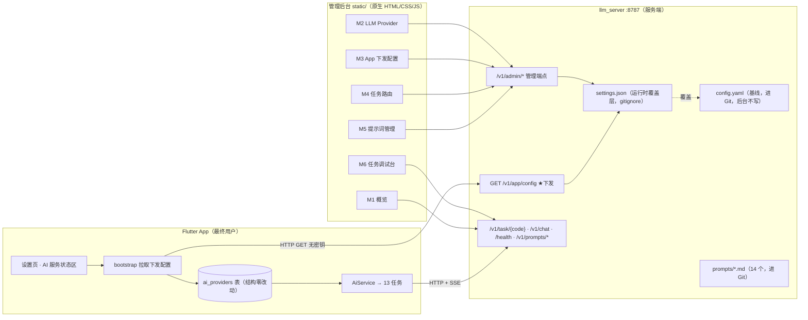
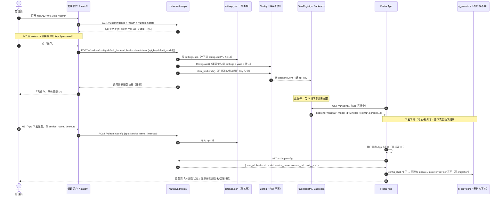
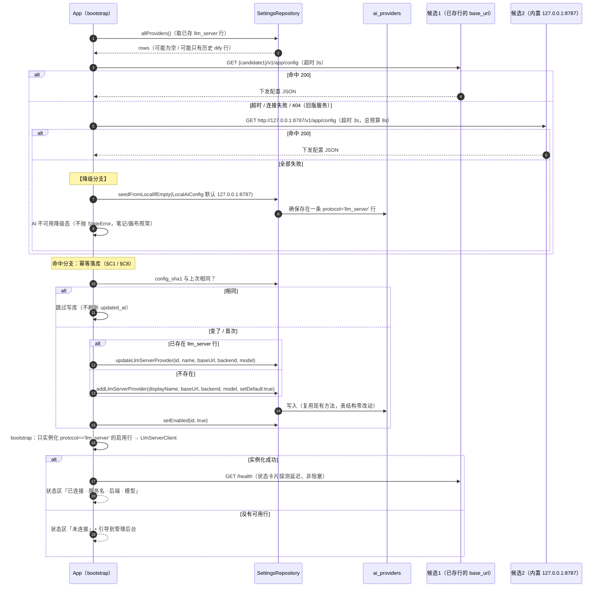

# 增量 PRD：AIMindTree 完整管理后台（App 配置收口 + LLM 运维后台）

| 项 | 内容 |
| --- | --- |
| 文档类型 | **增量 PRD**（只描述变更部分，不重写全量 PRD） |
| 关联文档 | `docs/PRD_LLM_SERVER.md`（llm_server 首版 PRD）、`docs/DESIGN_LLM_SERVER.md`（架构设计）、`docs/QA_LLM_SERVER.md`、`docs/ARCHITECTURE.md §6`（AI 协议层）、`llm_server/README.md` |
| 工作区根 | `D:\AndroidStudioProjects\AIMindTree` |
| 发起人 | 道源（用户） |
| 撰写 | 许清楚（产品经理） |
| 状态 | 待评审（约束已拍板，开放项见 §12，均带推荐默认值、**不留空阻塞**） |

> **阅读顺序**：§1 变更目标 → **§4 约束（必读，违反即不合格）** → §5 信息架构 → §6 接口契约 → §7 需求池 → §10 交互流程 → §12 待确认。

---

## 1. 变更目标

**一句话**：把「`llm_server` 上那个临时配置页」升级为 **AIMindTree 的完整 Web 管理后台**，并把 App 设置页里所有**运维级配置**（Provider / Base URL / 后端 / 模型 / 密钥 / 任务绑定）**全部收口到后台**，App 只保留「服务已连接 / 未连接」这类状态与最小排障入口，让 App 变成真正面向最终用户的产品。

### 1.1 用户原话与拆解

> 「我们还要完整完成这个 app 的管理后台，那个 llm 管理后台就是其中一部分……比如什么 provider 的，不应该放在 app 而应该放在管理后台给我配置，app 直接给用户使用」

| # | 诉求 | 本次落地方式 |
| --- | --- | --- |
| 1 | 要一个**完整的** App 管理后台（Web） | `llm_server/static/` 扩展为 9 个一级模块的管理后台（§5） |
| 2 | Provider / 模型 / 密钥 / 提示词等运维项**收口** | 后端 / Base URL / 协议 / 模型 / 密钥 / 任务路由 / 提示词 / 日志，全部只在后台出现（§8） |
| 3 | App 是给**用户**用的 | 设置页只留状态展示 + 最小入口；不再有 Provider 增删改与任务绑定（§8） |
| 4 | 解决「配置怎么下发到 App」 | 新增 `GET /v1/app/config`，App 启动拉取后写入 `ai_providers`（**复用现有 Repository 方法，零表结构改动**）（§6.1） |

### 1.2 变更前后对比

| 维度 | 变更前 | 变更后（本次） |
| --- | --- | --- |
| 后台形态 | 单页 `admin.html`（363 行）：后端下拉 + 模型 + MiniMax Key + /health + 余额 | **左导航 + 右内容区**的多模块后台（9 个一级模块，§5） |
| Provider 配置位置 | App 设置页「AI Provider 区」（Base URL / 后端 / 模型 / 启停 / 删除 / 测试连接） | **后台「LLM Provider」页**；App 侧不再出现 |
| 任务路由 | App 设置页「AI 任务路由区」绑 T1/T3/T4 → provider_id | **后台「任务路由」页**按 T1–T13 配 backend / model（服务端 `task_backends`） |
| 模型/后端下发 | 无；App 凭 `LocalAiConfig` 硬编码默认值 + 用户手填 | **`GET /v1/app/config` 下发**（§6.1），App 启动自动拉取落库 |
| 密钥管理 | 只能改 `.env` 或 config.yaml（无 UI） | 后台按后端分别填写；**只写 `settings.json`**，UI 只回显掩码，日志不落明文 |
| 提示词运维 | 无 UI（只能开编辑器改 md） | **提示词管理页**：列表 / 查看 / 编辑 / 保存 / 热重载 / sha1 变化追踪 |
| 调提示词手段 | 改完 md → 去 App 里点一遍看效果 | **任务调试台**：选任务、填 inputs、真跑一次，看原始输出 + 解析后 JSON + 耗时 + 模型 |
| App 启动体验 | 表内无 `llm_server` 行时 `bootstrap` 抛 `StateError`（App 起不来） | 自动拉取下发配置并落库；全部失败也进入「AI 不可用」**降级态**，不崩溃 |

### 1.3 范围边界

**要动**
- `llm_server/static/*`（后台前端重构 + 扩展）
- `llm_server/routers/admin.py`（新增/扩展管理端点）
- `llm_server/core/config.py`（per-backend 覆盖层扩展、`task_backends` 对象形态）
- `llm_server/core/registry.py`（per-task model 覆盖）
- `llm_server/core/logging.py` 或新增 `core/stats.py`（请求环形缓冲）
- `aimindtree_app/lib/ai/extraction_service.dart`（bootstrap 前拉下发配置 + 降级不抛错）
- `aimindtree_app/lib/data/repositories/settings_repository.dart`（可新增方法，**不改表**）
- `aimindtree_app/lib/features/settings/settings_page.dart`（移除运维 UI + 新增状态区）
- 文档：`docs/ARCHITECTURE.md §6`、本文

**不动**
- 15 张 Drift 表的任何结构（§C1）
- `AiProvider` / `AiTask` / `AiService` / `AiTaskRouter` 的既有接口与分支（除 bootstrap 前置逻辑）
- 业务页：`extract_screen` / `canvas_page` / `agent_page` / `teacher_page` / `homework_page` / `note_editor_page`
- 既有端点契约（§C4）：`/health`、`/v1/task/{code}`、`/v1/chat`、`/v1/prompts*`、`/v1/admin/*`
- `llm_server/requirements.txt`（仍是 4 个包，§C2）
- Dify 相关代码（继续保留注释态，本次不删不改）

---

## 2. 产品目标

| # | 目标 | 量化口径 |
| --- | --- | --- |
| G1 | **配置收口**：最终用户在 App 里看不到任何运维项 | 设置页的用户可见字符串中，Provider / Base URL / 后端 / 模型 / Key / 任务绑定 **0 处**；相关能力 100% 迁至后台 |
| G2 | **开箱可用**：服务已启动时 App **零手工配置**即可用 AI | 全新环境：起 `llm_server` → 打开 App（无需在 App 内填任何地址/模型）→ T1 跑通；启动引导 ≤ 8s，失败不影响非 AI 功能 |
| G3 | **改配置不等重启**：后台改的 Provider / 模型 / 路由 / 提示词，**下一次 AI 调用即生效** | 保存后 ≤ 1s 热重载；App 侧字段（地址/服务名）重启或手动重连后在状态区刷新 |
| G4 | **调提示词成本降到一次点击**：不打开编辑器、不重启服务完成「改 → 试 → 看」闭环 | 调试台支持 T1–T13（含 T5-detect）真实调用，展示 `content` / `parsed` / `latency_ms` / `model_id` / `backend` / `attempts` / 归一化错误码，闭环 ≤ 3 次点击 |
| G5 | **可观测**：管理员能回答「服务活着吗、用哪个后端/模型、最近失败在哪」 | 概览页 ≤ 3s 给出：服务状态、后端可达性、默认后端/模型、提示词数量、近 1h 调用数与错误数、最近 1 条错误 |

---

## 3. 用户故事

### 3.1 管理员视角

| # | 故事 | 验收要点 |
| --- | --- | --- |
| US-A1 | 作为**管理员**，我要在一个 Web 后台里统一管理**所有**运维配置（后端、Base URL、模型、密钥、任务路由、提示词、同步），以便不再在「改 yaml / 改 App 设置 / 改 env」之间来回切 | 左导航覆盖 §5 全部模块；任何一项都不必手工编辑文件 |
| US-A2 | 作为**管理员**，我要在后台切换 Provider 与模型并立即生效，以便随时在「本地省钱」与「云端更准」之间权衡 | 保存 → 热重载 → 下一次 `/v1/task/T1` 响应的 `backend` / `model_id` 即新值，不重启进程 |
| US-A3 | 作为**管理员**，我要**看不到也拿不到**任何完整密钥明文，以便配置页本身不成为泄露面 | UI 只显示掩码（如 `sk-1a…9f(len=51)`）；`GET /v1/admin/config` 只返回 `key_set` / `key_masked`；日志与 `/health` 无明文 |
| US-A4 | 作为**管理员**，我要 App 连哪个 Base URL / 后端 / 模型**由后台说了算**，以便我改一次，App 下次启动自动跟上 | 后台「App 下发配置」保存 → `GET /v1/app/config` 返回新值 → App 重启后状态区显示新值 |
| US-A5 | 作为**管理员**，我要在后台直接编辑某任务提示词并立刻试跑，以便 5 分钟内验证一次改动 | 提示词页保存 → 重载成功 → 切到调试台填 inputs → 看到新输出与耗时 |
| US-A6 | 作为**管理员**，我要知道服务是否健康、哪个后端挂了、最近失败原因，以便用户报障时先自查 | 概览显示后端可达性徽标；不可达给出归一化错误码（如 `auth_failed`），而非英文 traceback |
| US-A7 | 作为**管理员**，我要能导出/导入运行配置作备份，以便换机或误改后还原（P1） | 导出 JSON 默认**掩码**密钥；导入可预览差异、确认后热重载 |

### 3.2 终端用户视角

| # | 故事 | 验收要点 |
| --- | --- | --- |
| US-B1 | 作为**最终用户**，我要打开 App 就能用 AI，**不需要**知道什么是 Base URL / 后端 / 模型 | 首次安装 + 服务已起：直接可用；设置页没有这些字段 |
| US-B2 | 作为**最终用户**，我要在 AI 不可用时**知道为什么**且还能继续写笔记，以免被静默失败或闪退劝退 | 未连接时状态区提示「AI 服务未连接 · 点此重试」；笔记/画布/离线功能不受影响；**任何情况下不抛未捕获异常** |
| US-B3 | 作为**最终用户**，我要能一眼看到 AI 服务状态（连上了吗、用的哪个服务、快不快） | 状态卡展示：状态徽标、服务名、后端、模型、最近探测延迟、检查时间、「重新连接」 |
| US-B4 | 作为**最终用户**，我要能在排障时打开管理后台 / 查看本机服务地址 | 状态区提供「打开管理后台」；服务地址放折叠的「疑难排解」区，默认不展开 |
| US-B5 | 作为**最终用户**，我要同步设置不被 AI 运维项干扰 | 设置页一级分区收敛为：AI 服务状态 / 同步状态 / 关于；Provider 与路由区消失 |

---

## 4. 约束（违反即不合格）

| 编号 | 约束 | 来源 | 落地自检方式 |
| --- | --- | --- | --- |
| **C1** | **禁止修改 Drift 表结构**：已知 15 张表；相关的是 `ai_providers`（id/name/protocol/type/base_url/models/api_key_ref/enabled/is_default/created_at/updated_at/version）与 `ai_task_routes`（ai_task/provider_id）。沙箱跑不了 `build_runner`，改表 → `.g.dart` 无法重生成。**可以新增/复用 Repository 方法** | 用户拍板 | `git diff aimindtree_app/lib/data/db/tables.dart` **必须为空**（只允许注释变化）；无 migration |
| **C2** | **llm_server 不得新增 pip 依赖**（保持 `fastapi` / `uvicorn` / `httpx` / `pyyaml` 4 个）；管理后台前端必须是**原生 HTML/CSS/JS**，不引入任何框架或 CDN（`static/` 下的静态资源） | 用户拍板 | `requirements.txt` 仍 4 行；全文搜索 `http://cdn` / `https://unpkg` / `<script src="http` 命中 0 |
| **C3** | **密钥边界**：密钥只存在于服务端（`.env` / `settings.json`，均 gitignore）；**日志与任何 API 响应里一律掩码**。App 端与后台 UI 都不得明文回显完整密钥 | 用户拍板 | 遍历 `/v1/app/config`、`/health`、`/v1/admin/*` 响应与服务端日志，搜不到 `.env` 里任一原始密钥片段 |
| **C4** | **不破坏现有端点**：`/v1/task/{code}`、`/v1/chat`、`/health`、`/v1/prompts/*`、`/v1/admin/*` 的既有契约必须向后兼容 | 用户拍板 | 只在既有端点上**新增**可选字段；函数名与字段名一个都不改；`/v1/task/T1` 输出字段名与 `PRD_LLM_SERVER.md §C1` 逐字一致 |
| **C5** | **Dart 门禁**：唯一静态检查是 `cd aimindtree_app && D:/DevTools/flutter/bin/cache/dart-sdk/bin/dart.exe tool/analyze_inproc.dart`，**error + warning + info 都算失败**。`flutter test` / `dart analyze` / `build_runner` 在沙箱被拦截 | 用户拍板 | 每次改动必跑；特别注意注释掉 UI 后的 `unused_import` / `unused_element` |
| **C6** | **六层 JSON 容错两端等价**：`llm_server/core/json_repair.py` ↔ `aimindtree_app/lib/ai/structured_parse.dart`，改一侧必须同步另一侧 | 用户拍板 | 本次**不触碰** `json_repair.py` / `structured_parse.dart` 的逻辑；仅回归 `selftest.py` 的 6+1 个坏样本 |
| **C7** | **沙箱限制**：跨进程访问 `127.0.0.1:8787` 会被 loopback 隔离超时；成员验证用**进程内 FastAPI `TestClient`** 或库级直驱，不要指望起 uvicorn 再 curl | 用户拍板 | 服务端验收一律 `TestClient`；禁止写「curl 冒烟」作为唯一验收手段 |

**派生规则（由 C1–C7 推出，同等效力）**

| 编号 | 派生规则 |
| --- | --- |
| C8 | App 落库只能走**现有** `addLlmServerProvider` / `updateLlmServerProvider` / `setEnabled`；列解析只能走**现有** `backendOf` / `firstModel` / `encodeLlmServerModels`，禁止在别处再实现一份（避免「设置页显示 ollama、bootstrap 实际走 auto」的两处漂移） |
| C9 | `ai_providers` 的列复用语义沿用 `PRD_LLM_SERVER.md §C6`：`type`=backend（`auto`/`ollama`/`minimax`/`openai_compat`）、`models`=JSON 数组且长度 ≤ 1、`api_key_ref` 恒空串、`protocol='llm_server'` |
| C10 | 后台 UI 不得写入 `config.yaml`（保证 Git 基线干净可 diff），一切运行时改动写 `settings.json` |
| C11 | `AiTaskRouter.resolve` 与 `AiTaskRoute` 逻辑**一字不改**；服务端 `task_backends` 在服务端生效，与历史 `ai_task_routes` 行互不干扰 |

---

## 5. 信息架构（管理后台完整模块清单）

> **归属**列：服务端 = 只在 `llm_server` 实现；App 侧 = 只在 Flutter 实现；两边 = 两端都要改（含下发/联动）。

### 5.1 一级导航清单

| # | 一级模块 | 一句话说明 | 归属 | 数据源（已有 / 新增） |
| --- | --- | --- | --- | --- |
| M1 | **概览 Dashboard** | 服务状态 + 后端可达性 + 当前默认后端/模型 + 提示词数量 + 近 1h 请求统计 + 最近错误 | 服务端 | 已有 `/health`；新增 `GET /v1/admin/stats`（§6.3） |
| M2 | **LLM Provider** | 后端列表、Base URL、协议、模型（下拉+自定义）、密钥（掩码）、保存即热重载、探活、余额 | 服务端 | 已有 `GET/POST /v1/admin/config`、`/v1/admin/models`、`/v1/admin/balance`；**扩展 per-backend 可写**（§6.2） |
| M3 | **App 下发配置** ★ | 定义并预览 `GET /v1/app/config` 的内容：App 该连哪里、用哪个后端/模型、超时、后台地址、同步凭据是否就绪 | 两边 | **新增** `GET /v1/app/config` + settings `app` 段（§6.1）；App 启动拉取（§7 AC-16/17） |
| M4 | **任务路由** | T1–T13 逐任务指定 backend / model（缺省＝跟随全局） | 服务端 | **新增** `GET/PUT /v1/admin/routes`（§6.4） |
| M5 | **提示词管理** | 14 个提示词 md 的列表 / 查看 / 编辑 / 落盘保存 / 热重载 / sha1 与 mtime 变化追踪 | 服务端 | 已有 `GET /v1/prompts`、`GET/PUT /v1/prompts/{task}`、`POST /v1/prompts/reload`（**无需新增端点**） |
| M6 | **任务调试台** | 选任务（含 T5-detect 变体）→ 按 `inputs[]` 生成表单 → 真跑一次 → 展示原始输出 + 解析后 JSON + 耗时 + 模型 + 错误 | 服务端 | 已有 `POST /v1/task/{code}`、`POST /v1/chat`（`stream:false`）、`GET /v1/prompts`（**无需新增端点**） |
| M7 | **运行日志 / 诊断** | 近期请求明细：任务、后端、模型、耗时、成败、错误码；支持按失败/慢请求筛选 | 服务端 | **新增** `GET /v1/admin/logs`（P1，§7 AC-21/22） |
| M8 | **同步（Supabase）** | Supabase URL / Token（掩码）/ 启停开关；由服务端下发给 App | 两边 | **新增** settings `sync` 段 + `/v1/app/config` 下发（§6.1）；推荐收口见 §12 Q3 |
| M9 | **备份恢复 / 系统信息** | 导出导入 `settings.json`（密钥默认掩码）；版本、路径、进程、配置 mtime、监听地址、鉴权开关 | 服务端 | **新增** export / import / system 三个端点（P1） |

> M1–M6 为 **P0 必须交付**；M7–M9 页面本次做最小可用版或占位（见 §7 优先级），但 **M3 与 M8 的下发字段必须在 P0 定义完整**，否则 App 侧无法一次性对接。

### 5.2 模块关系图



---

## 6. 接口契约（本次新增/扩展的服务端端点）

> **§C4 硬约束**：以下全部为**新增**端点，或在既有端点上**新增可选字段**；既有字段语义一个都不改。

### 6.1 `GET /v1/app/config`（★ 核心新增 · P0 · 无鉴权 · 无密钥）

App 启动时拉取的唯一配置源。**不含任何密钥明文**。

**请求**：无参数、无鉴权头。

**响应 200**

```json
{
  "schema": 1,
  "server_version": "0.1.0",
  "service_name": "AIMindTree AI 服务",
  "protocol": "llm_server",
  "base_url": "http://127.0.0.1:8787",
  "backend": "ollama",
  "model": "qwen3:8b-8k",
  "console_url": "http://127.0.0.1:8787/admin",
  "timeouts": { "structured_s": 120, "chat_s": 120, "connect_s": 10 },
  "task_backends": { "T1": { "backend": "ollama", "model": null }, "T3": null },
  "sync": { "base_url": "https://xxx.supabase.co", "enabled": false, "token_set": true },
  "config_sha1": "9f2c1a...",
  "updated_at": "2026-09-05T10:00:00+08:00"
}
```

| 字段 | 类型 | 说明 | App 侧消费方式 |
| --- | --- | --- | --- |
| `schema` | int | 契约版本号，当前 `1`；App 只识别 `1`，其它值按降级处理 | 校验 |
| `server_version` | str | 服务版本 | 展示 |
| `service_name` | str | 展示名 | 落库 `ai_providers.name` |
| `protocol` | str | 恒 `'llm_server'`（与现有 `kLlmServerProtocol` 一致） | 落库 `protocol` |
| `base_url` | str | 推导规则：`server.host ∈ {127.0.0.1, localhost, 0.0.0.0}` → `http://127.0.0.1:<port>`；否则 `http://<host>:<port>` | 落库 `base_url` |
| `backend` | str | 默认后端名；空/非法时 App 写 `auto` | 落库 `type` |
| `model` | str\|null | `null`/空 = 用后端默认模型 | 落库 `models`（复用 `encodeLlmServerModels`） |
| `console_url` | str | 管理后台地址（App「打开管理后台」按钮） | 展示 |
| `timeouts` | object | `structured_s` / `chat_s` / `connect_s`，供 App 对齐与展示 | 展示 |
| `task_backends` | object | `{T1: {backend, model} \| null}`，`null`=跟随全局；**仅供展示/诊断，App 不做本地路由** | 展示 |
| `sync` | object\|null | `base_url` 明文、`enabled` 布尔、**`token_set` 只给布尔，绝不回显 token** | 本地未配置时采纳（§12 Q3） |
| `config_sha1` | str | 对下发字段（不含 `updated_at`）计算的 sha1 | **幂等落库判据**：与上次相同则不写库 |
| `updated_at` | str | ISO8601 最后保存时间 | 展示 |

**兼容规则（写死）**

1. **404 / 405**（连到了旧版服务）→ 判定「可达但不支持下发」→ 降级到内置默认 `http://127.0.0.1:8787` + `backend=auto` + `model=''`，状态区标注「服务版本较旧」。
2. **非 2xx 其它 / 超时 / 连接失败** → 按 §10.2 降级分支处理。
3. **绝不返回**任何 `.env` 原始密钥、`settings.json` 的 `api_key`、Supabase token 明文（§C3）。
4. **不鉴权**：该端点在未配置访问令牌时必须可被 App 无凭据访问（§12 Q1），否则 App 启动即失败。

### 6.2 `GET/POST /v1/admin/config`（扩展 · P0）

在**现有字段全部保留**的基础上扩展：

| 方向 | 变更 | 说明 |
| --- | --- | --- |
| GET 响应 | `backends[]` 每项新增 `base_url` / `editable: true` / `for_app: bool`（是否为当前下发后端） | 既有 `name/protocol/default_model/key_set/key_masked/models` 全部保留 |
| POST body | 新增 `backends: {<任意后端名>: {base_url?, models?, default_model?, protocol?, api_key?}}` | 不再只能改 minimax；`api_key` 现有 `Config.save_settings` 已通用本次补 `base_url` / `models` / `default_model` / `protocol` 四项生效逻辑 |
| POST body | 新增 `app: {service_name?, console_url?, timeouts?}` | 写入 `settings.json` 的 `app` 段，供 `/v1/app/config` 读取 |
| POST 行为 | 保存 → `Config.load()` → `clear_backends()` → 返回最新 `_config_summary()` | 与现有行为一致，**不返回密钥明文** |

**写入优先级（写死）**：`settings.json > config.yaml > 代码默认值`；`config.yaml` 永不被后台写入（§C10）。

### 6.3 `GET /v1/admin/stats`（新增 · P0）与进程内环形缓冲

服务端在内存维护最近 **500 条**调用记录（进程重启即清空，不落盘——避免引入存储依赖，§C2）。

**单条记录字段**

```json
{ "ts": 1757059200.123, "kind": "task|chat", "task": "T1", "variant": null,
  "backend": "ollama", "model": "qwen3:8b-8k", "latency_ms": 4137,
  "ok": true, "error_code": null, "attempts": 1,
  "input_chars": 812, "output_chars": 431 }
```

**响应**

```json
{
  "window_s": 3600, "total": 128, "ok": 120, "error": 8,
  "avg_latency_ms": 3120, "p95_latency_ms": 8100,
  "by_task":    [{ "task": "T1", "count": 40, "ok": 38, "error": 2, "avg_latency_ms": 4100 }],
  "by_backend": [{ "backend": "ollama", "count": 128, "error": 8 }],
  "last_error": { "ts": 1757059200, "task": "T1", "code": "bad_json", "message": "..." },
  "slowest":    [{ "ts": 1757059200, "task": "T3", "latency_ms": 9100 }],
  "buffer_size": 500, "since_startup": 412
}
```

> `error_code` 一律用已定义的 12 个归一化码（`DESIGN_LLM_SERVER.md §2.3`），**不得**出现上游原始报文。

### 6.4 `GET/PUT /v1/admin/routes`（新增 · P0）

- **GET** → `{"default_backend":"ollama","default_model":"qwen3:8b-8k","task_backends":{"T1":{"backend":"ollama","model":null}},"tasks":[{"task":"T1","backend":null,"model":null,"structured":true,"preferred_backend":"ollama"}]}`
  - `tasks[]` 由 `GET /v1/prompts` 派生，恒 14 条（含 T5-detect）；`backend/model=null` 表示「跟随全局」。
- **PUT** body 同 `task_backends` 形态。**校验**：`backend` 必须 ∈ `config.backends` 或 `null`（否则 `400 invalid_request`）；`model` 为任意字符串或 `null`。
- 写入 `settings.json` 的 `task_backends` 段 → `Config.load()` → `clear_backends()`；`TaskRegistry` 解析时若该 task 配了 `model`，**仅在请求未显式带 model 时**覆盖（§C4）。
- `config.yaml` 里 `task_backends` 的**字符串形态继续支持**（`'T1': 'minimax'` 等价 `{backend:'minimax', model:null}`），不做破坏性改造。

### 6.5 其余端点：全部复用，零改动

| 用途 | 复用端点 |
| --- | --- |
| 提示词列表/查看/编辑/重载 | `GET /v1/prompts`、`GET /v1/prompts/{task}?variant=`、`PUT /v1/prompts/{task}?reload=true`、`POST /v1/prompts/reload` |
| 调试台跑结构化任务 | `POST /v1/task/{code}` |
| 调试台跑会话任务 | `POST /v1/chat`（**`stream:false`**，非流式，避免后台写 SSE 客户端） |
| 探活 / 余额 / 模型列表 | `GET /health`、`GET /v1/admin/balance`、`GET /v1/admin/models?backend=` |

---

## 7. 需求池

> **优先级**：P0 = 本次必须做完；P1 = 本次尽量做；P2 = 后续。
> **P0 共 20 条**（服务端 8 / 后台 UI 7 / App 5），工程师一轮可完成。

### 7.1 服务端（`llm_server/`）

| 编号 | 模块 | 需求描述 | 优先级 | 验收标准 |
| --- | --- | --- | --- | --- |
| AC-01 | M3 下发 | 新增 `GET /v1/app/config`，按 §6.1 返回 App 运行所需配置 | P0 | 返回 200 且字段齐全；**响应体全文搜索不到任何 `.env` 密钥片段**；`schema=1`；`TestClient` 断言通过（§C7） |
| AC-02 | M3 下发 | `app` 段持久化：`service_name` / `console_url` / `timeouts` 可经 `POST /v1/admin/config` 写入 `settings.json` | P0 | 改 `service_name` → `GET /v1/app/config` 立即返回新值；`config.yaml` 的 `git diff` 为空 |
| AC-03 | M2 Provider | per-backend 覆盖层扩展：任意后端的 `base_url` / `models` / `default_model` / `protocol` / `api_key` 可写 | P0 | 把 ollama 的 `base_url` 改成不可用端口 → `/health` 显示新地址且探活随之不可达；改回即恢复 |
| AC-04 | M2 Provider | `GET /v1/admin/config` 返回每个后端的 `base_url` / `protocol` / `editable` / `for_app`（现有字段不动） | P0 | 后台 Provider 页无需硬编码即可渲染全部后端的地址与掩码 |
| AC-05 | M4 路由 | 新增 `GET/PUT /v1/admin/routes`，读写 `task_backends`（值支持 string 或 `{backend, model?}`，`null`=跟随全局） | P0 | PUT `{T1:{backend:'minimax'}}` → GET 回显一致 → 下次 `/v1/task/T1` 响应 `backend='minimax'`；非法后端名返回 `400 invalid_request` |
| AC-06 | M4 路由 | `TaskRegistry` 支持 per-task `model` 覆盖（仅请求未显式带 model 时生效） | P0 | 显式带 model 不被覆盖；未带时用路由 model；两条路径都不改变既有响应字段名 |
| AC-07 | M1/M7 诊断 | 进程内环形缓冲记录每次 `task` / `chat` 调用（上限 500 条，字段见 §6.3），成功与 `LlmError` 都记录 | P0 | 连续调用 5 次后 `GET /v1/admin/stats` 的 `total` 累加正确；超过 500 条自动淘汰最旧 |
| AC-08 | M1 诊断 | 新增 `GET /v1/admin/stats`（§6.3） | P0 | 概览能显示近 1h total/ok/error/avg/p95/last_error/slowest；刚启动时 `total=0` 返回空数组而非 null |
| AC-21 | M7 日志 | 新增 `GET /v1/admin/logs?limit=&task=&status=&slow_ms=` | P1 | 支持按失败/慢请求筛选；单页 ≤ 200 条；无记录返回空数组 |
| AC-23 | M9 备份 | 新增 `GET /v1/admin/settings/export`（**默认掩码**，需 `include_keys=true` 且前台二次确认才输出明文）与 `POST /v1/admin/settings/import`（校验 + 热重载） | P1 | 默认导出体搜不到密钥；导入非法 JSON 返回 400 且不破坏现有 settings.json |
| AC-25 | M9 信息 | 新增 `GET /v1/admin/system`：版本、config/settings/prompts 路径、pid、python 版本、uptime、config mtime、settings 是否存在（**不回显内容**）、监听地址、鉴权是否开启 | P1 | 与 `/health` 的 version/uptime 一致 |
| AC-27 | M9 安全 | 可选访问令牌（`config.server.admin_auth_token`，留空=关闭）。开启后 `/admin`、`/`、`/v1/admin/*` 需 `X-Admin-Token`；**`/v1/app/config`、`/v1/task/*`、`/v1/chat`、`/health` 不受影响** | P1 | 未配置时行为与现状完全一致；配置后无 token 访问 `/v1/admin/config` 返回 401，而 App 的 `/v1/app/config` 仍 200 |
| AC-28 | M5 提示词 | `PUT /v1/prompts/{task}` 落盘前自动写一份 `prompts/.backup/<file>.<yyyymmdd-HHMMSS>.bak` | P1 | 连续改两次同一文件，`.backup` 下有两个备份；`.gitignore` 忽略 `.backup/` |
| AC-34 | M1 用量 | 用量/成本统计落盘 + 成本视图 | P2 | — |
| AC-35 | M3 下发 | 配置变更 SSE 推送，App 运行期即时感知（免重启） | P2 | — |

### 7.2 管理后台前端（`llm_server/static/`）

| 编号 | 模块 | 需求描述 | 优先级 | 验收标准 |
| --- | --- | --- | --- | --- |
| AC-09 | 骨架 | 静态资源重组 + **左导航 + 右内容区**骨架；模块间无刷新切换；保留 `GET /` 与 `GET /admin` 入口 | P0 | 打开 `http://127.0.0.1:8787/admin` 直接进后台；点导航 5 次无整页刷新；**断网后除余额查询外所有页面可用**（无 CDN 外链，§C2） |
| AC-10 | M1 概览 | Dashboard：服务状态徽标 + 版本/uptime + 默认后端/模型 + 后端可达性表 + 提示词数量 + 近 1h 统计条 + 最近错误 + 快捷「重载配置」「重载提示词」 | P0 | 3s 内渲染完成；后端不可达显示归一化错误码而非英文堆栈；单卡失败不阻塞其它卡片 |
| AC-11 | M2 Provider | LLM Provider 页：每个后端一张卡（Base URL / 协议 / 模型下拉+自定义 / 密钥 password 框 / 「已设置」徽标 / 设为默认后端）+ 保存重载 + 立即探活 + MiniMax 余额卡 | P0 | 保存后 1s 内 `/health` 反映新配置；密钥保存成功后输入框清空且页面只显示掩码；余额不可用显示可读原因 |
| AC-12 | M3 下发 | App 下发配置页：表单编辑白名单字段 + 只读 JSON 预览（真实 `GET /v1/app/config`）+ 「复制 App 将拉取的地址」+ **自检**（可达性 / schema / 必需字段 / **无密钥泄露**） | P0 | 页面所见 JSON 与真实响应一致；自检能发现「响应体里命中本地已知 key 串」这类回归 |
| AC-13 | M4 路由 | 任务路由页：T1–T13（含 T5-detect）表格，每行 = 任务 + 后端下拉 + 模型输入 + 「跟随全局」；批量保存 | P0 | 全部跟随全局 → `/v1/admin/routes` 返回全 null；设 T1→minimax 后 `/v1/task/T1` 的 backend 为 minimax；非法输入前端拦截并给中文提示 |
| AC-14 | M5 提示词 | 提示词管理页：列表（`file` / `task` / `structured` / `inputs` / `sha1` 前 8 位 / `mtime` / `size`）+ 查看/编辑（Markdown 文本框）+ 保存（走 `PUT`）+ 重载 + sha1 变更提示 | P0 | 编辑 `t1_extract.md` 保存并 reload → 立刻在调试台跑 T1 能看到新提示词生效；列表 sha1 与 `GET /v1/prompts` 一致 |
| AC-15 | M6 调试台 | 任务调试台：任务下拉（含 `T5 · detect`）→ **按 `inputs[]` 逐个生成输入框**（长文本/JSON 串类入参给多行文本框）→ 可选覆盖 backend/model → 「运行」→ 展示 `content`（原始）/ `parsed`（格式化 JSON）/ `latency_ms` / `model_id` / `backend` / `attempts` / 归一化错误码 | P0 | structured 任务走 `/v1/task/{code}`，chat 任务走 `/v1/chat` + `stream:false`；失败显示中文错误码 + message + retryable；长文本可滚动不截断 |
| AC-22 | M7 日志 | 运行日志/诊断页：明细表格 + 筛选（任务/失败/慢请求 Top10）+ 刷新 | P1 | 与 `/v1/admin/stats` 数字可对上；慢请求按 `latency_ms` 倒序 |
| AC-24 | M9 备份 | 备份恢复页：导出 JSON（默认掩码）、粘贴导入、导入前 diff 预览（列出将变更的键） | P1 | 导入后配置立即生效；非法内容不写盘并给出可读错误 |
| AC-26 | M9 信息 | 系统信息页：版本/路径/pid/uptime/config mtime/监听地址/鉴权开关 + 「复制诊断信息」（脱敏） | P1 | 一键复制文本可直接贴进 issue 且不含任何密钥 |
| AC-30 | M8 同步 | 同步（Supabase）配置页：URL / Token（掩码，留空=不改）/ 启用开关 / 连接测试（只读探测，不上传数据） | P1 | 保存后 `GET /v1/app/config` 的 `sync` 段随之更新；`token_set` 正确反映且**不回显** |
| AC-32 | M5 提示词 | 保存前 sha1 前后对比 + 「离开未保存」提醒 + 「恢复到上次保存内容」 | P1 | 二次编辑未保存时切换列表给出确认提示 |
| AC-36 | M9 审计 | 后台操作审计日志（谁在何时改了哪段配置） | P2 | — |

### 7.3 客户端（`aimindtree_app/`）

| 编号 | 模块 | 需求描述 | 优先级 | 验收标准 |
| --- | --- | --- | --- | --- |
| AC-16 | App 启动 | **启动引导拉取下发配置**：候选地址 = 已存 `protocol=='llm_server'` 行的 `base_url`（去重）+ 内置默认 `http://127.0.0.1:8787`；依次 `GET {base}/v1/app/config`，单地址 3s 超时、总预算 8s | P0 | 服务在默认端口时冷启动 ≤ 8s 得到配置；服务换端口但表里有旧地址时也能命中候选；**阻塞不超过总预算** |
| AC-17 | App 落库 | **幂等落库（不改表）**：已存在 `llm_server` 行 → 调现有 `updateLlmServerProvider(...)` 并 `setEnabled(id,true)`；不存在 → 调现有 `addLlmServerProvider(...)`；`config_sha1` 与上次相同则**完全不写库** | P0 | 连续启动 3 次，`ai_providers.updated_at` 只在配置变化时被改写；无新列、无 migration、`tables.dart` diff 为空（§C1） |
| AC-18 | App 降级 | 全部候选失败（含旧版服务 404）→ 回落内置默认 + 现有 `seedFromLocalIfEmpty`；`bootstrap` **不再抛 `StateError`**，改入「AI 不可用」降级态 | P0 | 断网/未起服务时 App 能打开并使用笔记与画布；AI 入口给明确中文提示而非崩溃；服务恢复后点「重新连接」即可用 |
| AC-19 | App 设置页 | **移除运维 UI**：Provider 列表的「新增 / 编辑 / 删除 / 启停 / 测试连接」、FAB「添加 LLM 服务」、**「AI 任务路由」整区**；两个 dialog 的调用点移除 | P0 | 设置页面向用户的字符串里不再出现 Base URL / 后端 / 模型 / Provider / 任务绑定；两个 dialog 按既有「口径 A」处置（注释保留不删除），门禁 0 error 0 warning |
| AC-20 | App 设置页 | **新增「AI 服务状态」区**：状态徽标（已连接 / 未连接 / 部分可用）+ 服务名 + 后端 + 模型 + 最近探测延迟与检查时间 + 「打开管理后台」+「重新连接」+ 折叠「疑难排解」（服务地址只读 + 「修改请到管理后台」） | P0 | 两种状态截图可辨；「打开管理后台」能打开 `console_url`；重新连接后数值刷新 |
| AC-29 | App 同步 | 采纳 `/v1/app/config` 的 `sync` 段；**优先级：服务端下发 > 本地 prefs**；服务端给空则保留本地 | P1 | 后台配了 sync → App 启动后 `SyncConfig` 反映下发值并标注来源；后台清空不抹掉本地 |
| AC-31 | App 设置页 | 服务端下发了 sync 时，原同步输入区降为**只读**并显示「由管理后台下发」标签 | P1 | 用户可见当前同步目标但不可编辑；无下发时保持现状 |
| AC-33 | App 运行时 | AI 调用失败且错误码疑似配置变更（`backend_unknown` / `auth_failed` / `prompt_not_found`）时，静默重拉一次下发配置并重试一次 | P2 | — |
| AC-37 | App 部署 | App 内拉起/托管 `llm_server` 子进程（当前为手动启动） | P2 | — |

---

## 8. App 侧变更清单

### 8.1 移除（P0）

| 位置 | 现状 | 处置 |
| --- | --- | --- |
| `settings_page.dart` Provider 卡片 | `[开关] [编辑] [测试连接] [删除]` 四个操作 | **全部移除** |
| `settings_page.dart` FAB | 「添加 LLM 服务」 | **移除** |
| `settings_page.dart` 空态文案 | 「还没有 AI 服务。点右下角「添加 LLM 服务」创建一个。」 | 改为状态区的「未连接」表达 |
| `settings_page.dart` 「AI 任务路由」区 | T1/T3/T4 绑 provider 的下拉 + 说明文案 | **整区移除**（路由改由服务端 `task_backends` 决定） |
| `llm_server_add_dialog.dart` / `llm_server_edit_dialog.dart` | 新增/编辑 Provider 的对话框 | 移除调用点；文件按既有「口径 A」整段注释保留（**不删除**），`import` 一并处理以免门禁报 warning |
| 底部说明区 | 「增删 / 启停 Provider 后需重启 App 才生效」等 | 改写为用户视角文案（见 §8.3） |
| `sync_settings_section.dart` 输入框 | URL / Token 可编辑 | **P1** 降级为只读（仅当服务端下发时） |

### 8.2 保留

| 项 | 保留理由 |
| --- | --- |
| 设置页骨架与分区结构 | 用户仍需要「设置」入口承载状态展示 |
| 同步状态展示（待推条数 / 上次同步时间 / 最近错误） | 属用户可感知状态，不是运维配置 |
| 内置默认地址 `http://127.0.0.1:8787`（`kLlmServerDefaultBaseUrl`） | 下发失败时的唯一兜底 |
| `LocalAiConfig` + `seedFromLocalIfEmpty` | 兜底种子逻辑不动，仅在其之前插入「拉取下发」 |
| `ai_providers` / `ai_task_routes` 两张表与 `AiTaskRouter` | 表结构零改动（§C1）；路由表虽无 UI，仍可能有历史行，`resolve` 逻辑不动（§C11） |
| 现有 `backendOf` / `firstModel` / `encodeLlmServerModels` | 下发落库必须复用，禁止别处再实现一份（§C8） |

### 8.3 新增（P0）

| 新增项 | 说明 |
| --- | --- |
| **下发拉取器** | 一个「App 运行时配置」拉取单元：候选地址枚举、`GET /v1/app/config`、超时控制、JSON 解析、`config_sha1` 幂等判定。落点由架构师定，但**必须能被 `extraction_service.dart` 的 bootstrap 前置调用** |
| **AI 服务状态区**（设置页） | 徽标 + 服务名 + 后端 + 模型 + 最近探测延迟 + 检查时间 + 「重新连接」+「打开管理后台」+ 折叠「疑难排解」 |
| **降级态语义** | 无可用服务时 App 正常可用（笔记、画布、离线功能），AI 入口给出 SnackBar/对话框「AI 服务未连接，请确认服务已启动，或点此打开管理后台」；**不抛异常、不白屏** |
| **状态透出** | 把「本次使用哪套下发配置 + 来源是「下发」还是「内置默认」」写进日志（`AppLog('ai_config')`）便于排障 |

**设置页新文案（用户视角）**

```
• AI 服务由本机「AIMindTree AI 服务」提供，相关配置请在管理后台修改；
• 打开管理后台：http://127.0.0.1:8787/admin；
• 密钥保存在服务端，App 不保存任何密钥。
```

---

## 9. UI 设计稿（文字版）

> 亮色主题、浅灰底 + 白色卡片、圆角、细边框 + 轻阴影；中文标签；沿用并小幅扩展现有 `admin.html` 色板。

### 9.1 配色与字阶

| 变量 | 取值 | 用途 |
| --- | --- | --- |
| `--bg` | `#f4f6fb` | 页面底色 |
| `--card` | `#ffffff` | 卡片/导航底色 |
| `--line` | `#e3e8f0` | 边框、分隔线 |
| `--text` | `#1f2733` | 主文字 14px / 行高 1.55 |
| `--muted` | `#6b7785` | 次要文字、字段标签 13px |
| `--brand` | `#2f6fed` | 主按钮、选中态、链接 |
| `--brand-soft` | `#eaf1ff` | 焦点环、导航选中底色 |
| `--ok` / `--ok-soft` | `#1f9d57` / `#e7f6ee` | 已连接、成功 |
| `--bad` / `--bad-soft` | `#d6453d` / `#fdecea` | 未连接、错误 |
| `--warn` | `#c98a00` | 部分可用、未保存、告警 |

- 字阶：页面标题 18px/600；卡片标题 15px/600 + 12px 灰色提示；表格 13px；代码块 12px 等宽。
- 圆角：卡片 / 输入框 / 按钮统一 8–12px；阴影 `0 1px 3px rgba(20,30,50,.08), 0 6px 18px rgba(20,30,50,.06)`。
- **状态徽标**：`已连接`(绿) / `未连接`(红) / `部分可用`(橙) / `未知`(灰)，圆角胶囊 + 12px/600。

### 9.2 整体布局

```
┌────────────┬──────────────────────────────────────────────────────────────┐
│ 左导航 240 │  顶栏：当前模块名 + 右侧「服务状态」小徽标 + 重载按钮         │
│            │──────────────────────────────────────────────────────────────│
│ AIMindTree │                                                              │
│ 管理后台   │  内容区（max-width 1040px，卡片纵向堆叠，间距 18px）          │
│            │  ┌────────────────────────────────────────────────────────┐  │
│ ▸ 概览      │  │ 卡片 1                                                │  │
│            │  ├────────────────────────────────────────────────────────┤  │
│ AI 服务     │  │ 卡片 2                                                │  │
│ ▸ Provider  │  └────────────────────────────────────────────────────────┘  │
│ ▸ 任务路由  │                                                              │
│ ▸ 下发配置  │                                                              │
│            │                                                              │
│ 内容与调试  │                                                              │
│ ▸ 提示词    │                                                              │
│ ▸ 调试台    │                                                              │
│            │                                                              │
│ 运维        │                                                              │
│ ▸ 运行日志  │                                                              │
│ ▸ 同步      │                                                              │
│ ▸ 备份/信息 │                                                              │
│ ─────────  │                                                              │
│ v0.1.0 · 本机│                                                             │
└────────────┴──────────────────────────────────────────────────────────────┘
```

- 导航选中：底色 `--brand-soft`，文字 `--brand`，左侧 3px 蓝色竖条。
- 窗口宽 < 900px 时导航折叠为顶部横向标签（后台主要桌面使用）。
- 每张卡右上角可有「刷新」; **卡片级错误独立降级**（某张卡失败不白屏整页）。

### 9.3 各页控件与字段清单

**M1 概览 Dashboard**

| 卡片 | 控件/字段 |
| --- | --- |
| 服务状态卡 | 状态徽标（`status`）、版本、uptime、默认后端、默认模型、提示词加载数；按钮：`重载配置`、`重载提示词` |
| 后端可达性 | 表格：`后端` / `状态`徽标（含错误码时橙色标签）/ `Base URL`（等宽）/ `模型数` |
| 近 1 小时 | 四个数字块：总调用 / 成功 / 失败 / 平均延迟；右侧 p95 与最慢 Top3 |
| 最近错误 | 一行：时间 · 任务 · 错误码 · 中文 message（可折叠展开完整 JSON） |

**M2 LLM Provider**

| 区块 | 控件/字段 |
| --- | --- |
| 后端卡（每后端一张） | 后端名（标题）+「设为默认后端」；`Base URL`(文本框) / `协议`(下拉，协议可切时显示) / `模型`(下拉 + 自定义文本框联动) / `API Key`(password，`placeholder=留空则不修改`) / 密钥状态徽标（`已设置 · sk-1a…9f(len=51)` 或 `未设置`） |
| 操作条 | `保存`（内含热重载）+ `立即探活`（调 `/health` 并高亮该行）+ 结果提示行（`已保存，已热重载 ✅`） |
| MiniMax 余额卡 | `可用`徽标、关键数值（解析不出则展示折叠的原始 JSON）、`错误`（无则「无」）、`刷新` |

**M3 App 下发配置 ★**

| 区块 | 控件/字段 |
| --- | --- |
| 基本信息 | `服务显示名` / `后台地址` / `结构化超时` `会话超时` `连接超时`（秒）/ `保存` |
| 当前下发预览 | 只读 `<pre>` 展示**真实** `GET /v1/app/config` 的 JSON（含 `config_sha1`、`updated_at`），右上角「复制」 |
| 自检 | 逐项打勾：端点可达 ✓ / `schema=1` ✓ / `base_url` 可连通 ✓ / **响应体无密钥泄露 ✓**（与本地已知 key 值比对）/ 必需字段齐全 ✓ |

**M4 任务路由**

- 表格：`任务`（如「T1 知识点提取」「T5 · detect」）/ `结构化`徽标 / `后端`（下拉：跟随全局 + 各后端）/ `模型`（文本框，空=跟随全局）/ `建议后端`（只读 `preferred_backend`）
- 底部：`批量设为跟随全局` + `保存`；提示「已保存并热重载，下一次调用生效」。

**M5 提示词管理**

- 左：列表表格 `文件` / `任务` / `类型` / `sha1(前8)` / `修改时间` / `大小`
- 右：编辑区 `任务与变体`（只读头）/ Markdown 文本框（等宽、保留换行、可全屏）/ `保存`（`PUT` + `reload=true`）/ `重载全部` / `放弃修改`
- 顶部提示条：保存成功后显示 `sha1 已由 3f2a… 变为 9f2c… ✅`

**M6 任务调试台**

- 顶部：`任务`（下拉，含 `T5 · detect`）/ `后端`（下拉，默认跟随路由）/ `模型`（文本框，空=默认）/ `运行` / `清空`
- 中部：按 `inputs[]` 生成的表单（每个变量一个标签 + 输入框；长文本/JSON 串类变量给多行文本框；`timeout_s` 折叠在「高级」）
- 底部结果区（三标签页）：`原始输出`（`<pre>` 可滚动）/ `解析后 JSON`（格式化 + 折叠）/ `调用信息`（`backend`、`model_id`、`latency_ms`、`attempts`、`usage`、错误码/retryable）
- 失败时：结果区顶部红色错误条 `{code}` + 中文 message + `retryable` 标记

**M7 运行日志 / M8 同步 / M9 备份恢复与系统信息**（P1）沿用同款表格/卡片样式，字段对应 §6.3 / §6.1 `sync` / AC-23~AC-26。

### 9.4 App 侧「AI 服务状态」区（对照）

```
┌────────────────────────────────────────────────────────┐
│ ● 已连接                                    [重新连接]  │
│ AIMindTree AI 服务 · ollama · qwen3:8b-8k              │
│ 最近探测 42 ms · 09:12 检查                            │
│ [打开管理后台]                                          │
│ ▸ 疑难排解   服务地址 http://127.0.0.1:8787（只读）     │
│              如需修改，请在管理后台调整                  │
└────────────────────────────────────────────────────────┘
```

未连接时：`● 未连接` + 「AI 服务未连接。请确认本机服务已启动，或打开管理后台检查配置。」+ `[打开管理后台]` `[重新连接]`。

---

## 10. 交互流程

### 10.1 流程① 管理员改配置 → 后台保存 → 热重载 → App 下次启动生效



> **关键语义**：Provider / 模型 / 路由 / 提示词的改动对**服务端下一次 AI 调用立即生效**；只有「App 该连哪里、展示什么名字」这些**下发字段**需 App 重启或手动重连才刷新（有意为之：避免 App 运行期被后台改到连不上）。

### 10.2 流程② App 启动引导（拉 `/v1/app/config` → 落库 → bootstrap）



**降级策略（写死）**

| 场景 | 行为 |
| --- | --- |
| 服务可达、`/v1/app/config` 返回 200 | 用下发值（`backend` 空/非法 → `auto`；`model` 空 → 后端默认模型） |
| 服务可达但 **404/405**（旧版服务） | 用内置默认 `http://127.0.0.1:8787` + `backend=auto` + `model=''`，标注「服务版本较旧」 |
| 服务不可达（超时 / 拒绝连接 / DNS） | 内置默认 + 现有 seed 逻辑；状态区「未连接」+ 重试/打开后台入口；**AI 降级但 App 不崩** |
| 下发 JSON 缺字段 / `schema` 不是 1 | 缺字段按 §6.1 默认值兜底；`schema` 不认识则整体按「不支持下发」处理（等同 404 分支） |
| 多个候选都可达 | 取**第一个返回 200 的候选**（顺序：已存行地址 → 内置默认），不再继续 |

---

## 11. 非功能需求

| 编号 | 需求 | 验收标准 |
| --- | --- | --- |
| N-1 | **密钥零扩散**（§C3） | `/v1/app/config`、`/health`、`/v1/admin/logs`、`/v1/admin/stats` 全量响应 + 服务端日志中搜不到任何完整密钥；后台 UI 只显示掩码；App 侧 `api_key_ref` 恒空串 |
| N-2 | **表结构零改动**（§C1） | `aimindtree_app/lib/data/db/tables.dart` 的 `git diff` **为空**（只允许注释变化）；无 migration |
| N-3 | **依赖零新增**（§C2） | `requirements.txt` 仍 4 行；`static/` 下无 CDN 外链、无框架；断网后后台除「余额查询」外全部可用 |
| N-4 | **向后兼容**（§C4） | 既有端点的请求参数与响应字段名一个都不改；App 用旧库文件（含历史 dify 行）能正常启动 |
| N-5 | **后台性能** | `/v1/app/config` < 50ms；`/health` < 200ms（后端探测并发）；概览首屏 < 3s |
| N-6 | **App 启动预算** | 下发拉取总预算 ≤ 8s（单地址 3s）；不阻塞首帧过长 |
| N-7 | **幂等** | 同一份配置连续启动 10 次，`ai_providers` 只被写入 1 次（`config_sha1` 判据） |
| N-8 | **可观测** | 后台任一操作失败都有中文可读提示；失败组件不拖垮整页 |
| N-9 | **门禁通过**（§C5） | `cd aimindtree_app && D:/DevTools/flutter/bin/cache/dart-sdk/bin/dart.exe tool/analyze_inproc.dart` → 0 error 0 warning |
| N-10 | **错误归一化** | 后台所有错误展示用既有 12 个 error code + 中文 message，不出现 traceback / 上游原始 HTML |

---

## 12. 待确认问题与推荐默认值

> 全部给出推荐，**不阻塞开工**；无反馈即按推荐执行。

| # | 问题 | **推荐默认值**（可直接执行） | 影响面 |
| --- | --- | --- | --- |
| Q1 | 管理后台要不要登录/鉴权？ | **默认不要**。只绑 `127.0.0.1`，同机浏览器才能访问；提供可选开关 `admin.auth_token`（留空=关闭），开启后仅 `/v1/admin/*` 与 `/admin` 需 `X-Admin-Token`，**`/v1/app/config` 与业务端点永不鉴权**（否则 App 起不来）。见 AC-27（P1） | 低（不阻塞 P0） |
| Q2 | 后台是否暴露到局域网/公网？ | **默认只绑 `127.0.0.1`**。需局域网时改 `config.yaml` 的 `server.host` 或命令行 `--host`；「系统信息」页显示当前监听地址并警示；一旦非回环，建议同时开 Q1 令牌。**不提供「一键暴露」按钮**（防误操作） | 低 |
| Q3 | Supabase 同步配置是否收口进后台？ | **收口**（URL/anon key 属运维凭据，且多端应当一致）。本次 **P0 只定 `sync` 段契约 + App 能识别**，**P1 补后台配置页 + App 只读化**。优先级写死：**服务端下发 > 本地 prefs**，服务端给空才保留本地；`sync.token` 只回传 `token_set` 布尔 | 中（影响 §6.1 契约，须现在定义） |
| Q4 | App 要不要保留「本机服务地址」输入？ | **保留但不显性**：放在状态区折叠的「疑难排解」里**只读显示**当前地址 + 「如需修改请到管理后台」。极端排障由管理员改后台 | 低 |
| Q5 | App 何时感知后台改动？ | **启动拉一次 + 手动「重新连接」**（P0）。运行期静默重拉只在「疑似配置变更的错误码」下发生，列 **P2**（AC-33）；SSE 推送同为 P2（AC-35）。理由：运行期被后台改崩的风险 > 实时性收益 | 中（决定 AC-16 复杂度） |
| Q6 | 历史 `ai_task_routes` 行怎么办？ | **不清理、不读取、不展示**。`AiTaskRouter.resolve` 一字不改（§C11）；服务端 `task_backends` 在服务端生效 | 低 |
| Q7 | `llm_server_add_dialog.dart` / `llm_server_edit_dialog.dart` 怎么处置？ | 按既有「**口径 A**」：整段注释保留、文件头写「已迁至管理后台，回退步骤见本文档 §13」，并处理调用方 import，保证门禁 0 warning。**不删除文件**（与 Dify 保留策略一致） | 低（漏改 import 会门禁失败） |
| Q8 | 静态资源单文件还是拆分？ | 推荐**拆为 `static/index.html` + `static/app.css` + `static/app.js`**（可按模块再拆 js），用 FastAPI `StaticFiles` 挂载；`/` 与 `/admin` 仍返回 index。9 个模块单文件会膨胀到 2000+ 行难维护；纯原生多文件仍完全满足 §C2（无框架、无 CDN、无构建） | 中（影响前端可维护性） |
| Q9 | `/v1/app/config` 要不要带令牌/签名防伪造？ | **不带**。同机回环场景伪造收益极低；加签会引入密钥分发问题（又回到「App 存密钥」的老路）。走了局域网时由 Q1 令牌在**网络边界**防护 | 低 |
| Q10 | 提示词在线编辑的安全边界？ | 允许编辑，**落盘前自动备份**到 `prompts/.backup/`（AC-28，P1）；保存按钮旁明示「修改立即对所有 App 生效」。**不允许**通过后台新建/删除任务（只编辑既有 14 个 md），避免破坏任务注册表 | 中 |
| Q11 | 余额 / 模型列表这类要外网的卡片失败怎么处理？ | **局部降级**：该卡显示「无法获取 + 原因」，其它卡照常。绝不因外网失败整页报错 | 低 |
| Q12 | 后台要不要多语言 / 暗色主题？ | **中文 only、亮色 only**（IDE 为亮色主题、用户为中文）。暗色放 P2 | 低 |

---

## 13. 验收与门禁

| 层级 | 手段 | 说明 |
| --- | --- | --- |
| 服务端 | **`fastapi.testclient.TestClient` 进程内验证**（沙箱无法跨进程访问 8787，§C7） | 覆盖：`GET /v1/app/config`（字段齐全 + **无密钥泄露断言**）、`GET/PUT /v1/admin/routes`、`GET /v1/admin/stats`、per-backend 覆盖生效 |
| 服务端 | `python llm_server/selftest.py` 回归 | 六层 JSON 容错 6+1 个坏样本必须全绿（防止误伤 `json_repair`，§C6） |
| 兼容性 | `GET /health`、`GET /v1/prompts`、`POST /v1/task/T1` 冒烟 | 字段名与 `docs/PRD_LLM_SERVER.md §C1` 逐字一致（**§C4 回归保护**） |
| 客户端 | **`aimindtree_app/tool/analyze_inproc.dart`（唯一门禁，error+warning 都算失败）** | 每次改动必跑（§C5） |
| 端到端 | 四步人工脚本：后台改 Provider → 保存 → App 重启 → 状态区显示新值 → T1 跑通 | 结果写入 `docs/QA_ADMIN_CONSOLE.md`（实施方补） |
| 约束自检 | ① `git diff aimindtree_app/lib/data/db/tables.dart` 应为空 ② 依赖数仍 4 个 ③ 仓库内搜不到 CDN 外链 | 三条任一不过即判不合格 |

**回退**：本次全部为新增端点 + App 侧 UI 收敛。回退 = ① 删除新增路由（`/v1/app/config`、`/v1/admin/routes`、`/v1/admin/stats` 等）；② 反注释两个 dialog 与设置页分区（口径 A，同 Dify 策略）；③ 清掉 `settings.json` 的 `app` / `task_backends` / per-backend 覆盖段。**无需 git revert、无需 migration 回滚**（表结构始终未动）。
