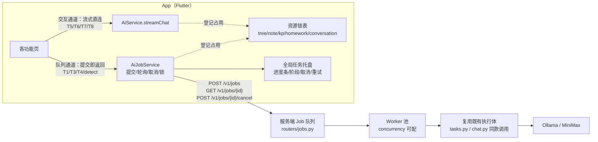
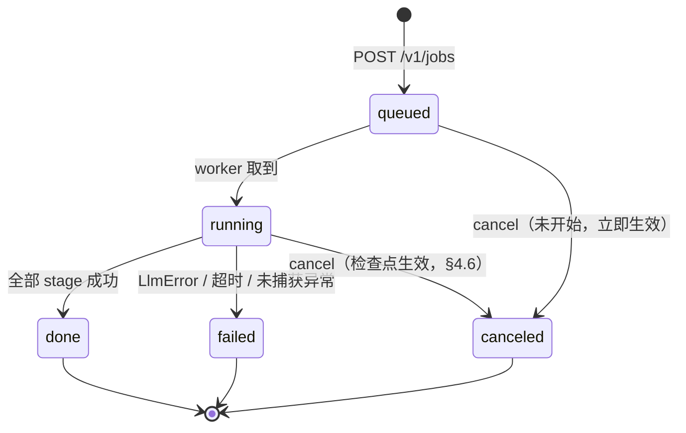

# AI 任务队列 · 完整方案（需求 + 设计，待评审）

> 状态：**方案评审稿**。管理后台日志（M7）与 AI 助手知识库工具已实现并提交
> （`fec47cc` / `a955c42`）；本文对应的任务队列**尚未动工**，等本方案确认后
> 按 §9 批次实施。
>
> 关联代码：`llm_server/`（自研 LLM Server）、`aimindtree_app/lib/ai/`、
> `aimindtree_app/lib/features/`。所有字段名以现有代码为准。

---

## 1. 背景与问题

### 1.1 现状痛点

当前 App 的每个 AI 功能都是「点击 → 当前界面转圈等待 → 出结果」的**阻塞式**调用：

- T1 提取（本地 `qwen3:8b-8k`）实测 **18–22 秒**，期间整个页面被 `showDialog`
  进度框钉住，什么都不能做；
- T3 自动连线 / T4 递归补前置更久（T4 按层递归，每层多个节点各一次调用）；
- 想同时干两件事（比如一边提取一边看另一棵树）**不可能**；
- 更糟的是**相互影响的 AI 功能没有互斥**：T3 正在给某棵树连边时，用户还能在
  同一棵树上手动加边 / 删边 / 拖节点 —— 两边同时写 `prerequisite_edges` 与
  `canvas_nodes`，产出不可预期。

### 1.2 需求原文（用户）

> 对于 app 功能各种 ai 功能，我希望你把这些请求做成**任务队列**的形式给服务器处理，
> 并且把**进度条尽量可视化**，这样我不用点击了一个 ai 功能后就要在那个界面一直等待，
> 但是要注意一些会相互影响的 ai 功能，在某个功能完成前不能允许点。

拆成四条硬需求：

| # | 需求 | 验收关键词 |
|---|---|---|
| R1 | AI 请求排队交给服务端处理，前端不干等 | 提交后立即可切页面 / 做别的事 |
| R2 | 进度尽量可视化 | 全局可见 + 页面内联 + 阶段文案 + 已用时间 |
| R3 | 完成 / 失败有明确反馈 | SnackBar + 结果摘要 + 失败可重试 |
| R4 | 相互影响的功能互斥 | 某功能完成前，冲突入口不可点 |

### 1.3 非目标（明确不做）

- 不做跨进程 / 分布式队列（单机单用户应用，进程内队列足够）；
- 不引入 Redis / Celery / MQ 等外部依赖（服务端当前零外部服务依赖，保持）；
- 不把会话类流式对话（T5/T6/T7/T8）改成轮询式——打字机效果是产品本体（§5.3）；
- 不做任务持久化（服务端重启丢任务是可接受降级，§8.3）。

---

## 2. 现状盘点：AI 调用点全表

> 依据 2026-10-22 代码实测（`grep AiTask\.` + 逐文件阅读）。

| # | 入口（文件） | 任务 | 形态 | 当前等待方式 | 资源冲突面 |
|---|---|---|---|---|---|
| C1 | `features/agent/agent_page.dart` `_addToTree` | T1 提取 | 结构化一次性 | `showDialog` 转圈（18–22s） | 目标树 `tree:{id}` |
| C2 | 同上，`_addToTree` 尾部 | T3 自动连线 | 结构化一次性 | 链在 C1 后同步等 | 目标树 `tree:{id}` |
| C3 | `features/agent/agent_page.dart` `_send` | T5 问答 | 流式 SSE | 输入栏禁用（可接受） | `conversation:agent` |
| C4 | 同上，`_runDetection` | T5 detect | 流式→JSON | 静默后台跑（可接受） | `conversation:agent` |
| C5 | `features/canvas/canvas_page.dart` `_autoLink` | T3 自动连线 | 结构化一次性 | 页面等待 | 当前树 `tree:{id}` |
| C6 | `features/canvas/canvas_page.dart` `_supplementIntoTree` | T4 递归补前置 | 结构化多次（按层） | `onProgress` 回调 + BottomSheet | 当前树 `tree:{id}` + 目标点 `kp:{id}` |
| C7 | `features/canvas/canvas_page.dart` `_mergeFromNote` | T1 提取 | 结构化一次性 | 对话框 | `note:{id}` → 目标树 |
| C8 | `features/teacher/teacher_page.dart` | T6 讲解 / T5 追问 | 流式 SSE | 页面内等待 | `kp:{id}` 会话 |
| C9 | `features/homework/homework_page.dart` | T8 出题 | 流式 SSE | 页面内等待 | `homework:{id}` |
| C10 | `ai/extraction_service.dart` `extract`（C1/C7 共用实现） | T1 | 结构化一次性 | 同上 | 笔记内容 |

**复合流水线**：C1→C2 是天然的两阶段复合任务（先锚定提取、再自动连线），
服务端可编排为一个 job 两个 stage，进度 0→100 连续（§5.4）。

---

## 3. 总体架构：双通道 + 资源锁



**两条通道的划分原则**：

| 通道 | 任务 | 理由 |
|---|---|---|
| **交互通道**（保留现状，流式 SSE 直连） | T5 问答、T6 讲解、T7 苏格拉底、T8 出题 | 边生成边显示是产品本体；单次调用时长可接受；改造收益低、风险高 |
| **队列通道**（本方案主体） | T1 提取、T3 自动连线、T4 递归补前置、T5 detect | 时长 18s–数分钟；用户诉求「别钉在界面里」的正是这些 |

两条通道**共用同一张资源锁表**：队列任务提交即占锁，交互任务开始即占锁，
锁释放前冲突入口一律禁用（R4）。

---

## 4. 服务端设计（`llm_server/routers/jobs.py` 新增）

### 4.1 命名理由

`/v1/task/{code}` 已被「结构化任务同步执行」占用（`routers/tasks.py`），
队列用 **`/v1/jobs`**，语义不撞车；`job` = 一次异步排队的 AI 请求。

### 4.2 API 契约（草案）

```http
POST /v1/jobs
{
  "task": "T1",                    # 必填，AiTask.code
  "inputs": { "note_text": "..." },# 可选（chat 类用 query）
  "query": "...",                  # 可选（会话类）
  "variant": null,                 # 可选（如 detect）
  "stages": ["T1", "T3"],          # 可选：复合流水线（§4.4），默认 [task]
  "backend": null, "model": null,  # 可选，同 /v1/task 语义
  "user": "aimindtree-app",
  "timeout_s": 120,
  "idempotency_key": "app-generated-uuid",   # 防重复提交（§4.5）
  "label": "提取《牛顿定律》并自动连线"        # 托盘显示名（App 生成）
}
→ 202 { "job_id": "job_ab12...", "status": "queued", "deduped": false }
```

```http
GET /v1/jobs?status=running,queued&limit=50
→ { "jobs": [ {…job 摘要…} ], "buffer_size": 12, "concurrency": 1 }

GET /v1/jobs/{job_id}
→ {
    "job_id": "job_ab12…", "task": "T1", "label": "…",
    "status": "running",            # queued|running|done|failed|canceled
    "stage": { "index": 1, "total": 2, "task": "T3",
               "percent": 45, "message": "正在请求前置（第 1/3 层，本层 2/5）…" },
    "submitted_at": 1729550000.5, "started_at": …, "finished_at": null,
    "elapsed_ms": 18200,
    "result": null,                 # done 时：与 /v1/task 同构的 content/parsed/…
    "error": null,                  # failed 时：{code, message, retryable}
    "cancel_requested": false
  }

POST /v1/jobs/{job_id}/cancel
→ { "job_id": "…", "status": "canceled" }        # queued：立即取消
→ { "job_id": "…", "status": "running", "cancel_requested": true }  # running：尽力
```

### 4.3 状态机



- **Worker 池**：`asyncio.Queue` + N 个 worker 协程，N = `config.jobs.concurrency`
  （默认 **1**——本地 Ollama 单模型，并发请求只会在 Ollama 内部排队，还会互相
  拖慢；接 MiniMax 云端可设 2–3）。配置落 `config.yaml` 的 `jobs:` 段，
  **不落 settings.json**（运维参数，不走后台热改，P1 再收进 M2）。
- **失败即终态**：与现有 `/v1/task` 一致——失败不重试（重试策略由 App 侧
  「重试」按钮显式发起，避免静默双倍计费/双倍耗时）。
- **保留策略**：内存环形缓冲保留最近 **200** 个 job（`config.jobs.retain`），
  托盘 / 管理后台（P1）都从这里读；`GET /v1/jobs` 只返回未终态 + 最近终态。

### 4.4 进度语义（R2 的服务端一半）

单次 LLM 调用**没有内部进度**，服务端能诚实上报的只有阶段。进度模型：

```
percent = 已完成 stage 权重 + 当前 stage 内权重
```

- 单 stage 任务（T1/T3/detect）：`queued 0% → running 10% →（等模型，10–90%
  之间只走 elapsed 计时，不假报进度）→ done 100%`；
- 复合 stage（C1→C2）：T1 占 0–60%，T3 占 60–100%；
- T4 递归补前置：**复用现有 `AutoPrereqProgress`**（`auto_graph_service.dart:77`
  已有 level/totalLevels/levelTotal/levelDone + `label`），App 提交时把
  `onProgress` 改写成「上报到 job」，服务端 stage.percent 按
  `(level-1 + levelDone/levelTotal) / totalLevels` 计算 —— **真实进度，不是假的**；
- `message` 字段直接透传现有中文文案（「正在请求前置（第 1/3 层…）」），
  与页面内联现有体验一致。

> 铁律：**不谎报进度**。等模型的阶段就是不确定态，UI 用阶段文案 + 已用时间
> 表达（§6.4），绝不拿假百分比糊弄。

### 4.5 幂等与去重

App 每次「提交」动作生成 `idempotency_key`（uuid），服务端 60s 内同 key
直接返回既有 job（`deduped: true`）。防的是「用户连点两下 / 弱网重试」
造成的双提交，与资源锁（App 侧）是两道独立防线。

### 4.6 取消语义

- `queued`：立即取消，worker 不会取到；
- `running`：置 `cancel_requested`，在**下一个检查点**生效——
  现有执行体的检查点：T4 的每层循环之间（`auto_graph_service.dart:365`）、
  复合 job 的 stage 之间；**单次 LLM HTTP 调用不可中断**（Ollama 没有
  中断 API），所以取消一个正在等模型的 job 会显示
  「已请求取消（当前步不可中断，下一步生效）」，最坏多等一个 stage。
  这一点在 UI 上明说，不装能秒停。

### 4.7 复用既有实现（零重复）

worker 执行体**直接调用现有函数**，不重写调用逻辑：

| stage 任务 | 执行体 | 位置 |
|---|---|---|
| T1/T3/T4（结构化） | `_run_task_impl` 的提取版 | `routers/tasks.py:74` |
| T5 detect / chat（会话） | `_blocking`（`stream:false`） | `routers/chat.py:173` |

T4 的**客户端递归**目前驱动方在 App（`autoPrerequisites` 按层调 T4）。
迁队列时二选一（§11 未决问题 Q1）：① 递归逻辑整体搬进服务端 job 执行体
（推荐：进度、取消、锁全在服务端闭环）；② App 侧保留递归，每层作为独立
job 提交（改动小，但进度/取消/原子性都差）。

### 4.8 埋点

job 终态时 `stats_record(kind='task', task=…, ok=…, latency_ms=…)`——
与现有埋点同构，管理后台 M1 统计自动可见队列调用；日志（M7）自动记录
`llmserver.job` 模块的提交 / 完成 / 取消 / 失败。

---

## 5. App 端设计

### 5.1 `lib/ai/ai_job_service.dart`（新增，单例挂在 bootstrap）

```dart
class AiJobService {
  /// 提交任务：占资源锁 → POST /v1/jobs → 登记本地 job → 起轮询。
  /// 锁被占返回 null（调用方据此禁用按钮 / 弹「有任务正在进行」）。
  Future<AiJob?> submit({
    required AiTask task,
    required String resourceKey,     // 'tree:xxx' / 'note:xxx' / …
    required String label,           // 托盘显示名
    List<AiTask> stages = const [],  // 复合流水线
    Map<String, dynamic> inputs = const {},
    void Function(AiJob done)? onDone,
    void Function(Object error)? onError,
  });

  Stream<AiJob> watch(String jobId);      // UI 订阅
  List<AiJob> get activeJobs;             // 托盘
  Future<void> cancel(String jobId);
  bool isLocked(String resourceKey);      // 按钮禁用判定
  Future<void> retry(String jobId);       // 用原参数重新提交
}
```

要点：

- **轮询**：每个未终态 job 一个 800ms 定时器（`Timer.periodic`），
  失败退避 1s→2s→5s 封顶；终态停表；App 冷启动时 `GET /v1/jobs` 对账
  （服务端重启 → 404 → 标记 `failed(服务已重启，请重试)`，§8.3）；
- **不引入新状态管理框架**：`ValueNotifier<AiJob>` + `Stream`，页面侧
  `ValueListenableBuilder` 订阅——与项目「Riverpod/StatefulWidget 混用」
  现状兼容，不强制迁移；
- **密钥边界**：job 只经本地 `127.0.0.1:8787` 传输，与现有 `LlmServerClient`
  同一信任域；`/v1/jobs` 不带任何密钥字段（密钥只在服务端）。

### 5.2 全局任务托盘（R1/R2 的核心 UI）

挂在 `main.dart` 的 `AppShell`（5 Tab 的 Scaffold）里，**body 顶部常驻**：

```
┌─────────────────────────────────────────────┐
│ ⏳ 2 个任务进行中            [展开 ▾]        │  ← 细进度条 + 汇总
├─────────────────────────────────────────────┤
│ 提取《牛顿定律》并自动连线      45%  18.2s  │  ← 展开态：每个 job 一行
 │████████████░░░░░░░░░ 正在自动连线（T3）…   │
 │ [取消]                          （kp:xx 锁）│
│ 补前置：导数 → 微分            第 1/3 层     │
 │██████░░░░░░░░░░░░░░░ 本层 2/5       [取消] │
└─────────────────────────────────────────────┘
```

- **折叠态**：一条 4px 细进度条 + 「N 个任务进行中」——不挡内容、随时可见；
- **展开态**：每 job 一行：label、百分比 / 阶段文案、已用时间、取消按钮、
  所占资源锁徽标（让用户知道「为什么某个按钮点不了」）；
- **终态**：done → 折叠 3s 后消失 + SnackBar 结果摘要（「已收录 3 个知识点、
  自动连线 2 条」）；failed → 红条 + 「重试」按钮；canceled → 灰条自动消失；
- **跨页面持久**：IndexedStack 常驻 5 Tab，托盘在 AppShell 层，切 Tab 不丢。

### 5.3 页面内联进度（提交按钮的就地变形）

以 C1（AI 助手「加入知识树」）为例：

```
[加入（3）]  ──点击──▶  [████░░░░ 正在 T1 锚定… 12s] [取消]
                       （按钮原位变进度条，不弹对话框、不钉页面）
```

每个调用点的统一模式：

```dart
final job = await _jobs.submit(
  task: AiTask.t1Extract, resourceKey: 'tree:$treeId',
  label: '提取并加入《${tree.name}》', stages: [AiTask.t1Extract, AiTask.t3Prerequisite],
  onDone: (j) { /* 原成功分支：刷新 UI + toast */ },
  onError: (e) { /* 原失败分支：toast + 重试入口 */ },
);
if (job == null) {
  _toast('该知识树有 AI 任务正在进行，完成后再试');  // 锁冲突
  return;
}
```

- 提交后**立即释放界面**：原来的 `showDialog` 阻塞等待全部删除；
- 结果回投走 `onDone/onError` 回调（页面还活着就刷新；页面已销毁则只进托盘）；
- 「重新分析」这类**静默后台功能**（C4 检测）不强行改造，只在其运行时于托盘
  登记一个 `conversation:agent` 锁 + 计时（让用户知道 AI 在忙）。

### 5.4 复合流水线的 App 侧配合

C1→C2（提取 + 自动连线）作为一个 job 提交（`stages: [T1, T3]`）：
服务端顺序执行两个 stage，进度 0–100 连续；App 的 `onDone` 里做原来的
「刷新候选列表 + 自动铺开新点」收尾。**比现在两段串联干等更短**（中间没有
App 侧往返）。

---

## 6. 互斥规则（R4）

### 6.1 资源锁键

| 锁键 | 占用者 | 冲突面 |
|---|---|---|
| `tree:{id}` | T3 自动连线、T4 补前置、T1 并入该树 | 同树再次发起上述任一；**手动加/删边、拖节点、删树** |
| `note:{id}` | T1 提取（该笔记） | 该笔记再次提取；编辑保存（P1 提示，不硬拦） |
| `kp:{id}` | T6/T7 会话（老师模式） | 同点另开老师模式 |
| `homework:{id}` | T8 出题 | 同作业再次出题 |
| `conversation:agent` | T5 问答 / 检测 | 与自身串行（现有 `_busy` 已覆盖） |

### 6.2 锁矩阵（行=持有锁的任务，列=被挡的操作）

| 持有 \ 尝试 | T3 同树 | T4 同树 | T1 并入同树 | 手动加边 | 手动删边 | 拖节点 | 删树 |
|---|---|---|---|---|---|---|---|
| **T3 同树** | ✗ | ✗ | ✗ | ✗ | ✗ | ✗ | ✗ |
| **T4 同树** | ✗ | ✗ | ✗ | ✗ | ✗ | ✗ | ✗ |
| **T1 并入同树** | ✗ | ✗ | ✗ | ✗ | ✗ | △ 允许 | ✗ |
| **T1 提取（note 锁）** | — | — | ✗ | — | — | — | — |

> △ = 拖节点只改坐标不改边，风险低，允许；加/删边直接改 `prerequisite_edges`，
> 与 T3/T4 同表，必须挡。

### 6.3 被挡时的 UX（说人话，不静默失败）

- 按钮禁用 + tooltip：「T3 自动连线进行中（12.3s），完成后可操作」；
- 已禁用按钮被点击 → SnackBar 同上文案 + 「查看任务」动作（展开托盘）；
- 托盘展开态每行显示所占锁徽标（`tree:高数`），用户一眼看懂谁挡了谁。

### 6.4 实现位置

锁判定全部收口在 `AiJobService.isLocked(resourceKey)`；画布页的
手动操作入口（`canvas_page.dart` 的加边/删边/拖拽/删树 handler）加一道
`if (_jobs.isLocked('tree:${_selectedTree!.id}')) { 提示; return; }`——
**一处判定、处处生效**，未来加新功能只查这一张表。

---

## 7. 进度可视化规范（R2）

| 层级 | 载体 | 内容 | 更新频率 |
|---|---|---|---|
| L1 全局 | AppShell 托盘折叠态 | N 个任务进行中 + 总细进度条 | 轮询 800ms |
| L2 单任务 | 托盘展开态 | label + percent + 阶段文案 + 已用时间 + 取消 | 轮询 800ms |
| L3 页面内 | 提交按钮原位 | 按钮变进度条 + 阶段文案（同 L2 文案） | 随 job 流 |
| L4 结果 | SnackBar | 完成摘要 / 失败原因 + 重试 | 终态一次 |

文案规范（与现有 `AutoPrereqProgress.label` 一致的中文语气）：

- 排队中：`排队中（前面还有 N 个任务）`
- 提取：`正在 T1 锚定知识点…（已用 12.4s）`
- 连线：`正在自动连线（T3）…`
- 补前置：`正在请求前置（第 1/3 层，本层已完成 2/5）…`
- 取消中：`已请求取消（当前步不可中断）…`

---

## 8. 可靠性与降级

### 8.1 服务端不可用

提交时 `POST /v1/jobs` 失败（连接拒绝）→ 调用方收到异常 → 走**现有同步
路径兜底**（`kAiJobQueueEnabled` 开关，§8.4）：即退回今天的行为，
保证「队列挂了只是变慢，不会变不能用」。

### 8.2 轮询失败

退避重试；连续 5 次失败 → job 标 `failed(网络中断)` + 重试按钮；
App 切回前台时立即全量对账一次。

### 8.3 服务端重启

内存 job 丢失 → 轮询拿到 404 → 标 `failed(服务已重启，请重试)`。
**不 persisted**（单机工具，接受这个降级；真要持久化是 P2，落 sqlite）。

### 8.4 开关与回滚

- App 侧 `kAiJobQueueEnabled`（默认 true）+ 每调用点独立开关常量；
- 回滚 = 关开关，全部调用点退回现有同步阻塞路径，**零数据迁移**；
- 服务端 jobs router 可独立摘除（`routers/__init__.py` 不 include 即可）。

---

## 9. 实施批次（每批独立可验收、可回滚）

| 批次 | 内容 | 涉及文件 | 验收 |
|---|---|---|---|
| **B0 基础设施** | 服务端 `routers/jobs.py`（单 stage 版）+ `AiJobService` + 托盘壳 + `config.yaml` jobs 段 | `llm_server/routers/jobs.py`(新)、`routers/__init__.py`、`core/config.py`、`lib/ai/ai_job_service.dart`(新)、`lib/main.dart`(托盘) | 提交 T1 job → 托盘见进度 → 完成回调；服务端 selftest + verify 新增 jobs 段 |
| **B1 提取入队** | C1/C7/C10：`extract` 改走队列（复合 stages T1→T3 先只做 T1，B2 再接 T3） | `agent_page.dart`、`canvas_page.dart`、`extraction_service.dart` | 点击后立即可切 Tab；完成 SnackBar；取消生效 |
| **B2 连线/补前置入队** | C5 T3、C6 T4（含 `onProgress` → job 上报）+ `tree:{id}` 锁全量接通 | `canvas_page.dart`、`auto_graph_service.dart`、`ai_job_service.dart` | 锁矩阵 §6.2 全绿；T4 真实层级进度；连边进行中手动加边被挡并提示 |
| **B3 检测入队** | C4 `_runDetection` 改队列提交（静默特性保留：无 SnackBar，只占锁计时） | `agent_page.dart` | 检测运行中托盘可见；不打扰主问答 |
| **B4 会话类纳管** | C8/C9：交互通道保留流式，但登记锁 + 托盘计时；`kp:{id}` / `homework:{id}` 锁生效 | `teacher_page.dart`、`homework_page.dart` | 同点重复开老师模式被挡；托盘显示讲解计时 |

> B1 依赖 B0；B2–B4 互相独立，可并行开发（不同文件集）。

---

## 10. 验收标准（AC）

1. **R1**：B1 后，点击「加入知识树」到返回可操作 **< 300ms**；等待期间可
   切换全部 5 个 Tab、可发起另一棵树的任务（不同资源键）；
2. **R2**：任务进行中，L1/L2/L3 三层进度至少两层可见；阶段文案与真实
   执行阶段一致；已用时间每秒可见；
3. **R3**：done → SnackBar 结果摘要（收录数 / 连线数 / 拒绝数）；
   failed → 原因 + 「重试」；重试成功后 SnackBar；
4. **R4**：§6.2 矩阵每一项都有对应测试或被挡提示；锁在任务终态**必然**
   释放（含失败 / 取消 / App 杀进程重启后对账）；
5. **取消**：queued 取消 100% 立即；running 取消在下个检查点生效且 UI
   明示「当前步不可中断」；
6. **不谎报**：等模型阶段 percent 不跳动（只走计时），进度条可不确定态；
7. **降级**：关 `kAiJobQueueEnabled` 后全部功能退回现状且行为不变；
   服务端不通时提交走同步兜底；
8. **回归**：`verify_admin_console`（现 82 项）+ jobs 新增 ≥ 12 项；
   `flutter test` 全量绿（存量 1 项画布拖拽阈值失败除外，已确认与本次无关）；
   Dart 门禁 0/0/0；
9. **性能**：轮询 800ms × 5 个并发 job 的 CPU 占用可忽略（本地 HTTP）；
10. **安全**：`/v1/jobs` 全链路无密钥字段；日志（M7）不记录 job 的
    用户内容原文（只记 task/label/latency）。

---

## 11. 未决问题（请拍板）

| # | 问题 | 建议 | 影响 |
|---|---|---|---|
| Q1 | T4 递归驱动权：服务端编排 vs App 侧每层一 job？ | **服务端编排**（进度/取消/原子性闭环；`autoPrerequisites` 逻辑整体搬 `routers/jobs.py`） | B2 工作量 ±1 天 |
| Q2 | `jobs.concurrency` 默认值？ | Ollama=1；检测到 minimax 默认后端时=2 | 吞吐 |
| Q3 | 托盘默认展开还是折叠？ | 默认折叠（4px 细条），有任务时轻量不挡内容 | 观感 |
| Q4 | 手动拖节点（△）在 T3 进行中是否放行？ | 放行（只改坐标），但删边/加边/删树硬挡 | §6.2 一行 |
| Q5 | 管理后台要不要 jobs 面板（P1）？ | 先不做；M7 日志已能看到 `llmserver.job` 记录 | 排期 |
| Q6 | C1→C2 复合 job 的 T3 段失败时，T1 成果是否保留？ | **保留**（提取已入库是有价值的），SnackBar 明说「已收录 N 个，自动连线失败可手动重试」 | 语义 |

---

## 12. 风险

| 风险 | 概率 | 缓解 |
|---|---|---|
| T4 递归搬服务端时行为漂移（现在 App 驱动） | 中 | B2 前先给 `autoPrerequisites` 补测试锁行为；搬迁后跑同一批真机用例对比 |
| 轮询把服务端打爆 | 低 | 800ms × 少量 job；`GET /v1/jobs/{id}` 是内存读，无 IO |
| 托盘遮挡小窗口内容 | 低 | 折叠态 4px；可手动收起；窗口高度 < 700px 时自动折叠 |
| 锁忘记释放（异常路径） | 中 | 释放统一走 `finally` + App 启动对账 + 终态停表三道 |
| 复合 job 中途失败半成品 | 中 | Q6 语义明确 + 每 stage 独立可观测（stats/日志） |

---

## 13. 工作量估算（单人）

| 批次 | 估算 |
|---|---|
| B0 | 1.5 天（服务端 1 + App 0.5） |
| B1 | 0.5 天 |
| B2 | 1.5 天（T4 搬迁 + 锁矩阵） |
| B3 | 0.5 天 |
| B4 | 0.5 天 |
| 测试与验收 | 1 天 |
| **合计** | **约 5.5 天** |

---

## 附：与已交付物的关系

- **管理后台 M7 运行日志**（`fec47cc`）：队列上线后 `llmserver.job` 日志
  自动进 M7，排障「任务卡住」第一现场；
- **AI 助手知识库工具**（`a955c42`）：其工具循环是**进程内顺序执行**，
  不占队列（单次 T5 问答的一部分）；若未来工具执行变重，可按同一锁模式纳管。
