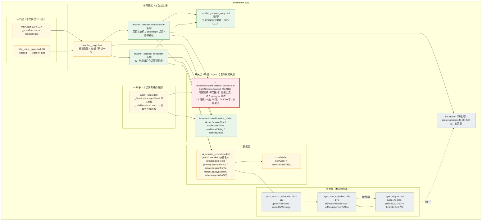
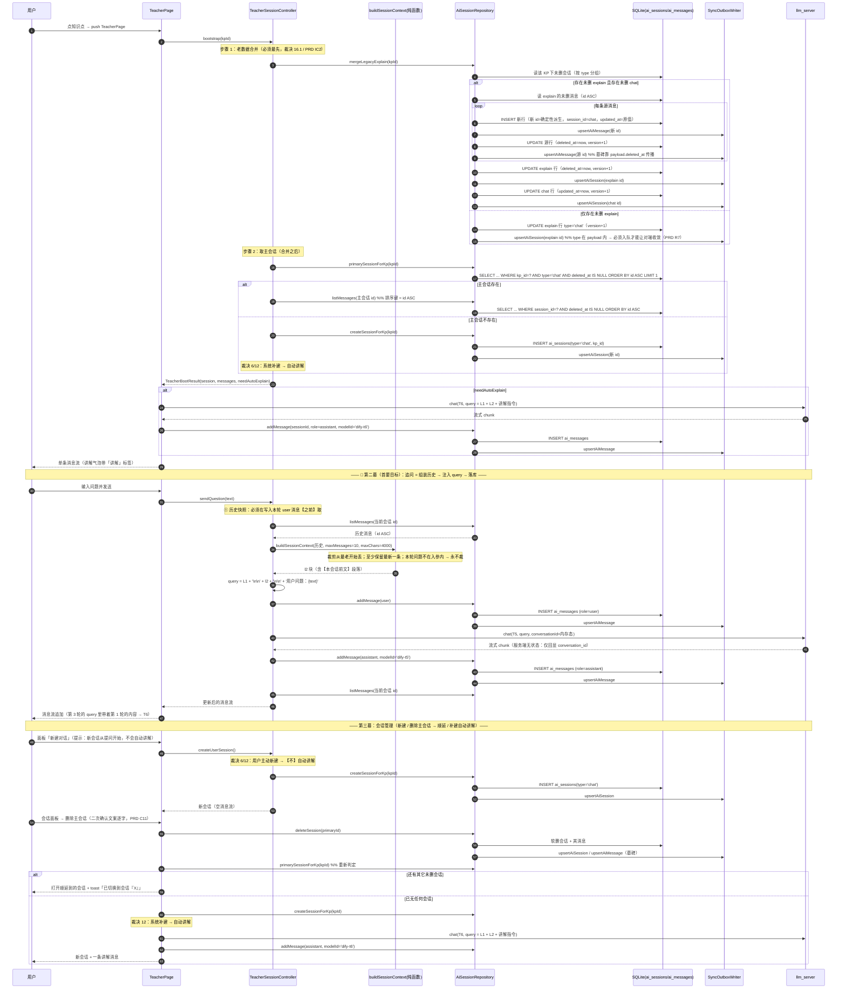
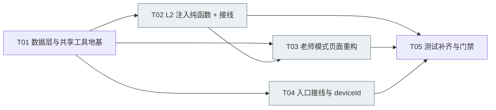

# AIMindTree 老师模式会话化 —— 系统设计与任务分解

| 项目 | 内容 |
| --- | --- |
| 文档类型 | **系统设计**（含任务分解 / 测试计划 / 护栏 / 风险） |
| 文档版本 | **v1.3**（依据 `docs/TEACHER_SESSION_PRD.md` **v1.3 终稿** + team-lead 终稿裁决 1–16 + PRD §8.2 实现约束 IC1–IC7 + team-lead 第二/三轮裁决（命名口径 / 排序键 / L2 规模三处收敛 + Q1–Q4 定案）+ **第四轮：按最终实现（HEAD `91f176b`）回写（规格 C / 派生 id 128 位 +1 / 再讲一次恒 T6）**） |
| 作者 | software-architect-2 |
| 语言 | 简体中文 |
| 上游输入 | `docs/TEACHER_SESSION_PRD.md` **v1.3 终稿**（产品经理）、team-lead 裁决 1–16、PRD §8.2 实现约束 IC1–IC7 |
| 协同产出 | `docs/TEACHER_SESSION_TEST_PLAN.md`（QA 工程师 Edward 的测试方案，与本设计 §7 逐条对齐：方法名 `listSessionsForKp` / `primarySessionForKp`、排序键 **`id ASC`**、L2 规模 **10 条 / 5 轮**、纯函数**绝不重排**（规格 C）、T1–T12 断言口径） |
| 下游产出 | `docs/teacher_session_component.mermaid`、`docs/teacher_session_sequence.mermaid`、`docs/teacher_session_class.mermaid` |
| 适用范围 | `aimindtree_app/`（Flutter 桌面端）；**`llm_server/` 零改动** |
| **首要目标** | 🔴 **补上多轮记忆（L2 上下文注入）** —— PRD §1.4 已把它升格为「本次改造的首要目标」；「合并两个 Tab」只是表象。**最高优先级硬验收 = PRD §9.2 的 T6**（连续追问 3 轮，第 3 轮能引用第 1 轮内容）。本设计的 §4 与 §7.3-T6 是围绕该目标组织的。 |

---

## 0. 事实基线校正（先于一切设计）

PRD §9-F1 与团队此前引用的基线数字**已过期**，本设计以实测为准（2026-10 实测）：

| 项 | PRD / 旧记录 | **实测（本设计采用）** | 依据 |
| --- | --- | --- | --- |
| Dart 门禁文件数 | 79 文件 | **139 文件 → 0 error / 0 warning / 3 info** | `dart tool/analyze_inproc.dart` 实跑输出（HEAD `91f176b`，2026-10-24 复测）；3 条 info 全是既有 `withOpacity` 弃用（`lib/features/agent/agent_page.dart:1636`、`lib/features/knowledge/knowledge_manage_page.dart:957`、`:1001`） |
| 门禁判定口径 | — | **只有 ERROR/WARNING 才 fail，INFO 仅提示** | `aimindtree_app/tool/analyze_inproc.dart:87-95`（`if (errors + warnings == 0) exit(0)`） |
| flutter test 基线 | 213/213 | **670/670 全绿（51 个测试文件）** | 实跑 `flutter test` → `+670: All tests passed!`（含 T05 新增的 68 条） |
| 测试运行前提 | — | **必须清掉 4 个代理变量**（`HTTP_PROXY` / `HTTPS_PROXY` / `http_proxy` / `https_proxy`），否则全部 `flutter_tester` 加载失败 | 实测：不设代理时 `flutter_tester` 报 `Unable to connect to flutter_tester process: WebSocketException` |
| 表结构版本 | — | `schemaVersion = 5`（T01 已落地），本次**不动** | `lib/data/db/drift_database.dart` |
| Drift 时间精度 | — | **`DateTime` 落库为 unix 秒**（`millisecondsSinceEpoch ~/ 1000`） | `drift-2.34.4/lib/src/runtime/types/mapping.dart:77`；仓库既有注释 `test/agent_features_test.dart:323-327` |

> 由此得出两条贯穿全文的工程约束：
> 1. **不要引入新的 INFO**（基线 3 条，不许变多）；门禁仍须 0 error / 0 warning。
> 2. **凡断言依赖 `updated_at` 先后顺序的测试，必须 ≥1.1s 步进**（秒级精度）；凡是能用 `id` 排序表达顺序的断言，**优先用 `id`**（毫秒级、无需等待）—— ⚠️ 但**同一毫秒内的两个 ULID 不保证单调**（本仓 `ulid` 用 `Random.secure()` 填尾巴，实测同毫秒逆序率 ≈50%，见 §9.2-R-10）→ 造数时若要断言**插入顺序**，必须保证两条记录**跨毫秒**。

---

## 1. 设计概述

### 1.1 四个问题 → 四个落点

> 🔴 **首要目标（PRD §1.4 终稿）**：本次改造的真正价值是**补上多轮记忆**。「把讲解与追问合并成一个 Tab」只是**表象**——即使 UI 合并了，只要不注入 L2 历史，AI 仍然「不记得上一句」，用户体感毫无改善。**§4 的 L2 注入链路是主链路，其余改造都是它的载体。**

| PRD 问题 | 现状根因（已核实） | 本设计的落点 |
| --- | --- | --- |
| **D：多轮追问当前无记忆** 🔴 **首要目标** | ① `llm_server` 完全无状态（`llm_server/routers/chat.py:36-38` 注释「服务端无状态，仅回显透传」；`:71-84` 的 `_build_messages()` **只渲染当前 query**）；② `teacher_page.dart:154-157` 每次只发「KP 上下文 + 当前这一个问题」，**从不带历史**；③ Dify 多轮是整段注释掉的死代码（`lib/ai/clients/dify_client.dart:333-475`，协议标「已停用」） | **§4**：`buildSessionContext` 纯函数 + 每次提问前「组装历史 → 注入 query → 落库」主链路；硬验收 = PRD §9.2 的 **T6**（§7.3） |
| **A：讲解「丢失」** | `teacher_page.dart:78-97` 的 `_bootstrap()` 读到了历史讲解消息，但 `:94-96` 只把它当「是否生成过」的判据，**从未回填 `_explainText`**；UI 只渲染内存变量（`:336-337`） | 改为**消息流为唯一数据源**：讲解即 `ai_messages` 里的 assistant 消息，页面渲染从库里读出的消息列表（§3.1） |
| **A'：删除后仍可见** | `ai_session_repository.dart:55-58` 的 `getOrCreateForKp` **漏了 `deletedAt.isNull()`**（同文件 `:118`/`:177`/`:208` 三处同类查询都过滤了） | 修复该方法 + 新增的所有会话查询一律带墓碑过滤（§2.3）；PRD §1.1b 已把它升级为独立必修项（它同时是老数据合并幂等性的前提） |
| **B：双 Tab 双会话冗余** | `getOrCreateForKp(kpId, task)` 按任务码分 type（`_sessionTypeFor`，`ai_session_repository.dart:253-260`：T5→`chat`、T6→`explain`）→ 同一 KP 下两行会话 | 老师模式统一 `type='chat'` 单流（PRD D4）；老 `explain` 行由 §2.5 合并消化（归一 + 迁移） |
| **C：无会话管理** | 老师模式无列表/新建/重命名/清空/删除 | 复用 `agent_page.dart:1518-1672` 的交互模式 + 共享纯函数（§3.4、§3.5） |

### 1.2 目标架构（组件图）



> 🔴 **红框 = 本次首要目标**：老师模式的每次提问都必须走 `组装历史(SCTX) → 注入 query → 落库` 这条链路（PRD §1.4）。组件图里 `SCTX` 被 `TeacherSessionController` 与 `AgentPage` **双向复用** → 一处实现、两处受益，且 Agent 侧现状（`agent_page.dart:722-735`）可作为行为范本。

**分层不变式**：UI 只调 `AiSessionRepository` 写会话/消息（PRD 附录 B「写操作收口」）；仓储只调 `SyncOutboxWriter` 入队；同步层只搬运 payload、不解析业务语义；`llm_server` 零改动。

### 1.3 裁决 → 设计落点对照表（16 条终稿裁决全落地）

| # | 裁决 | 落点（本文章节） |
| --- | --- | --- |
| 1 | 不持久化 conversationId（不入库 / 不进 `target_ref` / 不跨端） | §4.3；`target_ref` 只写 kpId（沿用 `ai_session_repository.dart:65` 现状） |
| 2 | 老数据自动合并：explain→chat、保留原时间戳、explain 行软删、**必须幂等** | §2.5（算法 + 幂等键 + 6 场景测试） |
| 3 | 主会话 = 该 KP 下未删除会话中 `id` 最小者；删除后顺延；**不加 `isPrimary` 列** | §2.4 `primarySessionForKp` |
| 4 | `getOrCreateForKp` 补 `deletedAt.isNull()` + 显式 `orderBy` | §2.3 |
| 5 | 「再讲一次」= 追加新 assistant 消息，不覆盖；按钮在消息流底部与输入框同区 | §3.2 / §3.3 |
| 6 | 用户自建会话**不**自动讲解 | §3.1 状态机（只有 bootstrap 与「删主会话补建」两条路径触发讲解） |
| 7 | 用 `ai_messages.model_id` 区分讲解/追问（`dify-t6`=讲解），**不加列、不分 Tab** | §3.2 状态判别；`model_id` 在同步 payload 内（`sync_row_map.dart:169`） |
| 8 | 历史注入：**最近 5 轮 = 10 条** user/assistant 消息、≤4000 字上限、**从最老开始丢**（数值口径**已裁决**，见 §1.6） | §4.2 纯函数 `buildSessionContext` |
| 9 | 消息条数不设上限 | §3.2（`ListView.builder` 虚拟化） |
| 10 | 本轮**不加索引**（仅登记为可选后续） | §10 开放项 |
| 11 | 修 `'local-dev'` 硬编码：仓储加可选 `deviceId` 形参，4 个调用点传真实 did，**兜底空串 `''`** | §2.2 / §6 T04 |
| 12 | 两条建会话入口语义不同：用户主动新建**不**讲解；删主会话后系统补建**要**讲解 | §3.1 状态机 + §2.4（入口落在 **controller** 层，理由见 §2.4 末） |
| 13 | `deriveSessionTitle` **禁止改既有签名与默认行为**；只允许新增可选参数 | §3.5（新增 `fallbackTitle`，默认仍 `'新对话'`） |
| 14 | 删除主会话二次确认文案：「删除后自动切换到『X』；若无其它会话将新建并自动讲解」 | §3.3（与 §3.1 补建语义同一套文案源） |
| 15 | 讲解/追问视觉区分 + **容错**（`model_id` 为空/其它 → 普通消息，不抛异常） | §3.2 |
| 16 | ① 合并必须**先于**取主会话；② 合并每条消息单独入队 `upsertAiMessage`、explain 行软删入队 `upsertAiSession`；同步层**没有** `tombstoneAiSession`/`tombstoneAiMessage`，软删靠 payload 的 `deleted_at` | §1.4 时序（merge → primary）、§2.5、§5.3 |

**PRD v1.3 终稿新增的 5 条增量（team-lead 2026-10 转达）**：

| # | 增量 | 落点 |
| --- | --- | --- |
| 17 | 🔴 **首要目标改为「补上多轮记忆」**；组件图/时序图须体现「每次提问前组装历史 → 注入 query → 落库」主链路；硬验收 T6（连续 3 轮，第 3 轮引用第 1 轮） | §1.1（升格）、§1.2（红框主链路）、§4、§7.3-T6 |
| 18 | **`type` 收敛为单一 `'chat'`**；历史 `'explain'` 行在合并时归一为 `'chat'`，且归一化**必须走 `upsertAiSession` 入队**（`type` 在同步 payload 的 8 键内，`sync_row_map.dart:149-159`） | §2.5 归一分支、§5.1、§8-G19 |
| 19 | 老师模式会话列表**必须用新增的独立方法**（`listSessionsForKp(kpId)`，按 `kp_id` 过滤、**不按 `type`**）；**`listAgentSessions()` 过滤语义与返回结果零变化**，两者不合并、不互相改语义。命名**不带业务标签**（方法语义 = 「按 kpId 取会话」的通用能力，与「老师模式」解耦） | §2.3 ④、§8-G20、§7.3-T12 |
| 20 | 主会话判定式补 `type='chat'` 条件 | §2.4（已含） |
| 21 | 必须补齐 **PRD §9.2 的 T1–T12 回归用例**（老师模式目前几乎零覆盖），**T6 标最高优先级** | §7.3（逐条映射到文件与断言） |

### 1.4 关键调用顺序（硬约束：merge → primary）



> **顺序硬约束（裁决 16.1）**：若先取主会话再合并，遗留 `explain` 行可能因 `id` 更小而抢成主会话（PRD §3.1 明确点名此风险）。因此 `mergeLegacyExplain` **必须**在 `primarySessionForKp` 之前完成，且二者同处 `bootstrap()` 的第 1、2 步。

---

## 1.5 PRD v1.3 §8.2 实现约束（IC1–IC7）落点映射

| # | PRD 实现约束（原文摘要） | 本设计的落点 | 状态 |
| --- | --- | --- | --- |
| **IC1** | `deriveSessionTitle` **不得修改既有签名与默认行为**，只允许新增可选参数（如 `fallbackTitle`，默认仍 `'新对话'`） | §3.5：签名加 `String fallbackTitle = '新对话'`；默认值下**逐字等价**；`agent_page.dart` 用 `import` + `export` 搬迁 → 既有测试 `test/agent_features_test.dart:362-376` **原样通过** | ✅ 已落 |
| **IC2** | 老数据合并**必须先于**「取主会话」 | §1.4 时序图第 1、2 步 + §3.1 状态机注释 + §2.5；验收 D7 / 测试 T5 | ✅ 已落 |
| **IC3** | 被移动的消息**原样保留** `model_id` / `role` / `content_md` / 原始 `updated_at`，**只允许改 `session_id`**（+ 新行 ULID、`version` 起算） | §2.5 合并伪码（逐字段照抄）；验收 D9 / 测试 T11 | ✅ 已落 |
| **IC4** | 每条被移动的消息**单独入队** `upsertAiMessage`；`explain` 行软删入队 `upsertAiSession` | §2.5 合并伪码（每条一次 `upsertAiMessage` + 一次行墓碑 `upsertAiMessage` + 一次 `upsertAiSession`）；验收 D10 / 测试 T9 | ✅ 已落 |
| **IC5** | 同步层**没有** `tombstoneAiSession` / `tombstoneAiMessage`，软删靠 payload 的 `deleted_at` | §2.5 末 + §5.3；§8-G8 | ✅ 已落 |
| **IC6** | 讲解/追问判别**必须容错**：`model_id` 为空/异常值按普通消息渲染，不得抛异常；判别逻辑**集中在一处 helper** | §3.2：`bool isExplainMessage(ChatMessage m) => m.modelId == 'dify-t6';`（**唯一判别点**，全仓只此一处）；验收 C16 | ✅ 已落 |
| **IC7** | 老师模式列表**必须用新增的独立方法**（`listSessionsForKp(kpId)`，过滤 `kp_id = K AND deleted_at IS NULL`）；**禁止修改 `listAgentSessions()`** 的过滤语义；两者不合并 | §2.3 ④（新增 `listSessionsForKp`，不碰 `listAgentSessions`）；§8-G20；验收 C17 / 测试 T12 | ✅ 已落 |

### 1.6 L2 注入规模口径（**已裁决：无分歧**）

> ✅ **team-lead 已裁决（规格 A）**：**10 条 = 5 轮**（1 轮 = 1 条 user + 1 条 assistant），字符预算 **≤4000**。PRD v1.3 的「12 条」与裁决 8 的「3–5 轮」之间的口径分歧**就此关闭**，实现与测试两侧统一取 **10**。

| 场景 | 取值 | 依据 |
| --- | --- | --- |
| 🔴 **老师模式注入（L2）** | 最近 **10 条**（= **5 轮**）user/assistant 消息，**≤ 4000 字符**，从最老开始丢 | 本次裁决（规格 A） |
| **Agent 侧（不动）** | 最近 **12 条**（≈6 轮）、不限长 | 迁移前的私有 `agent_page._buildSessionContext()`（旧 `agent_page.dart:646-657`）；现已改调共享纯函数并**保持默认值 12**（`agent_page.dart:449-451`）——**必须保持逐字等价**，见 §4.1 |

**唯一常量（老师模式侧）**：

```dart
// lib/features/teacher/teacher_session_controller.dart
/// L2 注入规模：最近 N 条 user/assistant 消息（N/2 轮）。
/// ✅ 已裁决：10 条 = 5 轮（PRD v1.3 写 12、裁决 8 写 3–5 轮 → 取 10）。
/// ⚠️ **不要**改成 12：QA 测试方案 §0.2 已按 10 条写断言，改了会与测试不一致。
const int kTeacherContextMaxMessages = 10;
const int kTeacherContextMaxChars = 4000;
```

> ⚠️ **两处「12」不要混淆**：
> - **老师模式 = 10**（`kTeacherContextMaxMessages`，本次新增）；
> - **Agent 侧 = 12**（`buildSessionContext` 的**默认参数** `maxMessages = 12`，**必须保持不变** —— 否则 Agent 的既有输出会变，违反 IC1「默认行为逐字等价」）。
> 老师模式调用时**显式传** `maxMessages: kTeacherContextMaxMessages`，二者互不影响。

---

## 2. 数据层设计

### 2.1 表结构：零变更（可用字段盘点）

| 表 | 列（`lib/data/db/tables.dart`） | 本次用途 |
| --- | --- | --- |
| `ai_sessions` (`:236-250` + `SyncMeta` `:14-31`) | `id` / `type` / `target_ref` / `title` / `kp_id` / `model_id` / `tutor_state` / `difficulty` + `version` / `updated_at` / `device_id` / `deleted_at` | 主键 ULID（`id` 最小 ≡ 最早创建）；`type` 归一为 `'chat'`；`title` 存重命名；`deleted_at` 墓碑 |
| `ai_messages` (`:254-262` + `SyncMeta`) | `id` / `session_id` / `role` / `content_md` / `tokens` / `latency_ms` / `model_id` + `version` / `updated_at` / `device_id` / `deleted_at` | `model_id='dify-t6'` 判别讲解（**已在同步 payload 内**，`sync_row_map.dart:169`）；`updated_at` 保留原始时间戳 |

**不新增任何列**（裁决：不改表结构 / 不跑 build_runner / 不写迁移测试）。`ai_sessions` 无 `created_at` → 主会话判定只能靠 ULID 序（裁决 3），这一点在 `primarySessionForKp` 的文档注释里写死，防止后人误加列。

### 2.2 `AiSessionRepository` 构造与 deviceId（裁决 11）

```dart
class AiSessionRepository {
  /// [deviceId] = 本机真实设备 id（同步自回声过滤依据）。
  /// 兜底 **空串 ''**（诚实优于谎报：空串 = 未知，不冒充某个设备）。
  AiSessionRepository(this._db, {this.deviceId = ''});
  final AppDatabase _db;
  final String deviceId;
  late final SyncOutboxWriter _sync = SyncOutboxWriter(_db);
```

**改造点**：把现有 5 处 `'local-dev'` 字面量（`ai_session_repository.dart:72`、`:84`、`:107`、`:150`、`:163`）全部替换为 `deviceId`。

**取值路径（照 `KnowledgeRepository` 的既有范式，`lib/data/repositories/knowledge_repository.dart:81`/`:83`）**：

| 调用点 | 取值 | 依据 |
| --- | --- | --- |
| `lib/main.dart:100` | `AiSessionRepository(widget.db, deviceId: widget.service.repo.deviceId)` | `ExtractionService.repo` 是 public 字段（`lib/ai/extraction_service.dart:64`），其 `deviceId` 为 `final did = deviceId ?? await DeviceId.get()`（`:376`）注入的真实 did（`:474`） |
| `lib/features/notes/note_editor_page.dart:120` | 同上 | 同 |
| `lib/features/teacher/teacher_page.dart` | **不构造**，由入口传入 | 页面只消费 `widget.sessions`（`:26`） |
| 单测 | `AiSessionRepository(db, deviceId: 'test-device')` | `test/agent_features_test.dart:40` 现状 `AiSessionRepository(db)` → 改为显式传 `'test-device'`（**不传则为空串，不影响断言**，但显式更清晰） |

> ⚠️ **不要再出现 `'local-dev'` 字面量**。历史事故：常量设备号导致 pull 把服务端**所有**行都当「本机自己上传的」跳过（`lib/ai/extraction_service.dart:369-377` 的注释即该事故记录；自回声过滤实现见 `lib/data/sync/sync_engine.dart:586`）。

### 2.3 方法清单（新增 / 修改）

> 全部写操作**必须**走本仓储并统一登记 outbox（PRD 附录 B）。

#### ① 修改：`getOrCreateForKp`（修 PRD A5 缺陷 + 裁决 4）

```dart
/// 获取或创建该 KP 的会话。
///
/// ⚠️ 修复（PRD §1.1b）：查询**必须**带 `deletedAt.isNull()`。
/// 原实现漏了它 → 删除过的会话被当成「还在」，页面永远空白。
/// ⚠️ 排序：显式 `orderBy(id ASC)` → 取该 (kpId, type) 下**最早**创建的一条
/// （ULID 单调递增，id 序 ≡ 创建序）。
///
/// 【老师模式已不再使用本方法】统一走 merge → primary → create（§2.4/§2.5）。
/// 保留本方法仅为兼容既有调用与测试；`task: AiTask.t6Explain` 会造出
/// `type='explain'` 的会话 —— 老师模式**禁止**再走这条路径（会产生双会话）。
Future<AiSessionRow> getOrCreateForKp({
  required String kpId,
  required AiTask task,
});
```

等价 SQL 语义：

```sql
SELECT * FROM ai_sessions
 WHERE kp_id = :kpId AND type = :type AND deleted_at IS NULL
 ORDER BY id ASC
 LIMIT 1;
-- 未命中 → INSERT 新行（type 由 _sessionTypeFor 决定，device_id = this.deviceId）
```

#### ② 修改：`listMessages`（排序键改为**纯 `id ASC`**）

```dart
/// 列出某 session 的全部消息。
///
/// 软删铁律：`deleted_at` 非空一律过滤。
/// ⚠️ 排序键：`updated_at ASC` → **纯 `id ASC`**（team-lead 已裁决 · 规格 B）。
///   ① `updated_at` 是**秒级**精度（Drift：`millisecondsSinceEpoch ~/ 1000`），
///      且**跨端不可信**：增量推送用 outbox 创建时间覆盖 envelope 的 `updated_at`
///      （`sync_engine.dart:183`），pull 时 `_hydrate`（`sync_engine.dart:744-751`）
///      再用它覆盖对端行的 `updated_at` → 两端 `updated_at` 会分叉；
///   ② `id` 是 ULID（48-bit 毫秒时间戳 + 80-bit 随机尾巴），**毫秒级**，
///      且 `id` 在同步 payload 内（`sync_row_map.dart:164`）→ 两端拿到**同一个 id**
///      → 用同一把尺子排序，**跨端顺序天然一致**；
///   ③ 老数据合并时按**原始毫秒单调派生新 id**（§2.6）→ 迁移后的讲解在
///      **所有设备**上回到它原来的位置（PRD §5.3-R4）。
/// ⚠️ 同毫秒并列的已知风险见 §9.2-R-10 与护栏 G23（实测 50% 逆序率）。
Future<List<ChatMessage>> listMessages(String sessionId);
```

等价 SQL：

```sql
SELECT * FROM ai_messages
 WHERE session_id = :sessionId AND deleted_at IS NULL
 ORDER BY id ASC;
```

> 🔴 **对既有测试的影响（必须实跑确认 · 护栏 G23）**
>
> `test/agent_features_test.dart:322-347`（「消息持久化 + 按时间序读取；追加消息会把会话顶到最前」）在 `:334-335` 连续调用两次 `addMessage`（**中间无等待**）→ 两条消息**极可能落在同一毫秒**（实测同毫秒比例 **1993/2000 ≈ 99.65%**）。
>
> 本仓 `ulid 2.0.1` 的 `Ulid({int? millis})` 用 **`Random.secure()`** 填充 10 字节随机尾巴（`ulid.dart:33-35`）→ **同一毫秒内的两个 ULID 不保证单调**（实测逆序率 **994/2000 ≈ 50%**）→ 排序键换成 `id ASC` 后，这两条消息的先后**变成掷硬币**。
>
> - **对既有数据**：正常写入路径下 `id` 与 `updated_at` 同源同序 → 顺序不变；
> - **对该测试**：它断言的是**插入顺序**（`['user', 'assistant']`）。换成 `id ASC` 后是否稳定，取决于这两条消息是否落在**同一毫秒**。
> ✅ **实测结论（10/10 通过）**：连跑 10 次 `flutter test test/agent_features_test.dart` **全部通过**（`+15: All tests passed!`）。原因是两次 `addMessage` 之间隔着一次 **DB 写入**（`insertMessageRow` + outbox `enqueue`），耗时通常 >1ms → **两条消息的 ULID 实际落在不同毫秒** → `id ASC` 与插入序一致。
> ⚠️ 但这是**依赖时序巧合**的稳定性，**不是契约保证**（若将来 `addMessage` 变成纯内存批量写，或机器极快，就可能翻车）→ 登记为**已知限制**（§9.2-R-10），并要求 CI 变更涉及该路径时**复跑确认**（护栏 G23）。


#### ③ 修改：`ChatMessage`（补 `modelId`）

```dart
class ChatMessage {
  const ChatMessage({
    required this.id,
    required this.sessionId,
    required this.role,
    required this.content,
    required this.createdAt,
    this.modelId,          // ← 新增：null 合法（老数据 / 非本模块写入）
  });
  final String id;
  final String sessionId;
  final String role;
  final String content;
  final DateTime createdAt;
  final String? modelId;   // 'dify-t6' = 讲解；'dify-t5' = 追问；null = 普通
}
```

`listMessages` 填充 `modelId: r.modelId`。**加字段而非改字段**：Agent 侧 `_openSession`（`agent_page.dart:429-432`）只读 `role`/`content`，不受影响。

#### ④ 新增：老师模式会话查询与创建

```dart
/// 按 `kp_id` 列出该知识点下**全部**未删除会话（最近活跃在前）。
///
/// ⚠️ 按 `kp_id` 过滤，**不按 `type` 过滤**：合并失败残留的 `type='explain'`
/// 行必须仍出现在列表里（PRD §4.1 的兜底 / 验收 D8）。
/// Agent 会话 `kp_id IS NULL` → 与本查询天然互斥（验收 C9 / C17）。
///
/// ⚠️ **本方法与 [listAgentSessions] 是两条独立查询，不合并、不互相改语义**
/// （PRD 实现约束 IC7）：`listAgentSessions` 是 **Agent 侧专用**
/// （`type='chat' AND kp_id IS NULL AND deleted_at IS NULL`），**本次不改它一行**。
Future<List<AiSessionRow>> listSessionsForKp(String kpId);

/// 取该知识点下的**主会话**：未删除、`type='chat'` 的会话中 `id` 最小者。
///
/// `type='chat'` 这一条件的作用：合并失败残留的 `explain` 行（id 往往更小）
/// 不会抢走主会话（PRD §3.1）。
/// 无则返回 null（调用方决定补建 + 是否自动讲解）。
Future<AiSessionRow?> primarySessionForKp(String kpId);

/// 在该 KP 下新建一条会话（`type='chat'`、`kp_id=kpId`、`title` 留空
/// → 运行时派生）。纯本地写，**不依赖 AI 可用性**。
///
/// ⚠️ **本方法不含 `autoExplain` 语义**：讲解与否由 controller 层决定
/// （§2.4「两条建会话入口」），仓储层不持有 AI 依赖。
Future<AiSessionRow> createSessionForKp(String kpId, {String title = ''});
```

> 🔴 **命名语义边界（team-lead 裁决 · 最终口径）**：这四个方法的语义是「**按 kpId 取/建会话**」的**通用能力**，**刻意不带「老师模式」业务标签** —— 将来 Agent 侧或别的页面要按 kpId 取会话时，**直接复用同一组方法**，不必再复制一份。
> - `listSessionsForKp(kpId)` —— 列出该 KP 下全部未删会话（**不按 `type` 过滤**）；
> - `primarySessionForKp(kpId)` —— 取主会话（`type='chat'` 且 `id` 最小）；
> - `createSessionForKp(kpId, {title})` —— 新建；
> - `mergeLegacyExplain(kpId)` —— 老数据合并（**唯一带业务语义的方法**：它处理的是历史遗留的 `type='explain'` 行，名字里必须体现这件事）。
>
> **调用方按场景取即可**：老师模式调这组方法；Agent 模式继续用 `listAgentSessions()`（**不动**）。
> ⚠️ 该口径与**数据层工程师 T01a 正在施工的代码一致** → 文档与代码零偏差、测试可直接编译。

等价 SQL：

```sql
-- listSessionsForKp
SELECT * FROM ai_sessions
 WHERE kp_id = :kpId AND deleted_at IS NULL
 ORDER BY updated_at DESC, id DESC;      -- 与 listAgentSessions 同口径（:178-181）

-- primarySessionForKp
SELECT * FROM ai_sessions
 WHERE kp_id = :kpId AND type = 'chat' AND deleted_at IS NULL
 ORDER BY id ASC LIMIT 1;
```

#### ⑤ 新增：老数据合并

```dart
/// 老数据合并结果（可观测性载体，PRD §5.5）。
enum LegacyMergeOutcome {
  merged,              // explain → chat 合并完成（含 type 归一 + 消息迁移）
  skippedNoLegacy,     // 该 KP 下没有未删的 explain 行（无需处理）
  failed,              // 合并异常（数据保留，调用方须提示用户）
}

class LegacyMergeResult {
  final LegacyMergeOutcome outcome;
  final String? chatSessionId;     // 保留方
  final String? explainSessionId;  // 并入方
  final int movedMessages;         // 迁移条数
  final int normalizedOnly;        // 仅做了 type 归一（没有 chat 可并入）
  final Object? error;             // failed 时的异常
}

/// 老数据合并：把该 KP 下未删的 `type='explain'` 会话并入 `type='chat'` 会话。
///
/// 方向固定 explain → chat（PRD §5.2）。幂等键 = **explain 行已软删**。
/// 失败**不抛异常、不删数据**，返回 `failed` 让调用方 toast 提示。
Future<LegacyMergeResult> mergeLegacyExplain(String kpId);
```

### 2.4 主会话与「两条建会话入口」（裁决 3 / 12）

**主会话判定**（无 `isPrimary` 列，纯派生）：

```
primarySessionForKp(K) =
  min( { s ∈ ai_sessions | s.kp_id = K ∧ s.type = 'chat' ∧ s.deleted_at IS NULL } , by id )
```

`id` 为 ULID，其 48-bit 时间部分单调（`ulid` 包 `Ulid({int? millis})`，`ulid-2.0.1/lib/ulid.dart:26-36`）→ **id 最小 ≡ 最早创建**。

**两条建会话入口**（裁决 12）：

| 入口 | 触发点 | `autoExplain` | 落地位置 |
| --- | --- | --- | --- |
| **用户主动新建** | AppBar「新建会话」/ 面板「新建对话」 | **false** | `TeacherSessionController.createUserSession()` |
| **系统补建（主会话）** | ① bootstrap 发现无主会话；② 删除主会话后该 KP 已无任何会话 | **true** | `TeacherSessionController.ensurePrimarySession()` / `createPrimarySessionWithExplain()` |

> ✅ **分层决策已裁决（team-lead 终审）**：裁决 12 的示例是 `createSessionForKp(kpId, {autoExplain: ...})`（仓储层）。**team-lead 已明确采纳本设计的落点** —— `autoExplain` 放在 **controller 层**而非仓储层，原因是：
> 1. **讲解生成需要 `AiService`**，仓储层（`AiSessionRepository`）当前**不持有** AI 依赖（`:37-41` 只持有 `AppDatabase` 与 `SyncOutboxWriter`）；把 AI 语义下沉到仓储会破坏分层并让单测必须造假 provider。
> 2. 裁决 12 的**语义要求**（两条入口、自动讲解与否）被**完整保留**，只是落点从仓储换成 controller；仓储只提供无歧义的 `createSessionForKp(kpId)`。
> 3. controller 是纯 Dart 类（不依赖 `BuildContext` 除弹窗外），可被单测直接驱动 → 比把 flag 塞进仓储**更容易测**。
> 4. **页面只调 controller**，controller 内部再调仓储 → UI 不出现任何 `autoExplain` 判断。
>
> ⚠️ **不改 PRD §4.1**（PRD 描述的是用户可见行为，行为未变 → 文字无需改）。

**删除主会话的接续规则**（PRD §3.3 + 裁决 14）：

```
deleteSession(primaryId):
  1. 软删会话 + 其消息（复用 deleteSession，:223-237）
  2. 重算主会话：
     a. 还有其它未删会话 → 顺延到 id 最小的未删会话 → 打开它
        + toast「已切换到会话『X』」（X = 该会话的派生标题）
     b. 已无任何会话   → 新建主会话 → **自动讲解一次** → 打开它
        + toast「已新建一条并自动生成一次讲解」
```

> 🔴 两处 toast 文案与 §3.3 的删除确认文案**同源**（PRD C11 的三处一致性铁律）→ 统一由 `lib/features/teacher/teacher_session_copy.dart` 的常量生成。

### 2.5 老数据合并算法（幂等 + 可观测）

**输入**：kpId。**输出**：`LegacyMergeResult`。**已落地**：`ai_session_repository.dart:313-433`（外壳 `:313` / 事务体 `:322` / 消息迁移 `:391` / 会话软删 `:436`）。

```
mergeLegacyExplain(kpId):                      # :313 —— 外壳只做「异常 → failed」
  try:  return await db.transaction(() => _mergeLegacyExplainInTx(kpId))
  catch: return LegacyMergeResult(failed, error)     # 不抛、不删数据

_mergeLegacyExplainInTx(kpId):                 # :322
  sessions = listSessionsForKp(kpId)           # kp_id=K 且 deleted_at IS NULL
  explains = sessions.where(type=='explain') ..sort(id ASC)
  if explains.isEmpty:
      return LegacyMergeResult(skippedNoLegacy)      # 幂等：已合并过 / 无老数据
  chats = sessions.where(type=='chat') ..sort(id ASC)

  if chats.isEmpty:
      # 补充规则（PRD §5.2）：只有 explain → 把【最早】那条【原地归一】为 chat
      keep = explains.first                    # ⚠️ id 不变 → 它就是主会话
      UPDATE ai_sessions SET type='chat', updated_at=now, version=version+1 WHERE id=keep
      upsertAiSession(keep)
      for e in explains.skip(1):               # 其余 explain 行的消息迁入保留方后软删
          moved += _migrateMessages(e.id, keep, now)
          _softDeleteSession(e.id, now)
      return LegacyMergeResult(merged, chatSessionId=keep, normalizedOnly=1, movedMessages=moved)

  # 正常合并：保留方 = id 最小的 chat（老库里 chat 先创建，见 PRD §5.1）
  target = chats.first
  for e in explains:                           # 通常 1 个；多则按 id 升序逐个并入
      moved += _migrateMessages(e.id, target.id, now)
      _softDeleteSession(e.id, now)
  # 触碰保留方（它刚收到新内容 → 列表置顶 + 同步一条变更）
  UPDATE ai_sessions SET updated_at=now, version=version+1 WHERE id=target.id
  upsertAiSession(target.id)
  return LegacyMergeResult(merged, chatSessionId=target.id, movedMessages=moved)

_migrateMessages(fromId, toId, now):            # :391 —— 返回实际迁移条数
  rows = SELECT * FROM ai_messages
         WHERE session_id=fromId AND deleted_at IS NULL
         ORDER BY id ASC        # 与 listMessages 同键（纯 id ASC）→ 复制后顺序原样还原
  for r in rows:
      newId = newDerivedUlid(r.id)              # 确定性派生：128 位 +1（§2.6，只有 1 个参数）
      if EXISTS(SELECT 1 FROM ai_messages WHERE id = newId):
          continue        # ⚠️ 幂等：派生 id 已存在（崩溃重试 / 跨端已合并过）
                          #    → 不重复插入、也【不】重复墓碑；源行的可见性由
                          #      会话级墓碑（_softDeleteSession）兜住
      INSERT ai_messages(
        id=newId, session_id=toId,
        role=r.role, content_md=r.content_md,          # 原样保留
        tokens=r.tokens, latency_ms=r.latency_ms,
        model_id=r.model_id,                           # 原样保留（dify-t6）
        updated_at=r.updated_at,                       # 原始时间戳
        version=1, device_id=deviceId, deleted_at=NULL)
      upsertAiMessage(newId)
      # 源行软删（墓碑靠 payload.deleted_at 传播，无 tombstoneAiMessage API）
      UPDATE ai_messages SET deleted_at=now, updated_at=now, version=version+1 WHERE id=r.id
      upsertAiMessage(r.id)
      moved++
  return moved
```

**与主会话判定的顺序**：`merge → primary` 硬约束（裁决 16.1 / IC2）由 `bootstrap()` 保证；**只有 explain** 时归一化**保留原 id** → 它就是 `id` 最小者 → 归一后自然成为主会话（无需再建）。

**`type` 归一的同步可见性（PRD §5.3-R7 / 增量 18 · 必须走 outbox）**：

- `ai_sessions.type` **在**同步 payload 内（`sync_row_map.dart:149-159` 的 8 键含 `type`）→ 归一化**必须**通过 `upsertAiSession(explainId)` 入队，否则对端永远停在 `type='explain'`。
- 归一化写的是**同一行**（`id` 不变，`type` 改值 + `version+1`）→ 对端按 LWW 覆盖该行 → **最终一致**，不会出现「多出一条会话」。
- 对端收到 `type='chat'` 后，其 `primarySessionForKp`（`type='chat'` 条件）自然收敛到同一行 → **两端主会话判定一致**（前提是 ULID 序在两端一致，见 §9.2-R4 的时钟偏差登记）。
- ⚠️ 归一化与消息迁移**必须成对入队**：先写行、再写消息；对端收到顺序由 outbox 的 id 升序保证（`sync_outbox.dart:79-85` 的 `pending()` 按 `id ASC`），**不依赖**业务顺序。

**幂等性证明**：

| 重入时机 | 结果 |
| --- | --- |
| 第一次合并成功后再次进入 | `explains` 为空（explain 行已 `deleted_at != NULL`，被 `deleted_at IS NULL` 过滤掉）→ `skippedNoLegacy` → **零写入** |
| 合并中途崩溃（部分消息已复制）后重入 | 新 id 是**确定性派生**（§2.6）→ `_migrateMessages` 查得该派生 id 已存在 → **`continue`（跳过插入、也不重复墓碑）**；源行的可见性由**会话级墓碑** `_softDeleteSession` 兜住 → **不产生重复消息** |
| 跨端各自合并（两端独立跑一遍） | 派生 id 由源 id **确定性**推出 → 两端算出**同一个 id** → 对端按主键命中 → 天然收敛，**不会分裂成两条** |
| 派生 id 与某个**无关行**撞车 | 概率 `2^-128`（128 位 +1 是全局平移，只有源 id 恰好等于「该行 id − 1」才撞）→ 与上一行同路径：跳过、**不软删源行** → 数据不丢 |
| 合并失败（异常） | `failed` → explain 行**未被软删** → 下次进入会重试；且 explain 会话**仍在列表里**（用户可点进去看原讲解） |

**可观测性**（PRD §5.5）：

| 事件 | 日志（`AppLog`，`lib/core/logger.dart:25`） | tag |
| --- | --- | --- |
| 合并发生 | `合并完成 kp=$kpId chat=$chatId explain=$explainId 迁移 $n 条` | `teacher_session` |
| 跳过 | `跳过合并 kp=$kpId 原因=无未删 explain 行` | `teacher_session` |
| 仅 type 归一 | `type 归一 kp=$kpId session=$id explain→chat` | `teacher_session` |
| 失败 | `合并失败 kp=$kpId chat=$chatId explain=$explainId` + `error` | `teacher_session` |

失败时 UI 必须给**非阻塞** toast：「历史讲解迁移失败，已保留为独立会话」（PRD §5.3-R2），**绝不静默失败、绝不阻断进入页面**。

**同步传播**（详见 §5）：每条被移动的消息**单独入队** `upsertAiMessage`；explain 行软删入队 `upsertAiSession`。软删**靠 payload 的 `deleted_at` 传播** —— `sync_engine.dart:186` 的 `deletedAt: _extractDeletedAt(r.entityTable, r.payloadJson)` 就是从 payload 取墓碑时间（`:947-954`）。**同步层没有 `tombstoneAiSession` / `tombstoneAiMessage`**（`lib/data/sync/sync_outbox_writer.dart` 全文只有 `upsertXxx` / `tombstoneXxx(部分表)` / `hardDeleteXxx`，AI 两表只有 `upsertAiSession:101` / `upsertAiMessage:110`）→ **禁止去找或臆造这两个 API**（裁决 16.2）。

### 2.6 确定性派生 id（保证跨端保序 + 合并幂等）

**问题**：`id` 是 ULID（内嵌 48-bit 毫秒时间戳 + 80-bit 随机尾巴）。老数据合并要「复制 + 软删原行」（PRD R1），新行必须是**新 id**，但又要满足：

1. **跨端保序**：新 id 要落在原消息在会话流里的**原位**（否则增量推送把对端 `updated_at` 覆盖成迁移时刻后，讲解会排到追问后面 —— `sync_engine.dart:183` + `:744-751`）。
2. **合并幂等**：同一源消息重复合并必须得到**同一个 id**（否则崩溃重试 / 跨端各自合并会产生两条不同的行）。

**方案（已落地，`lib/core/id.dart:32-51`）**：

```dart
/// 由源 id **确定性**派生一个新 id：把整个 ULID 当作 128 位大端整数 **+1**（带进位）。
String newDerivedUlid(String srcId) {
  final src = Ulid.parse(srcId);        // 非法 ULID → 抛 ArgumentError（不静默退化）
  final out = List<int>.from(src.toBytes());
  for (var i = 15; i >= 0; i--) {       // 从最低位字节往高位进位
    final v = out[i] + 1;
    if (v <= 0xFF) { out[i] = v; break; }
    out[i] = 0;                          // 0xFF + 1 → 0x00，并向高位进位
  }
  return Ulid.fromBytes(out).toString();
}
```

#### 🔴 四条性质（缺一不可）

| 性质 | 论证 |
| --- | --- |
| **双射（全局单射）** | 模 `2^128` 的 +1 是 `Z_{2^128}` 上的**平移** → 不同的源 id 必然派生出不同的新 id |
| **保序** | ULID 的字典序 ≡ 大端字节序，而 `x ↦ x + 1` 在该序上严格保序（`x < y ⟹ x+1 ≤ y < y+1`）→ 迁移前后消息的**相对顺序不变** |
| **时间戳不动** | 前 48 位是毫秒、后 80 位是随机数，+1 只进最低位字节；**只有随机段全为 `0xFF` 时**才会进位到毫秒位（概率 `2^-80`）→ 迁移后的消息仍带**原毫秒**，落在会话流**原位**，不会被排到末尾 |
| **幂等** | 同一源 id 恒得同一派生 id → 重复合并 / 跨端各自合并**天然收敛**（主键冲突即跳过） |

#### 🔴 两个已踩过的坑（写成护栏，禁止回退）

1. **必须「带进位」，不能「逐字节各自 +1 不进位」**。早期版本写成 `out[i] = (bytes[i] + 1) & 0xFF` 并作用于**全部 16 个字节** → 时间**最高位**字节（`bytes[0]`）也被 +1 → 时间戳凭空 `+2^40 ms`（**≈34.8 年**）→ 派生 id **全部排到会话流末尾**（老讲解被挤到最后一条）→ **彻底破坏保序**。这正是本次设计声明要避免的失效形态。
2. **不要写成「保持原毫秒、只把随机尾巴 +1」**。它看似等价，但**不是全局双射**：随机尾巴恰好相差 1 的两个源 id 会撞成同一个派生 id（且可能与某个已存在的行撞车）。整体 +1 才是干净的平移。

#### 实现细则（已实机核对 `ulid 2.0.1` 源码）

| 事实 | 依据 | 结论 |
| --- | --- | --- |
| 字节布局：`bytes[0..5]` = 48-bit 毫秒时间戳（**大端**），`bytes[6..15]` = 80-bit 随机尾巴 | `ulid.dart:29-32`（时间戳写循环）/ `ulid.dart:33-35`（随机尾巴写循环）/ `ulid.dart:110-114`（`toMillis()` 读回） | 进位从 `bytes[15]` 起 → **绝大多数情况下只动最后一个字节**，毫秒位完全不受影响 |
| `Ulid.fromBytes` **会校验长度**（`bytes.length != 16` → 抛 `ArgumentError`），实测传 3 字节确实抛异常 | `ulid.dart:54-59` | 派生代码仍须保证恰好 16 字节（`List<int>.from(src.toBytes())` 天然满足） |
| `Ulid._` 内的 `assert(_data.length == 16)` **仅 debug 生效** | `ulid.dart:22` | 不能依赖 assert 兜底 |
| `toBytes()` 返回**副本**（`Uint8List.fromList(_data)`） | `ulid.dart:118` | 改写它不会污染原 `Ulid` 实例 ✓ |

> ⚠️ 派生 id **不要**用 `newUlid()`（`lib/core/id.dart:8`）—— 那是随机时间戳 + 随机尾巴，破坏保序与幂等。
> ⚠️ **签名只有 1 个参数**（`String newDerivedUlid(String srcId)`）：**没有** `millis` 形参 —— 时间戳由「不进位」天然保留，不需要、也不应该由调用方另行指定。

**保序推导（对应纯 `id ASC` 排序键）**：源消息按 **`id ASC`** 读取（`_migrateMessages`，`ai_session_repository.dart:391-402`）→ 派生 id = 源 id + 1（严格保序）→ 复制行在 `id ASC` 下与源消息**逐条同序**，且因为 `id` 在同步 payload 内（`sync_row_map.dart:164`）→ **所有设备拿到同一个 id → 同序**。


### 2.7 内存态设计（页面级）

| 状态 | 类型 | 生命周期 | 备注 |
| --- | --- | --- | --- |
| `_currentSessionId` | `String?` | 页面 | 当前打开的会话；`null` = 尚未就绪 |
| `_messages` | `List<ChatMessage>` | 页面 | **消息流的唯一数据源**（替代旧 `_explainText` 内存变量） |
| `_sessions` | `List<AiSessionRow>` | 页面 | 会话列表（面板展示用） |
| `_primarySessionId` | `String?` | 页面 | 主会话 id（面板打「默认」标签） |
| `_askBusy` / `_explainBusy` | `bool` | 页面 | 分别控制「发送」与「再讲一次」的禁用/loading |
| `_error` | `String?` | 页面 | 顶部错误条（非阻塞） |
| `_conversationId` | `String?` | **纯内存、页面级** | **不持久化**（裁决 1）；仅作 L3 标签透传，重启即失效 |
| `_sessionTicket` | `String` | 页面 | 资源锁 `kp:{id}`（`teacher_page.dart:71-74`、`:231`），语义不变 |

**`conversationId` 纪律（裁决 1）**：
- 不写库、不写 `target_ref`（`target_ref` 只放 kpId，沿用 `ai_session_repository.dart:65` 现状）、不随同步跨端。
- 依据：`llm_server/routers/chat.py:36-38` 注释「服务端无状态，仅回显透传」+ `:71-84` 的 `_build_messages()` 只渲染当前 query → 持久化**零上下文收益**，只制造「换端后莫名答非所问」的错觉。
- 多轮连贯**只**靠 §4 的 L2 注入保证。

---

## 3. UI 设计

### 3.1 页面结构与状态机

**结构（去双 Tab，单消息流）**：

```
Scaffold
├─ AppBar
│   ├─ title: 老师模式 · {kp.name}
│   ├─ actions:
│   │   ├─ IconButton(Icons.forum_outlined)   → 打开会话管理面板
│   │   ├─ IconButton(Icons.add_comment_outlined) → 用户主动新建会话（**不**自动讲解）
│   │   └─ PopupMenuButton(Icons.more_vert)   → 重命名当前会话 / 清空消息 / 删除当前会话
├─ body Column
│   ├─ _KpHeader(kp, mastery)      // 保留现状（:436-481）
│   ├─ Divider(height: 1)
│   ├─ Expanded → 消息流 ListView.builder
│   │    └─ 每条 = _MessageBubble(role, content, isExplain)
│   │         · isExplain = (modelId == 'dify-t6') → 气泡上方「讲解」小标签
│   │         · 其它一律普通气泡（modelId 为 null / 其它值也走这里，不抛异常）
│   └─ 底部区 SafeArea
│        ├─ Row: [TextField 1..4 行] [IconButton.filled(send)]
│        └─ Row: [TextButton.icon('再讲一次')]  ← 靠右，与输入框同区（裁决 5）
└─ 资源锁：holdInteractive('kp:{id}')（语义不变）
```

**状态机**：

```
                 ┌──────────────┐
   initState ───►│  bootstrapping│
                 └──────┬───────┘
                        │ ① mergeLegacyExplain  ② primarySessionForKp  ③ listMessages
                        ▼
        ┌───────────────────────────────┐
        │            ready               │◄────────────┐
        │  _currentSessionId / _messages  │             │
        └───┬───────────┬───────────┬────┘             │
            │           │           │                  │
   「再讲一次」│    发送提问 │     打开会话面板         │
            ▼           ▼           ▼                  │
      ┌───────────┐ ┌─────────┐ ┌──────────┐           │
      │ explaining│ │ asking  │ │ switching│           │
      └─────┬─────┘ └────┬────┘ └────┬─────┘           │
            └────────────┴───────────┴───────────────────┘
                          （写库 → reload messages → ready）
```

**自动讲解的三个触发点（裁决 6 / 12，**只有**这三条）**：

| # | 触发 | 讲解？ | 依据 |
| --- | --- | --- | --- |
| T1 | bootstrap：主会话不存在 → 系统补建 | ✅ 讲解 | PRD §2.2 旅程 1；裁决 12 |
| T2 | bootstrap：主会话存在但**是空的** | ✅ 讲解 | PRD §2.2 旅程 2 / §9-A6 |
| T3 | 删除主会话后该 KP 已无任何会话 → 系统补建 | ✅ 讲解 | 裁决 12 / PRD §3.3 |
| — | 用户主动「新建会话」 | ❌ **不**讲解 | 裁决 6 / 12 |
| — | 切换到一个空会话 | ❌ **不**讲解 | PRD §2.2 旅程 4 |

**T2 的判定口径（已落地，`teacher_page.dart:99-102`）**：

```dart
// ④ 若主会话为空 → 触发自动讲解（T2 触发点）
if (primary.title.isNotEmpty ||
    msgs.where((x) => x.role == 'assistant').isNotEmpty) {
  return;                                    // 已有内容 → 不重复讲解
}
await _generateExplainOnce(sessionId: primary.id);
```

即：**`title` 为空 且 没有任何 assistant 消息** 才讲解。

> ⚠️ 判据是「**有没有 assistant 消息**」，**不是**「有没有 `dify-t6` 消息」—— 因为合并后讲解消息就在主会话里，判定过严会导致重复讲解；`title` 非空（用户重命名过 / 系统写入过）也视为「已激活」，跳过讲解。
> ⚠️ bootstrap 的四步顺序（`teacher_page.dart:80-82` + `:99`）：① `mergeLegacy` → ② `ensurePrimarySession` → ③ 加载列表与消息 → ④ 空则讲解。**合并必须先于取主会话**（裁决 16.1 / IC2）。

### 3.2 状态判别（讲解 vs 追问）与容错（裁决 7 / 15）

```dart
/// 该消息是否是「讲解」消息。
///
/// 判别依据：model_id == 'dify-t6'（讲解任务码）。
/// ⚠️ 容错：model_id 为 null / 其它值 / 历史老数据 → 一律 false（普通消息），
///    **不得抛异常、不得崩**（裁决 15）。
bool isExplainMessage(ChatMessage m) => m.modelId == 'dify-t6';
```

| 场景 | `model_id` | 渲染 |
| --- | --- | --- |
| 自动讲解 / 「再讲一次」 | `'dify-t6'` | 普通气泡 + 气泡上方「讲解」小标签 |
| 追问回答 | `'dify-t5'` | 普通气泡，**无**标签 |
| 老数据 / 非本模块写入 / 空 | `null` 或其它 | 普通气泡，**无**标签，不崩 |

**视觉规范（裁决 15）**：多段讲解**各自独立成条**、按时间顺序排列，**不做折叠、不做分隔线、不另起分区或 Tab**。「讲解」标签用一个小 chip（`Container` + 小圆角 + 11px 字号）置于气泡**上方左侧**。

**写入约定**：讲解消息一律 `modelId: 'dify-t6'`（沿用 `teacher_page.dart:129`），追问回答一律 `modelId: 'dify-t5'`（沿用 `:190`）。

### 3.3 会话管理 UI 最终形态

**入口**：AppBar「会话列表」图标 → 底部弹层（形态复用 `agent_page.dart:1446-1656` 的 `_SessionManagerSheet`：0.7 屏高（`:1529-1530`）、顶部「新建对话」（`:1535`）、`FutureBuilder + revision` 刷新（`:1472-1477`、`:1543-1544`）、行内 `PopupMenuButton`（`:1572`））。

**每行展示**（PRD §4.1）：

| 元素 | 内容 | 来源 |
| --- | --- | --- |
| 标题 | 重命名值优先 → 首条 user 消息首行截 24 字 → **回落文案** | `deriveSessionTitle`（§3.5） |
| 主会话标记 | 「默认」小标签（仅主会话） | `primarySessionForKp` 结果 |
| 副标题 | `MM-dd HH:mm · N 条消息` | `fmtSessionTime`（`lib/features/shared/session_ui.dart:44-49`） |
| 预览 | **最后一条消息首行截 20 字**（✅ 已裁决：**按 PRD §4.1 做**） | `listMessages` 末条 |
| 图标 | 当前会话 `Icons.chat_bubble`，否则 `Icons.chat_bubble_outline` | 沿用 `agent_page.dart:1566-1567` |

**菜单项**：重命名 / 清空消息 / 删除会话（沿用 `agent_page.dart:1572-1584`）。

**二次确认文案**（PRD §4.4 + 裁决 14，**PRD 唯一且逐字一致**）：

| 动作 | 文案 |
| --- | --- |
| 清空消息 | 「会话会保留，消息不可恢复。」（沿用 `agent_page.dart:1507`） |
| 删除**非主**会话 | 「连同消息一起删除，不可恢复。」（沿用 `agent_page.dart:1517`） |
| 删除**主**会话 | **逐字照抄 PRD §10.2-Q4 / 验收 C11**：「这是该知识点的默认会话。删除后将自动切换到『{下一个会话标题}』；若无其它会话，将新建一条并自动生成一次讲解。确定删除？」 |

> 🔴 **一致性铁律（PRD C11）**：这段文案必须在**三处**逐字一致 ——
> ① 删除确认对话框；② 删除后「已切换到会话『X』」/「已新建会话并自动生成一次讲解」的提示（§3.1 接续规则）；③ 会话列表菜单项的语义提示。
> **实现约束**：三处文案由**同一个常量/同一个函数**生成（例如 `lib/features/teacher/teacher_session_copy.dart` 里的 `const String kDeletePrimaryConfirmTemplate`），**禁止三处各写一份字面量**（否则必然漂移）。
> `{下一个会话标题}` 为空（该 KP 下已无其它会话）时，该占位替换为「将新建一条并自动生成一次讲解」分支的措辞。

**「新建对话」语义提示（PRD 验收 C13 · 新增）**：

| 位置 | 提示文案 |
| --- | --- |
| 面板顶部「新建对话」ListTile 的副标题 | 「新会话从提问开始，不会自动讲解」 |
| AppBar「新建会话」IconButton 的 tooltip | 「新建会话（从提问开始，不会自动讲解）」 |

> 目的：让「主动新建 → 不自动讲解」与「删主会话后系统补建 → 自动讲解」这两条**语义差异**在 UI 上可理解（PRD Q1 / C13）。**主动新建**走 `createUserSession()`（**不**自动讲解），**系统补建**走 `createPrimarySessionWithExplain()`（**自动讲解**）。

**「新建对话」语义**（裁决 12）：面板顶部「新建对话」→ `createUserSession()` → **不**自动讲解 → 消息流清空 → 空态引导「这个会话还没有内容，问点什么吧」。

### 3.4 与 Agent 侧面板的关系（不复用面板本身，只复用纯函数）

| 维度 | Agent 面板（`agent_page.dart:1446-1656`） | 老师模式面板（新增） |
| --- | --- | --- |
| 数据源 | `listAgentSessions()`（`kp_id IS NULL`） | `listSessionsForKp(kpId)`（`kp_id = K`） |
| 主会话标记 | 无 | 有（「默认」） |
| 删除主会话 | 不适用 | 特殊文案 + 顺延/补建（裁决 14） |
| 标题回落 | 「新对话」 | 主会话「{kp.name} 讲解」/ 用户自建「新对话」/ 残留 explain「{kp.name} 讲解（历史）」 |
| 最后一条预览 | 无 | 有（PRD §4.1，✅ 已裁决） |
| 排序 | `updated_at DESC, id DESC` | 同 |

**决策：不改造、不复用 Agent 面板本体**，老师在 `lib/features/teacher/teacher_session_sheet.dart` 另起一个；**共享的是 4 个纯函数**（§3.5）。理由：两者的数据源、删除语义、标题回落、标记规则**四项都不同**，强行参数化会把 Agent 的既有交互也拖进回归风险；Agent 面板的既有行为**必须零变化**（PRD §8.2「不改 Agent Tab」）。

### 3.5 公共组件抽取方案与参数化清单（裁决 13）

**新文件**：`lib/features/shared/session_ui.dart`（✅ **已由 T01b 落地**，提交 `f3c7176`，共 103 行）

| 函数 | 搬迁前位置 | 现位置（`lib/features/shared/session_ui.dart`） | 签名 | 兼容性 |
| --- | --- | --- | --- | --- |
| `deriveSessionTitle` | `agent_page.dart:182-195` | **`:27-43`** | `String deriveSessionTitle({required String storedTitle, required List<ChatMessage> messages, String fallbackTitle = '新对话'})` | **只新增可选参数**（裁决 13）。默认参数下**行为逐字等价**；`test/agent_features_test.dart:376-380`（回落 `'新对话'`）与 `:349`/`:362`（派生/重命名）**一行不改** |
| `fmtSessionTime` | `agent_page.dart:198-202` | **`:44-49`** | `String fmtSessionTime(DateTime t)` | 逐字搬迁，签名不变 |
| `askNameDialog` | `agent_page.dart:205-233` | **`:51-80`** | `Future<String?> askNameDialog(BuildContext, {required String title, required String hint, String initial = ''})` | 逐字搬迁，签名不变 |
| `confirmDialog` | `agent_page.dart:236-257` | **`:82-103`** | `Future<bool> confirmDialog(BuildContext, {required String title, required String message})` | 逐字搬迁，签名不变 |

> ℹ️ 搬迁前的行号（`agent_page.dart:182-257`）是 **T01b 提交 `f3c7176` 之前**的位置，现已整体前移 6 行；本表以**现位置**为准（附录 A 同）。

**依赖方向说明（避免后人误判为架构缺陷）**：

`session_ui.dart` 依赖 `ChatMessage`（来自 `lib/data/repositories/ai_session_repository.dart`，`session_ui.dart:17`）→ 即 **`features → data` 的依赖方向**。

- ✅ **这是本仓既有方向**：`agent_page.dart`（`features/agent`）同样 `import` 该仓储拿 `ChatMessage`；本次只是把同样的依赖**平移**到 `features/shared`，**没有引入新的反向依赖**。
- ⚠️ **本次不上提到 `core`**（`lib/core/` 不依赖 `data/`）：那会把 `ChatMessage` 抽成公共 DTO，属于**独立于本需求的架构重构**，会扩大回归面 → **不在本轮范围**。
- 若将来确需上提，正确做法是把 `ChatMessage` 抽成 `lib/core/models/chat_message.dart` 并让仓储**引用**它（而不是复制一份）—— 登记为**后续技术债**，本轮不做。

**`agent_page.dart` 的改法（保证既有 import 路径与测试零改动）**：

```dart
// agent_page.dart 顶部
import '../shared/session_ui.dart';
export '../shared/session_ui.dart'
    show deriveSessionTitle, fmtSessionTime, askNameDialog, confirmDialog;
```

- **已删掉**原 `agent_page.dart:182-257` 的这 4 个函数定义（T01b 提交 `f3c7176` 完成，现位于 `lib/features/shared/session_ui.dart`）。
- `export` 保证 `import 'package:aimindtree/features/agent/agent_page.dart'` 仍能拿到 `deriveSessionTitle` → **`test/agent_features_test.dart` 的 import 与断言一行都不用改**。
- `agent_page.dart` 内部调用点（现 `:942`、`:1494`、`:1498`、`:1504`、`:1514`、`:1558`、`:1571`、`:1706`）**签名不变 → 行为不变**。

**老师模式的用法**（三种回落口径，**全部已裁决**）：

```dart
// ① 主会话：回落「{知识点名} 讲解」
deriveSessionTitle(storedTitle: row.title, messages: msgs,
                    fallbackTitle: '${kp.name} 讲解');
// ② 用户自建会话：回落「新对话」
deriveSessionTitle(storedTitle: row.title, messages: msgs);   // 默认即 '新对话'
// ③ 合并失败残留的 explain 会话：回落「{知识点名} 讲解（历史）」
//    （与 ① 的「{知识点名} 讲解」区分开，让用户一眼看出它是历史遗留）
deriveSessionTitle(storedTitle: row.title, messages: msgs,
                    fallbackTitle: '${kp.name} 讲解（历史）');
```

> ✅ **裁决落点**：③ 是 team-lead 定案的**兜底形态**（合并失败时 explain 行仍在列表里可见，见 §9.2-R-6）。它只有 assistant 消息 → 取不到首条 user 消息 → **必然走回落** → 用 `fallbackTitle` 传入即可，**无需改 `deriveSessionTitle` 的既有签名或默认行为**（裁决 13）。

**「再讲一次」按钮**（裁决 5 · **已落地** `teacher_page.dart:474`）：文案从「重新生成」（旧 `teacher_page.dart:313`）改为「**再讲一次**」；位置在**消息流底部、与输入框同区**，靠右；**生成中禁用 + loading**；**不占 Tab、不占 AppBar 顶级入口**；落库到**当前会话**（主会话或用户当前打开的会话），`modelId='dify-t6'`，**追加**不覆盖。

> ✅ **裁决落点（Q3 已定案）**：「再讲一次」与「自动讲解」的 L2 注入**完全同构** —— 两者走**同一个** `TeacherSessionController.buildQuery(...)` 入口（`teacher_session_controller.dart:79-92`）：**同样的历史快照时机**（写入本轮消息之前）、**同样的 `buildSessionContext(..., maxMessages: kTeacherContextMaxMessages, maxChars: kTeacherContextMaxChars)`**、**同样的落库路径**。
> ⚠️ 禁止为「再讲一次」另写一套拼接逻辑 —— 那会让 L2 覆盖率出现盲区（R-1 的失效形态之一）。

#### 🔴 「讲解」恒走 T6（已落地 `teacher_page.dart:105-111`）

`_generateExplainOnce({required String sessionId})` **只有两个调用点**：

| 调用点 | 位置 | 场景 | 任务码 |
| --- | --- | --- | --- |
| 自动讲解 | `teacher_page.dart:102`（`_bootstrap` 里主会话为空时） | 空主会话 → 补一次讲解 | **`AiTask.t6Explain`** |
| 用户点击 | `teacher_page.dart:474`（「再讲一次」按钮） | 已有讲解 → 再讲一次 | **`AiTask.t6Explain`** |

> **两者语义都是「产出一段讲解」→ 任务码恒定 `const task = AiTask.t6Explain;`**（`teacher_page.dart:111`）。
> ⚠️ 旧实现的 `_taskForSession()` 启发式（「会话里已有讲解就退化成 `t5Ask`」）**已删除，不得恢复** —— 它会让「再讲一次」实际发出一次**追问**（拿着讲解当历史去追问），既违背用户预期，也污染 L2 上下文。护栏 **G25**。

---

## 4. 历史注入（L2）与 Prompt 模板

### 4.1 复用还是另写：`agent_page._buildSessionContext()` 的评估

**迁移前**（旧 `agent_page.dart:646-657` 的私有 `_buildSessionContext()`，12 条 / 不限长）→ **迁移后**已删除，改调共享纯函数（`agent_page.dart:449-451`）：

```dart
// L2 前文：由公共纯函数组装（AI 助手与老师模式共用同一份实现，避免两份
// 同构实现各自漂移）。默认 maxMessages=12 / maxChars=0 → 与迁移前的私有
// 实现 `_buildSessionContext()` **输出逐字相同**。
final sessionCtx = buildSessionContext(
  _history.map((m) => (role: m.role, content: m.content)).toList(),
);
```

**评估结论：抽取为公共纯函数（成本低、风险可控）**。

| 维度 | 评估 |
| --- | --- |
| 函数本体 | 纯计算，只读 `_history`（私有 `_Msg`，`agent_page.dart:184-188`）→ 只需把入参从「实例字段」改成「列表形参」 |
| 调用点改动 | ✅ 已完成：`agent_page.dart:449-451` 一行（传 2 字段记录，**不传** `maxMessages` → 走默认 12） |
| 类型障碍 | `_Msg` 是私有类 → 公共函数用**记录类型** `({String role, String content})` 承接；调用点做一次 `.map((m) => (role: m.role, content: m.content)).toList()`（**行为等价**，字段同名） |
| 行为保持 | 公共函数默认参数 `maxMessages = 12`、`maxChars = 0`（不限长）→ **Agent 侧输出与今天逐字相同**（⚠️ 默认值 **12 不可改**，见 §1.6） |
| 回归面 | Agent 侧只有 1 处调用点 + 既有单测（✅ 实测全绿）；老师模式是新增调用方 |

→ **抽公共函数、两边共用**。取舍理由（team-lead 要求的说明）：抽取会改动 `agent_page.dart`，但改动面是「1 个 import + 1 个 export + 1 个调用点 + 删 4 个函数定义」，且**默认参数下输出逐字等价**、既有测试不改一行 → 风险低于「另写同构函数」（后者会产生两份会漂移的实现）。

### 4.2 纯函数契约（**已落地**：`lib/features/shared/session_context.dart`）

```dart
/// 把一段会话此前的问答拼成「本会话前文」块。
///
/// [turns] 当前会话此前的 user / assistant 消息（**不含本轮问题**）。
///        每条是一个具名记录：`role`（`'user'` / `'assistant'`）、`content`（正文）。
///        其它 role 一律忽略。
///
///        ⚠️ **函数内部绝不重排**：严格按调用方传入的顺序输出。
///        排序权威在数据层 `listMessages`（纯 `id ASC`）；而 `updated_at` 跨端
///        会被同步覆盖（推送时用 outbox 创建时间覆盖、pull 时 `_hydrate` 再覆盖）
///        → 不可信。若在这里再按时间排一次，就会出现「第二个排序权威」，
///        把列表顺序与上下文顺序搞成两套。
///
/// [maxMessages] 最多取最近多少条；超限时**从最老**开始丢。
///               默认 12 —— 这是 **AI 助手侧**的历史条数口径（保持其输出逐字不变）。
/// [maxChars]    注入块总长度上限（字符）；`0` = 不限长。
///               超限时**从最老的一条**开始丢；**至少保留最新一条**
///               （若最新一条单独就超限 → **截断它的内容**，不是整条丢弃）。
/// [header]      前文块标题行。
///
/// 返回值 = `[header, ...保留的各行].join('\n').trimRight()`；
/// 没有可用内容时返回**空字符串**（不是只有 header）。
String buildSessionContext(
  List<({String role, String content})> turns, {
  int maxMessages = 12,
  int maxChars = 0,
  String header = '【本会话前文】（同一会话内此前的问答，请参考上下文）',
});
```

#### 🔴 规格 C：纯函数绝不重排

| 项 | 定案 |
| --- | --- |
| 记录类型 | **只有 2 个字段** `({String role, String content})` —— **没有** `at` / `id` |
| 输出顺序 | **== 调用方传入顺序**，函数内部**不做任何排序** |
| 唯一排序权威 | 数据层 `listMessages`（**纯 `id ASC`**） |
| 为什么不加 `at`/`id` | ① **结构上不可能重排**：记录本身不含时间字段，函数拿不到时间，也就不可能按时间排 → 契约由类型系统保证，而不是靠注释约束；<br>② **Dart 记录类型的可空命名字段在构造时不能省略**（必须显式写 `at: null, id: null`）→ 加了会逼**所有调用点**补参，纯属噪音；<br>③ 排序权威一旦有两处（数据层 + 纯函数），列表顺序与上下文顺序就会分裂 |

> ⚠️ **禁止**为了「让乱序传入也稳定」而在函数内部补排序 —— 那正是规格 C 要消灭的「第二个排序权威」。调用方必须自己传**已排好序**的列表（老师模式：`listMessages` 的结果；AI 助手：`_history` 的插入顺序）。

**截断算法（伪码）**：

```
1. picked = turns.where(role in {user, assistant})      // 保持传入顺序，不排序
2. if picked.isEmpty: return ''
3. if picked.length > maxMessages:
     picked = picked.sublist(picked.length - maxMessages)   # 从最老开始丢
4. lines = picked.map((m) => '${m.role == 'user' ? '用户' : 'AI'}：${m.content}')
5. if maxChars > 0:
     budget = maxChars - header.length - 1
     kept = []                       // 从最新往最老收
     used = 0
     for i from lines.length-1 downto 0:
        cost = lines[i].length + 1
        if used + cost <= budget: kept.insert(0, lines[i]); used += cost
        else if kept.isEmpty:      // 最新一条单独就超限 → 截断它的内容，保留
            kept.insert(0, truncate(lines[i], max(0, budget)))
            used = budget
        else: break                  // 更老的全部丢弃
6. return ([header] + kept).join('\n').trimRight()        # 无内容时返回 ''
```

**老师模式的取值（✅ 已裁决 + 已落地）**：`maxMessages = kTeacherContextMaxMessages`（**10** = **5 轮**）、`maxChars = kTeacherContextMaxChars`（**4000**）、`header` 用默认值。调用点在 `lib/features/teacher/teacher_session_controller.dart:89-92`（`buildQuery`）。

> ✅ **口径已统一**：PRD v1.3 写「12 条」、裁决 8 写「3–5 轮」→ **取 10 条**；QA 测试方案 §0.2 亦按 10 条写断言 → **实现与测试两侧一致**（§1.6）。
> ⚠️ **Agent 侧的 12 必须保留**：`maxMessages` 的**默认值 12** 是 AI 助手的历史口径（`agent_page.dart:449` 不传该参数）→ 改了会让 Agent 输出变化，违反 IC1「默认行为逐字等价」。

### 4.3 Prompt 模板（App 侧拼装；llm_server 模板与任务码**零改动**）

**T5 追问**：

```
{L1 知识点上下文}          ← 逐字沿用现状（teacher_page.dart:154-156）
定义：{kp.definition}
来源：{kp.sourceQuote}

【本会话前文】（同一会话内此前的问答，请参考上下文）
用户：{…}
AI：{…}

用户问题：{currentQuestion}      ← 逐字沿用现状（:157）
```

**T6 讲解 / 「再讲一次」**：

```
{L1 知识点上下文}          ← 逐字沿用现状（:108-110）
定义：{kp.definition}
来源：{kp.sourceQuote}

【本会话前文】（同一会话内此前的问答，请参考上下文）
用户：{…}
AI：{…}

请用通俗、循序渐进的方式讲解这个概念，帮助初学者建立直观理解，并点出它容易和哪些概念混淆。
```

**改动的边界（PRD §8.1 + 硬约束）**：

| 项 | 是否改动 |
| --- | --- |
| T5 / T6 的**任务码**（`AiTask.t5Ask` / `AiTask.t6Explain`，`lib/ai/ai_task.dart:13-14`） | ❌ 不改 |
| T5 / T6 的**指令正文**（`teacher_page.dart:157` 的「用户问题：」段、`:111-113` 的讲解指令） | ❌ **逐字不改** |
| L1 知识点上下文的文字 | ❌ 逐字不改 |
| **新增**：L2 前文块 | ✅ 本次唯一新增 |
| `llm_server/prompts/*` | ❌ 不改 |
| `llm_server/routers/chat.py` | ❌ 不改 |

**调用时序（保证「本轮问题不被裁剪」）**：

```
1. historySnapshot = 当前 _messages（**尚未**包含本轮 user 消息）
   // 来自 listMessages（已按 id ASC 排序）→ 转记录类型时 at 传 null，保持顺序
2. l2 = buildSessionContext(historySnapshot.map((m) => (role: m.role, content: m.content)),
                             maxMessages: kTeacherContextMaxMessages,  // 10
                             maxChars: kTeacherContextMaxChars)        // 4000
3. query = L1 + (l2.isEmpty ? '' : '\n\n' + l2 + '\n\n') + 指令
4. addMessage(user)          ← 落库 + 入队（:151-152）
5. await for (chunk in ai.chat(T5, query, conversationId: _conversationId))
6. addMessage(assistant, modelId: 'dify-t5')   ← 落库 + 入队（:186-191）
7. reload messages → 渲染
```

> ✅ **「再讲一次」与「自动讲解」完全同构（Q3 已定案）**：上面这 7 步对 **T5 追问 / T6 自动讲解 / T6 再讲一次** 三种场景**完全一样**，只有第 3 步的「指令」段与第 6 步写入的 `model_id` 不同 → **必须收敛到同一个 `buildQuery(task)` 方法**（禁止各写一份）。

### 4.4 注入失败降级（PRD §7.3 降级处理）

| 情形 | 处理 |
| --- | --- |
| L2 为空（首轮提问） | 不注入前文块，query = L1 + 指令（与今天等价） |
| L2 构造抛异常 | 降级为仅 L1 + 指令，**记日志不阻断回答** |
| `conversationId` 失效 / 服务端返回新值 | 以服务端返回为准更新内存态；不影响 L2（多轮连贯由 L2 保证） |

---

## 5. 同步影响分析

### 5.1 受影响的表与字段（**payload 结构零变化**，满足 PRD §9-F3）

| 表 | payload 构造 | 本次是否变字段 |
| --- | --- | --- |
| `ai_sessions` | `sync_row_map.dart:149-159`（8 键：`id/type/target_ref/title/kp_id/updated_at/version/device_id/deleted_at`） | ❌ 不变 |
| `ai_messages` | `sync_row_map.dart:162-175`（11 键，**含 `model_id`** `:169`） | ❌ 不变 |

> `ai_sessions` 的 `model_id` / `tutor_state` / `difficulty` **不在** payload 内（`_aiSessionFromMap`，`sync_engine.dart:1024-1034`，不读这三列）→ 拉取时会被重置为默认。本功能**不使用**这三列（`conversationId` 不持久化，裁决 1）→ 无影响。

### 5.2 「换 sessionId 的行在远端会怎样」—— 明确答复

**本设计采用 PRD §5.2 的「复制 + 软删原行」**（R1：直接改 `session_id` 会让同一 id 的 payload 变化 → 在途同步回声覆盖 + 违背 append-only）。

远端（对端设备）收到的两组变更与**远端净效果**：

| 变更 | 上行 | 对端 `_merge` 行为 | 对端净效果 |
| --- | --- | --- | --- |
| 新消息行（新 id，`session_id`=chat，`content_md`/`model_id`/`role` 不变，`updated_at`=原值） | `upsertAiMessage(新 id)` → payload 含 `session_id`/`model_id` | `local == null` → `_applyInsert`（`sync_engine.dart:722-730`）→ `_hydrate`（`:744-751`） | **chat 会话下多一条**（内容与原讲解一致，`model_id='dify-t6'` → 讲解标签跨端可判别 ✓） |
| 原消息行墓碑（`deleted_at` 置位） | `upsertAiMessage(原 id)` → payload 含 `deleted_at` | `env.deletedAt != null` → **硬删本地行**（`sync_engine.dart:621-624`） | **explain 会话下少一条**（行被物理删除） |
| explain 会话行墓碑 | `upsertAiSession(explain id)` → payload 含 `deleted_at` | 同上 → 硬删 | **explain 会话整行从对端消失**（不是变灰） |

> ✅ **答复**：**「旧 session 下少一条 + 新 session 下多一条」是成立的、且正是本设计要的效果**——但必须以「**新 id 的新行 + 旧 id 的墓碑**」两条独立变更来实现，不能靠原地改 `session_id`。
> ⚠️ **对端不可恢复语义**：远端对 `deleted_at != null` 的行是**硬删本地行**（`sync_engine.dart:20` 注释同义）→ 对端被删会话是「彻底消失」，不是「墓碑可见」。PRD §4.4 已明确不承诺跨端恢复。

### 5.3 跨端顺序一致性（**排序键 = 纯 `id ASC`，已裁决**）

| 路径 | envelope 的 `updated_at` 来源 | 对端落地的 `updated_at` | 后果 |
| --- | --- | --- | --- |
| **增量推送**（outbox 驱动，`sync_engine.dart:178-186`） | `updatedAt: r.createdAt` —— **outbox 行的创建时间**（`:183` 注释：「简化：用 outbox 创建时间（行真正 updatedAt 在 payload 里）」） | `_hydrate`（`:744-751`）用 envelope 值**覆盖** payload 里的 `updated_at` | 🔴 对端上「迁移来的讲解」`updated_at` = **迁移时刻** → **若按 `updated_at` 排序就会排到流末尾** |
| **全量快照推送**（`pushAll`，`sync_engine.dart:375-388`） | `updatedAt: _dt(payload['updated_at'])` = 行真实 `updated_at` | 原值 | 顺序正确 |

→ **结论（team-lead 已裁决 · 规格 B）：消息列表排序键取 **纯 `id ASC`**，理由三条**：

1. **`updated_at` 跨端不可信**：上表显示增量推送会把对端的 `updated_at` 覆盖成「迁移时刻」→ 任何以 `updated_at` 为主键的排序在跨端场景下**必然错位**；
2. **`id` 跨端天然一致**：`id` 在同步 payload 内（`sync_row_map.dart:164`）→ 两端拿到**同一个字符串** → 用**同一把尺子**排序 → **两端顺序完全相同**（无论谁先收到）；
3. **`id` 毫秒级**：`id` 内嵌 48-bit 毫秒时间戳（`ulid.dart:29-32`）→ 分辨率**高于**秒级的 `updated_at`；老数据合并时按**原始毫秒单调派生新 id**（§2.6）→ 迁移后的讲解在**所有设备**上回到它原来的位置。

> ✅ **代价登记**：跨端「最近活跃时间」显示为**迁移时刻**（`updated_at` 被覆盖）→ **可接受**，登记为 **P2 已知限制**（§10.5 归档 · 裁决 Q4）。
> ⚠️ **同毫秒并列的残余风险**：本仓 ULID 的随机尾巴由 `Random.secure()` 生成 → **同一毫秒内的两个 id 顺序随机**（实测逆序率 ≈50%）→ 这在**两端是一致的**（同样的 id、同样的比较器），但**不保证等于插入顺序** → 影响既有测试，见 §9.2-R-10 与护栏 **G23**。

### 5.4 LWW 与版本号

| 行 | 本地 version | envelope `base_version` | 对端 LWW 判定（`_compare`，`sync_engine.dart:640-645`：先比 version 再比 `updated_at`） |
| --- | --- | --- | --- |
| 复制出的新消息 | 1 | 1 | 对端无此行 → 直接插入 ✓ |
| 源消息墓碑 | 原 version + 1 | 原 version + 1 | `env.deletedAt != null` → 硬删（先于 LWW 判定，`:621-624`）✓ |
| explain 会话墓碑 | 原 version + 1 | 原 version + 1 | 硬删 ✓ |
| 保留方 chat 会话 | 原 version + 1 | 原 version + 1 | 版本更高 → 覆盖对端 ✓ |

### 5.5 白名单与回滚

- 同步表白名单 `kSyncTableAllowlist`（`sync_engine.dart:47-60`，13 张表，含 `ai_sessions` `:55` / `ai_messages` `:56`）→ 本次**不改白名单**。
- 若合并引发同步异常，**一行回滚**：从白名单移除 `ai_sessions` / `ai_messages` 即停止这两张表的上行（注意：白名单只影响 push，pull 不受影响）。

---

## 6. 任务分解（有序）

> ✅ **实现状态（HEAD `91f176b`）**：T01–T05 **已全部落地**；门禁 **139 文件 / 0 error / 0 warning / 3 info**，`flutter test` **670/670 全绿（51 文件）**，`'local-dev'` 全仓 **0 命中**。本节保留为**实现记录与回滚依据**。
>
> **多写者文件顺序**：`lib/features/agent/agent_page.dart` 被 **T01 与 T02** 同时触碰 → **T01 必须先落地并提交，T02 才能开始改同一文件**。其余文件无跨任务重叠。

### T01 · 数据层与共享工具地基（P0）

| 项 | 内容 |
| --- | --- |
| **目标** | 修 `getOrCreateForKp` 墓碑缺陷；加 `deviceId` 注入；新增按 kpId 取/建会话的方法与老数据合并；抽出 4 个共享纯函数（**签名等价搬迁**） |
| **涉及文件** | `lib/data/repositories/ai_session_repository.dart`（改，**+300 / -60**）<br>`lib/core/id.dart`（改，**+30 / -0**）<br>`lib/features/shared/session_ui.dart`（✅ **已由 T01b 落地**，`f3c7176`）<br>`lib/features/agent/agent_page.dart`（改，**+6 / -76**） |
| **依赖** | 无（本任务即地基） |
| **可并行** | ❌ 不可与其它任务并行（`agent_page.dart` 的所有权归本任务，T02 需排队） |
| **验收** | `dart tool/analyze_inproc.dart` → 0 error / 0 warning / ≤3 info；<br>`flutter test test/agent_features_test.dart` → 全绿且**该文件一行未改**；<br>🔴 **G23**：排序键换成 `id ASC` 后**必须实跑**该文件（若红 → **不改断言**，按 §9.2-R-10 上报裁决）；<br>`grep -rn "'local-dev'" aimindtree_app/lib` → 0 命中 |
| **要点** | ① `getOrCreateForKp` 加 `deletedAt.isNull()` + `orderBy(id ASC)`；<br>② `listMessages` 排序键改为**纯 `id ASC`**（一行，见 §2.3 ② 与护栏 G23）；③ `ChatMessage` 加 `modelId`；<br>④ 新增 `listSessionsForKp` / `primarySessionForKp` / `createSessionForKp` / `mergeLegacyExplain`（✅ 已落地，与数据层实现一致）；<br>⑤ 5 处 `'local-dev'` → `deviceId`；<br>⑥ `newDerivedUlid(String srcId)`（**128 位大端 +1 带进位**，见 §2.6：禁止「逐字节各自 +1 不进位」——那会把时间戳 +2^40 ms）；<br>⑦ `deriveSessionTitle` 加 `fallbackTitle` 可选参数（默认 `'新对话'` 不变）；<br>⑧ `agent_page.dart` 用 `import` + `export` 完成等价搬迁 |

### T02 · L2 历史注入纯函数 + 老师模式接线（P0）

| 项 | 内容 |
| --- | --- |
| **目标** | 把「拼最近 N 轮进 query」抽成公共纯函数（Agent 与老师模式共用）；老师模式接入 L1+L2。🔴 **本任务是本次改造首要目标的实现载体**（PRD §1.4） |
| **涉及文件** | `lib/features/shared/session_context.dart`（**新建**，**+80 / -0**）<br>`lib/features/agent/agent_page.dart`（改，**+3 / -14**）<br>`lib/features/teacher/teacher_page.dart`（改，**+45 / -6**） |
| **依赖** | **T01**（`agent_page.dart` 的所有权顺序；共享目录约定） |
| **可并行** | ✅ 可与 T04 并行（不碰同一文件） |
| **验收** | 🔴 **`flutter test test/teacher_session_context_test.dart` → T6 的纯函数层必须过**；<br>`flutter test test/agent_features_test.dart` → 全绿；<br>**Agent 侧输出等价性**：默认参数（**12 条 / 不限长**）下 `buildSessionContext` 与迁移前 `_buildSessionContext` 输出**逐字相同**（单测固化） |
| **要点** | ① 纯函数签名与默认值按 §4.2（⚠️ 默认 `maxMessages = 12` **不可改**，老师模式**显式传 10**）；② 裁剪从最老丢、至少保留最新一条；③ 本轮问题不在 `turns` 内 → 永不裁剪；④ T5/T6 指令正文逐字不改；⑤ **历史快照必须在写入本轮 user 消息之前取**（否则本轮问题会同时出现在前文块与 query 里，且可能被裁）；⑥ 老师模式传入记录时 **`at` 传 `null`**（保持 `listMessages` 的 `id ASC` 顺序，§4.2）；⑦ **「再讲一次」与「自动讲解」必须走同一个 `buildQuery(task)`**（Q3 已定案） |

### T03 · 老师模式页面重构：单流 + 会话管理（P0）

| 项 | 内容 |
| --- | --- |
| **目标** | 去双 Tab → 单消息流；讲解以消息形式落库并回填；「再讲一次」追加；会话增删改查；主会话顺延/补建 |
| **涉及文件** | `lib/features/teacher/teacher_page.dart`（改，**+180 / -230**）<br>`lib/features/teacher/teacher_session_controller.dart`（**新建**，**+220 / -0**）<br>`lib/features/teacher/teacher_session_sheet.dart`（**新建**，**+200 / -0**）<br>`lib/features/teacher/teacher_session_copy.dart`（**新建**，**+40 / -0** —— 三处文案同源常量，PRD C11） |
| **依赖** | **T01、T02** |
| **可并行** | ✅ 可与 T04 并行（不碰同一文件） |
| **验收** | 🔴 **`flutter test test/teacher_page_widget_test.dart` → T6 的集成层（假 provider 断言第 3 轮 query 含第 1 轮内容）必须过**；<br>单流 / 讲解标签 / 再讲一次追加 / 删除主会话顺延与补建 四组用例全绿；<br>`dart tool/analyze_inproc.dart` → 0/0 |
| **要点** | ① 状态机按 §3.1（自动讲解仅 3 个触发点）；② `isExplain = modelId=='dify-t6'`，null 安全；③ 「再讲一次」在底部与输入框同区、追加不覆盖；④ 面板按 §3.3 展示（含「默认」标签与预览）；⑤ 删除主会话文案按裁决 14，且与补建语义同源；⑥ 合并 → 主会话的**顺序**在 controller 的 `bootstrap()` 里写死并加注释 |

### T04 · 入口接线与 deviceId 真实化（P0）

| 项 | 内容 |
| --- | --- |
| **目标** | 两个生产入口把真实设备 id 传进 `AiSessionRepository`；消灭 `'local-dev'` |
| **涉及文件** | `lib/main.dart`（改，**+2 / -2**）<br>`lib/features/notes/note_editor_page.dart`（改，**+2 / -2**）<br>`test/agent_features_test.dart`（改，**+2 / -2** —— 仅 `AiSessionRepository(db)` → `AiSessionRepository(db, deviceId: 'test-device')`，**断言一行不改**） |
| **依赖** | **T01** |
| **可并行** | ✅ 可与 T02 / T03 并行 |
| **验收** | `grep -rn "'local-dev'" aimindtree_app/lib aimindtree_app/test` → **0 命中**；<br>`flutter test` 全绿 |
| **要点** | ① `main.dart:100` 与 `note_editor_page.dart:120` 传 `deviceId: widget.service.repo.deviceId`；② 兜底空串 `''`，**不谎报设备号**；③ 测试点显式传 `'test-device'` |

### T05 · 测试补齐与门禁（P0）

| 项 | 内容 |
| --- | --- |
| **目标** | 覆盖 6 类合并场景、主会话判定、L2 截断、讲解标签容错、共享函数兼容性 |
| **涉及文件** | `test/teacher_session_repo_test.dart`（**新建**，**+260 / -0**）<br>`test/teacher_session_context_test.dart`（**新建**，**+120 / -0**）<br>`test/teacher_page_widget_test.dart`（**新建**，**+180 / -0**） |
| **依赖** | **T01、T02、T03、T04** |
| **可并行** | ❌ 收口任务 |
| **验收** | 🔴 **`flutter test` → T1–T12 全部有对应用例且全绿（其中 T6 两层防线均须过）**；<br>`flutter test` → **602 + 新增用例 全绿**（新增 ≥ 20 条：T1–T12 共 15 条断言组 + N1–N8 共 8 条）；<br>`dart tool/analyze_inproc.dart` → 0 error / 0 warning / ≤3 info |
| **要点** | ① 时间断言遵守 §0 的 1.1s 规则；能用 `id` 排序表达的一律用 `id`（免等待），但**断言插入顺序时必须跨毫秒**（§9.2-R-10）；② **T6 两层防线**（§7.3.1）：纯函数层 + 假 provider 集成层；③ **T4 五个子场景**（只有 chat / 只有 explain→归一 / 两者都有→合并 / explain 已软删→幂等 / 迁移抛异常→保留 explain）；④ T9 需注入 fake outbox 断言入队与 payload 的 `deleted_at`；⑤ **既有测试文件（`agent_features_test.dart`）在 T04 改完后不再触碰** |

### 6.1 依赖图



> **并行安排建议**：`T01` 单独一轮（`agent_page.dart` 所有权）→ 之后 `T02`（改 `agent_page.dart` + `teacher_page.dart`）与 `T04`（改 `main.dart` + `note_editor_page.dart`）**可并行** → `T03`（改 `teacher_page.dart`，须等 T02 落地）→ `T05` 收口。

### 6.2 多写者文件顺序（显式）

| 文件 | 写入者 | 顺序要求 |
| --- | --- | --- |
| `lib/features/agent/agent_page.dart` | T01 → T02 | **必须串行**：T01 先提交（搬迁 4 函数），T02 再改调用点 |
| `lib/features/teacher/teacher_page.dart` | T02 → T03 | **必须串行**：T02 先改注入，T03 再重构页面 |
| `lib/data/repositories/ai_session_repository.dart` | T01（→ T04 收尾） | T04 的清理若已并入 T01，则无二次写入 |
| `lib/main.dart` / `lib/features/notes/note_editor_page.dart` | T04 | 单写者 |
| `test/agent_features_test.dart` | T04 | 单写者（T01/T02/T03 期间只读断言，不得改；T04 改完 deviceId 一行后交由 T05 跑全量） |

---

## 7. 测试计划

### 7.1 基线与门禁口径

| 项 | 基线 | 目标 |
| --- | --- | --- |
| `dart tool/analyze_inproc.dart` | **139 文件** / 0 error / 0 warning / **3 info** | 0 error / 0 warning / **≤3 info（不新增）** |
| `flutter test` | **670/670**（51 文件） | 全绿（T05 新增 68 条已落地） |
| 运行前提 | 清 `HTTP_PROXY`/`HTTPS_PROXY`/`http_proxy`/`https_proxy` | 同 |

### 7.2 既有测试：**必须改的**与**必须不改的**

| 文件 | 处理 | 原因 |
| --- | --- | --- |
| `test/agent_features_test.dart:310` | **断言不改**（`getOrCreateForKp(kpId:'kp-1', task:t5Ask)` 仍只用于验证「KP 会话不混入 agent 列表」；修复后语义更严，断言更强而非更弱） | 修复墓碑过滤不破坏该断言 |
| `test/agent_features_test.dart:319-347`（消息持久化 + 时间序 + 顶到最前） | **断言不改**；✅ **已实测 10/10 通过**（护栏 **G23** 已执行） | 排序键从 `updated_at ASC` 换成**纯 `id ASC`** → 该用例在 `:334-335` 连续两次 `addMessage`（中间无 `delay`）→ 理论上若两条消息落在**同一毫秒**，本仓 ULID 同毫秒不单调（`Random.secure()` 尾巴，实测逆序率 ≈50%）会导致顺序随机；**实测两次调用之间的 DB 写入使它们跨毫秒** → 稳定通过。**若将来失败 → 不得改断言**，按 §9.2-R-10 上报裁决 |
| `test/agent_features_test.dart:349` / `:362` / `:376-380` | **一行不改** | `deriveSessionTitle` 默认参数下行为等价 + `export` 保持 import 路径不变 |
| `test/agent_features_test.dart:323-327`（1.1s 步进） | 保留 | Drift `updated_at` 秒级精度 |
| `test/agent_features_test.dart:40` | **T04 改 1 行**：`AiSessionRepository(db)` → `AiSessionRepository(db, deviceId: 'test-device')` | 裁决 11 |
| `test/ai_job_service_notify_test.dart` | 不改 | 只测 `AiJobService` 通知合并，与本次无关 |
| 其余依赖 `listMessages` 顺序的既有断言 | 不改 | 正常写入路径下 `id` 与 `updated_at` 同源同序（`id` 内嵌毫秒、`updated_at` 取插入时刻）→ 顺序不变；**跨毫秒**的断言天然稳定 |

> ⚠️ 若 `agent_page.dart` 的搬迁导致 `test/agent_features_test.dart` 出现 import 错误，**优先用 `export` 解决**（保持 import 路径不变），**不得**改测试的 import 路径 —— 那会掩盖公共 API 的破坏。

### 7.3 新增测试：PRD §9.2 的 **T1–T12 逐条映射**（强制项）+ 补充用例

> **现状**：老师模式**几乎零覆盖** —— 现有测试只到仓储层（`test/agent_features_test.dart` 7 个 case）与 `AiJobService` 通知（`test/ai_job_service_notify_test.dart`），**双 Tab 形态 / 讲解自动生成 / `getOrCreateForKp` 复用语义均无测试**。PRD §9.2 把 T1–T12 定为本次交付的**强制项**；**T6 不通过，其余全绿也不算本次改造成功**。
>
> 🤝 **与 QA 测试方案对齐**（`docs/TEACHER_SESSION_TEST_PLAN.md`，作者 Edward）：本节与该方案**逐条对应**——
> 方法名统一用 `listSessionsForKp(kpId)` / `primarySessionForKp(kpId)`；排序键统一用 **纯 `id ASC`**（team-lead 已裁决 · 规格 B，见 §2.3 ② 与 §5.3）；L2 规模统一用 **10 条 / 5 轮 / ≤4000 字**（§1.6）；
> T6 的两层防线（纯函数层 + 假 provider 端到端层）与 QA 方案的 §3.1 / §3.2 同构；造数规范（**显式指定 `updated_at`** 或用 ≥1 秒时间差）沿用 QA §4 的口径。

| PRD # | 用例 | 断言要点（可判定） | 测试文件 | 对应验收 |
| --- | --- | --- | --- | --- |
| **T1** | 软删会话后 `getOrCreateForKp` 返回**新会话**（非墓碑行） | 软删该 KP 的 chat 会话 → 再调 `getOrCreateForKp` → 返回 id **≠** 墓碑行 id，且 `deletedAt == null` | `teacher_session_repo_test.dart` | A5 / A7 |
| **T2** | 同一会话二次进入 → 渲染历史讲解（**不经内存变量**） | 先写入一条 `model_id='dify-t6'` 的 assistant 消息 → 重建页面 → 消息流**渲染出该条**，且**不出现**「暂无讲解，点『再讲一次』」 | `teacher_page_widget_test.dart` | A2 / A3 / A4 |
| **T3** | 主会话判定与接续 | 造 3 条未删 chat 会话 → `primarySessionForKp` 返回 **id 最小**者；删掉它 → 顺延到次小；全删 → 新建 + **自动讲解**（库中新增一条 `dify-t6` 消息） | `teacher_session_repo_test.dart` + `teacher_page_widget_test.dart` | C8 / D2 |
| **T4** | explain→chat 合并（5 个子场景） | ① 只有 chat → `skippedNoLegacy` 且**零写入**；② 只有 explain → `type` 归一为 `'chat'` 且**入队 `upsertAiSession`**；③ 两者都有 → 消息全部出现在 chat 会话、`model_id`/`role`/`content_md`/`updated_at` **原样**、explain 行 `deletedAt != null`；④ explain 已软删 → 幂等**零写入**；⑤ 迁移中抛异常 → `failed`、源数据未删、explain 行仍出现在 `listSessionsForKp` | `teacher_session_repo_test.dart` | D1–D4 / D8 |
| **T5** | **加载顺序**：先合并 → 再取主会话 | 构造「explain 行 id **更小**」的老数据 → 进入页面 → 打开的主会话是**合并后的 chat 行**（`type='chat'`），**不是** explain 行 | `teacher_session_repo_test.dart`（控制器级）+ `teacher_page_widget_test.dart` | D7 / IC2 |
| 🔴 **T6** | **【最高优先级】多轮记忆** | 见 **§7.3.1**（纯函数单测 + 假 provider 集成验证，**两层都必须过**） | `teacher_session_context_test.dart` + `teacher_page_widget_test.dart` | **B5** |
| **T7** | 会话隔离 | `listSessionsForKp(kpId)` **不含** Agent 会话（`kp_id IS NULL`）；`listAgentSessions()` **不含**老师模式会话 | `teacher_session_repo_test.dart` | C9 / C17 |
| **T8** | 「再讲一次」为**追加** | 点击「再讲一次」→ 消息流**新增**一条 assistant（`model_id='dify-t6'`）；**历史讲解仍在**（条数 +1 而非替换） | `teacher_page_widget_test.dart` | E1 / E2 / E3 |
| **T9** | 会话写操作均登记 outbox | 注入 `SyncOutboxRepo.current`（测试用 fake outbox）→ 重命名 / 清空 / 删除 / 合并后，outbox 中分别出现 `ai_sessions` / `ai_messages` 记录，且**墓碑行的 payload 含 `deleted_at`** | `teacher_session_repo_test.dart` | C3–C5 / D5 / D10 |
| **T10** | `deriveSessionTitle` 扩展后 Agent 侧**原样通过** | 既有 `test/agent_features_test.dart:362-376` **一行不改**且通过；新增用例：默认回落 `'新对话'`、传 `fallbackTitle` 生效 | `teacher_session_context_test.dart`（新增部分）+ 既有文件**零改动** | IC1 / C15 |
| **T11** | 被移动消息字段**原样保留** | 合并后逐字段 `expect`：新消息的 `model_id` / `role` / `content_md` / `updated_at` 与源消息**完全一致**，仅 `session_id` 与 `id` 不同 | `teacher_session_repo_test.dart` | IC3 / D9 |
| **T12** | `listAgentSessions()` **零变化** | 既有 Agent 用例全绿；`listAgentSessions()` 的过滤条件与顺序断言**不变**；老师模式走**新增的** `listSessionsForKp`（两条独立查询） | `teacher_session_repo_test.dart` | IC7 / C17 |

**补充用例（本次设计额外加的，不替代 T1–T12）**：

| # | 用例 | 断言要点 | 文件 |
| --- | --- | --- | --- |
| N1 | L2 截断边界 | 20 条历史 → 只取最近 **10 条**；总长超 4000 → 从**最老**丢；最新一条始终保留；本轮问题不在入参内 → 不被裁 | `teacher_session_context_test.dart` |
| N2 | Agent 侧等价性 | `buildSessionContext(turns)`（默认 **12** / 不限长）与迁移前 `_buildSessionContext` 输出**逐字相同**（把旧实现作为测试内参考实现） | `teacher_session_context_test.dart` |
| N3 | 合并幂等（崩溃重试） | 同一批源消息合并两次 → chat 会话消息条数**不变**（确定性派生 id → 主键冲突即跳过，无重复） | `teacher_session_repo_test.dart` |
| N4 | 讲解标签与**容错** | `model_id='dify-t6'` → 出现「讲解」标签；`'dify-t5'` → 无标签；`null` / 任意值 → 无标签且**不抛异常、不崩溃** | `teacher_page_widget_test.dart` |
| N5 | 单流渲染 | 页面**无**「讲解 (T6)」「追问 (T5)」Tab；讲解与追问按时间序在**同一列表** | `teacher_page_widget_test.dart` |
| N6 | 主动新建 vs 系统补建 | 用户「新建会话」→ 消息流为空且**不**产生讲解消息；删除主会话后已无其它会话 → 新建 + **产生**一条讲解消息 | `teacher_page_widget_test.dart` |
| N7 | 软删铁律 | 删除 / 清空后消息在任何界面都不复现 | `teacher_page_widget_test.dart` |
| N8 | deviceId 真实化 | 新写入的会话 / 消息行 `device_id == 'test-device'`（不再是 `'local-dev'`） | `teacher_session_repo_test.dart` |

#### 7.3.1 T6 的测试形态（最高优先级 · 两层防线）

T6 是本次改造**首要目标**的直接验证，**当前实现必然失败**（`teacher_page.dart:154-157` 不带历史 + `llm_server` 无状态）。必须**两层都写**，缺任一层都算 T6 未覆盖：

**① 纯函数层（离线、确定、必过）** —— `test/teacher_session_context_test.dart`

```
输入：3 轮对话历史（第 3 轮的提问不在历史里）
  turn1(user)      = '反向传播的例子里有个数字 7.5'
  turn1(assistant) = '好的，反向传播会沿梯度下降……'
  turn2(user)      = '那梯度怎么回传？'
  turn2(assistant) = '梯度由链式法则逐层计算……'

断言：
  l2 = buildSessionContext(
        历史 4 条.map((m) => (role: m.role, content: m.content)),
        maxMessages: kTeacherContextMaxMessages,   // 10（已裁决，§1.6）
        maxChars: kTeacherContextMaxChars)         // 4000
  expect(l2, contains('7.5'));                  // ← 第 1 轮内容进入后续 query
  expect(l2, contains('梯度由链式法则'));         // ← 第 2 轮也在
  expect(l2, isNot(contains('刚才那个数是多少'))); // ← 本轮问题不在前文块内
  expect(l2.length, lessThanOrEqualTo(4000 + header.length));
```

> ℹ️ 记录只有 `role` / `content` 两个字段 → 纯函数**结构上不可能重排**，输出顺序 == 传入顺序；而传入顺序就是 `listMessages` 的 `id ASC` 顺序 → 前文块顺序与界面显示顺序**逐条一致**（规格 C，§4.2）。

**② 集成层（假 provider，验证「真的发出去了」）** —— `test/teacher_page_widget_test.dart`

用**假 `AiProvider`** 拦截 `streamChat`、记录每次收到的 `query`（范式照仓库既有假 provider：`test/ai_task_route_test.dart:38-52`、`test/note_editor_selection_test.dart:94`、`test/t15_selection_extract_test.dart:61`）：

```
provider.streamChat(query, ...) 记录 query 并返回固定回答 '回答 N'
连续跑 3 轮（每轮：输入 → 发送 → 落库）

断言：
  expect(queries[1], contains('7.5'));               // 第 2 轮就已带上第 1 轮
  expect(queries[2], contains('7.5'));               // ← 🔴 第 3 轮带着第 1 轮的内容 → T6 通过
  expect(queries[2], contains('刚才那个数是多少'));   // 本轮问题也在
  expect(queries[2], contains('【本会话前文】'));     // 前文块确实注入了
```

> ⚠️ 集成层**不依赖真实 LLM**：断言的是「**发出去的 query 里有没有历史**」，而不是「模型回答得好不好」——后者不可判定、不可进 CI。这正是 T6 能稳定执行的原因，也是 PRD B5「第 3 轮能引用第 1 轮」的可工程化落地。
> ⚠️ 假 provider 要实现的接口见 `lib/ai/ai_provider.dart:59-99`：`id` / `protocol` / `runTask` / `streamChat` / `dispose` 五个成员。
> ⚠️ 控制器/页面必须把 `AiService` 的调用点**收敛成唯一一处**（`TeacherSessionController` 或页面的 `_chat`），否则集成层无法稳定断言「每轮发出的 query」。

### 7.4 时间精度规则（**硬性**）

Drift 把 `DateTime` 落库为 unix **秒**（`drift-2.34.4/lib/src/runtime/types/mapping.dart:77`）→ 同一秒内的两条消息 `updated_at` 相同。

| 断言依赖 | 规则 |
| --- | --- |
| `updated_at` 先后（如会话列表 `updated_at DESC` 排序、`_touchSession` 顶前） | **必须 `await Future.delayed(const Duration(milliseconds: 1100))`**（照 `test/agent_features_test.dart:323-327` 的既有写法） |
| 消息顺序（`listMessages` 的排序键 = **纯 `id ASC`**） | 用 **`id ASC`** 表达（毫秒级）→ **无需等待**；⚠️ 但**同一毫秒内**两个 ULID **不保证单调**（实测逆序率 ≈50%，§9.2-R-10）→ **断言「插入顺序」时必须保证两条记录跨毫秒**（或直接断言「集合相等」而非「序列相等」） |
| 合并后的保序 | 断言 **`id ASC`** 的结果 == 源顺序（派生 id 的时间戳**严格递增** → 严格同序） |
| 主会话判定 | 断言 **id 最小**（不依赖 `updated_at`）→ 无需等待 |

> 预计新测试**总耗时 < 5s**（T3 的「删除后顺延」需要 1 次 1.1s 步进；其余全部用 `id` 排序或纯函数断言，无需等待）。

---

## 8. 实现护栏（**25 条** · 最终集）

| # | 护栏 | 依据 |
| --- | --- | --- |
| G1 | **不改表结构**：不加列、不改 `schemaVersion`、不跑 build_runner、不写迁移测试 | 硬约束 + 裁决 3 |
| G2 | **不改 `llm_server` 任何代码**，`llm_server/prompts/*` 模板零改动；T5/T6 任务码与**指令正文逐字不改**，只新增 L2 前文块 | 硬约束 + PRD §8.1 |
| G3 | **老数据合并必须先于取主会话**（`merge → primary` 顺序写死在 `bootstrap()`） | 裁决 16.1 |
| G4 | 合并采用「**复制 + 软删原行**」；被移动的消息**只允许改 `session_id`**，`model_id`/`role`/`content_md`/原始 `updated_at` 一律原样保留 | 裁决 15 / PRD R1 |
| G5 | 合并幂等键 = **explain 行已软删**；重复进入不重复迁移；崩溃重试不产生重复消息（确定性派生 id） | 裁决 2 / PRD R3 |
| G6 | 合并失败**不阻断进入、不删任何数据**，explain 会话保留在列表 + 非阻塞 toast + 可检索日志 | PRD R2 |
| G7 | **软删铁律**：所有会话/消息读路径一律带 `deleted_at IS NULL`（含修好的 `getOrCreateForKp`） | PRD 附录 B |
| G8 | 同步层**没有** `tombstoneAiSession`/`tombstoneAiMessage`；软删靠 payload 的 `deleted_at` 传播 → **禁止臆造这两个 API** | 裁决 16.2 |
| G9 | 消息排序键必须是 **纯 `id ASC`**（`ORDER BY id ASC;`）：`updated_at` 是秒级精度**且跨端不可信**（增量推送用 outbox 创建时间覆盖 → `sync_engine.dart:183` + `_hydrate :744-751`），而 `id` 内嵌毫秒时间戳且在 payload 内 → **两端同一把尺子 → 跨端顺序一致** | team-lead 裁决（规格 B）/ §5.3 |
| G10 | 复制出的消息 id 必须**确定性派生**：`newDerivedUlid(srcId)` = 把 ULID 当作 **128 位大端整数 +1（带进位）**。🔴 **禁止**写成「逐字节各自 +1 不进位」`(b+1)&0xFF`（会因时间最高位字节 +1 而让时间戳 `+2^40 ms ≈ 34.8 年` → 派生 id 全排到末尾，彻底破坏保序）；也**禁止**写成「只把随机尾巴 +1」（非全局双射）。四条性质**缺一不可**：双射 / 保序 / 时间戳不动 / 幂等 | §2.6 / `lib/core/id.dart:32-51` |
| G11 | `deriveSessionTitle` **只允许新增可选参数**，默认行为与现状**逐字等价**（`'新对话'`）；Agent 侧既有断言不得改动 | 裁决 13 |
| G12 | **Agent Tab 行为与会话列表零变化**；老师模式会话（`kp_id = K`）与 Agent 会话（`kp_id IS NULL`）在所有查询中互斥 | PRD §8.2 / C9 |
| G13 | `isExplain = (model_id == 'dify-t6')`；`model_id` 为 null / 其它值一律按普通消息渲染，**不得抛异常、不得崩** | 裁决 15 |
| G14 | `conversationId` **不持久化**（不入库 / 不进 `target_ref` / 不跨端）；多轮连贯**只**靠 L2 注入 | 裁决 1 |
| G15 | `deviceId` 用真实设备 id（`widget.service.repo.deviceId`），兜底**空串 `''`**；**禁止再出现 `'local-dev'` 字面量** | 裁决 11 |
| G16 | 所有会话/消息写操作走 `AiSessionRepository`（**禁止 UI 直写表**），并统一登记 outbox（`upsertAiSession` / `upsertAiMessage`） | PRD 附录 B |
| G17 | 门禁：analyze **0 error / 0 warning**、**不新增 INFO**；`flutter test` 全绿；新测试遵守 1.1s 时间步进规则（或改用 `id` 排序免等待） | §0 |
| G18 | 消息条数**不设上限**（`ListView.builder` 虚拟化）；「再讲一次」只**追加**不覆盖；消息 append-only（不编辑、不删单条） | 裁决 9 / PRD §4.5 / §6 |
| G19 | **`type` 归一必须走 `upsertAiSession` 入队**（`type` 在同步 payload 的 8 键内，`sync_row_map.dart:149-159`）→ 否则对端永远停在 `type='explain'`；归一化写**同一行**（id 不变），不产生新会话 | PRD §5.3-R7 / 增量 18 |
| G20 | **`listAgentSessions()` 的过滤语义与返回结果零变化**；老师模式必须用**新增的独立方法** `listSessionsForKp(kpId)`；两条查询**不合并、不互相改语义** | PRD IC7 / C17 / T12 |
| G21 | 🔴 **L2 注入是本次首要目标**：每次提问（含「再讲一次」）都必须走「组装历史 → 注入 query → 落库」；**T6（3 轮引用第 1 轮）不通过 = 本次改造未成立** | PRD §1.4 / B5 / §9.2-T6 |
| G22 | 删除主会话的**三处文案**（删除确认 / 接续提示 / 菜单语义）由**同一常量**生成，**禁止三处各写字面量** | PRD C11 一致性铁律 |
| G23 | **排序键改动后必须实跑既有测试**：`listMessages` 排序键由 `updated_at ASC` 改为**纯 `id ASC`** → `test/agent_features_test.dart:319-347` 连续写两条消息（中间无 `delay`）→ 若两者落在**同一毫秒**，顺序就不再由插入序保证。✅ **已实测 10/10 通过**（两次调用之间有 DB 写入 → 实际跨毫秒）。⚠️ 这是**时序巧合**而非契约保证 → 今后凡改动 `addMessage` / `listMessages` 排序 / `newUlid()`，**必须复跑该用例**；**若失败 → 禁止改断言**，按 §9.2-R-10 上报 team-lead 裁决 | team-lead 指示（第二轮）/ §9.2-R-10 |
| G24 | 🔴 **`buildSessionContext` 内部绝不重排**（规格 C）：记录类型**只有** `({String role, String content})` 两个字段，**没有** `at` / `id`；输出顺序 **== 调用方传入顺序**。排序权威**唯一**在数据层 `listMessages`（纯 `id ASC`）。⚠️ 禁止为了「乱序传入也稳定」而在纯函数里补排序（那会造出第二个排序权威），也禁止给记录加时间字段（Dart 记录的可空命名字段构造时不能省略 → 逼所有调用点补参） | team-lead 规格 C / §4.2 |
| G25 | 🔴 **「再讲一次」恒走 `AiTask.t6Explain`**：`_generateExplainOnce` 只有两个调用点（空主会话的自动讲解 / 用户点「再讲一次」），语义都是「产出一段讲解」→ **任务码恒定**。旧实现里的 `_taskForSession()` 启发式（会话已有讲解就退化成 `t5Ask`）**已删除**，不得恢复 | team-lead 第 6 条 / `teacher_page.dart:105-111` |

---

## 9. 风险与回滚

### 9.1 三大风险（按 PRD §1.4 的首要目标重排优先级）

| # | 风险 | 影响 | 缓解 | 回滚 |
| --- | --- | --- | --- | --- |
| **R-1** 🔴 | **L2 注入链路没真正生效 → T6 不通过 = 本次改造的首要目标落空**。三种典型失效：① 组装时取的历史快照**漏了本会话消息**（取错集合 / 快照时机晚于落库）；② 历史被 4000 字上限**裁掉了关键轮**（裁剪策略错）；③ 注入块**没落到 query**（拼装顺序错 / `query` 用了别的变量） | 用户体感「AI 还是不记得上一句」→ 整个改造被判为无效 | ① §7.3.1 的**两层防线**：纯函数单测（断言 `l2` 含第 1 轮内容）+ 假 provider 集成验证（断言**发出去的 query** 含第 1 轮内容）；② 注入块拼装**收敛到唯一一处**（`TeacherSessionController.buildQuery()`），页面与「再讲一次」共用；③ 历史快照**在写入本轮 user 消息之前**取（本轮问题永不进前文块、也永不被裁）；④ 裁剪从最老丢、至少保留最新一条 | 关闭 L2 注入（`buildSessionContext` 调用点短路返回 `''`）→ 退化为「有 UI 无记忆」的中间态（但会明确不达标） |
| **R-2** | **抽取共享函数触碰 `agent_page.dart`**（搬迁 4 个函数 + 改 1 个调用点）引入 Agent 回归 | AI 助手 Tab 的会话标题 / 改名 / 清空 / 删除行为可能变化 | ① `export` 保持 import 路径不变（既有测试零改动）；② 默认参数下输出**逐字等价**；③ N2 用「旧实现作为参考实现」固化等价性；④ 搬迁是**纯位移**（函数体逐字复制），不改逻辑 | `git revert` T01 的单次提交（**独立提交，不夹带其它改动**） |
| **R-3** | **合并在异常数据下失效**（重复消息 / 顺序错乱 / 时间戳丢失 / 部分迁移） | 用户最在意的「讲解别丢」被破坏，或出现重复内容 | ① 幂等键 + 确定性派生 id（T4 五个子场景 + N3 覆盖）；② 失败**不删数据**、explain 会话保留可见；③ 非阻塞 toast + 可检索日志；④ 逐条入队，墓碑与新行同批上行 | 关闭自动合并（`mergeLegacyExplain` 直接返回 `skippedNoLegacy`）→ 退化为「explain 会话作为独立会话保留」的兜底形态 |

### 9.2 次级风险

| # | 风险 | 缓解 |
| --- | --- | --- |
| R-4 | **跨端「最近活跃时间」显示为迁移时刻**（增量推送用 outbox 创建时间覆盖对端 `updated_at`，`sync_engine.dart:183` + `_hydrate :744-751`） | ✅ **已裁决：可接受**（**顺序**问题已由「纯 `id ASC`」根治，见 §5.3；这里只剩**时间显示**偏差）→ 登记为 **P2** 已知限制（§10.5 归档 · 裁决 Q4）；不改同步层 |
| R-5 | 主会话判定依赖 ULID 序 → **跨设备时钟偏差**可能导致两端主会话不同 | 已知限制（PRD §3.3），登记为 P2 观察项；本地判定不依赖 type 之外的任何列 |
| R-6 | `type='chat'` 过滤导致**合并失败的残留 explain 行不参与主会话判定** → 用户进页面看到新建的空会话 | 这是 PRD §3.1 的**刻意设计**（避免用户只看到讲解）；explain 行仍在会话列表里可点入查看（验收 D8），标题回落「{知识点名} 讲解（历史）」（§3.5 ③） |
| R-7 | 大幅改写 `teacher_page.dart`（510 行 → 结构重排）引入 UI 回归 | T03 独占该文件；`_KpHeader`（`:436-481`）、资源锁（`:71-74`/`:231`）、托盘文案（`:213-216`）**语义不动**；widget 测试覆盖单流 / 标签 / 再讲一次 / 删除接续（T2 / N4–N7） |
| R-8 | `listMessages` 排序键从 `updated_at ASC` 换成**纯 `id ASC`** 影响历史顺序 | 正常写入路径下 `id` 与 `updated_at` 同源同序（`id` 内嵌毫秒、`updated_at` 取插入时刻）→ **顺序不变**；跨端更一致（§5.3）；**残余风险见 R-10** |
| R-9 | 三处删除主会话文案各写一份 → 必然漂移（PRD C11 一致性铁律） | 三处由**同一常量**生成（§3.3 / G22）；T3 的 widget 测试断言「确认框文本 == 常量」 |
| **R-10** | **同毫秒内 ULID 不单调**（本仓 `ulid 2.0.1` 的 `Ulid({int? millis})` 用 **`Random.secure()`** 填 10 字节随机尾巴，`ulid.dart:33-35`）→ 同一毫秒内的两个 ULID 顺序随机。**实测**：无 I/O 时连续两次 `newUlid()` 落在同一毫秒的比例 **1993/2000（≈99.65%）**，其中逆序 **994/2000（≈50%）**。<br>但对 `test/agent_features_test.dart:319-347` **不构成实际风险**：两次 `addMessage` 之间隔着一次 DB 写入 → 实测跨毫秒 → ✅ **连跑 10 次全通过** | ✅ **当前无需动作**（护栏 G23 已执行并通过）。登记为**已知限制**：该用例的稳定性依赖「两次写入耗时 >1ms」这一**时序巧合**，**不是契约保证**。<br>若将来 `addMessage` 改为纯内存批量写、或 `newUlid()` 被改成同毫秒批量生成 → 该用例可能翻车 → 届时按三个选项处置：<br>**A** 接受 flake（❌ 不推荐，会把 CI 变随机红）；<br>**B（🏆 推荐）**把 `newUlid()` 改成**进程内单调**（同毫秒时尾巴递增而非重随机，1 文件 ~25 行）→ 顺序由契约保证；<br>**C** 给那两条 `addMessage` 加 1.1s 步进（不改断言语义，但需授权动既有测试文件） |
|

### 9.3 回滚策略（按任务）

| 层级 | 回滚动作 | 后果 |
| --- | --- | --- |
| 单任务 | T01–T05 **各自独立提交**，`git revert <sha>` 即可 | 依赖顺序倒序回滚（T05 → T04/T03 → T02 → T01） |
| 功能级 | 把 `mergeLegacyExplain` 短路为 `skippedNoLegacy` | 退化为「explain 会话独立保留」形态（PRD §5.3 明示的兜底），功能其余部分照常 |
| 同步级 | 从 `kSyncTableAllowlist`（`sync_engine.dart:47-60`）移除 `ai_sessions` / `ai_messages` | 停止这两张表上行（pull 不受影响） |
| 数据级 | **无需数据回滚**：合并是「复制 + 软删」，原行仍在库（墓碑），`explain` 会话行也在库（墓碑）→ 可由研发手工复活 | 回滚代码后旧版老师模式：追问 Tab 显示合并后的完整历史；讲解 Tab 因 explain 行已软删而为空并会重新生成 → **数据一条不丢** |

---

## 10. 决策台账

### 10.1 本轮裁决（team-lead · **全部已落地**）

| # | 议题 | 裁决 | 落点 |
| --- | --- | --- | --- |
| **Q1** | L2 注入规模 | **10 条 = 5 轮**，字符预算 **≤4000**（规格 A） | §1.6 / §4.2 |
| **Q2** | 裁决 12 的 `autoExplain` 落点 | **采纳 controller 层方案**（`TeacherSessionController.createPrimarySessionWithExplain` / `createUserSession`），**不改 PRD §4.1**；语义 100% 保留 | §2.4 / §3.1 |
| **Q3** | 合并失败残留 `explain` 会话的标题回落 | **「{知识点名} 讲解（历史）」**（与主会话的「{知识点名} 讲解」区分） | §3.5 ③ |
| **Q4** | 跨端「最近活跃时间」显示为迁移时刻 | **可接受** → 登记 **P2**（顺序问题已由「纯 `id ASC`」根治） | §5.3 / §9.2-R-4 |
| **Q5** | `ai_messages` 加索引 | **本轮不加** → 登记 **P2** | §10.3 |
| **Q6** | 消息排序键 | **纯 `id ASC`**（规格 B） | §2.3 ② / §5.3 / G9 |
| **Q7** | 方法命名口径 | `listSessionsForKp(kpId)` / `primarySessionForKp(kpId)` / `createSessionForKp(kpId, {title})` / `mergeLegacyExplain(kpId)`（**不带业务标签**，与数据层工程师 T01a 施工口径一致） | §2.3 ④ / G20 |
| **Q8** | 会话面板是否显示最后一条消息预览 | **按 PRD §4.1 做**（显示） | §3.3 |
| **Q9** | 「再讲一次」的 L2 注入 | **与「自动讲解」完全同构**（同一个 `buildQuery(task)` 入口） | §3.5 / §4.3 |
| **Q10** | PRD §9-F1 基线数字过期 | **已由 team-lead 订正为 v1.4**：门禁 **134 文件 / 0 error / 0 warning / 3 info**；`flutter test` **602/602 全绿（48 文件）** | §0 / §7.1 |

### 10.2 PRD v1.3 终稿已定案、不再是待确认项

> 主动新建 vs 系统补建（§10.2-Q1）、标题规则与 `deriveSessionTitle` 约束（§10.2-Q2 / IC1）、`conversationId` 不持久化（§10.2-Q3）、删除主会话文案（§10.2-Q4 / C11）、讲解/追问视觉区分与容错（§10.2-Q5 / IC6）、索引本期不做（§8-12 / §10.3 P2 立项）。

### 10.3 P2 登记项（本期不做，留档）

| 项 | 结论 | 登记 | 触发重开的条件 |
| --- | --- | --- | --- |
| `ai_messages` 加索引（`session_id` / `updated_at`） | 本轮不加 | **P2** | 单会话消息量 > 500 条后按需评估 |
| 跨端「最近活跃时间」显示为迁移时刻 | 可接受（顺序已由 `id ASC` 保证） | **P2** | 用户反馈跨端时间显示困惑时再评估 |

### 10.4 唯一开放项（**不阻塞开工**）

| # | 问题 | 我的建议 | 影响 |
| --- | --- | --- | --- |
| **O1** | **已知限制（非阻塞）**：排序键换纯 `id ASC` 后，`test/agent_features_test.dart:319-347` 的稳定性依赖「两次 `addMessage` 之间耗时 >1ms」这一**时序巧合**（同毫秒 ULID 不单调，实测逆序率 ≈50%）。✅ 已实测 **10/10 通过**，**当前无需动作** | 维持现状；但今后改动 `addMessage` / `listMessages` / `newUlid()` 时**必须复跑该用例**（护栏 G23）。若将来翻车 → 建议**选项 B**（`newUlid()` 改进程内单调，1 文件 ~25 行）；次选 **选项 C**（加 1.1s 步进，需授权动既有测试） | 不阻塞；仅为登记项 |

### 10.5 已拍板问题归档（**已定案，无需再问**）

| # | 议题 | 定案 | 定案方 | 落点 |
| --- | --- | --- | --- | --- |
| A1 | 方法命名口径 | `listSessionsForKp` / `primarySessionForKp` / `createSessionForKp` / `mergeLegacyExplain` / `LegacyMergeResult` / `LegacyMergeOutcome` | team-lead | §2.3 ④ / §2.5 |
| A2 | 消息排序键 | **纯 `id ASC`**（跨端顺序由「同一把尺子」保证） | team-lead（规格 B） | §2.3 ② / §5.3 / G9 |
| A3 | L2 注入规模 | **10 条 / 5 轮 / ≤4000 字符** | team-lead（规格 A） | §1.6 / §4.2 |
| A4 | `autoExplain` 落点 | **controller 层**（仓储只提供 `createSessionForKp`） | team-lead | §2.4 |
| A5 | 残留 `explain` 会话标题 | 「{知识点名} 讲解（历史）」 | team-lead | §3.5 ③ |
| A6 | 会话面板预览 | **按 PRD §4.1 显示最后一条消息预览** | team-lead | §3.3 |
| A7 | 「再讲一次」L2 | **与自动讲解完全同构** | team-lead | §3.5 / §4.3 |
| A8 | 跨端时间显示偏差 | **可接受**，P2 | team-lead | §5.3 / §9.2-R-4 |
| A9 | `ai_messages` 索引 | **本轮不加**，P2 | team-lead | §10.3 |
| A10 | PRD §9-F1 基线数字 | **订正为 v1.4**；本设计按 HEAD `91f176b` 实测 139 文件 / 670 测试 | team-lead | §0 / §7.1 |
| A11 | 规格 C：纯函数重排 | **绝不重排**；2 字段记录；排序权威唯一 = `listMessages`（纯 `id ASC`） | team-lead | §4.2 / G24 |
| A12 | 派生 id 语义 | **128 位大端 +1（带进位）**，签名 1 个参数 | team-lead | §2.6 / G10 |
| A13 | 「再讲一次」任务码 | **恒 T6**；`_taskForSession` 已删除 | team-lead | §3.5 / G25 |

---

## 附录 A · 本设计引用的代码锚点（file:line）

> ⚠️ 行号以 **HEAD = `91f176b`（T01–T05 全部落地后）** 为准，已逐条实地核对。

### A.1 老师模式（本次主战场）

| 位置 | 说明 |
| --- | --- |
| `lib/features/teacher/teacher_page.dart:78` | `_bootstrap()`：merge → primary → 建/补建 → 自动讲解 |
| `lib/features/teacher/teacher_page.dart:102` | 自动讲解调用点（`_generateExplainOnce`，主会话为空时） |
| `lib/features/teacher/teacher_page.dart:105-111` | 🔴 `_generateExplainOnce()`：`const task = AiTask.t6Explain;`（**恒 T6**；旧的 `_taskForSession` 启发式已删除） |
| `lib/features/teacher/teacher_page.dart:151` / `:172` / `:178` | `_send()`：T5 追问（`AiTask.t5Ask`） |
| `lib/features/teacher/teacher_page.dart:474` | 「再讲一次」按钮 → `_generateExplainOnce` |
| `lib/features/teacher/teacher_page.dart:497` / `:544` / `:604` | `_KpHeader` / `_MessageBubble` / `_SessionManagerSheet`（老师模式自己的面板，未复用 Agent 的） |
| `lib/features/teacher/teacher_session_controller.dart:23` / `:26` | 🔴 `kTeacherContextMaxMessages = 10` / `kTeacherContextMaxChars = 4000` |
| `lib/features/teacher/teacher_session_controller.dart:63` | `class TeacherSessionController`（持有 `repo` / `ai` / `kp`，**不持有 BuildContext**） |
| `lib/features/teacher/teacher_session_controller.dart:79-92` | 🔴 `buildQuery()` —— T5/T6/再讲一次的**唯一** L2 注入入口（`:89-92` 传 10 / 4000） |
| `lib/features/teacher/teacher_session_controller.dart:114` / `:137` | `createUserSession()`（**不**讲解）/ `createPrimarySessionWithExplain()`（**自动**讲解）—— 裁决 12 的落点 |
| `lib/features/teacher/teacher_session_controller.dart:161` | `deleteSession()`（含主会话顺延 / 补建） |

### A.2 共享层

| 位置 | 说明 |
| --- | --- |
| `lib/features/shared/session_context.dart:32` | 🔴 `buildSessionContext(List<({String role, String content})> turns, {maxMessages = 12, maxChars = 0, header})` —— **内部绝不重排**（规格 C） |
| `lib/features/shared/session_ui.dart:27-43` / `:44-49` / `:51-80` / `:82-103` | `deriveSessionTitle` / `fmtSessionTime` / `askNameDialog` / `confirmDialog`；`:17` import `ChatMessage`（`features → data`，本仓既有方向，不上提 `core`） |
| `lib/features/agent/agent_page.dart:42` | `export '../shared/session_ui.dart' show ...` → 既有测试的 import 路径不变 |
| `lib/features/agent/agent_page.dart:449-451` | Agent 侧调用共享纯函数（**不传** `maxMessages` → 走默认 12） |

### A.3 数据层

| 位置 | 说明 |
| --- | --- |
| `lib/data/repositories/ai_session_repository.dart:47` / `:59` | `LegacyMergeOutcome` 枚举 / `LegacyMergeResult` |
| `lib/data/repositories/ai_session_repository.dart:120` | `getOrCreateForKp`（已补 `deletedAt.isNull()` + `orderBy(id ASC)`，`:128`） |
| `lib/data/repositories/ai_session_repository.dart:163` / `:193` | `addMessage` / `insertMessageRow`（`device_id = this.deviceId`，**`'local-dev'` 已清零**） |
| `lib/data/repositories/ai_session_repository.dart:208` | 🔴 `listMessages`（`:211` 排序键 = **纯 `id ASC`**） |
| `lib/data/repositories/ai_session_repository.dart:240` / `:256` / `:271` | `listSessionsForKp` / `primarySessionForKp` / `createSessionForKp` |
| `lib/data/repositories/ai_session_repository.dart:313` / `:322` | `mergeLegacyExplain` 外壳（异常 → `failed`） / 事务体 |
| `lib/data/repositories/ai_session_repository.dart:391` | `_migrateMessages`（`ORDER BY id ASC`、`newDerivedUlid`、幂等跳过） |
| `lib/data/repositories/ai_session_repository.dart:436` | `_softDeleteSession`（会话墓碑 + `upsertAiSession`） |
| `lib/data/repositories/ai_session_repository.dart:455` / `:490` / `:507` / `:523` / `:541` / `:558` | `createAgentSession` / `listAgentSessions`（**零改动**）/ `renameSession` / `clearMessages` / `deleteSession` / `_touchSession` |

### A.4 同步层（本次零改动）

| 位置 | 说明 |
| --- | --- |
| `lib/data/sync/sync_row_map.dart:149` / `:162` | `aiSessionRowToMap`（8 键，含 `type`）/ `aiMessageRowToMap`（11 键，**含 `model_id`** `:169`） |
| `lib/data/sync/sync_outbox_writer.dart:101` / `:110` | `upsertAiSession` / `upsertAiMessage`（**无** `tombstoneAiSession`/`tombstoneAiMessage`） |
| `lib/data/sync/sync_engine.dart:183` | 增量推送 `updatedAt: r.createdAt`（outbox 创建时间 → 覆盖对端 `updated_at`） |
| `lib/data/sync/sync_engine.dart:586` | 自回声过滤 `env.deviceId == deviceId` |
| `lib/data/sync/sync_engine.dart:621-624` | 墓碑 → **硬删本地行** |
| `lib/data/sync/sync_engine.dart:640-645` | LWW 判定（先 version 后 `updated_at`） |
| `lib/data/sync/sync_engine.dart:744-751` | `_hydrate` 用 envelope 覆盖 `updated_at`/`version`/`device_id` |
| `lib/data/sync/sync_engine.dart:947-954` | `_extractDeletedAt`（墓碑时间取自 payload） |

### A.5 ID / 入口 / 外部依赖

| 位置 | 说明 |
| --- | --- |
| `lib/core/id.dart:8` | `newUlid()`（⚠️ 同毫秒**不单调**，见 §9.2-R-10） |
| `lib/core/id.dart:32-51` | 🔴 `newDerivedUlid(String srcId)` —— 128 位大端 +1（带进位），**只有 1 个参数** |
| `lib/core/id.dart:56` / `:77` | `DeviceId`（`:77` `orEmpty`） |
| `lib/main.dart:100` / `:117-136` | `AiSessionRepository(widget.db, deviceId: ...)` / `_openTeacher` → `TeacherPage` |
| `lib/features/notes/note_editor_page.dart:117-127` | 第二个 `TeacherPage` 入口 |
| `lib/data/repositories/knowledge_repository.dart:81` / `:83` | `deviceId` 注入范式来源 |
| `lib/ai/extraction_service.dart:64` / `:376` / `:474` | 真实 did 的取值路径 |
| `lib/ai/ai_task.dart:13-14` | `t5Ask` / `t6Explain` 任务码（本次不改） |
| `llm_server/routers/chat.py:36-38` / `:71-84` / `:132` | 「服务端无状态，仅回显透传」/ `_build_messages()` 只渲染当前 query / `conversation_id` 回显 |
| `tool/analyze_inproc.dart:30` / `:87-95` | 排除 `*.g.dart` / 门禁只对 ERROR+WARNING 失败 |
| `drift-2.34.4/.../mapping.dart:77` | `DateTime` → unix **秒**（时间精度规则的根因） |
| `ulid-2.0.1/lib/ulid.dart:26-36` / `:33-35` / `:54-59` / `:110-114` / `:118` / `:123` | `Ulid({int? millis})`（时间戳写 `bytes[0..5]`、尾巴**随机**填 `bytes[6..15]`）/ `Ulid.fromBytes`（**校验长度 16**）/ `toMillis()` / `toBytes()`（返回副本）/ `toString() => toCanonical()` |
| `ulid-2.0.1/lib/ulid.dart:13` / `:22` | `Random _random = Random.secure()`（← **同毫秒不单调的根因**）/ `assert(_data.length == 16)`（仅 debug） |
| `test/agent_features_test.dart:319-347` | 消息持久化 + 时间序 + 顶到最前（🔴 排序键改成 `id ASC` 后已实测 **10/10 通过**） |

---

## 附录 B · 术语与常量速查

| 术语 | 值 / 位置 |
| --- | --- |
| 老师模式会话 `type` | `'chat'`（统一；老 `'explain'` 由合并消化） |
| 讲解消息 `model_id` | `'dify-t6'`（讲解 = 恒 `AiTask.t6Explain`） |
| 追问消息 `model_id` | `'dify-t5'`（`AiTask.t5Ask`） |
| 主会话 | 该 KP 下未删 `type='chat'` 会话中 `id` 最小者（`primarySessionForKp(kpId)`） |
| 会话列表 | `listSessionsForKp(kpId)`（**按 `kp_id` 过滤，不按 `type`**；`listAgentSessions()` **零改动**） |
| L2 注入规模（老师模式） | 最近 **10 条（= 5 轮）**，总长 ≤ **4000 字符**，从最老丢（`kTeacherContextMaxMessages` / `kTeacherContextMaxChars`，`teacher_session_controller.dart:23`/`:26`） |
| L2 注入规模（Agent 侧） | **12 条 / 不限长** —— `buildSessionContext` 的**默认参数**，**不可改**（IC1） |
| L2 排序权威 | **唯一**：数据层 `listMessages`（纯 `id ASC`）；纯函数**绝不重排**（规格 C） |
| 纯函数入参 | `List<({String role, String content})>` —— **2 个字段，无 `at` / `id`** |
| 「再讲一次」任务码 | **恒 `AiTask.t6Explain`**（`teacher_page.dart:111`）；`_taskForSession` 启发式已删除 |
| 资源锁 | `holdInteractive('kp:{id}')` |
| 消息排序键 | **纯 `id ASC`**（`id` 为 ULID，毫秒级；跨端一致 —— §5.3） |
| 派生 id | `newDerivedUlid(String srcId)`：整个 ULID 当 **128 位大端整数 +1（带进位）** → 双射 / 保序 / 时间戳不动 / 幂等（§2.6，`lib/core/id.dart:32-51`） |
| deviceId 兜底 | `''`（空串）；`'local-dev'` 字面量**已清零**（全仓 0 命中） |

---

## 附录 C · 文档版本记录

| 版本 | 变更 |
| --- | --- |
| v1.0 | 初稿：四问题落点、数据层/UI/L2 设计、T01–T05 分解 |
| v1.1 | PRD v1.3 + 首要目标重定位（补多轮记忆）、IC1–IC7 映射、T1–T12 测试映射、护栏 G1–G22 |
| v1.2 | 三处口径收敛（命名 / 排序键纯 `id ASC` / L2 = 10 条）+ Q1–Q4 裁决归档 + 附录 A 锚点核对 |
| **v1.3** | **按最终实现回写**（HEAD `91f176b`）：① 规格 C（纯函数 2 字段、绝不重排）；② `newDerivedUlid` 改为 **128 位 +1 带进位**（1 个参数，修正「逐字节 +1 不进位」的时间戳 +2^40 ms 缺陷）；③ 「再讲一次」恒走 T6（`_taskForSession` 已删除）；④ 合并算法按实际事务实现重写；⑤ 附录 A 锚点全部重核对；⑥ 护栏 G24 / G25 新增，R-10 用实测 10/10 数据修正 |
