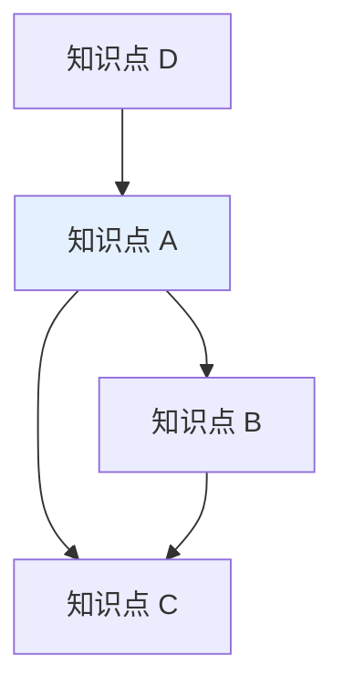
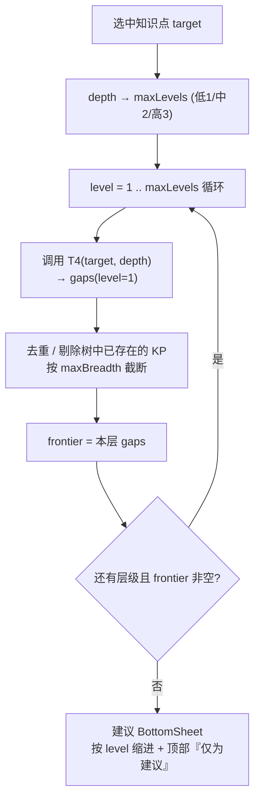
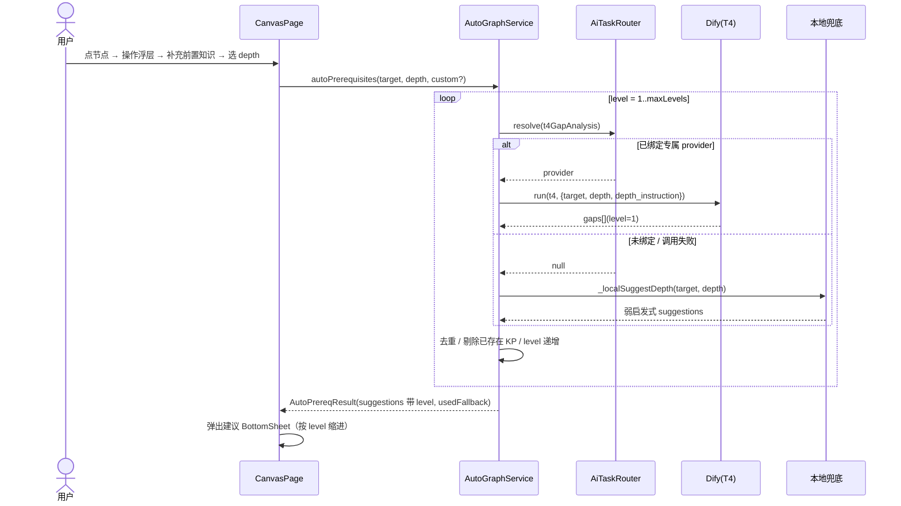

# T3 / T4 工作流绘制指南（Dify 手画 + 结构图解）

> 适用：AIMindTree 的「前置关系推断（T3）」与「深度补前置（T4）」两个 Dify workflow。
> 本文只教**怎么画 / 怎么理解**，不写 Flutter 代码。所有字段与提示词均来自
> `scripts/dify_t3_prerequisite.yaml` 与 `scripts/dify_t4_gap_analysis.yaml`，与已落地实现一致。
> 文末 §4 给出**直接导入 DSL** 的最快路径（若你的控制台导入能用，就不必手画）。

---

## 0. 一句话区别（先定调）

| 工作流 | 输入 | 输出 | 形状 |
|--------|------|------|------|
| **T3 前置关系推断** | 一组知识点（points） | 它们之间**谁是谁的前置**（成网） | 一张有向图 |
| **T4 深度补前置** | **单个**目标知识点 + 深度档 | 理解它**需要先掌握**的前置（成链/树） | 一棵前置树 |

关键点：**T4 的「递归展开多层」不在 Dify 里做**，Dify 单次只算「直接前置一层」，
真正的逐层下钻由客户端 `AutoGraphService` 循环驱动（见 §2.5）。画 T4 时 Dify 端只需要 3 个节点。

---

## 1. T3 前置关系推断

### 1.1 在 Dify 里怎么画：3 个节点一条直线


| 节点 | 类型 | 位置(x,y) | 关键配置 |
|------|------|-----------|----------|
| 开始 `start` | start | (80, 240) | 变量 `points`（paragraph，**必填**，max_length 200000） |
| LLM `llm` | llm | (400, 180) | model: ollama / llama3，temperature **0.3**；见 §1.3 提示词 |
| 结束 `end` | end | (740, 240) | 输出 `prerequisites = {{#llm.text#}}` |

连线：两条 `start→llm`、`llm→end`（均为自定义 edge）。

### 1.2 数据契约

- **输入**：`points` —— 把若干知识点拼成一段文本，每条含 `id / name / type / definition`。
- **输出**：`prerequisites` —— 一个 JSON 字符串：
  ```json
  {
    "prerequisites": [
      { "from": "A 的 id 或 name", "to": "B 的 id 或 name",
        "reason": "一句话为什么 A 是 B 的前置（≤40字）" }
    ]
  }
  ```

### 1.3 提示词（照抄即可）

**system**：
```
你是一名严谨的「知识图谱工程师」，服务于一款叫 AIMindTree 的 AI 知识笔记 App。
给定一组知识点（每条含 id / name / type / definition），你的唯一任务是推断它们之间的
「前置关系」：若要先掌握 from 才能掌握 to，则存在一条 from → to 的边。
```
**user**：
```
请分析下面这组知识点，推断前置关系。

# 知识点
{{#start.points#}}

# 输出要求（严格遵守）
1. 只输出一个 JSON 对象，不要任何解释、前后缀或 Markdown 代码块标记。
2. 结构固定为：{"prerequisites":[{"from":"...","to":"...","reason":"..."}]}
3. from / to 必须使用输入里给出的 id 或 name（不要编造新知识点）。
4. 关系应当是有向无环的（DAG），不要出现循环依赖。
5. 只输出你确有把握的关系；把握低的不输出。
```

### 1.4 概念图（T3 在干什么）


> 输入一堆点 → 输出它们之间的有向边。T3 不做深度控制，只回答「谁是谁的前置」。

---

## 2. T4 深度补前置

### 2.1 关键认识（画之前必须懂）

> **Dify 单次只算「直接前置一层」（level=1）**。
> 用户选了「中/高」要往下钻多层，是客户端把 T4 **反复调用**实现的：
> 第 1 层的前置点 → 当作下一轮 target → 再调 T4 → 直到 `maxLevels` 或没有新前置。
> 所以 Dify 端画法和 T3 一样简单（3 节点），复杂度在客户端循环里。

### 2.2 在 Dify 里怎么画：也是 3 节点直线，但变量不同


| 节点 | 类型 | 位置(x,y) | 关键配置 |
|------|------|-----------|----------|
| 开始 `start` | start | (80, 240) | 变量① `target`(paragraph,必填) ② `depth`(text,必填: low/medium/high/custom) ③ `depth_instruction`(paragraph,**选填**，仅 custom 非空) |
| LLM `llm` | llm | (400, 180) | model: ollama / llama3，temperature **0.4**；见 §2.4 |
| 结束 `end` | end | (740, 240) | 输出 `gaps = {{#llm.text#}}` |

> 注意：`depth_instruction` **不要拼进主 prompt**（架构约定：变量分离便于分支/日志/单测），
> 只在 `` 时才插入。

### 2.3 数据契约

- **输入**：
  - `target`：单个目标知识点 `{name} | {type} | {definition}`
  - `depth`：`low` / `medium` / `high` / `custom`
  - `depth_instruction`：仅 custom 档的自然语言指令
- **输出**：`gaps` —— JSON 字符串，**每项 `level` 恒为 1（相对直接前置）**：
  ```json
  {
    "gaps": [
      { "name":"前置名(≤20字)", "type":"概念|公式|定理|方法|事实|误区",
        "definition":"一句话定义(≤60字)", "reason":"为何先于目标(≤40字)", "level":1 }
    ]
  }
  ```
  > 绝对层级（第几层）由客户端在递归循环里累加，Dify 自己不数层。

### 2.4 提示词（照抄即可）

**system**：
```
你是一名严谨的「学习路径规划师」，服务于一款叫 AIMindTree 的 AI 知识笔记 App。
给定单个目标知识点，你的任务是列出理解它直接需要的前置知识点（即 level=1，
只往前推一层，不要做多跳递归）。
```
**user**：
```
请分析下面这个单个目标知识点，找出掌握它之前应当先掌握的直接前置知识点。

# 目标知识点
{{#start.target#}}

# 深度档位
{{#start.depth#}}
（low=大学/高中入门级，只列最近一层；medium=初中/高中基础；high=小学/常识级，可更基础；
custom=由下方自定义指令决定）


# 自定义深度指令
{{#start.depth_instruction#}}


# 输出要求（严格遵守）
1. 只输出一个 JSON 对象，不要任何解释、前后缀或 Markdown 代码块标记。
2. 结构固定为：{"gaps":[{"name":"...","type":"...","definition":"...","reason":"...","level":1}]}
3. 只输出直接前置（再往前的基础不要列，客户端会递归展开）；最多 15 条。
4. name 必须是具体概念，不要用「基础知识」之类空泛词；不要编造目标里没有依据的前置。
5. 每条 reason 要说明为何先于目标掌握。
```

### 2.5 客户端递归循环（T4 真正「深度」的地方）



**任一层 T4 调用失败 / 返回空** → 立即转本地兜底 `_localSuggestDepth`，填 `level=1`
（high 档做一层伪递归到 `level=2`），并标 `usedFallback=true`，UI 提示「本地启发式，建议以 AI 为准」。



### 2.6 depth 档位 → 层数 / 广度

| depth | maxLevels（绝对层数） | maxBreadth（每节点广度上限） | 学段文案 |
|-------|----------------------|------------------------------|----------|
| low | 1 | 3 | 大学/高中入门级 |
| medium | 2 | 4 | 初中/高中基础 |
| high | 3 | 5 | 小学/常识级 |
| custom | 3（可被指令降到 1） | 5（可被指令改） | 由自定义指令决定 |

> custom 档把用户自由文本透传为 `depth_instruction`；本地解析做关键词粗映射：
> 大学/本科/高中/初中 → 偏 medium；小学/常识/基础 → high；「只要一层/直接前置」→ `maxLevels=1`；
> 识别不出 → 回落 high。

---

## 3. 三条铁律（画的时候别踩坑）

1. **锚点铁律**：补前置的「建议」**绝不入库**——只生成 `SuggestedPrerequisite`，
   绝不 `new KnowledgePoint`。要收进知识树，用户得自己「去新建笔记」跑一次 T1 提取。
   （理由：没有可逐字定位 `source_quote` 的知识点视为幻觉，禁止入库。）
2. **递归在客户端**：Dify T4 永远只算一层，`level` 恒为 1；多层的展开由 `AutoGraphService` 循环做。
   不要在 Dify 里试图写「让模型自己递归多跳」的 prompt。
3. **路由不回落 T1**：T3/T4 若没在 `ai_task_routes` 绑定专属 provider，`AiTaskRouter.resolve`
   返回 `null`，`AiService.run` 返回 `Failure`，随后走本地兜底——**绝不调用 T1 工作流**。
   画完 Dify 后记得在设置页/数据库给 T3、T4 各绑一个 provider，否则会一直走本地兜底。

---

## 4. 最快路径：直接导入 DSL（若控制台导入可用）

你已经有了两个现成文件，无需手画：

- `scripts/dify_t3_prerequisite.yaml` —— T3
- `scripts/dify_t4_gap_analysis.yaml` —— T4

Dify 控制台 → **DSL 导入** → 选对应 yaml 即可。导入后核对两点：
1. `start` 节点的输入变量名（`points` / `target`+`depth`+`depth_instruction`）与本文一致；
2. `end` 节点输出变量名（`prerequisites` / `gaps`）与本文一致（客户端 `_taskOutputKey` 按这两个 key 取值）。

变量名对不上才会「画对了也跑不通」，这是导入后第一件要检查的事。

---

## 5. 把画好的 T3 / T4 绑到 App（不绑 = 永远走本地兜底）

### 5.1 为什么要绑：Dify 的 Key 是按「应用」签发的

一个 Dify 工作流 = 一个 API Key = 一条 `ai_providers` 行。T1 / T3 / T4 是三个**不同的
Dify 应用**，三个 Key 互不通用，所以不能复用同一个 provider。

`ai_task_routes` 表负责把「任务 → provider」对上号：

| 表 | 作用 |
|----|------|
| `ai_providers` | 存 baseUrl + 密钥**引用名**（`dify_<ulid>`），密钥本体在 SecretStore |
| `ai_task_routes` | `ai_task`（`T1`/`T3`/`T4`）→ `provider_id` |

### 5.2 操作步骤（设置页，4 步）

1. **设置 → 右下角「添加 Dify」→ 建 T3 provider**
   - 显示名：`Dify T3 前置推理`
   - Base URL：`http://localhost:8080`
   - API Key：`app-yR8zqEa56VDuXgHXpUaXywJj`（你的 T3 应用 Key）
2. **同样再建一个 T4 provider**
   - 显示名：`Dify T4 缺口分析`，Base URL 同上
   - API Key：`app-PZelFIzkuqlbhOBNcXIm3Uae`
3. **重启 App** —— provider 的实例化在 `ExtractionService.bootstrap()` 里一次性完成
   （P0 简化：改 provider 必须重启，响应式监听留 T09+）
4. **设置页 → 滚到「AI 任务路由」区**，逐个下拉：
   - `T1 知识点提取` → 保持**未绑定**（会回落到第一个启用的 provider，即原来的「本地 Dify（默认）」）
   - `T3 前置知识推断` → 选 `Dify T3 前置推理`
   - `T4 知识缺口分析` → 选 `Dify T4 缺口分析`

> **路由绑定即时生效，不需要重启** —— `AiTaskRouter.resolve()` 是每次调用现查 DB。
> 需要重启的只有「新增 / 启用 / 停用 provider」这一步。

### 5.3 副标题一眼看懂状态

| 副标题 | 含义 | 该做什么 |
|--------|------|----------|
| `未绑定 → 走本地兜底，AI 不会参与` | T3/T4 没绑 | 选一个 provider |
| `未绑定 → 回落默认 Provider` | T1 没绑，属正常 | 不用管 |
| `http://localhost:8080` | 已绑定且密钥在位 | ✅ |
| `http://… · ⚠️ 密钥缺失` | SecretStore 取不到 key | 删掉重建 provider |
| `⚠️ 原绑定的 Provider 已删除或已停用` | 悬挂引用 | 重新选一个 |

### 5.4 验证链路通了

- 设置页：T3 / T4 两行副标题从「未绑定」变成 `http://localhost:8080`；
- 启动日志出现 `任务路由：T3→<id>, T4→<id>`；若为 `ai_task_routes 为空：T3/T4 未绑定` 说明没绑上；
- 在知识树点节点 → 「补充前置知识」，结果里的 `usedFallback` 应为 `false`；
- 想单独验证工作流本身（绕开 App）：`scripts/test_dify_t3_t4.sh`。

### 5.5 排查

| 现象 | 原因 | 处理 |
|------|------|------|
| 下拉里没有刚建的 provider | 没重启，或该 provider 被停用 | 重启 / 打开启用开关 |
| 绑了但仍走兜底 | 密钥缺失（bootstrap 会跳过） | 看启动日志「密钥缺失，已跳过」，重建 provider |
| 删了 provider 后任务静默回落 | 已自动解绑（删除时连带清理路由） | 重新绑定即可 |
| T1 突然调到了 T3 的工作流 | 不会发生了：bootstrap 选 fallback 时排除 T3/T4 绑定的 provider | — |

### 5.6 相关代码

| 文件 | 职责 |
|------|------|
| `lib/features/settings/settings_page.dart` | 任务路由绑定 UI（`kRoutableTasks` / `_routeTile` / `_bind`） |
| `lib/data/repositories/settings_repository.dart` | `bindTask` / `unbindTask` / `allRoutes`；`deleteProvider` 连带解绑 |
| `lib/data/daos/ai_task_route_dao.dart` | `bind`（先删后插，幂等覆盖）/ `unbindProvider` |
| `lib/ai/ai_task_router.dart` | `resolve` ①②③ 优先级；T3/T4 未命中返回 `null` |
| `lib/ai/extraction_service.dart` | `bootstrap`：实例化 provider + 挑 fallback（排除 T3/T4 专属） |

> 想直接改库（App 必须**关闭**）：`C:\Users\ASUS\Documents\aimindtree.sqlite`，
> 密钥在 `C:\Users\ASUS\Documents\.aimindtree\secrets.json`。
