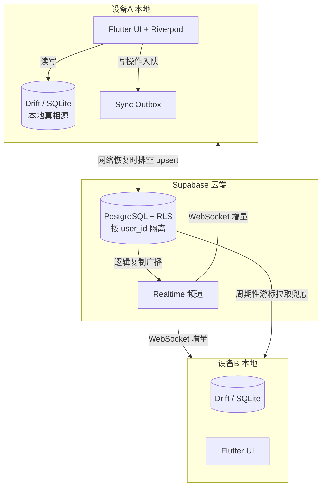
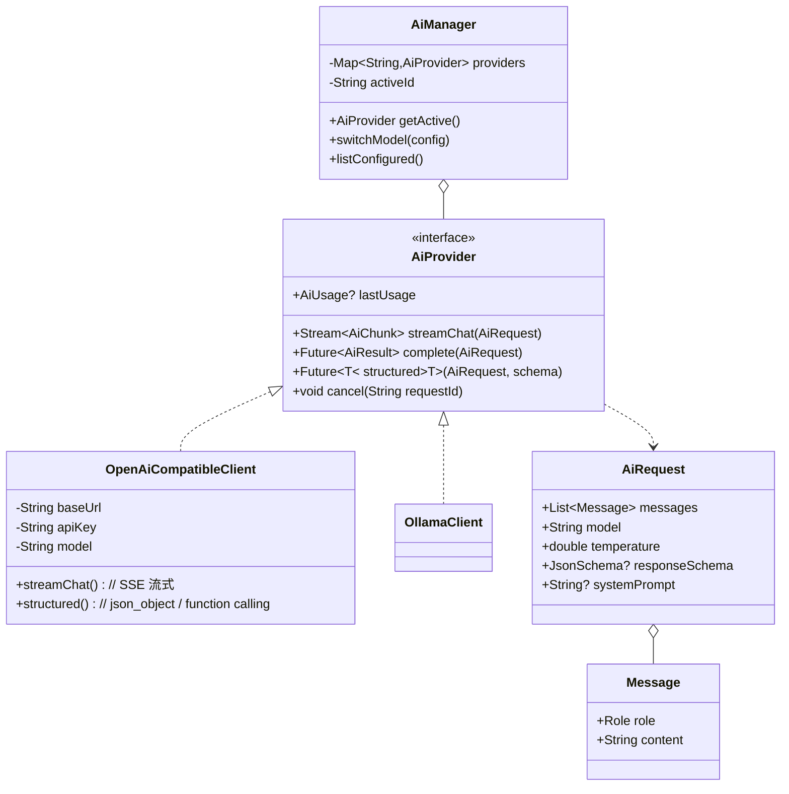

# AIMindTree 技术选型预研（Tech Spike）

> 文档性质：架构设计前置调研，**本轮只做技术选型，不做完整架构与任务拆解**。
> 目标读者：后续完整架构设计（本人）、产品经理、用户。
> 编写日期：2026-09-02
> 语言：中文

---

## 0. 文档范围与约束回顾

### 0.1 已确定的硬约束（用户拍板，选型不得推翻）
1. **Flutter 一套代码打全端**：iOS / Android / 桌面（Windows/macOS/Linux）/ Web，数据多端互通。
2. **AI 可插拔**：云端大模型 + 本地模型均支持，用户在设置里配置切换（供应商 / 模型名 / API Key / Base URL / 本地模型地址），不绑死一家。
3. 当前工作区 `D:\AndroidStudioProjects\AIMindTree` 是空壳 Gradle Kotlin JVM 工程，可推倒重来（实际将改为 Flutter 工程）。
4. 用户为**华南理工大学学生**，有 Kotlin/Android 基础，Flutter 边学边做——**选型要照顾学习曲线**。
5. 本轮交付**只要方案不要代码**。

### 0.2 产品核心能力（用于判断选型）
- 笔记（Markdown / 富文本）→ AI 提取结构化知识点
- AI 推断「前置知识依赖」生成知识树
- 无限画布组织笔记与知识点、自由连线
- 对任意对象「追问」，AI 回答以**小卡片形态贴在画布源内容旁**、可拖动折叠、可再追问成链
- 「老师模式」AI 扮演老师讲解 / 苏格拉底追问 / 出题

### 0.3 重要前置说明
- 此文档撰写时 **PRD 尚未产出（docs/PRD.md 为空）**。本选型基于上面 0.2 的能力描述，结论需在 PRD 出来后校验。
- 版本号以 pub.dev 当前（2026-09）为准，文中给出“建议主版本 + 以最新为准”的写法，避免过期。

---

## 1. 状态管理

### 结论
**选 Riverpod（3.x，建议 `^3.0.0`，当前已发布 3.2.x）。**

理由：
1. 编译期安全 + 强类型 Provider，配合 `riverpod_generator` 代码生成，学习曲线对“有强类型背景的学生”友好（Kotlin 经验可迁移）。
2. 内置 `AsyncValue`（loading/error/data）天然适配 AI 流式/异步调用与网络请求，UI 状态处理代码量远低于 Bloc 的 Event/State 样板。
3. 3.0 起内置**自动重试 / 暂停恢复 / 实验性 offline & mutation**，与“离线优先 + 后台同步”主题契合。
4. 对画布高频交互的性能可控（见下）。

### 画布高频交互下的性能注意点（关键）
画布节点拖动、连线是高频更新，若用 Riverpod 不当会整树重建：
- **局部订阅**：拖动单个节点时，只 `ref.watch(nodePositionProvider(id))`，不要让整个画布页面 watch 一个“全局画布状态”。
- **状态放在 Notifier 而非 Widget**：节点坐标、选中态、视口变换放 `Notifier`/`AsyncNotifier`，Widget 用 `Consumer` 精确订阅。
- **拖动过程用局部 state（setState / ValueNotifier）**：真正的“落库 + 广播”在拖动结束时做一次，避免每帧写全局状态。已落库的位姿变化再通过 Riverpod 广播给其它监听者（如小地图）。
- **`keepAlive` 与 `autoDispose`**：画布/编辑器相关 Provider 用默认 autoDispose，避免离屏泄漏；常驻服务（同步引擎、AI 管理器）用 `keepAlive: true`。
- 配合 `RepaintBoundary` 隔离重绘区域。

### 方案对比表
| 方案 | 学习曲线 | 画布高频性能 | 与 AI/异步契合 | 结论 |
|---|---|---|---|---|
| **Riverpod 3.x** | 中（代码生成友好） | 高（需正确局部订阅） | 极好（AsyncValue/重试/离线） | ✅ 选用 |
| Bloc | 中高（Event/State 样板多） | 中 | 一般 | ❌ 样板多、AI 流处理啰嗦 |
| GetX | 低 | 高但易滥用全局可变态 | 弱（类型安全差） | ❌ 不利可维护性，且用户要“能学扎实” |
| Provider | 低 | 中 | 弱（无原生异步态） | ❌ 能力不够，仅为 Riverpod 前身 |

---

## 2. 本地存储与 ORM

### 结论
**选 Drift（SQLite 封装，建议 `^2.21.0`，以最新 2.x 为准）。**

理由（决定性因素）：
- 数据模型是**图结构**：笔记、知识点、AI 卡片、画布节点、边（node–edge）之间是典型关系型多对多/父子关系，需要**关系型查询与联结（JOIN）**。
- **必须 Web 端可用**。各候选 Web 支持实测结论：
  - **Drift**：Web 端通过 `drift/web`（sql.js 或新版 `sqlite3.wasm` + OPFS）完整支持 SQLite，关系查询、事务、迁移全部可用 → **唯一同时满足“关系型 + Web”**。
  - **Isar**：原版（`isar`/`isar-community`）**无 Web 支持**；社区 fork `isar_db`（`isar_db_flutter_libs`）声称通过 WASM+OPFS/IndexedDB 支持 Web，但它是 **NoSQL 且为社区 fork（维护风险、API 非官方主线）**，对“图关系查询”也不如 SQL 自然。
  - **ObjectBox**：Flutter 包（含 4.x/5.x）平台列表为 Android/iOS/macOS/Linux/Windows，**确认不支持 Web** → 直接出局。
  - **Hive**：Web 支持但为 KV，无关系查询，图结构要靠手动键映射，不适合。

### 方案对比表
| 方案 | 关系型查询 | Web 支持 | 学习曲线 | 适合本项目的图结构 | 结论 |
|---|---|---|---|---|---|
| **Drift (SQLite)** | ✅ 完整 SQL/JOIN | ✅ wasm+OPFS | 中（需写表/DAO） | ✅ 天然契合 | ✅ 选用 |
| Isar 原版 | ⚠️ 关系靠链接 | ❌ 无 Web | 中 | 一般 | ❌ 无 Web |
| isar_db fork | ⚠️ NoSQL | ✅ 但有 fork 风险 | 中 | 一般 | ❌ 风险+非关系型 |
| ObjectBox | ✅ 关系 | ❌ 无 Web | 中 | ✅ | ❌ 无 Web |
| Hive | ❌ 手动 | ✅ | 低 | ❌ | ❌ 不适合 |

> 注：Drift Web 性能建议用 **`sqlite3.wasm` + OPFS VFS**（接近原生、可持久化），而非纯内存的 sql.js；初始化需在 `main()` 里 `await` 打开数据库后再 `runApp`。

### 实体关系（指导后续建表，非最终实现）
```
Note(1) ──< KnowledgePoint(m)        // 一篇笔记提取出多个知识点
KnowledgePoint(m) ──< dependsOn ──> KnowledgePoint(n)  // 前置依赖（知识树边）
CanvasNode(1) ──< belongsTo ──> Note / KnowledgePoint / AiCard  // 画布上的节点引用源对象
AiCard(m) ──< repliesTo ──> (Note | KnowledgePoint | AiCard)    // 追问链
CanvasEdge(m) ── connects ──> CanvasNode(a), CanvasNode(b)
```

---

## 3. 无限画布渲染

### 结论
**推荐：以 `infinite_canvas` 作为画布“外壳”（平移/缩放/框选/连线基础设施），在其内部渲染我们自定义的节点 Widget；同时把“节点/边”的域模型与渲染解耦，便于未来替换为自研引擎。**

理由与权衡：
- 需求是**自由画布 + 高度自定义节点**（笔记节点 / 知识点节点 / AI 卡片节点，且 AI 卡要可拖动、折叠、再追问成链）——这本质是“Widget 节点 + 自由连线”，不是自动布局的图。
- `infinite_canvas`（rodydavis，0.0.10；基于 `InteractiveViewer` + `CustomMultiChildLayout`，节点是 Widget child，支持 `InfiniteCanvasEdge`、框选、Web 兼容）正好提供：平移/缩放/选中/边。**但它仍是 pre-1.0（API 可能变动）**，且自定义节点行为（AI 卡折叠、追问链展开）可能需要绕过其默认交互。
- 竞品：
  - `graphview` / `flutter_flow_chart`：偏**自动布局图**（树/流程图），不适合“自由坐标 + 富 Widget 节点”，排除。
  - `infinity_canvas`（0.8+，分层渲染、控制器驱动相机，性能更好）：更偏底层、更可控，但生态/文档少。
  - **完全自研**（InteractiveViewer + CustomPainter/CustomMultiChildLayout + 手势）：对节点交互、AI 卡行为**控制力最强、无第三方 API 风险**，但工作量明显更大（约 2–4 周起步）。

### 工作量差异
| 路线 | 起步速度 | 长期可控性 | 额外工作量 | 结论 |
|---|---|---|---|---|
| **infinite_canvas + 自研节点模型** | 快（1–2 天出原型） | 中（受限于其交互） | 低 | ✅ 推荐起步 |
| infinity_canvas | 中 | 高 | 中 | 备选（若 infinite_canvas 卡脖子） |
| 完全自研引擎 | 慢 | 最高 | 高（数周） | 后期如必需再切换 |

> 决策点：若团队评估“AI 卡片链 + 折叠”在 infinite_canvas 上阻碍过大，则切到完全自研。因域模型已解耦，切换成本可控。

---

## 4. 富文本 / Markdown 编辑器

### 结论
**推荐 `appflowy_editor`（`^6.0.0`，以最新 6.x 为准）作为主选；用一层薄抽象包裹，必要时可降级到 `flutter_quill`。**

理由：
- 产品核心是“选中文本 → 触发 AI 操作（提取知识点 / 追问 / 讲解）”。appflowy_editor 提供：
  - **Selection Service**：可精确拿到选中区间与文本，便于挂“AI 操作”入口（自定义 Toolbar / 右键菜单 / 悬浮按钮）。
  - **文档 JSON 模型（Block 模型）**：AI 读取/改写笔记结构友好，比纯 Markdown 字符串更适合“结构化知识点提取”。
  - Web 支持（已验证：支持 Web 平台、修复过 Web 复制粘贴）。
  - Markdown 导入导出、可自定义 Block 组件（未来可做“知识点块”）。
- 学习曲线顾虑：appflowy_editor 比 flutter_quill 重。若用户更看重“先跑起来”，flutter_quill（MIT、更轻、易上手）是合理降级，但自定义选区 AI 触达与 Block JSON 模型能力弱于 appflowy_editor。
- `super_editor`：能力强但维护节奏不稳定、文档少，不优先。

### 方案对比表
| 方案 | 选区→AI 触发 | 结构化模型 | Web | 学习曲线 | 结论 |
|---|---|---|---|---|---|
| **appflowy_editor** | ✅ Selection Service | ✅ Block JSON | ✅ | 中高 | ✅ 主选 |
| flutter_quill | ⚠️ 需自行扩展 | ⚠️ Delta | ✅ | 低 | 降级备选 |
| super_editor | ✅ | ✅ | ⚠️ | 高 | ❌ 维护不确定 |
| markdown_editor(轻量) | ❌ | ❌ | ✅ | 低 | ❌ 能力不足 |

> 建议：定义 `EditorGateway` 接口（getSelection / getText / insertBlock / exportMarkdown），UI 与 AI 逻辑只依赖该接口，底层编辑器可替换。

---

## 5. 多端同步方案（重点）

### 5.1 后端选型结论
**选 Supabase（PostgreSQL + Realtime + Auth + Storage，客户端 `supabase_flutter` `^2.5.0`）。**

理由：
- 数据模型是**关系型图结构** → 需要真正的关系数据库（Postgres 的 JOIN/外键/约束），Firebase(Firestore) 是文档型、无服务端 JOIN，不适合。
- **免费额度友好**：免费层含 200 并发 Realtime 连接、API 请求不限量，对学生项目成本可控；后期可平滑升 Pro（$25/月）。
- **开源、无厂商锁定**：可本地自建 Postgres，未来不被绑死。
- `supabase_flutter` 跨端（含 Web）统一 SDK；Auth 直接解决“同一账号多设备”。
- Realtime（基于 PG 逻辑复制的 WebSocket）天然支持“准实时”多设备同步。
- 备选：
  - **Firebase**：离线开箱即用、成熟，但 NoSQL 不适合关系图、且强厂商锁定 → 不优先。
  - **Appwrite**：功能齐全但 Realtime/关系能力成熟度弱于 Supabase → 次选。
  - **自建（Dart Frog + Postgres）**：最可控但对学生成本/运维过高 → 不推荐 v1。

### 5.2 同步策略结论
**v1 采用「按实体 Last-Write-Wins（LWW）+ 服务端时间戳 + 离线 Outbox + 增量同步」；CRDT 作为未来可选（仅针对多人/同笔记并发文本）。**

分层冲突处理（关键点：画布坐标与文本特性不同，应分层）：
- **画布坐标 / 节点位置 / 元数据**：字段级 LWW（谁后写谁赢，按服务端 `updated_at` 裁决），这类数据“最后状态即真相”，冲突代价低。
- **笔记正文（富文本）**：v1 假设“同一笔记同一时刻主要由一台设备编辑”（单人多设备切换场景），仍用 LWW；若后续要做**多人协同编辑同一笔记**，再引入 CRDT（Yjs/Yrs 的 Dart 绑定 `y_crdt`，或 Automerge）——但这是 v2 议题，不在本轮范围。

为什么 v1 不上 CRDT/OT：
- CRDT（Ditto/Yrs）与 OT 都显著抬高复杂度、学习曲线与后端成本；单人多设备的“切换式编辑”用 LWW + Outbox 已能覆盖 90% 场景。
- 把同步协议设计成“可插拔合并器”，未来可仅对文本实体换 CRDT 合并器。

### 5.3 离线优先架构
- **本地（Drift/SQLite）为真相源**：所有读写先落本地，UI 只跟本地打交道，体验即时。
- **Outbox 模式**：本地写操作同时写入 `sync_outbox` 表（table_name, row_id, op, payload, created_at, retry_count, client_uuid）。
- **网络恢复时**后台 Isolate 顺序排空 Outbox → upsert 到 Supabase；成功后标记 `_synced`。
- **拉取**：订阅 Supabase Realtime（按 `user_id` 过滤的表变更），增量合并到本地；过滤自身回环事件（用 `client_uuid`）。
- **冲突 UI 提示**：检测到同实体在服务端 `updated_at` 晚于本地待推送版本时，标记“冲突”并提示用户（v1 默认 LWW 覆盖，提供“查看差异”入口）。

### 5.4 同步协议数据形态
**采用「实体快照 + 操作日志」混合（Delta Sync）：**
- 推送：Outbox 记录的是**带时间戳的实体最终态（upsert）**，而非每一步细粒度操作（降低复杂度）。
- 拉取：Realtime 推送行级变更（INSERT/UPDATE/DELETE）+ 周期性全量/游标拉取兜底。
- 删除：用 `_deleted` 软删除标志（便于 Realtime 广播与离线合并），而非物理删除。

### 5.5 同步架构图（Mermaid）


---

## 6. AI Provider 抽象层

### 6.1 设计结论
- 定义统一接口 `AiProvider`，云端（OpenAI 兼容）与本地（Ollama / llama.cpp server）**都通过“OpenAI 兼容 Chat Completions 协议”统一接入**——因为 DeepSeek / 通义 / Kimi / 智谱 均提供 OpenAI 兼容端点，Ollama 与 llama.cpp server 也暴露 `/v1/chat/completions`，所以**一套 HTTP 客户端 + 配置（baseUrl/apiKey/model）即可通吃**。
- 本地模型仅在**桌面/移动端**可用；**Web 端浏览器无法运行本地模型**（无原生进程、WASM 跑大模型不现实），Web 上只能用云端或自建代理。

### 6.2 类图草稿（Mermaid）


### 6.3 关键能力实现要点
- **流式输出**：用 SSE（`dio` + 流式响应逐块解析 `data:` 行）或 `openai_dart` 包的 stream API；UI 用 Riverpod `StreamProvider` / `AsyncValue` 渲染增量。
- **结构化输出（JSON Schema / function calling）降级**：
  1. 优先 `response_format: {type:"json_object"}` 或 function calling（云端大模型支持好）。
  2. 降级：若模型/本地模型不支持，改为在 system prompt 内嵌 JSON Schema 约束 + 输出后严格解析校验；解析失败触发一次“修正重试”。
  3. 统一返回类型 `AiResult<T>`（含 `parsed` 与原始 `raw`），让调用方容错。
- **超时 / 重试 / 取消**：`dio` 的 `CancelToken` 实现取消；超时用 `ConnectTimeout`/`ReceiveTimeout`；重试用指数退避（可借助 Riverpod 3 内置重试）。每个请求带 `requestId` 以便 UI 取消“追问链”中某一步。
- **用量统计**：解析响应 `usage`（prompt_tokens/completion_tokens），本地累计展示；本地模型用量记 0 或本地估算。
- **密钥安全存储**：`flutter_secure_storage`（`^9.0.0`）写 Keychain/Keystore。
  - **Web 限制**：`flutter_secure_storage` 在 Web 上实际存于 `localStorage`（非安全）。方案：① 移动/桌面用 secure_storage；② Web 端用 `Index`/`localStorage` 但**明确提示用户风险**，或要求 Web 端不持久化密钥、每次会话输入；③ 长期可对 Web 密钥做“主密码派生加密后再存”。建议抽象 `SecretStore`，按平台分支。

---

## 7. 路由与工程结构

### 7.1 路由
**选 `go_router`（`^14.0.0`）。** 官方维护、声明式、支持 Web URL/深链、嵌套路由、重定向（如未登录跳 Auth），与全端一致体验契合。

### 7.2 工程结构（目录分层）
**推荐：单 Flutter 包 + “分层 + 按功能”混合结构，不早期拆 melos monorepo。**

理由：用户是边学边做的学生，melos 多包会增加构建/版本/依赖管理负担；先单包把文件夹按“层/模块”组织，等规模变大再拆。

建议目录：
```
lib/
  main.dart
  app.dart                 # 顶层 MaterialApp + ProviderScope + GoRouter
  core/                    # 跨功能：结果类型、日志、存储、网络、错误
    result.dart
    storage/secret_store.dart
  data/                    # Drift 数据库、DAO、Repository、同步 Outbox
    db/drift_database.dart
    daos/*.dart
    sync/outbox.dart sync_engine.dart
    repositories/*.dart
  ai/                      # AI 抽象层（第6节）
    ai_provider.dart ai_manager.dart clients/*.dart
  canvas/                  # 画布域模型与渲染（节点/边/控制器）
    domain/node.dart edge.dart
    render/canvas_widget.dart
  features/                # UI 功能模块（每模块独立页面/状态）
    auth/ notes/ knowledge_tree/ canvas/ ai_chat/ settings/
  models/                  # 实体与 DTO（freezed / json_serializable）
```
- `core/data/ai/canvas` 虽在目录上分离，但**本轮不拆独立 package**；保持“可拆”的边界（依赖单向：features → data/ai/canvas → core）。

### 7.3 melos 决策
- **v1：不用 melos。** 单包足够。
- 触发再拆的信号：当 `ai`、`canvas`、`data` 需要被独立测试/复用、或团队扩大需要并行发版时，再用 melos 拆为 `packages/{core,data,ai,canvas}`。

---

## 8. 跨端差异与坑（逐项）

### 8.1 Flutter Web
- **文件/本地存储**：无真实文件系统。本地 DB 用 Drift 的 wasm+OPFS（见 §2）；用户上传文件走 Supabase Storage 或 `object_url`，不要假设本地路径。
- **CORS（最关键坑）**：浏览器直连 AI 供应商（OpenAI/DeepSeek 等）常被 CORS 拦截。**Web 端建议走 Supabase Edge Function 或自有轻代理转发 AI 请求**（云端 Key 也不应暴露在前端）。这也顺带解决“密钥不该进前端”的安全问题。
- **本地模型**：浏览器无法运行 Ollama/llama.cpp → Web 仅能用云端（经代理）。
- **Canvas 性能**：Flutter Web 用 Canvas/WebGL 渲染大量 Widget 节点会吃力。对策：节点数大时用 `RepaintBoundary`、`cacheExtent`、`ListView`/懒构建，画布做视口裁剪（culling）。
- **中文输入与字体**：确保引入中文字体（如 `Noto Sans SC`）并在 `index.html`/字体清单声明；IME 候选窗在 Web 上一般可用，但需实测；避免 `TextField` 在 Web 上的合成输入 bug（保持 Flutter 版本较新）。

### 8.2 桌面端（Windows/macOS/Linux）
- **窗口管理**：`window_manager`（`^0.4.0`）控制尺寸/居中/最小化；`tray_manager` 做托盘；`menubar` 做原生菜单。
- **快捷键**：用 `HardwareKeyboard` / `shortcuts` + `actions`，或 `hotkey_manager` 注册全局快捷键（如 `Ctrl/Cmd+K` 唤起 AI）。
- **后台同步**：桌面可较自由地常驻同步，用 `flutter_background_service`（桌面支持有限，谨慎）或应用内定时/生命周期触发即可。

### 8.3 移动端（iOS/Android）
- **手势**：画布的缩放/平移/拖动需与系统手势（返回、多指）协调；iOS 边缘返回可能吞掉画布手势，必要时 `GestureDetector` 调整 `behavior`。
- **键盘遮挡**：编辑器/追问输入框用 `Scaffold(resizeToAvoidBottomInset: true)` + `flutter_keyboard_visibility` 调整画布偏移。
- **后台同步限制**：iOS 后台窗口约 30s，用 `workmanager`（Android）/ `background_fetch`（iOS）做周期同步兜底，主要同步仍在前台/Realtime。
- **本地模型**：移动端可跑 Ollama（需同网/本机服务）或端侧小模型（如 `flutter_llama`/`onnx` 方案），但 v1 建议本地模型主打桌面，移动端优先云端。

---

## 9. 依赖包清单（建议，pub.dev 2026-09 为准）

| 包 | 建议版本 | 用途 | Web 风险 |
|---|---|---|---|
| `flutter` / `dart` | 稳定频道最新 | 框架 | — |
| `riverpod` + `flutter_riverpod` | `^3.0.0`（用 3.2.x） | 状态管理 | 无 |
| `riverpod_annotation` + `riverpod_generator` + `build_runner` | 最新 3.x | 代码生成 | 无 |
| `go_router` | `^14.0.0` | 路由 | 无 |
| `drift` + `drift_dev` | `^2.21.0` | 本地关系型 DB | ⚠️ Web 需 `drift/web`(wasm+OPFS)，初始化异步 |
| `sqlite3_flutter_libs` / `sqlite3` | 跟随 drift | 原生 SQLite 引擎 | 仅原生端；Web 用 wasm |
| `appflowy_editor` | `^6.0.0` | 富文本/MD 编辑器 | ⚠️ 体积较大，Web 构建略增；注意 AGPL/MPL 双授权 |
| `freezed` + `json_serializable` | 最新 | 不可变模型/序列化 | 无 |
| `supabase_flutter` | `^2.5.0` | 后端/Auth/Realtime/Storage | ⚠️ 需处理 CORS（AI 代理） |
| `dio` | `^5.4.0` | HTTP/流式/SSE/取消 | 无 |
| `openai_dart`（可选，或自封装 dio 客户端） | 最新 | OpenAI 兼容调用 | 无 |
| `flutter_secure_storage` | `^9.0.0` | 密钥存储 | ⚠️ Web 实为 localStorage（见 §6.3） |
| `infinite_canvas` | `^0.0.10` | 无限画布外壳 | ⚠️ pre-1.0，API 可能变动 |
| `window_manager` / `tray_manager` / `menubar` | 最新 | 桌面窗口/托盘/菜单 | 仅桌面 |
| `hotkey_manager` | 最新 | 全局快捷键 | 仅桌面 |
| `flutter_keyboard_visibility` | 最新 | 移动端键盘遮挡 | 无 |
| `workmanager` / `background_fetch` | 最新 | 移动端后台同步 | 仅移动 |
| `connectivity_plus` | 最新 | 网络状态触发同步 | 无 |
| `universal_platform` / `platform` | 最新 | 平台分支 | 无 |
| `uuid` / `nanoid` | 最新 | 实体/客户端 ID | 无 |
| `logger` | 最新 | 日志 | 无 |

> 不在 Web 编译进来的包（用 `flutter_platform` 条件导入或 `web:` 分离器）以免 Web 构建报错：`window_manager`、`tray_manager`、`workmanager` 等。

---

## 10. 待用户决策的关键点
1. **后端是否用 Supabase？** 需要注册账号（免费层够用）；若坚持“完全自建/不依赖第三方”，则改为 Dart Frog + Postgres 自建（工作量与运维显著上升）。
2. **同步策略接受 v1 用 LWW（非 CRDT）吗？** 意味着 v1 不做“同一笔记多人实时协同”，只做单人多设备切换式同步。若产品明确要多人协同，需提前上 CRDT。
3. **编辑器选 appflowy_editor（能力强、学习曲线陡）还是 flutter_quill（轻、易上手）？** 影响开发速度与你学习成本。
4. **Web 端 AI 调用方式**：是否接受“Web 端 AI 请求经 Supabase Edge Function / 轻代理转发”（解决 CORS + 前端不暴露 Key）？还是仅桌面/移动直连、Web 暂不支持云端直连？
5. **本地模型是否 v1 仅限桌面/移动，Web 暂不支持？**（浏览器技术限制，建议如此）
6. **画布起步用 infinite_canvas 库还是直接自研？**（建议库起步，见 §3）
7. **是否接受密钥在 Web 端以“非安全存储”方式处理**（或 Web 端每次会话重新输入）？

## 11. 不确定 / 需随 PRD 调整的点
- PRD 未产出，上述选型基于 0.2 能力描述；**PRD 出来后需校验**：知识树是否要多人协作、追问链是否跨设备、老师模式交互细节，可能反过来影响同步/编辑器选型。
- `infinite_canvas` 为 pre-1.0，需在实际原型中验证其自定义节点交互能否满足“AI 卡片折叠/追问链”；若不行按 §3 切换自研。
- Isar 生态在 2025–2026 出现 `isar_db` fork 带 Web，但因其 NoSQL + 社区 fork 风险，仍不推荐；若后续社区主线回归并原生支持 Web，可重评。
- Riverpod 3.x 的 offline/mutation 为实验性 API（`package:riverpod/experimental/...`），正式使用前需评估稳定性。
- 各包具体版本以 pub.dev 发布时最新为准，本文版本为建议主版本。
